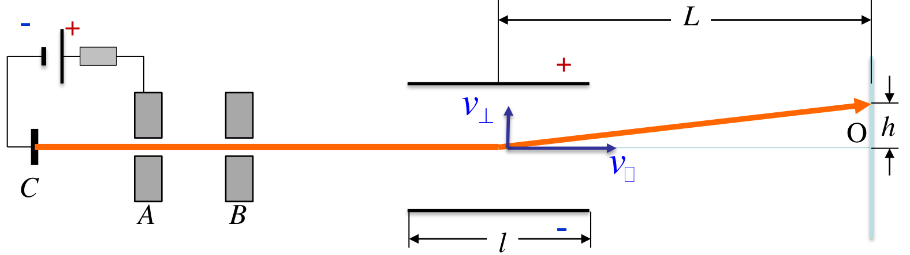
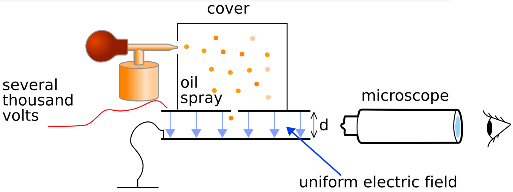
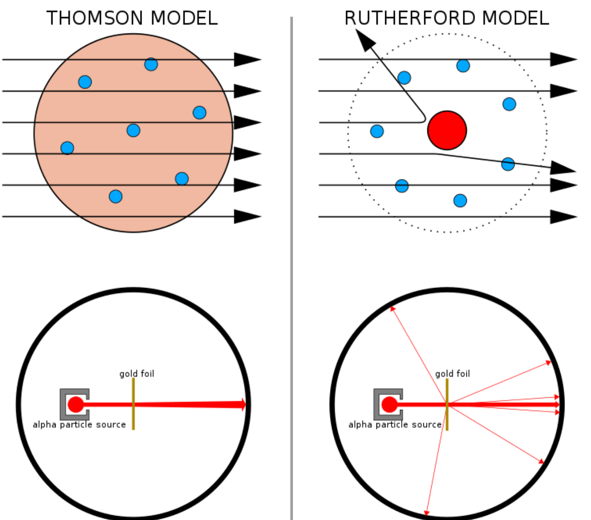
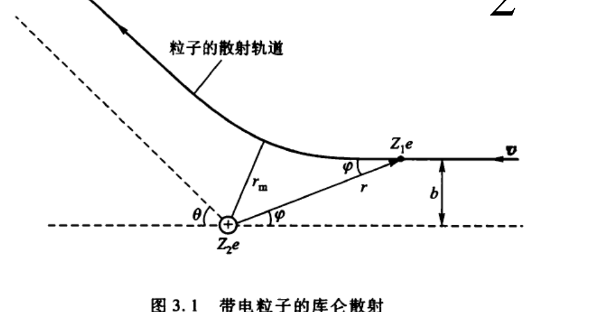
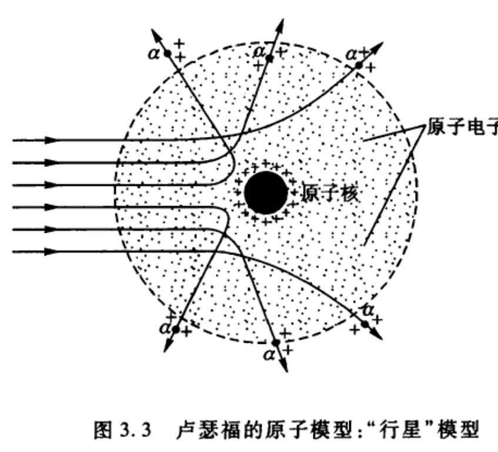

# 预备 原子的结构

!!! note "本章学习范围"

    这一章还是经典图像：原子有多大，电子怎么被发现，核式模型为什么站得住，又为什么在经典物理里站不稳。旧量子论从[第 1 章](ch1.md)开始。0.1–0.4 都是重点；标了「拓展」的方框是背景，可以跳过。

!!! tip "本章目标"

    1. 会用阿伏伽德罗常数从宏观密度估计原子的质量和线度（$0.1\,\mathrm{nm}$ 这一量级），会数立方晶胞里的原子数。
    2. 知道电子的荷质比和元电荷是两次独立实验测出来的，会推汤姆孙荷质比公式和密立根油滴公式。
    3. 能定量说明汤姆孙模型给不出大角度 $\alpha$ 散射，会用瞄准距离公式 $b=\dfrac a2\cot\dfrac\theta2$ 估计核的大小。
    4. 能指出核式模型在经典电动力学里的两个困难：原子不稳定、光谱应当连续。解决办法留到[第 1 章](ch1.md)。

---

## 0.1 原子有多大

化学和气体分子运动论已经说明物质由分立的原子组成。要定量，只需要两个数：摩尔质量和密度。

设某种原子的摩尔质量为 $M$（单位 $\mathrm{g/mol}$），固体或液体的质量密度为 $\rho$。每个原子平均占的体积是

$$v=\frac{M}{\rho N_A},\qquad N_A=6.022\times10^{23}\,\mathrm{mol^{-1}}.$$

把这个体积看成边长为 $d$ 的小立方体，$d=v^{1/3}$ 就是原子间距的量级。对大多数固体，$d\sim 0.1\sim0.3\,\mathrm{nm}$。原子不是没有大小的质点，但也远小于日常尺度。

!!! info "拓展 · 阿伏伽德罗常数是怎么测出来的"

    上面的估计全靠 $N_A$。它的第一个可靠数值来自洛施密特（1865）：用气体黏滞系数定出分子平均自由程，再和液态的密度比较，得到 $1\,\mathrm{cm^3}$ 标准状态气体约含 $10^{19}$ 个分子。真正让「原子是否存在」不再有争议的是佩兰（1908–1909）：他在显微镜下数悬浮微粒随高度的指数分布、测布朗运动的方均位移，按爱因斯坦 1905 年的扩散理论反推出 $N_A\approx6\times10^{23}\,\mathrm{mol^{-1}}$，与其他十几种独立方法吻合。1926 年他因此获诺贝尔奖。今天 $N_A$ 已经按定义取精确值 $6.022\,140\,76\times10^{23}\,\mathrm{mol^{-1}}$。

晶体里原子排成布拉菲格子。这一章只用到立方晶胞里有几个原子（角上的原子被 8 个胞共用，面心的被 2 个胞共用）：

| 格子 | 每个立方晶胞的原子数 | 例子 |
|---|---|---|
| 简单立方 | $8\times\frac18=1$ | Po |
| 体心立方 | $1+1=2$ | Fe、Na |
| 面心立方 | $1+6\times\frac12=4$ | Cu、Al、Au |
| 金刚石结构 | $4+4=8$ | C、Si、Ge |
| 岩盐结构 | 4 个 $\mathrm{Na^+}$ + 4 个 $\mathrm{Cl^-}$ | NaCl |

原子数密度 $n=N_{\text{胞}}/a^3$，$a$ 是晶格常数。质量密度 $\rho=n\,M/N_A$。

!!! example "例题 0.1　硅的原子密度"

    硅是金刚石结构，晶格常数 $a=0.543\,\mathrm{nm}$，原子量 28.09。求原子数密度和质量密度。

    ??? success "解"

        每个立方晶胞 8 个原子。

        $$n=\frac{8}{a^3}=\frac{8}{(0.543\times10^{-9}\,\mathrm m)^3}=5.00\times10^{28}\,\mathrm{m^{-3}}.$$

        $$\rho=\frac{nM}{N_A}=\frac{5.00\times10^{28}\times28.09\times10^{-3}}{6.022\times10^{23}}\,\mathrm{kg\,m^{-3}}=2.33\times10^{3}\,\mathrm{kg\,m^{-3}},$$

        正是硅的实测密度 $2.33\,\mathrm{g\,cm^{-3}}$。反过来，用密度和 X 射线测出的 $a$ 就能定出 $N_A$；这正是现代测 $N_A$ 的「硅球法」。

!!! warning "易错点 · 氯化钠的晶胞里有几个分子"

    岩盐的立方晶胞（$a=0.564\,\mathrm{nm}$）不是「简单立方、每胞一个分子」，而是 $\mathrm{Na^+}$ 和 $\mathrm{Cl^-}$ 各自组成一套面心立方格子，互相错开半个边长。所以每个胞里有 4 个 $\mathrm{NaCl}$：

    $$\rho=\frac{4\times58.44\,\mathrm{g\,mol^{-1}}}{N_A a^3}=2.16\,\mathrm{g\,cm^{-3}},$$

    和食盐的密度一致。按每胞 1 个分子算会把密度少算 4 倍；如果反过来用密度求 $a$，则会把 $a$ 少算 $4^{1/3}$ 倍。

---

## 0.2 电子

### 0.2.1 汤姆孙测荷质比

1897 年汤姆孙用电场和磁场偏转阴极射线，测到的是**荷质比**，不是电荷本身。

<figure markdown>
{ width="85%" }
<figcaption>图 0-1　汤姆孙阴极射线管示意：阴极 $C$ 发出的射线经狭缝 $A$、$B$ 准直，进入长 $l$ 的偏转板，在距板中点 $L$ 的荧光屏上偏移 $h$（图源：课程课件）</figcaption>
</figure>

测量分两步。

1. **定速度。** 在偏转板区域同时加电场 $E$ 和与之垂直的磁场 $B$，调到光点不偏，电力和洛伦兹力平衡：$eE=evB$，所以 $v=E/B$。
2. **只加电场。** 粒子在板内飞行时间 $t=l/v$，获得横向速度 $v_\perp=\dfrac{eE}{m}\dfrac{l}{v}$。出板后近似沿直线飞到屏上；从板中点看去，偏转角 $\tan\alpha=v_\perp/v$，屏上偏移 $h=L\tan\alpha$。于是

$$h=\frac{eElL}{mv^2}\quad\Longrightarrow\quad \frac{e}{m}=\frac{hv^2}{ElL}=\frac{hE}{lLB^2}.$$

右边全是可测量。汤姆孙得到

$$\frac{e}{m_e}\approx1.76\times10^{11}\,\mathrm{C\,kg^{-1}}.$$

这个值约是电解中氢离子荷质比的 1836 倍，而且不随阴极材料和管内气体改变。结论是：阴极射线是一种比原子轻得多、所有原子都含有的共同成分。

### 0.2.2 密立根测元电荷

<figure markdown>
{ width="75%" }
<figcaption>图 0-2　密立根油滴实验：喷雾器喷出的油滴落入两块平行板之间，用显微镜看单个油滴的升降（图源：课程课件）</figcaption>
</figure>

1909–1913 年密立根测单个油滴所带电荷。油滴很小，空气阻力用斯托克斯公式 $f=6\pi\eta rv$。

- **不加电场。** 油滴匀速下落，速度 $v_1$：$\dfrac43\pi r^3\rho g=6\pi\eta rv_1$，由此得半径 $r=\sqrt{\dfrac{9\eta v_1}{2\rho g}}$，质量也就知道了（浮力可并入 $\rho$）。
- **加向上的电场 $E$。** 油滴匀速上升，速度 $v_2$：$qE=mg+6\pi\eta rv_2$。两式相除消去 $mg$：

$$q=\frac{6\pi\eta r\,(v_1+v_2)}{E}.$$

测了几千个油滴，$q$ 总是同一个数的整数倍：

$$e=1.602\times10^{-19}\,\mathrm C.$$

于是 $m_e=e/(e/m_e)=9.11\times10^{-31}\,\mathrm{kg}$，约为氢原子质量的 $1/1836$。电荷是量子化的，这是「量子」在本课程里的第一次出场。

---

## 0.3 从葡萄干布丁到原子核

### 0.3.1 汤姆孙模型给不出大角度散射

汤姆孙模型：正电荷均匀铺在半径 $R\approx0.1\,\mathrm{nm}$ 的球里，电子嵌在其中。卢瑟福的学生盖革和马斯登（1909）用 $\alpha$ 粒子（电荷 $+2e$，质量约为电子的 7300 倍）打金箔，发现约 $1/8000$ 的 $\alpha$ 粒子偏转超过 $90^\circ$，有的甚至被弹回。

<figure markdown>
{ width="62%" }
<figcaption>图 0-3　上：$\alpha$ 粒子穿过汤姆孙模型（正电荷均匀分布）几乎不偏；穿过卢瑟福模型（正电荷集中于核）时，靠近核的会大角度偏转。下：金箔散射实验的预期（图源：课程课件）</figcaption>
</figure>

用数量级看汤姆孙模型为什么不行。$\alpha$ 粒子掠过一个均匀带电球时，受到的最大库仑力出现在球面附近，作用时间约 $2R/v$，横向冲量 $\Delta p\sim\dfrac{2Ze^2}{4\pi\varepsilon_0R^2}\cdot\dfrac{2R}{v}$。偏转角

$$\theta_1\sim\frac{\Delta p}{p}\sim\frac{1}{4\pi\varepsilon_0}\frac{2Ze^2}{R}\cdot\frac{1}{E_k}\quad(E_k=\tfrac12 Mv^2).$$

对金（$Z=79$）、$E_k=5\,\mathrm{MeV}$，取 $\dfrac{e^2}{4\pi\varepsilon_0}=1.44\,\mathrm{eV\cdot nm}$，得 $\theta_1\sim\dfrac{2\times79\times1.44}{0.1\times5\times10^6}\approx5\times10^{-4}\,\mathrm{rad}$；电子太轻，它们造成的偏转更小。一次碰撞偏转不到 $0.03^\circ$。

金箔厚约 $0.4\,\mu\mathrm m$，$\alpha$ 粒子穿过约 $N\sim10^3$ 层原子。每次偏转方向随机，总偏转像无规行走，方均根 $\sqrt N\,\theta_1\sim10^{-2}\,\mathrm{rad}\approx1^\circ$。多次小角散射叠加后，偏转超过 $\theta$ 的概率是 $P(>\theta)=e^{-\theta^2/\overline{\theta^2}}$。取 $\sqrt{\overline{\theta^2}}\approx1^\circ$，$P(>90^\circ)\approx e^{-8100}\approx10^{-3500}$。实验的 $1/8000$ 和它差了几千个数量级：大角散射只能来自**一次**近距离碰撞，正电荷必须集中在很小的核里。

### 0.3.2 卢瑟福核式模型

设动能 $E_k$ 的 $\alpha$ 粒子对头撞上电荷 $Ze$ 的核，最近距离 $d$ 由能量守恒给出：

$$E_k=\frac{1}{4\pi\varepsilon_0}\frac{(2e)(Ze)}{d}\equiv\frac{1}{4\pi\varepsilon_0}\frac{2Ze^2}{a},\qquad a=d_{\min}.$$

金的 $Z=79$、$E_k=7.68\,\mathrm{MeV}$（$^{214}\mathrm{Po}$ 的 $\alpha$ 粒子）时

$$a=\frac{2\times79\times1.44\,\mathrm{MeV\cdot fm}}{7.68\,\mathrm{MeV}}=29.6\,\mathrm{fm},$$

比原子半径小四个数量级。这就是核式模型：质量几乎全在核里，电子在外面。

不是对头碰时，$\alpha$ 粒子在核的库仑斥力下走双曲线。入射方向到核的垂直距离叫**瞄准距离** $b$。由角动量守恒和能量守恒可以证明

$$b=\frac a2\cot\frac\theta2 .$$

<figure markdown>
{ width="100%" }
<figcaption>图 0-4　$\alpha$ 粒子在核的库仑场中的双曲线轨道，$b$ 为瞄准距离，$\theta$ 为散射角（图源：课程课件）</figcaption>
</figure>

<figure markdown>
{ width="78%" }
<figcaption>图 0-5　卢瑟福的「行星」模型：电子绕很小的原子核运动（图源：课程课件）</figcaption>
</figure>

$b$ 越小偏得越厉害。用 $a=29.6\,\mathrm{fm}$：

| $b$ | $10\,\mathrm{fm}$ | $100\,\mathrm{fm}$ | $1000\,\mathrm{fm}$ |
|---|---|---|---|
| $\theta$ | $112^\circ$ | $16.8^\circ$ | $1.7^\circ$ |

所以大角度散射只发生在 $b\lesssim a$ 的极少数粒子上。瞄准距离落在 $b\sim b+\dd b$ 圆环里的粒子散射到 $\theta\sim\theta+\dd\theta$，由此得到卢瑟福散射公式

$$\frac{\dd\sigma}{\dd\Omega}=\left(\frac a4\right)^2\frac{1}{\sin^4(\theta/2)} .$$

盖革和马斯登测到的计数正好随 $1/\sin^4(\theta/2)$ 变化，一直到很大的 $\theta$ 都成立，说明直到 $\sim30\,\mathrm{fm}$ 都还是点电荷的库仑场。用更高能量的 $\alpha$ 粒子，偏离这个公式的地方给出核半径 $R\approx1.2A^{1/3}\,\mathrm{fm}$，金核约 $7\,\mathrm{fm}$。散射截面的量子力学处理见[第 6 章](ch6.md)，结果和经典的卢瑟福公式完全一样。

<figure class="video" markdown>
<video controls preload="metadata" width="100%" poster="assets/posters/C0_Rutherford.jpg"><source src="assets/videos/C0_Rutherford.mp4" type="video/mp4"></video>
<figcaption>动画 0-1　同样的 $\alpha$ 粒子束分别射向汤姆孙模型（正电荷均匀分布）和点状原子核：前者几乎不偏，后者靠近核的粒子大角度散射。第二部分扫过瞄准距离 $b$，验证 $b=\frac a2\cot\frac\theta2$。</figcaption>
</figure>

### 0.3.3 核式模型的经典困难

核式模型立刻带来经典电动力学解释不了的两件事，[第 1 章](ch1.md)用旧量子论来接：

- **不稳定。** 电子绕核做加速运动，按拉莫尔公式应当辐射电磁波，能量约在 $10^{-11}\,\mathrm s$ 内耗尽，螺旋掉进核里。原子却是稳定的，而且同种原子大小都一样。
- **光谱应当连续。** 辐射频率等于轨道频率，会随半径连续变化。实验看到的是一条条分立的谱线（巴耳末公式）。

氢原子里电磁力比万有引力大约 $10^{39}$ 倍（练习 0.2），把原子绑在一起的是电磁作用，不是引力。原子的大小也不能由经典量决定：只用 $e$、$m_e$、$\varepsilon_0$ 凑不出长度，必须再加一个 $h$，这正是玻尔半径 $a_0=4\pi\varepsilon_0\hbar^2/(m_ee^2)=0.053\,\mathrm{nm}$ 的由来。

---

## 知识点归纳

| 问题 | 结论 |
|---|---|
| 原子线度 | 由 $M/(\rho N_A)$ 开立方，约 $0.1\,\mathrm{nm}$；晶体用 $n=N_{\text{胞}}/a^3$ |
| 电子 | 先测 $e/m=hE/(lLB^2)$，再测 $e=6\pi\eta r(v_1+v_2)/E$；质量约为质子的 $1/1836$ |
| 原子内部 | 汤姆孙模型给出的大角散射概率 $\sim10^{-3500}$；正电荷集中在 $\lesssim10^{-14}\,\mathrm m$ 的核内 |
| 卢瑟福散射 | $b=\frac a2\cot\frac\theta2$，$\dd\sigma/\dd\Omega=(a/4)^2/\sin^4(\theta/2)$ |
| 经典核模型 | 不稳定，而且给不出线状光谱；原子大小需要 $h$ |

---

## 练习题

!!! example "练习 0.1　锗的密度"

    锗是金刚石结构，晶格常数 $0.566\,\mathrm{nm}$，原子量 72.6。求原子数密度和质量密度。

    ??? success "答案"

        每胞 8 个原子。$n=8/a^3=4.41\times10^{28}\,\mathrm{m^{-3}}$，$\rho=n\times72.6\times10^{-3}/N_A=5.32\times10^{3}\,\mathrm{kg\,m^{-3}}$（实测 $5.32\,\mathrm{g\,cm^{-3}}$）。

!!! example "练习 0.2　库仑力与引力"

    比较氢原子里质子与电子的库仑力和万有引力。$m_p=1.67\times10^{-27}\,\mathrm{kg}$，$G=6.67\times10^{-11}\,\mathrm{N\,m^2\,kg^{-2}}$。

    ??? success "答案"

        距离 $r$ 消去后

        $$\frac{F_e}{F_g}=\frac{e^2}{4\pi\varepsilon_0 G m_p m_e}\approx2.3\times10^{39}.$$

        引力在原子尺度可以忽略。

!!! example "练习 0.3　石墨烯的面密度"

    石墨烯是单层碳原子组成的六角蜂窝，二维晶格常数 $a=0.246\,\mathrm{nm}$，每个菱形原胞（面积 $\frac{\sqrt3}{2}a^2$）含 2 个碳原子。求单位面积的原子数和质量。

    ??? success "答案"

        原胞面积 $\frac{\sqrt3}{2}(0.246\,\mathrm{nm})^2=5.24\times10^{-2}\,\mathrm{nm^2}$，原子面密度

        $$n_s=\frac{2}{5.24\times10^{-2}\,\mathrm{nm^2}}=38.2\,\mathrm{nm^{-2}}=3.82\times10^{19}\,\mathrm{m^{-2}},$$

        面质量 $n_s\times12\times1.66\times10^{-27}\,\mathrm{kg}=7.6\times10^{-7}\,\mathrm{kg\,m^{-2}}$，即 $1\,\mathrm{m^2}$ 石墨烯不到 $1\,\mathrm{mg}$。

!!! example "练习 0.4　铜和空气"

    (1) 铜是面心立方，$a=0.3615\,\mathrm{nm}$，原子量 63.55。求原子数密度和质量密度。
    (2) 求 $0\,^\circ\mathrm C$、一个大气压下空气的分子数密度和分子平均间距，并与 (1) 比较。

    ??? success "答案"

        (1) $n=4/a^3=8.47\times10^{28}\,\mathrm{m^{-3}}$，$\rho=nM/N_A=8.94\times10^3\,\mathrm{kg\,m^{-3}}$。

        (2) $n=\dfrac{p}{k_BT}=\dfrac{1.013\times10^5}{1.381\times10^{-23}\times273}=2.69\times10^{25}\,\mathrm{m^{-3}}$（洛施密特常数），平均间距 $n^{-1/3}=3.3\,\mathrm{nm}$。气体分子间距约是固体原子间距（$n^{-1/3}=0.23\,\mathrm{nm}$）的 15 倍，数密度小三个数量级。

!!! example "练习 0.5　瞄准距离"

    $5.0\,\mathrm{MeV}$ 的 $\alpha$ 粒子射向金核。(1) 求对头碰撞的最近距离 $a$；(2) 散射角大于 $90^\circ$ 要求瞄准距离小于多少？

    ??? success "答案"

        (1) $a=\dfrac{2\times79\times1.44\,\mathrm{MeV\,fm}}{5.0\,\mathrm{MeV}}=45.5\,\mathrm{fm}$。

        (2) $\theta>90^\circ$ 即 $\cot(\theta/2)<1$，$b<a/2=22.8\,\mathrm{fm}$。这个圆的面积 $\pi b^2\approx1.6\times10^{-27}\,\mathrm{m^2}$，而每个金原子在箔面上占的面积约 $(0.26\,\mathrm{nm})^2$，比值 $\sim10^{-8}$ 一层；乘上箔中的上千层仍只有 $10^{-5}\sim10^{-4}$，与「极少数粒子被弹回」一致。
