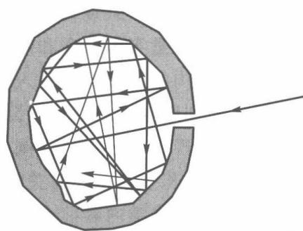
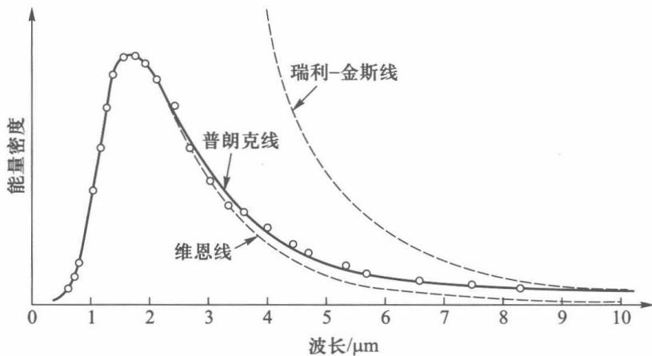
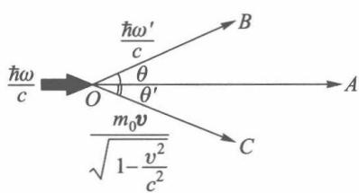
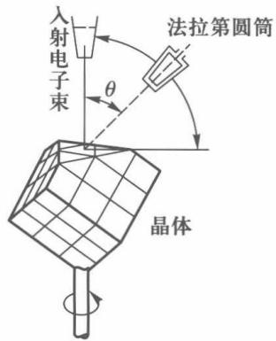
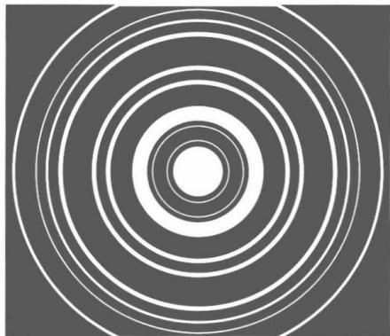
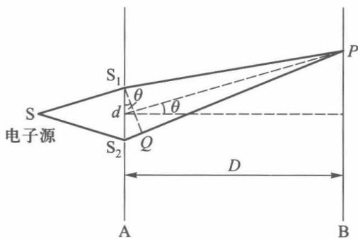
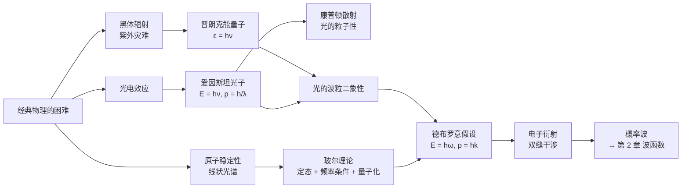

# 第 1 章 绪论

!!! tip "本章目标"

    1. 知道经典物理在微观领域遇到的几大困难：黑体辐射、光电效应、原子的稳定性和线状光谱。
    2. 掌握普朗克的能量子假设和普朗克公式，会由它导出维恩位移定律和两个经典极限。
    3. 掌握爱因斯坦光电效应方程和康普顿散射公式，理解光子的能量 $E=h\nu$、动量 $p=h/\lambda$。
    4. 掌握玻尔理论的三条假设、氢原子能级 $E_n=-13.6\,\mathrm{eV}/n^2$，会用玻尔–索末菲量子化条件 $\oint p\,\dd q=nh$。
    5. 掌握德布罗意关系 $E=\hbar\omega$、$\vv p=\hbar\vv k$，会计算各种粒子的德布罗意波长，理解电子衍射和双缝实验的含义。

**本章在全书中的位置。** 本章是“为什么需要量子力学”。它讲的是 1900–1927 年间物理学家被实验一步步逼出来的两个结论：**能量是一份一份的**（量子化），**粒子也是波**（波粒二象性）。第 2 章会把“粒子是波”写成精确的数学语言——波函数和薛定谔方程；本章出现的每一个“拍脑袋”的假设（玻尔的定态、量子化条件）都会在第 2、3 章被严格推导出来。

!!! info "一句话主线"

    光原以为是波 → 发现它也是粒子（光子）；电子原以为是粒子 → 发现它也是波（德布罗意波）。**波粒二象性是一切微观客体的共同属性**，联系两种图像的桥梁是普朗克常量 $h$：

    $$E=h\nu=\hbar\omega,\qquad \vv p=\frac{h}{\lambda}\vv e_k=\hbar\vv k,\qquad \hbar=\frac{h}{2\pi}=1.054\,6\times10^{-34}\ \mathrm{J\cdot s}.$$

---

## 1.1 经典物理学的困难

到 19 世纪末，经典力学、电动力学和热力学–统计物理已经非常成熟，能解释几乎所有宏观现象。但有几类与**微观**过程有关的实验，经典理论完全解释不了：

| 现象 | 实验事实 | 经典理论的预言 | 后来的解释 |
|---|---|---|---|
| 黑体辐射 | 能量密度随波长先升后降，有一个峰 | 瑞利–金斯公式：短波处发散（“紫外灾难”） | 普朗克能量子 $\varepsilon=h\nu$ |
| 光电效应 | 存在截止频率；光电子动能只与频率有关；瞬时发射 | 能量与光强有关，弱光需长时间积累 | 爱因斯坦光量子 |
| 原子的稳定性 | 原子稳定存在 | 绕核电子辐射能量，约 $10^{-11}\,\mathrm s$ 内落入核 | 玻尔定态假设 |
| 原子光谱 | 线状光谱，满足里德伯公式 | 连续光谱 | 玻尔频率条件 |
| 固体比热 | 低温下比热趋于零 | 杜隆–珀蒂定律：比热为常数 | 爱因斯坦、德拜量子比热理论 |

这些困难有一个共同的根源：经典物理假定**能量可以连续变化**、**粒子和波是截然不同的两类东西**。量子力学就是从推翻这两条开始的。

---

## 1.2 光的波粒二象性

### 1.2.1 黑体辐射与普朗克的能量子

!!! definition "定义 1.1（黑体）"

    能全部吸收照射到它上面的各种波长的辐射而不反射的物体叫**绝对黑体**，简称黑体。开有小孔的空腔就是黑体的良好模型：射入小孔的辐射在腔内多次反射，几乎全部被吸收（图 1-1）。腔壁与腔内辐射达到热平衡时，从小孔射出的辐射叫**黑体辐射**，其能量按频率的分布只与温度 $T$ 有关，与空腔的形状和材料无关。

<figure markdown>
{ width="260" }
<figcaption>图 1-1　空腔上的小孔可看成黑体（图源：教材）</figcaption>
</figure>

<figure markdown>
{ width="320" }
<figcaption>图 1-2　黑体辐射能量分布：实验点、维恩公式与瑞利–金斯公式（图源：教材）</figcaption>
</figure>

经典理论的两次尝试都失败了：维恩从热力学出发得到的公式在短波（高频）处与实验符合，长波处偏低；瑞利和金斯用能量均分定理（每个振动模式平均能量 $k_BT$）得到的公式在长波处符合，短波处趋于无穷——这就是“紫外灾难”。

!!! theorem "定理 1.1（普朗克黑体辐射公式，1900）"

    **普朗克假设**：频率为 $\nu$ 的辐射只能以**能量子** $\varepsilon=h\nu$ 为单位被发射或吸收，即振子的能量只能取 $0,h\nu,2h\nu,\dots$。由此得到频率在 $\nu\sim\nu+\dd\nu$ 之间的辐射能量密度

    $$\rho_\nu\,\dd\nu=\frac{8\pi h\nu^3}{c^3}\cdot\frac{1}{\ee^{h\nu/k_BT}-1}\,\dd\nu .$$

    其中 $h=6.626\times10^{-34}\ \mathrm{J\cdot s}$ 是普朗克常量，$k_B=1.381\times10^{-23}\ \mathrm{J/K}$ 是玻耳兹曼常量。

??? proof "推导思路（为什么能量子能消除紫外灾难）"

    腔内频率在 $\nu\sim\nu+\dd\nu$ 的电磁驻波模式数（单位体积）为 $\dfrac{8\pi\nu^2}{c^3}\dd\nu$，这一步是纯电磁学，经典和量子相同。区别在**每个模式的平均能量** $\bar\varepsilon$：

    - 经典：能量连续，按玻耳兹曼分布 $\bar\varepsilon=\dfrac{\int_0^\infty \varepsilon\,\ee^{-\varepsilon/k_BT}\dd\varepsilon}{\int_0^\infty \ee^{-\varepsilon/k_BT}\dd\varepsilon}=k_BT$，与频率无关，于是 $\rho_\nu\propto\nu^2$ 在高频处发散。
    - 普朗克：能量只取 $nh\nu$，求和代替积分。记 $x=h\nu/k_BT$，

        $$\bar\varepsilon=\frac{\sum_{n=0}^\infty nh\nu\,\ee^{-nx}}{\sum_{n=0}^\infty \ee^{-nx}}=-h\nu\frac{\dd}{\dd x}\ln\frac{1}{1-\ee^{-x}}=\frac{h\nu}{\ee^{h\nu/k_BT}-1}.$$

        当 $h\nu\gg k_BT$ 时 $\bar\varepsilon\approx h\nu\,\ee^{-h\nu/k_BT}\to0$：**高频模式的能量子太“贵”，热运动激发不起来**，紫外灾难就消失了。

    两者相乘即得普朗克公式。

普朗克公式包含了两个经典公式作为极限：

$$h\nu\ll k_BT:\ \ \rho_\nu\approx\frac{8\pi\nu^2}{c^3}k_BT\ \ (\text{瑞利–金斯});\qquad h\nu\gg k_BT:\ \ \rho_\nu\approx\frac{8\pi h\nu^3}{c^3}\ee^{-h\nu/k_BT}\ \ (\text{维恩}).$$

<figure class="video" markdown>
<video controls preload="metadata" width="100%" poster="assets/posters/C1_Blackbody.jpg"><source src="assets/videos/C1_Blackbody.mp4" type="video/mp4"></video>
<figcaption>动画 1-1　普朗克公式（黄）、瑞利–金斯公式（红）与维恩公式（蓝）；温度降低时峰值向长波移动，$\lambda_mT$ 保持不变。</figcaption>
</figure>

!!! success "两个由普朗克公式得到的定律"

    - **维恩位移定律**：能量密度极大值对应的波长 $\lambda_m$ 满足 $\lambda_mT=b\approx2.90\times10^{-3}\ \mathrm{m\cdot K}$（推导见练习 1）。
    - **斯特藩–玻耳兹曼定律**：总能量密度 $\displaystyle u=\int_0^\infty\rho_\nu\,\dd\nu=aT^4$，辐出度 $M=\sigma T^4$，$\sigma=5.67\times10^{-8}\ \mathrm{W\,m^{-2}\,K^{-4}}$。

!!! example "例题 1.1"

    太阳光谱的峰值波长约为 $500\ \mathrm{nm}$，人体（$T\approx310\ \mathrm K$）热辐射的峰值波长是多少？分别估算太阳表面温度和人体辐射所在的波段。

    **解。** 由维恩位移定律 $T_\odot=\dfrac{b}{\lambda_m}=\dfrac{2.90\times10^{-3}}{500\times10^{-9}}\approx5.8\times10^3\ \mathrm K$。

    人体：$\lambda_m=\dfrac{2.90\times10^{-3}}{310}\approx9.4\times10^{-6}\ \mathrm m=9.4\ \mu\mathrm m$，在中红外波段。这正是红外测温仪和热像仪工作在 $8\sim14\ \mu\mathrm m$ 波段的原因。

### 1.2.2 光电效应与光量子

光照射金属表面时有电子逸出，这就是**光电效应**。实验规律有三条：

1. 存在**截止频率** $\nu_0$：$\nu<\nu_0$ 时，无论光多强、照多久，都没有光电子；
2. 光电子的最大动能随频率线性增大，与光强无关；光强只影响光电子的**数目**；
3. 只要 $\nu>\nu_0$，光一照上去就立即（$<10^{-9}\ \mathrm s$）有电子逸出。

按光的波动理论，光的能量由振幅（光强）决定，弱光应该需要很长时间才能让电子积累足够的能量——与第 2、3 条都矛盾。

!!! theorem "定理 1.2（爱因斯坦光电效应方程，1905）"

    光由**光量子（光子）**组成，频率为 $\nu$ 的光子能量为 $h\nu$。一个电子一次吸收一个光子，把一部分能量用来克服金属的束缚（**逸出功** $W_0$），剩下的成为动能：

    $$\frac12m_ev_m^2=h\nu-W_0,\qquad \nu_0=\frac{W_0}{h}.$$

<figure class="video" markdown>
<video controls preload="metadata" width="100%" poster="assets/posters/C1_Photoelectric.jpg"><source src="assets/videos/C1_Photoelectric.mp4" type="video/mp4"></video>
<figcaption>动画 1-2　光电效应：低于截止频率时强光也打不出电子；高于截止频率时弱光也立即发射。$E_k$–$\nu$ 直线的斜率就是 $h$。</figcaption>
</figure>

**光子的动量。** 由相对论能量–动量关系 $E^2=m_0^2c^4+c^2p^2$，光子的静止质量 $m_0=0$，所以 $E=cp$。于是

$$E=h\nu=\hbar\omega,\qquad \vv p=\frac{h\nu}{c}\vv e_k=\frac{h}{\lambda}\vv e_k=\hbar\vv k,\qquad \vv k=\frac{2\pi}{\lambda}\vv e_k .$$

左边 $(E,\vv p)$ 描述粒子，右边 $(\omega,\vv k)$ 描述波，$\hbar$ 是换算系数。

!!! example "例题 1.2"

    一台 $1\ \mathrm{mW}$ 的氦氖激光器，波长 $632.8\ \mathrm{nm}$。求每个光子的能量和动量，以及每秒发出的光子数。

    **解。** 常用组合 $hc=1\,240\ \mathrm{eV\cdot nm}$。

    $$E=\frac{hc}{\lambda}=\frac{1240}{632.8}\ \mathrm{eV}=1.96\ \mathrm{eV}=3.14\times10^{-19}\ \mathrm J,\qquad p=\frac{h}{\lambda}=\frac{6.626\times10^{-34}}{632.8\times10^{-9}}=1.05\times10^{-27}\ \mathrm{kg\cdot m/s}.$$

    每秒光子数 $N=\dfrac{P}{E}=\dfrac{10^{-3}}{3.14\times10^{-19}}\approx3.2\times10^{15}\ \mathrm{s^{-1}}$。光子数这么多，所以日常生活中感觉不到光的“颗粒性”。

### 1.2.3 康普顿散射

X 射线被石墨等轻元素散射后，散射光中除了原波长 $\lambda$，还有波长变长的成分 $\lambda'$，而且 $\lambda'-\lambda$ 随散射角 $\theta$ 增大而增大，与散射物质无关。经典电磁理论认为散射波频率应等于入射波频率，解释不了波长的改变。

<figure markdown>
{ width="360" }
<figcaption>图 1-3　康普顿散射：光子与静止电子的弹性碰撞（图源：教材）</figcaption>
</figure>

!!! theorem "定理 1.3（康普顿散射公式）"

    把散射看成**光子与静止自由电子的弹性碰撞**，由能量守恒和动量守恒（电子用相对论力学）得

    $$\Delta\lambda=\lambda'-\lambda=\frac{h}{m_0c}(1-\cos\theta)=\frac{4\pi\hbar}{m_0c}\sin^2\frac\theta2,$$

    其中 $\lambda_C=\dfrac{h}{m_0c}=2.426\times10^{-3}\ \mathrm{nm}$ 叫电子的**康普顿波长**。

??? proof "证明"

    设入射光子能量 $\hbar\omega$、动量 $\hbar\omega/c$ 沿 $OA$；散射光子 $\hbar\omega'$ 沿与 $OA$ 成 $\theta$ 角的 $OB$；反冲电子能量 $E_e$、动量 $\vv p_e$。

    能量守恒：$\hbar\omega+m_0c^2=\hbar\omega'+E_e$；动量守恒：$\vv p_e=\hbar\vv k-\hbar\vv k'$。

    由动量守恒，$p_e^2c^2=\hbar^2\omega^2+\hbar^2\omega'^2-2\hbar^2\omega\omega'\cos\theta$。

    由能量守恒，$E_e^2=(\hbar\omega-\hbar\omega'+m_0c^2)^2$。代入 $E_e^2=p_e^2c^2+m_0^2c^4$：

    $$(\hbar\omega-\hbar\omega')^2+2(\hbar\omega-\hbar\omega')m_0c^2=\hbar^2\omega^2+\hbar^2\omega'^2-2\hbar^2\omega\omega'\cos\theta,$$

    化简得 $(\omega-\omega')m_0c^2=\hbar\omega\omega'(1-\cos\theta)$，即 $\dfrac{1}{\omega'}-\dfrac1\omega=\dfrac{\hbar}{m_0c^2}(1-\cos\theta)$。乘以 $2\pi c$，用 $\lambda=2\pi c/\omega$ 即得结论。

!!! info "直觉：为什么只有 X 射线才看得出康普顿效应"

    $\Delta\lambda$ 的最大值是 $2\lambda_C\approx0.005\ \mathrm{nm}$，与入射波长无关。对 $\lambda\approx0.07\ \mathrm{nm}$ 的 X 射线，相对变化约 7%；对 $500\ \mathrm{nm}$ 的可见光只有 $10^{-5}$，根本测不出来。散射光中保留的原波长成分来自原子内层**束缚很紧**的电子：光子相当于和整个原子碰撞，$m_0$ 换成原子质量，$\Delta\lambda$ 小到可以忽略。

!!! example "例题 1.3"

    波长 $\lambda=0.0711\ \mathrm{nm}$ 的 X 射线被石墨散射，在 $\theta=90^\circ$ 方向观察。求散射光波长和反冲电子的动能。

    **解。** $\Delta\lambda=\lambda_C(1-\cos90^\circ)=0.00243\ \mathrm{nm}$，$\lambda'=0.0735\ \mathrm{nm}$。

    反冲电子动能等于光子损失的能量：

    $$E_k=hc\left(\frac1\lambda-\frac1{\lambda'}\right)=1240\times\left(\frac{1}{0.0711}-\frac{1}{0.0735}\right)\ \mathrm{eV}\approx5.8\times10^2\ \mathrm{eV}.$$

**光的波粒二象性。** 干涉、衍射证明光是波；黑体辐射、光电效应、康普顿效应证明光是粒子。两种性质由 $E=h\nu$、$p=h/\lambda$ 联系在一起。凡是 $h$ 起重要作用的现象都叫**量子现象**；在宏观现象中 $h$ 相对于其他物理量可以忽略，能量可以看作连续变化。

---

## 1.3 原子结构的玻尔理论

卢瑟福 $\alpha$ 粒子散射实验（1911）确立了原子的**核式模型**：原子的正电荷和几乎全部质量集中在半径约 $10^{-15}\ \mathrm m$ 的原子核内，电子绕核运动。但按经典电动力学，做加速运动的电子要不断辐射电磁波、能量减少、轨道缩小，最终落入核内，发出的光谱也应是连续的。这与原子的稳定性和**线状光谱**都矛盾。

氢原子光谱的谱线波数满足**里德伯公式**：

$$\tilde\nu=\frac1\lambda=R_H\left(\frac{1}{m^2}-\frac{1}{n^2}\right),\qquad n>m,\qquad R_H=1.097\times10^7\ \mathrm{m^{-1}}.$$

$m=1$ 为莱曼系（紫外），$m=2$ 为巴耳末系（可见），$m=3$ 为帕邢系（红外）。“两个整数项之差”这一结构强烈暗示：原子只能处在一系列分立的能量状态上。

!!! definition "定义 1.2（玻尔的三条假设，1913）"

    1. **定态假设**：电子只能在一些分立的轨道上运动，处在这些**定态**时不辐射电磁波，能量为 $E_1,E_2,\dots$。
    2. **频率条件**：电子从能量 $E_n$ 的定态跃迁到能量 $E_m$ 的定态时，发射（$E_n>E_m$）或吸收频率为
        $$\nu=\frac{E_n-E_m}{h}$$
        的光子。
    3. **角动量量子化**：圆轨道上电子的角动量只能取 $\hbar$ 的整数倍，$L=m_evr=n\hbar$，$n=1,2,3,\dots$。

!!! theorem "定理 1.4（玻尔模型的氢原子能级）"

    由库仑力提供向心力 $\dfrac{m_ev^2}{r}=\dfrac{e^2}{4\pi\varepsilon_0r^2}$ 和 $m_evr=n\hbar$ 解出

    $$r_n=n^2a_0,\quad a_0=\frac{4\pi\varepsilon_0\hbar^2}{m_ee^2}=0.0529\ \mathrm{nm};\qquad E_n=-\frac{m_e}{2\hbar^2}\left(\frac{e^2}{4\pi\varepsilon_0}\right)^2\frac{1}{n^2}=-\frac{13.6\ \mathrm{eV}}{n^2}.$$

    代入频率条件即得里德伯公式，且 $R_H=\dfrac{m_e}{4\pi\hbar^3c}\left(\dfrac{e^2}{4\pi\varepsilon_0}\right)^2$，与实验值符合。

这个结果在第 3 章 3.3 节会由薛定谔方程严格得到，能级公式完全一样，但“轨道”的图像会被“电子云”取代。

**玻尔–索末菲量子化条件。** 索末菲把角动量量子化推广到任意周期运动：对每一个广义坐标 $q$ 和对应的广义动量 $p$，

$$\oint p\,\dd q=nh,\qquad n=0,1,2,\dots$$

积分沿运动一个周期进行，几何上就是相轨道 $(q,p)$ 围成的面积。对圆轨道，$q=\varphi$、$p=L$，$\oint L\,\dd\varphi=2\pi L=nh$，回到 $L=n\hbar$。对某些体系（如谐振子、磁场中的带电粒子），更精确的形式是 $\oint p\,\dd q=\left(n+\tfrac12\right)h$，第 2 章会看到 $\tfrac12$ 正是零点能的来源。

!!! example "例题 1.4（教材例题）"

    电子（质量 $m_e$，电荷 $-e$）在与均匀磁场 $\vv B$ 垂直的平面内做圆周运动。用量子化条件 $\oint\vv p\cdot\dd\vv l=\left(n+\tfrac12\right)h$ 求电子能量的可能值。

    **解。** 有磁场时，量子化条件中的 $\vv p$ 是**正则动量**，它与机械动量的关系是 $m_e\vv u=\vv p+e\vv A$（电子电荷为 $-e$）。于是

    $$\oint\vv p\cdot\dd\vv l=\oint m_e\vv u\cdot\dd\vv l-e\oint\vv A\cdot\dd\vv l=m_eu\cdot2\pi r-e\pi r^2B=\left(n+\tfrac12\right)h, \tag{a}$$

    其中用了斯托克斯定理 $\oint\vv A\cdot\dd\vv l=\int(\nabla\times\vv A)\cdot\dd\vv S=\pi r^2B$。

    洛伦兹力提供向心力：$euB=\dfrac{m_eu^2}{r}$，即 $u=\dfrac{eB}{m_e}r$。代入 (a)：$eBr^2\pi=\left(n+\tfrac12\right)h$，

    $$r_n^2=\left(n+\tfrac12\right)\frac{2\hbar}{eB},\qquad E_n=\frac12m_eu^2=\frac{e^2B^2r_n^2}{2m_e}=\left(n+\tfrac12\right)\frac{e\hbar B}{m_e},\quad n=0,1,2,\dots$$

    能级等间距，间隔 $\hbar\omega_c$，$\omega_c=eB/m_e$ 是回旋频率。这就是**朗道能级**，严格的量子力学结果与此完全相同。

!!! warning "玻尔理论的局限"

    - 只能处理氢原子和类氢离子，连最简单的氦原子都算不对；
    - 只能给出谱线频率，算不出谱线强度和选择定则；
    - 本质上是“经典力学 + 人为的量子化条件”，没有说明为什么要量子化。

    这些缺陷的根源是把电子当作经典质点。下一节的德布罗意假设给出了答案。

---

## 1.4 微粒的波粒二象性

### 1.4.1 德布罗意假设

光既然有粒子性，那么实物粒子（电子、原子……）是不是也有波动性？德布罗意（1924）大胆地把光的关系式推广到一切微观粒子：

!!! definition "定义 1.3（德布罗意关系与德布罗意波）"

    能量为 $E$、动量为 $\vv p$ 的自由粒子，对应一列频率 $\nu$、波长 $\lambda$ 的平面波：

    $$E=h\nu=\hbar\omega,\qquad \vv p=\frac{h}{\lambda}\vv e_k=\hbar\vv k .$$

    这种与实物粒子相联系的波叫**德布罗意波（物质波）**。自由粒子的德布罗意波是平面波

    $$\Psi(\vv r,t)=A\,\ee^{\ii(\vv k\cdot\vv r-\omega t)}=A\,\ee^{\frac{\ii}{\hbar}(\vv p\cdot\vv r-Et)} .$$

用复指数而不用 $\cos(\vv k\cdot\vv r-\omega t)$ 不只是为了计算方便：第 2 章会看到，量子力学的波函数**本质上必须是复数**。复指数 $\ee^{\ii\theta}=\cos\theta+\ii\sin\theta$ 的几何意义（单位圆上的旋转）可复习[复变函数 · 第 1 章](https://cockroach-f.github.io/complex-functions/ch1.html)。

!!! theorem "定理 1.5（德布罗意波长的计算）"

    非相对论粒子 $E_k=\dfrac{p^2}{2m}$，于是 $\lambda=\dfrac{h}{p}=\dfrac{h}{\sqrt{2mE_k}}$。电子经电压 $V$ 加速（$E_k=eV$）：

    $$\lambda=\frac{h}{\sqrt{2m_eeV}}\approx\frac{1.226}{\sqrt{V/\mathrm{V}}}\ \mathrm{nm}.$$

    相对论情形用 $pc=\sqrt{E_k^2+2E_km_0c^2}$。

!!! example "例题 1.5"

    求 (1) 经 $100\ \mathrm V$ 加速的电子；(2) 质量 $10\ \mathrm g$、速度 $300\ \mathrm{m/s}$ 的子弹的德布罗意波长。为什么我们观察不到子弹的波动性？

    **解。** (1) $\lambda=1.226/\sqrt{100}\ \mathrm{nm}=0.123\ \mathrm{nm}$，与晶体的原子间距同数量级，所以电子打在晶体上会产生明显的衍射。

    (2) $\lambda=\dfrac{h}{mv}=\dfrac{6.63\times10^{-34}}{0.01\times300}=2.2\times10^{-34}\ \mathrm m$，比原子核小 $10^{19}$ 倍，没有任何狭缝或障碍物能与之比拟，衍射效应完全观察不到。**$h$ 很小**，是宏观世界看起来“经典”的原因。

**用德布罗意波理解玻尔量子化。** 如果电子是波，那么沿圆轨道稳定存在的条件是绕一周后波能首尾相接，形成驻波：

$$2\pi r=n\lambda=n\frac{h}{p}\quad\Longrightarrow\quad L=pr=n\hbar .$$

玻尔的角动量量子化条件就这样有了物理解释：**量子化来自波的边界条件**。这个思想贯穿全书：第 2 章势阱中的能级、第 3 章角动量和氢原子能级，都是波动方程加边界条件的本征值问题。

### 1.4.2 电子衍射实验

<figure markdown>
{ width="230" }
<figcaption>图 1-4　戴维森–革末实验：电子束在镍单晶上反射（图源：教材）</figcaption>
</figure>

<figure markdown>
{ width="230" }
<figcaption>图 1-5　电子穿过多晶薄膜得到的衍射环（图源：教材）</figcaption>
</figure>

1927 年戴维森和革末让电子束射到镍单晶上，发现反射电子在某些方向特别强，与 X 射线的布拉格衍射完全一样：

$$2d\sin\theta=n\lambda\qquad(d\ \text{为晶面间距},\ \theta\ \text{为掠射角}).$$

由衍射极大的位置算出的 $\lambda$ 与 $h/p$ 完全一致。同年汤姆孙让电子穿过多晶金属薄膜，得到与 X 射线粉末衍射一样的同心圆环。后来中子、原子、分子的衍射也都被观察到。电子显微镜正是利用了电子波长远小于可见光波长这一点。

### 1.4.3 双缝实验与概率波

<figure markdown>
{ width="380" }
<figcaption>图 1-6　电子双缝实验示意（图源：教材）</figcaption>
</figure>

最能揭示微观粒子本质的是双缝实验。让电子**一个一个地**通过双缝：

- 每个电子在屏上只留下**一个点**，位置完全随机——这是粒子性；
- 大量电子的落点累积起来，形成明暗相间的**干涉条纹**——这是波动性；
- 关闭一条缝，条纹消失，变成单缝衍射图样；在缝后探测“电子走哪条缝”，干涉条纹也会消失。

<figure class="video" markdown>
<video controls preload="metadata" width="100%" poster="assets/posters/C1_DoubleSlit.jpg"><source src="assets/videos/C1_DoubleSlit.mp4" type="video/mp4"></video>
<figcaption>动画 1-3　电子一个一个通过双缝：单个落点随机，大量累积出干涉条纹。条纹的强度分布就是 $\lvert\psi\rvert^2$。</figcaption>
</figure>

!!! info "直觉：波粒二象性到底是什么意思"

    电子既不是经典的“小球”，也不是经典的“水波”。它在被探测时总是以一个完整的粒子出现（不会出现“半个电子”）；但它出现在哪里的**概率**按波的规律分布，波在两条缝处的**振幅相加**而不是概率相加，所以有干涉：

    $$\psi=\psi_1+\psi_2,\qquad \lvert\psi\rvert^2=\lvert\psi_1\rvert^2+\lvert\psi_2\rvert^2+\underbrace{2\Re(\psi_1^*\psi_2)}_{\text{干涉项}} .$$

    这就是玻恩的**概率波**解释，第 2 章 2.1 节会把它作为量子力学的第一条基本假设。

!!! warning "易错点"

    - **德布罗意波不是“电子在波浪线上运动”**，也不是“大量电子组成的疏密波”——单个电子就有波动性（一个一个通过也有干涉）。
    - 计算德布罗意波长时，$p$ 是粒子的动量，不要误用 $\lambda=c/\nu$（那只对光子成立）。电子的相速度 $\omega/k=E/p$ 甚至可以大于光速，没有物理意义；有意义的是群速度 $\dd\omega/\dd k=v$。
    - 普朗克假设的是**振子能量**量子化，爱因斯坦进一步提出**光本身**由光子组成。两者不是一回事。
    - 康普顿公式中的 $m_0$ 是**电子**的静止质量，$\Delta\lambda$ 与入射波长和散射物质无关。
    - 玻尔理论中“电子轨道”的概念在量子力学中被抛弃，但能级公式 $E_n=-13.6\ \mathrm{eV}/n^2$ 保留了下来。

---

## 知识点归纳总结

### 知识地图

### 核心公式

| 内容 | 公式 | 备注 |
|---|---|---|
| 普朗克公式 | $\rho_\nu=\dfrac{8\pi h\nu^3}{c^3}\dfrac{1}{\ee^{h\nu/k_BT}-1}$ | 低频→瑞利–金斯，高频→维恩 |
| 维恩位移定律 | $\lambda_mT=b=2.90\times10^{-3}\ \mathrm{m\cdot K}$ | 由 $\dfrac{\dd\rho_\lambda}{\dd\lambda}=0$ 得 |
| 光电效应方程 | $\frac12m_ev_m^2=h\nu-W_0$ | 截止频率 $\nu_0=W_0/h$ |
| 光子能量、动量 | $E=h\nu=\hbar\omega$，$p=h/\lambda=\hbar k$ | 静止质量为零 |
| 康普顿公式 | $\Delta\lambda=\dfrac{h}{m_0c}(1-\cos\theta)$ | $\lambda_C=2.43\times10^{-3}\ \mathrm{nm}$ |
| 玻尔频率条件 | $h\nu=E_n-E_m$ | 一直沿用到量子力学 |
| 氢原子能级 | $E_n=-\dfrac{13.6\ \mathrm{eV}}{n^2}$，$r_n=n^2a_0$ | $a_0=0.0529\ \mathrm{nm}$ |
| 量子化条件 | $\oint p\,\dd q=nh$ | 相轨道面积量子化 |
| 德布罗意关系 | $E=\hbar\omega$，$\vv p=\hbar\vv k$ | 对一切微观粒子成立 |
| 电子波长 | $\lambda=\dfrac{h}{\sqrt{2m_eeV}}\approx\dfrac{1.226}{\sqrt V}\ \mathrm{nm}$ | 非相对论 |

**常用数值**：$hc=1240\ \mathrm{eV\cdot nm}$，$\hbar c=197.3\ \mathrm{eV\cdot nm}$，$m_ec^2=0.511\ \mathrm{MeV}$，$k_BT\big|_{300\,\mathrm K}\approx\tfrac1{40}\ \mathrm{eV}$。

### 方法归纳

1. **算德布罗意波长**：先判断是否相对论（$E_k\ll m_0c^2$ 用 $p=\sqrt{2mE_k}$），再 $\lambda=h/p$。用 $hc=1240\ \mathrm{eV\cdot nm}$ 和 $mc^2$ 的 eV 值计算最省事：$\lambda=\dfrac{hc}{\sqrt{2mc^2E_k}}$。
2. **玻尔–索末菲量子化**：写出 $p(q)$，计算相轨道面积 $\oint p\,\dd q$，令其等于 $nh$，解出能量。椭圆相轨道面积 $=\pi\times$ 两半轴之积。
3. **康普顿问题**：能量守恒 + 动量守恒（矢量）+ 电子用相对论，最后消去电子的量。
4. **量级判断**：比较德布罗意波长与系统尺度、比较量子化能级间隔与 $k_BT$，判断量子效应是否显著。

---

## 练习题

!!! example "练习 1（教材习题 1.1）"

    由黑体辐射公式导出维恩位移定律：能量密度极大值所对应的波长 $\lambda_m$ 与温度 $T$ 成反比，即 $\lambda_mT=b$，并近似计算 $b$ 的数值（两位有效数字）。

    ??? success "答案"

        换成波长分布：$\rho_\lambda=\rho_\nu\left|\dfrac{\dd\nu}{\dd\lambda}\right|=\dfrac{8\pi hc}{\lambda^5}\dfrac{1}{\ee^{hc/\lambda k_BT}-1}$。令 $x=\dfrac{hc}{\lambda k_BT}$，$\rho_\lambda\propto\dfrac{x^5}{\ee^x-1}$。

        $\dfrac{\dd}{\dd x}\dfrac{x^5}{\ee^x-1}=0\Rightarrow 5(\ee^x-1)=x\ee^x\Rightarrow x=5(1-\ee^{-x})$。迭代：$x_0=5\to x\approx4.965$。

        于是 $\lambda_mT=\dfrac{hc}{4.965k_B}=\dfrac{6.626\times10^{-34}\times2.998\times10^8}{4.965\times1.381\times10^{-23}}\approx2.9\times10^{-3}\ \mathrm{m\cdot K}$。

        注意：$\rho_\nu$ 的峰值频率 $\nu_m$ 满足 $h\nu_m=2.821k_BT$，**$c/\nu_m\neq\lambda_m$**，因为两种分布的“单位间隔”不同。

!!! example "练习 2（教材习题 1.2）"

    在 $0\ \mathrm K$ 附近，钠的价电子动能约为 $3\ \mathrm{eV}$，求其德布罗意波长。

    ??? success "答案"

        $\lambda=\dfrac{hc}{\sqrt{2m_ec^2E_k}}=\dfrac{1240}{\sqrt{2\times0.511\times10^6\times3}}\ \mathrm{nm}=\dfrac{1240}{1751}\ \mathrm{nm}\approx0.71\ \mathrm{nm}$。

!!! example "练习 3（教材习题 1.3）"

    氦原子的动能 $E=\frac32k_BT$，求 $T=1\ \mathrm K$ 时氦原子的德布罗意波长。

    ??? success "答案"

        $E=1.5\times1.381\times10^{-23}\times1=2.07\times10^{-23}\ \mathrm J$，$m_{\mathrm{He}}=4\times1.66\times10^{-27}=6.64\times10^{-27}\ \mathrm{kg}$。

        $\lambda=\dfrac{h}{\sqrt{2mE}}=\dfrac{6.626\times10^{-34}}{\sqrt{2\times6.64\times10^{-27}\times2.07\times10^{-23}}}\approx1.26\times10^{-9}\ \mathrm m=1.26\ \mathrm{nm}$。

        这比液氦中原子间距（约 $0.36\ \mathrm{nm}$）还大，所以低温液氦的量子效应显著（超流）。

!!! example "练习 4（教材习题 1.4）"

    利用玻尔–索末菲量子化条件求：(1) 一维谐振子的能量；(2) 在均匀磁场中做圆周运动的电子的可能轨道半径。已知 $B=10\ \mathrm T$，玻尔磁子 $\mu_B=9\times10^{-24}\ \mathrm{J/T}$，计算动能的量子化间隔 $\Delta E$，并与 $T=4\ \mathrm K$ 和 $T=100\ \mathrm K$ 的热运动能量比较。

    ??? success "答案"

        (1) $E=\dfrac{p^2}{2m}+\dfrac12m\omega^2x^2$，相轨道是半轴为 $\sqrt{2mE}$ 和 $\sqrt{2E/m\omega^2}$ 的椭圆，面积 $\oint p\,\dd x=\pi\sqrt{2mE}\sqrt{\dfrac{2E}{m\omega^2}}=\dfrac{2\pi E}{\omega}=nh$，所以 $E_n=n\hbar\omega$。（严格结果是 $\left(n+\tfrac12\right)\hbar\omega$，见第 2 章。）

        (2) 按例题 1.4，$r_n=\sqrt{\left(2n+1\right)\dfrac{\hbar}{eB}}$，$E_n=\left(n+\tfrac12\right)\hbar\omega_c$，间隔 $\Delta E=\dfrac{e\hbar B}{m_e}=2\mu_BB=2\times9\times10^{-24}\times10=1.8\times10^{-22}\ \mathrm J\approx1.1\ \mathrm{meV}$。

        $k_B\times4\ \mathrm K=5.5\times10^{-23}\ \mathrm J$，$\Delta E\approx3k_BT$，量子化效应明显；$k_B\times100\ \mathrm K=1.4\times10^{-21}\ \mathrm J$，$\Delta E\approx0.13k_BT$，能量可视为连续。这就是为什么量子霍尔效应要在低温强磁场下观察。

!!! example "练习 5（教材习题 1.5）"

    两个光子在一定条件下可以转化为正负电子对。如果两光子能量相等，要实现这种转化，光子的波长最大是多少？

    ??? success "答案"

        能量守恒要求 $2h\nu\geqslant2m_ec^2$（两光子对撞、总动量为零时阈值最低），即 $h\nu\geqslant m_ec^2=0.511\ \mathrm{MeV}$。

        $\lambda_{\max}=\dfrac{hc}{m_ec^2}=\dfrac{h}{m_ec}=2.43\times10^{-12}\ \mathrm m$，恰好等于电子的康普顿波长。

!!! example "练习 6"

    钠的逸出功 $W_0=2.3\ \mathrm{eV}$。用 $\lambda=400\ \mathrm{nm}$ 的紫光照射，求光电子最大动能、遏止电压和钠的红限波长。

    ??? success "答案"

        $h\nu=1240/400=3.10\ \mathrm{eV}$，$E_{k\max}=3.10-2.3=0.80\ \mathrm{eV}$，遏止电压 $U_a=0.80\ \mathrm V$。

        红限 $\lambda_0=hc/W_0=1240/2.3\approx539\ \mathrm{nm}$（绿光）。比它更长的波长（如红光）再强也打不出光电子。

!!! example "练习 7"

    求氢原子巴耳末系中波长最长的谱线（$H_\alpha$）和最短的谱线（线系限）的波长，以及氢原子的电离能。

    ??? success "答案"

        $H_\alpha$：$n=3\to2$，$h\nu=13.6\left(\dfrac14-\dfrac19\right)=1.89\ \mathrm{eV}$，$\lambda=1240/1.89\approx656\ \mathrm{nm}$（红色）。

        线系限：$n=\infty\to2$，$h\nu=13.6/4=3.40\ \mathrm{eV}$，$\lambda\approx365\ \mathrm{nm}$。

        电离能：从 $n=1$ 到 $n=\infty$，$13.6\ \mathrm{eV}$。

!!! example "练习 8"

    用德布罗意驻波条件说明：长度为 $a$ 的一维“盒子”中（两端为不可穿透的墙），粒子的能量只能取 $E_n=\dfrac{n^2h^2}{8ma^2}$。并计算 $a=0.1\ \mathrm{nm}$ 时电子的基态能量。

    ??? success "答案"

        两端是波节，驻波条件 $a=n\dfrac\lambda2$，$\lambda=\dfrac{2a}{n}$，$p=\dfrac h\lambda=\dfrac{nh}{2a}$，$E=\dfrac{p^2}{2m}=\dfrac{n^2h^2}{8ma^2}$，$n=1,2,\dots$

        $E_1=\dfrac{(hc)^2}{8m_ec^2a^2}=\dfrac{1240^2}{8\times0.511\times10^6\times0.01}\ \mathrm{eV}\approx37.6\ \mathrm{eV}$。这正是原子能级的数量级。第 2 章 2.6 节会用薛定谔方程严格得到同样的结果。
