# 第 2 章 波函数和薛定谔方程

!!! tip "本章目标"

    1. 掌握波函数的统计解释（玻恩解释）、归一化条件和波函数的标准条件（单值、有限、连续）。
    2. 理解态叠加原理，会把任意波函数按平面波（动量本征态）展开，求动量概率分布。
    3. 掌握含时薛定谔方程、概率流密度与连续性方程。
    4. 掌握定态的概念和定态薛定谔方程，理解“能量本征值问题”的含义。
    5. 熟练求解三个一维模型：无限深方势阱、线性谐振子、方势垒（隧道效应），记住它们的能级、波函数和物理结论。

**本章在全书中的位置。** 第 1 章说“粒子是波”，本章把这句话变成数学：用**波函数** $\Psi(\vv r,t)$ 描述状态（2.1–2.2），用**薛定谔方程**描述状态怎样随时间变化（2.3–2.5），然后用三个一维例子（2.6–2.8）练习求解。这三个模型会贯穿全书：势阱是最简单的束缚态，谐振子在第 4 章发展为占有数表象，势垒穿透在第 6 章推广为三维散射。

!!! info "先打个比方：量子力学 ≈ 线性代数"

    | 线性代数 | 量子力学 | 本书出现位置 |
    |---|---|---|
    | 向量 $\vv v$ | 波函数 $\psi(x)$，即态矢量 $\ket\psi$ | 本章 |
    | 内积 $\vv u\cdot\vv v$ | $\int\phi^*\psi\,\dd x=\ip{\phi}{\psi}$ | 本章、第 3 章 |
    | 向量的线性组合 | 态叠加原理 | 2.2 节 |
    | 矩阵 $A$ | 算符 $\hat F$ | 第 3 章 |
    | 特征值问题 $A\vv v=\lambda\vv v$ | 本征值问题 $\hat H\psi=E\psi$ | 2.5 节起 |
    | 换坐标系 | 换表象 | 第 4 章 |

    区别只是：$\psi(x)$ 的“分量”有无穷多个（每个 $x$ 一个），而且是**复数**。

---

## 2.1 波函数的统计解释

### 2.1.1 波函数与玻恩解释

第 1 章的电子双缝实验告诉我们：微观粒子的状态要用一个“波”来描述，而这个波的强度决定粒子在各处出现的概率。

!!! definition "定义 2.1（波函数及其统计解释）"

    微观体系的状态用一个复函数 $\Psi(\vv r,t)$ 描述，叫做**波函数**。玻恩（1926）给出它的物理意义：

    $$\dd W(\vv r,t)=\lvert\Psi(\vv r,t)\rvert^2\,\dd\tau=\Psi^*\Psi\,\dd\tau$$

    是 $t$ 时刻在 $\vv r$ 附近体积元 $\dd\tau=\dd x\,\dd y\,\dd z$ 内找到粒子的**概率**。$w(\vv r,t)=\lvert\Psi\rvert^2$ 叫**概率密度**。因此德布罗意波是**概率波**。

由于粒子一定在空间某处，全空间的概率之和为 1：

$$\int_{\infty}\lvert\Psi(\vv r,t)\rvert^2\,\dd\tau=1\qquad(\text{归一化条件}).$$

!!! info "直觉：概率波的两个特殊之处"

    1. **常数因子不影响状态。** 概率只与 $\lvert\Psi\rvert^2$ 的**相对**大小有关，$\Psi$ 和 $C\Psi$ 描述同一个状态。所以只要 $\int\lvert\Psi\rvert^2\dd\tau=A$ 有限，就可以用 $\Psi/\sqrt A$ 把它归一化。这和经典波（振幅加倍、能量变四倍，是不同的波）完全不同。
    2. **整体相因子不确定。** 归一化后仍可以乘 $\ee^{\ii\delta}$（$\delta$ 为实常数），$\lvert\ee^{\ii\delta}\Psi\rvert^2=\lvert\Psi\rvert^2$。但**相对相位有物理意义**：$\psi_1+\psi_2$ 和 $\psi_1-\psi_2$ 的干涉图样不同。

    平面波 $\ee^{\ii(\vv p\cdot\vv r-Et)/\hbar}$ 的 $\lvert\Psi\rvert^2=1$ 处处相等，在全空间积分发散，不能按上式归一化。这类“理想化”的态要用 $\delta$ 函数归一化（见第 3 章 3.4 节）。

!!! definition "定义 2.2（波函数的标准条件）"

    由统计解释，物理上可接受的波函数一般应满足：

    1. **单值**：概率密度在每一点只能有一个值；
    2. **有限**：不能在有限区域内使概率无穷大（更准确地说，$\lvert\Psi\rvert^2$ 可积）；
    3. **连续**：$\Psi$ 连续；势能有限时 $\nabla\Psi$ 也连续（由薛定谔方程保证，见 2.8 节）。

    这三个条件是后面求解本征值问题时“挑出”分立能级的依据。

!!! example "例题 2.1"

    将波函数 $\psi(x)=A\,\ee^{-\alpha^2x^2/2}$（$\alpha>0$）归一化，并求粒子出现在 $\lvert x\rvert\leqslant1/\alpha$ 区间内的概率。

    **解。** 用高斯积分 $\displaystyle\int_{-\infty}^{\infty}\ee^{-\lambda x^2}\dd x=\sqrt{\pi/\lambda}$：

    $$\int_{-\infty}^\infty\lvert\psi\rvert^2\dd x=\lvert A\rvert^2\int\ee^{-\alpha^2x^2}\dd x=\lvert A\rvert^2\frac{\sqrt\pi}{\alpha}=1\ \Rightarrow\ A=\sqrt{\frac{\alpha}{\sqrt\pi}}\quad(\text{取为正实数}).$$

    $$P=\frac{\alpha}{\sqrt\pi}\int_{-1/\alpha}^{1/\alpha}\ee^{-\alpha^2x^2}\dd x=\frac{1}{\sqrt\pi}\int_{-1}^{1}\ee^{-t^2}\dd t=\operatorname{erf}(1)\approx0.843 .$$

    这正是 2.7 节谐振子基态的波函数，$\lvert x\rvert\leqslant1/\alpha$ 是经典允许区。所以基态粒子约有 $16\%$ 的概率出现在**经典禁区**。

---

## 2.2 态叠加原理

!!! theorem "原理 2.1（态叠加原理）"

    如果 $\Psi_1,\Psi_2,\dots,\Psi_n,\dots$ 都是体系可能的状态，那么它们的线性叠加

    $$\Psi=c_1\Psi_1+c_2\Psi_2+\dots+c_n\Psi_n+\dots=\sum_nc_n\Psi_n\qquad(c_n\ \text{为复常数})$$

    也是体系可能的状态。当体系处于 $\Psi$ 时，体系部分地处于 $\Psi_1$、部分地处于 $\Psi_2$……（第 3 章会精确地说：测量时得到 $\Psi_n$ 对应结果的概率是 $\lvert c_n\rvert^2/\sum\lvert c_k\rvert^2$。）

这正是“向量空间”的定义：态可以相加、可以数乘，结果还是态。

**双缝干涉的解释。** 电子穿过缝 1 的状态为 $\Psi_1$，穿过缝 2 的为 $\Psi_2$，两缝都开时的状态是 $\Psi=c_1\Psi_1+c_2\Psi_2$，屏上概率密度

$$\lvert\Psi\rvert^2=\lvert c_1\Psi_1\rvert^2+\lvert c_2\Psi_2\rvert^2+c_1^*c_2\Psi_1^*\Psi_2+c_1c_2^*\Psi_1\Psi_2^*,$$

后两项就是干涉项。

### 2.2.1 按平面波展开：坐标与动量的傅里叶变换对

最重要的一种叠加是按**动量确定的态**（平面波）展开。动量为 $\vv p$ 的态是

$$\psi_{\vv p}(\vv r)=\frac{1}{(2\pi\hbar)^{3/2}}\ee^{\ii\vv p\cdot\vv r/\hbar}.$$

!!! theorem "定理 2.1（任意波函数按平面波展开）"

    任意波函数都可以写成动量本征态的叠加：

    $$\psi(\vv r)=\int c(\vv p)\,\psi_{\vv p}(\vv r)\,\dd^3p=\frac{1}{(2\pi\hbar)^{3/2}}\int c(\vv p)\,\ee^{\ii\vv p\cdot\vv r/\hbar}\,\dd^3p,$$

    $$c(\vv p)=\frac{1}{(2\pi\hbar)^{3/2}}\int\psi(\vv r)\,\ee^{-\ii\vv p\cdot\vv r/\hbar}\,\dd\tau .$$

    $c(\vv p)$ 叫**动量空间的波函数**，$\lvert c(\vv p)\rvert^2\dd^3p$ 是动量在 $\vv p\sim\vv p+\dd\vv p$ 内的概率。由帕塞瓦尔定理 $\int\lvert\psi\rvert^2\dd\tau=\int\lvert c\rvert^2\dd^3p$，归一化自动保持。

在一维情况下，$\psi(x)$ 和 $c(p)$ 就是一对**傅里叶变换**（变量 $k=p/\hbar$）。用信号与系统的语言来说：$\psi(x)$ 是“时域信号”，$c(p)$ 是“频谱”。窄脉冲对应宽频谱，这就是第 3 章不确定关系的数学根源。

**波包。** 把许多动量相近的平面波叠加，就得到一个局域的**波包**。下面的动画用高斯波包演示：

<figure class="video" markdown>
<video controls preload="metadata" width="100%" poster="assets/posters/C2_WavePacket.jpg"><source src="assets/videos/C2_WavePacket.mp4" type="video/mp4"></video>
<figcaption>动画 2-1　自由粒子高斯波包：包络以群速度 $\hbar k_0/m$ 前进，同时因色散而变宽。</figcaption>
</figure>

!!! warning "波包不等于粒子"

    早期有人想把电子“解释”为一个波包。但自由粒子的色散关系 $\omega=\hbar k^2/2m$ 是非线性的，不同频率分量跑得不一样快，波包必然扩散（动画中宽度 $\sigma(t)$ 不断增大），而电子并不会“散开”。所以波函数只能理解为概率幅。

!!! example "例题 2.2"

    求高斯波函数 $\psi(x)=\left(\dfrac{1}{2\pi\sigma^2}\right)^{1/4}\ee^{-x^2/4\sigma^2+\ii p_0x/\hbar}$ 的动量概率分布。

    **解。** 
    $$c(p)=\frac{1}{\sqrt{2\pi\hbar}}\left(\frac{1}{2\pi\sigma^2}\right)^{1/4}\int_{-\infty}^{\infty}\exp\left[-\frac{x^2}{4\sigma^2}-\frac{\ii(p-p_0)x}{\hbar}\right]\dd x .$$

    配方：指数 $=-\dfrac{1}{4\sigma^2}\left[x+\dfrac{2\ii\sigma^2(p-p_0)}{\hbar}\right]^2-\dfrac{\sigma^2(p-p_0)^2}{\hbar^2}$。把积分路径平移到 $\Im x=$ 常数的直线上不改变积分值（被积函数解析，这一步就是[复变函数 · 第 3 章](https://cockroach-f.github.io/complex-functions/ch3.html)的柯西定理），得到

    $$\lvert c(p)\rvert^2=\frac{1}{\sqrt{2\pi}\,\sigma_p}\exp\left[-\frac{(p-p_0)^2}{2\sigma_p^2}\right],\qquad \sigma_p=\frac{\hbar}{2\sigma}.$$

    动量分布也是高斯型，中心在 $p_0$，宽度 $\sigma_p=\hbar/2\sigma$，于是 $\sigma\cdot\sigma_p=\hbar/2$。

---

## 2.3 薛定谔方程

波函数描述某一时刻的状态，还需要一个方程告诉我们 $\Psi$ 怎样随时间演化。这个方程应当满足：(1) 是 $\Psi$ 对时间的**一阶**微分方程（知道初态就能确定以后的状态）；(2) 是**线性**的（与态叠加原理相容）；(3) 不含状态参量 $E,\vv p$（对一切状态都适用）。

**从自由粒子“猜”出方程。** 平面波 $\Psi=A\,\ee^{\ii(\vv p\cdot\vv r-Et)/\hbar}$ 满足

$$\ii\hbar\frac{\partial\Psi}{\partial t}=E\Psi,\qquad -\ii\hbar\nabla\Psi=\vv p\Psi,\qquad -\hbar^2\nabla^2\Psi=p^2\Psi .$$

自由粒子 $E=\dfrac{p^2}{2m}$，所以 $\ii\hbar\dfrac{\partial\Psi}{\partial t}=-\dfrac{\hbar^2}{2m}\nabla^2\Psi$。这相当于在经典关系 $E=p^2/2m$ 两边作替换

$$E\ \to\ \ii\hbar\frac{\partial}{\partial t},\qquad \vv p\ \to\ \hat{\vv p}=-\ii\hbar\nabla .$$

对势场 $U(\vv r)$ 中的粒子，把 $E=\dfrac{p^2}{2m}+U$ 作同样替换：

!!! theorem "基本假设 2.2（薛定谔方程）"

    势场 $U(\vv r,t)$ 中粒子的波函数满足

    $$\ii\hbar\frac{\partial\Psi(\vv r,t)}{\partial t}=\left[-\frac{\hbar^2}{2m}\nabla^2+U(\vv r,t)\right]\Psi(\vv r,t)\equiv\hat H\Psi .$$

    $\hat H=-\dfrac{\hbar^2}{2m}\nabla^2+U$ 叫**哈密顿算符**。$N$ 个粒子的体系：$\hat H=\sum_i\left(-\dfrac{\hbar^2}{2m_i}\nabla_i^2\right)+U(\vv r_1,\dots,\vv r_N,t)$，$\Psi=\Psi(\vv r_1,\dots,\vv r_N,t)$。

!!! warning "这是假设，不是推导"

    上面的“猜法”只说明薛定谔方程是合理的，它本身是量子力学的**基本假设**，正确性由它导出的结论与实验一致来保证（就像牛顿第二定律）。注意方程中出现了 $\ii$：**波函数必然是复数**，否则 $\ii\hbar\partial_t\Psi$（纯虚）与 $\hat H\Psi$（实）无法相等。

---

## 2.4 粒子流密度和粒子数守恒定律

概率密度 $w=\Psi^*\Psi$ 随时间变化，概率是怎么“流动”的？对 $w$ 求时间导数，用薛定谔方程及其复共轭 $-\ii\hbar\partial_t\Psi^*=\left(-\dfrac{\hbar^2}{2m}\nabla^2+U\right)\Psi^*$（$U$ 为实数）：

$$\frac{\partial w}{\partial t}=\Psi^*\frac{\partial\Psi}{\partial t}+\Psi\frac{\partial\Psi^*}{\partial t}=\frac{\ii\hbar}{2m}\left(\Psi^*\nabla^2\Psi-\Psi\nabla^2\Psi^*\right)=\frac{\ii\hbar}{2m}\nabla\cdot\left(\Psi^*\nabla\Psi-\Psi\nabla\Psi^*\right).$$

!!! theorem "定理 2.2（概率流密度与连续性方程）"

    定义**概率流密度**

    $$\vv J=\frac{\ii\hbar}{2m}\left(\Psi\nabla\Psi^*-\Psi^*\nabla\Psi\right)=\frac{\hbar}{m}\Im\left(\Psi^*\nabla\Psi\right)=\Re\left(\Psi^*\frac{\hat{\vv p}}{m}\Psi\right),$$

    则

    $$\frac{\partial w}{\partial t}+\nabla\cdot\vv J=0 .$$

    积分形式：$\dfrac{\dd}{\dd t}\displaystyle\int_Vw\,\dd\tau=-\oint_S\vv J\cdot\dd\vv S$。体积 $V$ 内概率的减少等于从表面流出的概率。取 $V$ 为全空间（波函数在无穷远处足够快地趋于零），得 $\dfrac{\dd}{\dd t}\displaystyle\int_\infty w\,\dd\tau=0$：**归一化不随时间改变**，粒子数守恒。

这和电磁场中的电荷守恒 $\partial_t\rho+\nabla\cdot\vv J=0$ 形式完全一样（可对照[电磁场与电磁波 · 第 2 章](https://cockroach-f.github.io/em-fields-waves/ch2.html)的电流连续性方程）。乘以粒子质量 $m$ 或电荷 $e$，就得到质量守恒和电荷守恒：$w_m=m\lvert\Psi\rvert^2$、$\vv J_m=m\vv J$；$w_e=e\lvert\Psi\rvert^2$、$\vv J_e=e\vv J$。

!!! info "直觉：$\vv J=$ 概率密度 × 速度"

    对平面波 $\Psi=A\,\ee^{\ii(kx-\omega t)}$，$\vv J=\lvert A\rvert^2\dfrac{\hbar k}{m}\vv e_x=w\,\vv v$，正是“密度乘速度”。**实波函数**（例如束缚态的驻波 $\sin kx$）的 $\vv J=0$：驻波不输运概率。概率流只来自波函数的**相位梯度**：写成 $\Psi=\sqrt w\,\ee^{\ii S/\hbar}$，则 $\vv J=w\,\nabla S/m$。

---

## 2.5 定态薛定谔方程

当势能 $U(\vv r)$ 不显含时间时，薛定谔方程可以分离变量。令 $\Psi(\vv r,t)=\psi(\vv r)f(t)$，代入后两边除以 $\psi f$：

$$\ii\hbar\frac{1}{f}\frac{\dd f}{\dd t}=\frac{1}{\psi}\left[-\frac{\hbar^2}{2m}\nabla^2+U\right]\psi=E .$$

左边只依赖 $t$，右边只依赖 $\vv r$，所以都等于同一个常数，记作 $E$。于是 $f(t)=\ee^{-\ii Et/\hbar}$，

$$\Psi(\vv r,t)=\psi(\vv r)\,\ee^{-\ii Et/\hbar}.$$

!!! definition "定义 2.3（定态与定态薛定谔方程）"

    形如 $\Psi=\psi(\vv r)\ee^{-\ii Et/\hbar}$ 的波函数所描写的状态叫**定态**，其中 $\psi(\vv r)$ 满足**定态薛定谔方程**

    $$\hat H\psi=\left[-\frac{\hbar^2}{2m}\nabla^2+U(\vv r)\right]\psi(\vv r)=E\psi(\vv r).$$

    这是一个**本征值方程**：$E$ 叫哈密顿算符的**本征值**（能量本征值），$\psi$ 叫属于 $E$ 的**本征函数**。

比较 $\ii\hbar\partial_t\Psi=E\Psi$ 可知 $E$ 就是体系的能量。定态有三个重要性质：

1. 概率密度 $\lvert\Psi\rvert^2=\lvert\psi(\vv r)\rvert^2$ 与时间无关（所以叫“定”态）；
2. 概率流密度与时间无关（练习 2）；
3. 任何不显含 $t$ 的力学量的期望值、取各值的概率都不随时间变化（第 3 章）。

**一般解。** 定态薛定谔方程加上标准条件，往往只在一系列分立的 $E_n$ 处有解（束缚态），记为 $\hat H\psi_n=E_n\psi_n$。由于薛定谔方程是线性的，一般解是定态的叠加：

$$\boxed{\ \Psi(\vv r,t)=\sum_nc_n\psi_n(\vv r)\,\ee^{-\ii E_nt/\hbar},\qquad c_n=\int\psi_n^*(\vv r)\Psi(\vv r,0)\,\dd\tau\ }$$

这就是求解含时问题的标准方法：**把初态按能量本征函数展开，每个分量各自乘上自己的相因子** $\ee^{-\ii E_nt/\hbar}$。线性代数的说法是：在 $\hat H$ 的本征基下，时间演化是对角的。（$c_n$ 的公式用到本征函数的正交归一性，见第 3 章 3.4 节。）

!!! warning "易错点"

    - 定态不是“静止”的态：$\Psi$ 本身随时间振荡（$\ee^{-\ii Et/\hbar}$），只是 $\lvert\Psi\rvert^2$ 不变。
    - **两个不同能量定态的叠加不是定态**，它的概率密度会振荡（2.6 节动画）。
    - 定态薛定谔方程只适用于 $U$ 不含时的情形。

---

## 2.6 一维无限深方势阱

!!! definition "模型 2.1（一维无限深方势阱）"

    $$U(x)=\begin{cases}0,&\lvert x\rvert<a\\\infty,&\lvert x\rvert\geqslant a\end{cases}\qquad(\text{阱宽 }2a).$$

<figure markdown>
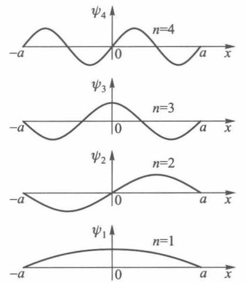{ width="200" }
<figcaption>图 2-1　前四个能量本征函数（图源：教材）</figcaption>
</figure>

<figure markdown>
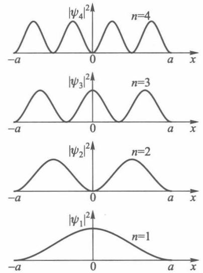{ width="200" }
<figcaption>图 2-2　前四个态的概率密度（图源：教材）</figcaption>
</figure>

**求解。** 阱外 $U=\infty$，由标准条件（有限）$\psi=0$。阱内定态薛定谔方程为

$$-\frac{\hbar^2}{2m}\psi''=E\psi\quad\Longleftrightarrow\quad\psi''+\alpha^2\psi=0,\qquad\alpha=\sqrt{2mE}/\hbar,$$

通解 $\psi=A\sin\alpha x+B\cos\alpha x$。由连续性 $\psi(\pm a)=0$：

$$A\sin\alpha a+B\cos\alpha a=0,\quad -A\sin\alpha a+B\cos\alpha a=0\quad\Rightarrow\quad A\sin\alpha a=0,\ \ B\cos\alpha a=0 .$$

$A,B$ 不能同时为零，所以有两组解：$A=0,\cos\alpha a=0$（$\alpha a=\tfrac{n\pi}{2}$，$n$ 奇）或 $B=0,\sin\alpha a=0$（$\alpha a=\tfrac{n\pi}{2}$，$n$ 偶）。合起来 $\alpha a=\dfrac{n\pi}{2}$，$n=1,2,3,\dots$（$n=0$ 给出零解；负 $n$ 与正 $n$ 线性相关）。

!!! theorem "定理 2.3（无限深方势阱的能级与波函数）"

    $$E_n=\frac{\pi^2\hbar^2n^2}{8ma^2},\qquad \psi_n(x)=\begin{cases}\dfrac{1}{\sqrt a}\sin\dfrac{n\pi}{2a}(x+a),&\lvert x\rvert<a\\[4pt]0,&\lvert x\rvert\geqslant a\end{cases}\qquad n=1,2,3,\dots$$

    $n$ 为奇数时 $\psi_n\propto\cos\dfrac{n\pi x}{2a}$ 为偶函数，$n$ 为偶数时 $\psi_n\propto\sin\dfrac{n\pi x}{2a}$ 为奇函数。

    若阱取在 $0<x<a$（阱宽 $a$），则 $E_n=\dfrac{\pi^2\hbar^2n^2}{2ma^2}$，$\psi_n=\sqrt{\dfrac2a}\sin\dfrac{n\pi x}{a}$。两种写法只差坐标原点和阱宽记号，做题时看清题目。

从这个最简单的例子可以读出量子力学的几乎所有典型特征：

- **能量量子化**：$E_n\propto n^2$，来自边界条件，不需要像玻尔那样人为假设。与第 1 章练习 8 的德布罗意驻波结果完全一致。
- **零点能**：基态 $E_1>0$。粒子不可能静止在阱底——这与不确定关系相容（$\Delta x\sim a$ 限制了 $\Delta p$ 不能为零）。
- **节点定理**：$\psi_n$ 有 $n-1$ 个节点，能量越高节点越多。
- **宇称**：势能对称 $U(-x)=U(x)$，本征函数有确定的奇偶性（练习 5）。
- **束缚态**：$\psi$ 在无穷远处为零的态，能级分立。
- 定态波函数 $\Psi_n=\psi_n\ee^{-\ii E_nt/\hbar}$ 可以写成两列反向传播平面波 $\ee^{\ii(\pm k_nx-E_nt)/\hbar}$ 的叠加，是**驻波**。

<figure class="video" markdown>
<video controls preload="metadata" width="100%" poster="assets/posters/C2_InfiniteWell.jpg"><source src="assets/videos/C2_InfiniteWell.mp4" type="video/mp4"></video>
<figcaption>动画 2-2　无限深方势阱的前四个定态；基态与第一激发态等权叠加后，概率密度以玻尔频率 $(E_2-E_1)/\hbar$ 在阱内左右晃动。</figcaption>
</figure>

!!! example "例题 2.3（教材例题：基态的动量分布）"

    宽度为 $a$ 的一维无限深方势阱（$0<x<a$）中，求处于基态的粒子的动量分布。

    **解。** 基态 $\psi_1=\sqrt{2/a}\,\sin(\pi x/a)$。按平面波展开，$k=p/\hbar$：

    $$c(p)=\frac{1}{\sqrt{2\pi\hbar}}\sqrt{\frac2a}\int_0^a\sin\frac{\pi x}{a}\,\ee^{-\ii px/\hbar}\dd x=\frac{1}{\sqrt{2\pi\hbar}}\sqrt{\frac2a}\cdot\frac{(\pi/a)\left(1+\ee^{-\ii pa/\hbar}\right)}{(\pi/a)^2-(p/\hbar)^2},$$

    $$\lvert c(p)\rvert^2=\frac{4\pi\hbar^3a\cos^2(pa/2\hbar)}{\left(\pi^2\hbar^2-p^2a^2\right)^2}.$$

    这是 $p$ 的连续函数，峰在 $p=0$，在 $p=\pm\pi\hbar/a$ 处（分母为零处）是有限值 $a/(4\pi\hbar)$。

    **易错：** 初学者常以为 $\sin(\pi x/a)=\dfrac{\ee^{\ii\pi x/a}-\ee^{-\ii\pi x/a}}{2\ii}$，所以动量只能取 $\pm\pi\hbar/a$，各占一半。这只对定义在整个实轴上的 $\sin(\pi x/a)$ 成立；阱中波函数在 $x=0,a$ 处被“截断”，频谱必然展宽（就像截断的正弦信号频谱有旁瓣）。只有在高激发态 $n\gg1$ 时，$\lvert c_n(p)\rvert^2$ 才在 $p=\pm n\pi\hbar/a$ 处出现两个尖峰，接近经典结果。

!!! example "例题 2.4（教材例题：阱宽突然加倍）"

    电子处在宽度为 $a$ 的无限深方势阱的基态，阱壁突然向两侧移动，阱宽变为 $2a$（中心不动）。求电子留在新阱基态的概率。

    **解。** 突然变化时波函数来不及改变，所以新阱中的初态仍是旧的基态，但它不再是新阱的本征态，需要按新阱的本征函数展开。

    

    <figure markdown>
    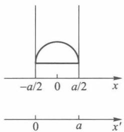{ width="160" }
    </figure>
    <figure markdown>
    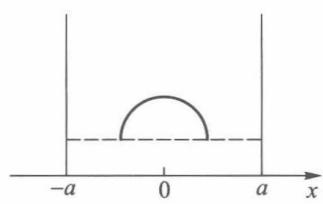{ width="220" }
    </figure>
    

    坐标原点取在阱中心。旧阱基态 $\psi_1(x)=\sqrt{\dfrac2a}\cos\dfrac{\pi x}{a}$（$\lvert x\rvert<a/2$），新阱基态 $\psi_1'(x)=\sqrt{\dfrac1a}\cos\dfrac{\pi x}{2a}$（$\lvert x\rvert<a$）。

    $$c_1=\int_{-a/2}^{a/2}\psi_1'\psi_1\,\dd x=\frac{\sqrt2}{a}\int_{-a/2}^{a/2}\cos\frac{\pi x}{2a}\cos\frac{\pi x}{a}\dd x=\frac{8}{3\pi},$$

    $$P=\lvert c_1\rvert^2=\frac{64}{9\pi^2}\approx0.72 .$$

    （积分：$\cos A\cos B=\tfrac12[\cos(A-B)+\cos(A+B)]$，$\displaystyle\int_{-a/2}^{a/2}\cos\frac{\pi x}{2a}\dd x=\frac{4a}{\pi}\sin\frac\pi4$，$\displaystyle\int_{-a/2}^{a/2}\cos\frac{3\pi x}{2a}\dd x=\frac{4a}{3\pi}\sin\frac{3\pi}4$，合起来 $\dfrac{\sqrt2}{a}\cdot\dfrac12\cdot\dfrac{4a}{\pi}\cdot\dfrac{\sqrt2}{2}\left(1+\dfrac13\right)=\dfrac{8}{3\pi}$。）

---

## 2.7 线性谐振子

<figure markdown>
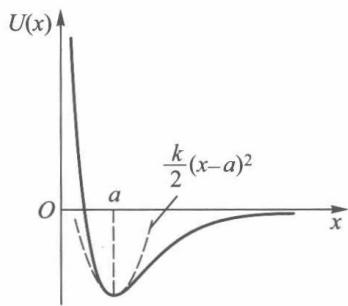{ width="230" }
<figcaption>图 2-3　双原子分子势能曲线在平衡点附近近似为抛物线（图源：教材）</figcaption>
</figure>

<figure markdown>
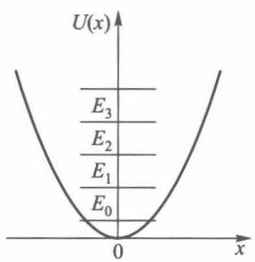{ width="190" }
<figcaption>图 2-4　线性谐振子的能级（图源：教材）</figcaption>
</figure>

**为什么谐振子这么重要。** 任何体系在稳定平衡点 $x=a$ 附近，势能都可以展开为 $U\approx U_0+\tfrac12k(x-a)^2+\cdots$。分子振动、晶格振动（声子）、电磁场的每个模式（光子）、LC 电路的量子化，全都是谐振子。

!!! definition "模型 2.2（线性谐振子）"

    $U(x)=\dfrac12m\omega^2x^2$。引入量纲为一的变量

    $$\xi=\alpha x,\quad \alpha=\sqrt{\frac{m\omega}{\hbar}};\qquad \lambda=\frac{2E}{\hbar\omega},$$

    定态薛定谔方程 $-\dfrac{\hbar^2}{2m}\psi''+\dfrac12m\omega^2x^2\psi=E\psi$ 化为

    $$\frac{\dd^2\psi}{\dd\xi^2}+(\lambda-\xi^2)\psi=0 .$$

**求解思路（三步）。**

1. **渐近行为**：$\lvert\xi\rvert\to\infty$ 时 $\lambda$ 可略，$\psi''\approx\xi^2\psi$，$\psi\sim\ee^{\pm\xi^2/2}$。有限性要求取 $\ee^{-\xi^2/2}$。
2. **剥离渐近因子**：令 $\psi=\ee^{-\xi^2/2}H(\xi)$，代入得**厄米方程**
    $$H''-2\xi H'+(\lambda-1)H=0 .$$
3. **级数截断**：设 $H=\sum_k a_k\xi^k$，得递推 $a_{k+2}=\dfrac{2k+1-\lambda}{(k+1)(k+2)}a_k$。若级数不中断，$k\to\infty$ 时 $a_{k+2}/a_k\to2/k$，与 $\ee^{\xi^2}$ 的展开系数比相同，于是 $\psi\sim\ee^{\xi^2/2}$ 发散。所以级数必须在某一项中断，即 $\lambda=2n+1$，$n=0,1,2,\dots$

!!! theorem "定理 2.4（线性谐振子的能级与波函数）"

    $$E_n=\left(n+\frac12\right)\hbar\omega,\qquad \psi_n(x)=N_n\,\ee^{-\alpha^2x^2/2}H_n(\alpha x),\qquad N_n=\left(\frac{\alpha}{\sqrt\pi\,2^nn!}\right)^{1/2},\quad n=0,1,2,\dots$$

    $H_n$ 是厄米多项式：
    $$H_n(\xi)=(-1)^n\ee^{\xi^2}\frac{\dd^n}{\dd\xi^n}\ee^{-\xi^2};\quad H_0=1,\ H_1=2\xi,\ H_2=4\xi^2-2,\ H_3=8\xi^3-12\xi .$$

    递推关系：$H_{n+1}=2\xi H_n-2nH_{n-1}$，$H_n'=2nH_{n-1}$。

由递推关系可得两个极常用的公式（第 4 章用升降算符会更简洁地得到）：

$$\xi\psi_n=\sqrt{\frac n2}\psi_{n-1}+\sqrt{\frac{n+1}{2}}\psi_{n+1},\qquad \frac{\dd\psi_n}{\dd\xi}=\sqrt{\frac n2}\psi_{n-1}-\sqrt{\frac{n+1}{2}}\psi_{n+1}.$$

<figure class="video" markdown>
<video controls preload="metadata" width="100%" poster="assets/posters/C2_Oscillator.jpg"><source src="assets/videos/C2_Oscillator.mp4" type="video/mp4"></video>
<figcaption>动画 2-3　线性谐振子：等间距能级与前五个本征函数；$n=10$ 时量子概率密度（黄）与经典概率密度（红）的比较。</figcaption>
</figure>

**物理结论。**

- **能级等间距**，间隔 $\hbar\omega$，与普朗克的能量子假设一致；但多了**零点能** $E_0=\tfrac12\hbar\omega$（第 1 章玻尔–索末菲量子化中的 $n+\tfrac12$）。零点能已被实验证实（如低温下晶体的 X 射线散射、卡西米尔效应）。
- **宇称**：$\psi_n(-x)=(-1)^n\psi_n(x)$，$n$ 个节点。
- **经典禁区**：经典粒子只能在 $\lvert\xi\rvert\leqslant\sqrt{2n+1}$ 内运动，量子粒子在禁区也有一定概率（基态约 16%，例题 2.1）。
- **对应原理**：经典振子在端点附近速度最小、停留时间最长，概率密度 $w_{\mathrm{cl}}\propto1/\sqrt{\xi_0^2-\xi^2}$。基态的量子分布在中心最大，与经典相反；但 $n$ 很大时，量子分布的平均趋势趋近经典分布（动画后半段、图 2-5）。

<figure markdown>
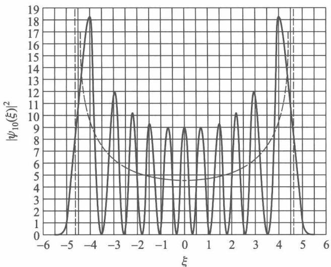{ width="300" }
<figcaption>图 2-5　$n=10$ 时谐振子的概率密度（实线）与经典概率密度（虚线）（图源：教材）</figcaption>
</figure>

!!! example "例题 2.5"

    求谐振子在第一激发态时概率密度最大的位置（教材习题 2.6）。

    **解。** $\psi_1=N_1\cdot2\alpha x\,\ee^{-\alpha^2x^2/2}$，$w_1\propto x^2\ee^{-\alpha^2x^2}$。

    $\dfrac{\dd w_1}{\dd x}\propto2x\,\ee^{-\alpha^2x^2}(1-\alpha^2x^2)=0$，除 $x=0$（极小，为零）外，得 $x=\pm\dfrac1\alpha=\pm\sqrt{\dfrac{\hbar}{m\omega}}$。

---

## 2.8 势垒穿透

前两节是**束缚态**（能级分立），本节是**散射态**（能量连续，粒子从无穷远来、到无穷远去）。我们关心的不是能级，而是粒子被反射和透射的概率。

!!! definition "模型 2.3（一维方势垒）"

    $$U(x)=\begin{cases}U_0,&0<x<a\\0,&x<0\ \text{或}\ x>a\end{cases}$$

    能量为 $E$ 的粒子从左方入射。

<figure markdown>
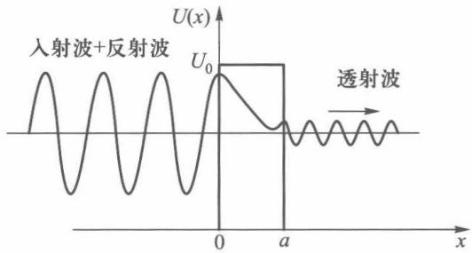{ width="380" }
<figcaption>图 2-6　势垒穿透：左侧入射波 + 反射波，右侧透射波（图源：教材）</figcaption>
</figure>

**求解。** 令 $k_1=\sqrt{2mE}/\hbar$，$k_2=\sqrt{2m(E-U_0)}/\hbar$。三个区域的解为

$$\psi=\begin{cases}A\,\ee^{\ii k_1x}+A'\ee^{-\ii k_1x},&x<0\\B\,\ee^{\ii k_2x}+B'\ee^{-\ii k_2x},&0<x<a\\C\,\ee^{\ii k_1x},&x>a\end{cases}$$

（右侧没有从右向左的波。）在 $x=0$ 和 $x=a$ 处要求 $\psi$ 和 $\psi'$ 连续，得 4 个方程，可用 $A$ 表示 $A',B,B',C$。

**透射系数和反射系数**定义为透射流、反射流与入射流之比。由 2.4 节，平面波 $A\ee^{\ii kx}$ 的流密度为 $\dfrac{\hbar k}{m}\lvert A\rvert^2$：

$$D=\frac{J_D}{J}=\frac{\lvert C\rvert^2}{\lvert A\rvert^2},\qquad R=\frac{J_R}{J}=\frac{\lvert A'\rvert^2}{\lvert A\rvert^2},\qquad D+R=1 .$$

!!! theorem "定理 2.5（方势垒的透射系数）"

    $E>U_0$：
    $$D=\frac{4k_1^2k_2^2}{(k_1^2-k_2^2)^2\sin^2k_2a+4k_1^2k_2^2}.$$

    $E<U_0$：$k_2=\ii k_3$，$k_3=\sqrt{2m(U_0-E)}/\hbar$，
    $$D=\frac{4k_1^2k_3^2}{(k_1^2+k_3^2)^2\sinh^2k_3a+4k_1^2k_3^2}.$$

    当 $k_3a\gg1$ 时，$\sinh^2k_3a\approx\tfrac14\ee^{2k_3a}$，
    $$D\approx D_0\,\ee^{-2k_3a}=D_0\exp\left[-\frac2\hbar\sqrt{2m(U_0-E)}\,a\right],\qquad D_0=\frac{16k_1^2k_3^2}{(k_1^2+k_3^2)^2}\sim1 .$$

<figure class="video" markdown>
<video controls preload="metadata" width="100%" poster="assets/posters/C2_Tunneling.jpg"><source src="assets/videos/C2_Tunneling.mp4" type="video/mp4"></video>
<figcaption>动画 2-4　平均能量 $E\approx0.72U_0$ 的波包撞上方势垒（数值求解含时薛定谔方程）：大部分被反射，约 17% 穿过势垒。注意入射波与反射波叠加处出现的干涉条纹。</figcaption>
</figure>

**解读。**

- **$E<U_0$ 时 $D\neq0$**：粒子能穿过经典上不可能越过的势垒，这就是**隧道效应**。势垒内波函数按 $\ee^{-k_3x}$ 衰减（就像电磁波在导体中的趋肤衰减，或全反射时的倏逝波），只要势垒不太厚，在右侧还剩一点。
- **$E>U_0$ 时 $D\neq1$**：经典粒子一定能越过，量子粒子却有一部分被反射。当 $k_2a=n\pi$ 时 $D=1$（共振透射），这和光学中薄膜的增透原理相同。
- **指数敏感**：$D$ 对 $a$、$U_0-E$、$m$ 都是指数依赖。对电子，$U_0-E=5\ \mathrm{eV}$：

    | $a/\mathrm{nm}$ | 0.1 | 0.2 | 0.5 | 1.0 |
    |---|---|---|---|---|
    | $D$ | $0.10$ | $1.0\times10^{-2}$ | $1.1\times10^{-5}$ | $1.1\times10^{-10}$ |

    势垒宽度为原子尺度时 $D$ 相当可观，宽度稍大就微乎其微。宏观物体质量大，完全观察不到隧道效应。

**任意形状势垒。** 把势垒切成许多宽 $\dd x$ 的方势垒，透射系数相乘：

$$D\approx D_0\exp\left[-\frac2\hbar\int_a^b\sqrt{2m\left[U(x)-E\right]}\,\dd x\right],$$

$a,b$ 是经典转折点 $U(a)=U(b)=E$（图 2-7）。这个公式虽不严格，但与 WKB 近似的结果一致，是估算 $\alpha$ 衰变寿命、场致电子发射的标准工具。

<figure markdown>
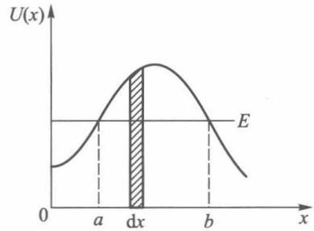{ width="260" }
<figcaption>图 2-7　任意形状的势垒（图源：教材）</figcaption>
</figure>

!!! info "隧道效应与电子工程"

    - **扫描隧道显微镜（STM）**：针尖与样品间距变化 $0.1\ \mathrm{nm}$，隧穿电流变化约一个数量级，因此能分辨单个原子。
    - **隧道二极管**、**约瑟夫森结**：利用隧穿实现负阻和超导量子器件。
    - **闪存（Flash）**：编程/擦除时电子通过 F–N 隧穿穿过约 $10\ \mathrm{nm}$ 的氧化层进出浮栅。
    - **MOSFET 栅极漏电**：栅氧化层薄到 $1\sim2\ \mathrm{nm}$ 时直接隧穿电流急剧增大，这是工艺改用高 $k$ 介质的原因之一。

!!! example "例题 2.6（教材例题：$\delta$ 势垒）"

    设 $x=a$ 处有 $\delta$ 势垒 $U(x)=A\,\delta(x-a)$（$A>0$），能量为 $E$ 的粒子从左方入射，求透射系数。

    <figure markdown>
    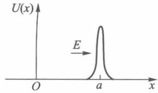{ width="220" }
    </figure>

    **解。** 方程 $-\dfrac{\hbar^2}{2m}\psi''+A\delta(x-a)\psi=E\psi$ 中 $\psi''$ 在 $x=a$ 处含 $\delta$ 函数，所以 $\psi'$ 在该处**不连续**。对方程在 $[a-\epsilon,a+\epsilon]$ 上积分再令 $\epsilon\to0$：

    $$\psi'(a^+)-\psi'(a^-)=\frac{2mA}{\hbar^2}\psi(a)\qquad(\psi\ \text{本身连续}).$$

    设 $\psi=\ee^{\ii k(x-a)}+R\,\ee^{-\ii k(x-a)}$（$x<a$），$\psi=S\,\ee^{\ii k(x-a)}$（$x>a$），$k=\sqrt{2mE}/\hbar$。

    连续：$1+R=S$。跃变：$\ii kS-\ii k(1-R)=\dfrac{2mA}{\hbar^2}S$。消去 $R$：$2\ii k(S-1)=\dfrac{2mA}{\hbar^2}S$，

    $$S=\frac{1}{1+\ii mA/\hbar^2k},\qquad D=\lvert S\rvert^2=\frac{1}{1+\dfrac{m^2A^2}{\hbar^4k^2}}=\frac{1}{1+\dfrac{mA^2}{2\hbar^2E}} .$$

    能量越高越容易透过；$A\to\infty$ 时 $D\to0$。

!!! warning "易错点"

    - 透射系数要用**流密度**之比，不是振幅平方之比。若势垒两侧势能不同（如台阶势），$D=\dfrac{k_3\lvert C\rvert^2}{k_1\lvert A\rvert^2}$，要乘上速度之比。
    - 衔接条件：$U$ 有限跃变时 $\psi,\psi'$ 都连续；$U$ 为无穷大（硬壁）时只有 $\psi=0$，$\psi'$ 不连续；$\delta$ 势时 $\psi'$ 有确定跃变。
    - 散射态（$E>U(\pm\infty)$）的能量是连续的，不需要“求能级”；束缚态才有分立能级。
    - 隧道效应中粒子在势垒内并不是“动能为负”。第 3 章会看到，测量粒子在势垒内的位置会给它很大的动量扰动，“同时具有确定的位置和动能”这一前提本身不成立。

---

## 知识点归纳总结

### 知识地图

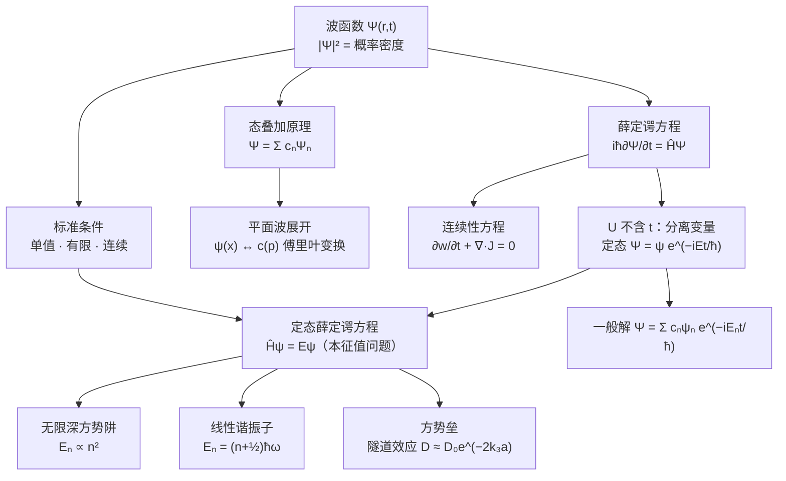

### 核心公式

| 内容 | 公式 |
|---|---|
| 统计解释、归一化 | $\dd W=\lvert\Psi\rvert^2\dd\tau$，$\int\lvert\Psi\rvert^2\dd\tau=1$ |
| 平面波展开 | $c(p)=\dfrac{1}{\sqrt{2\pi\hbar}}\displaystyle\int\psi(x)\ee^{-\ii px/\hbar}\dd x$ |
| 薛定谔方程 | $\ii\hbar\partial_t\Psi=\left(-\dfrac{\hbar^2}{2m}\nabla^2+U\right)\Psi$ |
| 概率流密度 | $\vv J=\dfrac{\ii\hbar}{2m}(\Psi\nabla\Psi^*-\Psi^*\nabla\Psi)$，$\partial_tw+\nabla\cdot\vv J=0$ |
| 定态 | $\Psi=\psi\ee^{-\ii Et/\hbar}$，$\hat H\psi=E\psi$ |
| 一般解 | $\Psi(x,t)=\sum c_n\psi_n\ee^{-\ii E_nt/\hbar}$，$c_n=\int\psi_n^*\Psi(x,0)\dd x$ |
| 无限深势阱（$0<x<a$） | $E_n=\dfrac{n^2\pi^2\hbar^2}{2ma^2}$，$\psi_n=\sqrt{\dfrac2a}\sin\dfrac{n\pi x}{a}$ |
| 无限深势阱（$\lvert x\rvert<a$） | $E_n=\dfrac{n^2\pi^2\hbar^2}{8ma^2}$，$\psi_n=\dfrac{1}{\sqrt a}\sin\dfrac{n\pi(x+a)}{2a}$ |
| 线性谐振子 | $E_n=\left(n+\tfrac12\right)\hbar\omega$，$\psi_n=N_n\ee^{-\alpha^2x^2/2}H_n(\alpha x)$，$\alpha=\sqrt{m\omega/\hbar}$ |
| 谐振子递推 | $x\psi_n=\dfrac1\alpha\left[\sqrt{\tfrac n2}\psi_{n-1}+\sqrt{\tfrac{n+1}2}\psi_{n+1}\right]$ |
| 方势垒（$E<U_0$） | $D=\dfrac{4k_1^2k_3^2}{(k_1^2+k_3^2)^2\sinh^2k_3a+4k_1^2k_3^2}\approx D_0\ee^{-2k_3a}$ |
| $\delta$ 势衔接 | $\psi'(a^+)-\psi'(a^-)=\dfrac{2mA}{\hbar^2}\psi(a)$ |

### 方法归纳

**一维定态问题的标准流程：**

1. 按势能分区，每区写出定态薛定谔方程；
2. 每区写通解：$E>U$ 用 $\ee^{\pm\ii kx}$ 或 $\sin,\cos$；$E<U$ 用 $\ee^{\pm\kappa x}$ 或 $\sinh,\cosh$；
3. 用**无穷远条件**去掉发散项（束缚态）或指定入射条件（散射态，右侧只有出射波）；
4. 在分界点用衔接条件（$\psi,\psi'$ 连续，或硬壁 $\psi=0$，或 $\delta$ 势跃变）；
5. 束缚态：齐次线性方程组有非零解 ⇒ 系数行列式为零 ⇒ 能级方程；散射态：解出 $D,R$；
6. 势能对称时，分别找偶宇称解和奇宇称解，计算量减半。

**含时问题：** 初态 $\Psi(x,0)$ → 求 $c_n=\int\psi_n^*\Psi(x,0)\dd x$ → $\Psi(x,t)=\sum c_n\psi_n\ee^{-\ii E_nt/\hbar}$。

---

## 练习题

!!! example "练习 1（教材习题 2.1）"

    证明归一化常数与时间无关。

    ??? success "答案"

        由连续性方程，$\dfrac{\dd}{\dd t}\displaystyle\int_V\lvert\Psi\rvert^2\dd\tau=-\int_V\nabla\cdot\vv J\,\dd\tau=-\oint_S\vv J\cdot\dd\vv S$。取 $V$ 为全空间，束缚态在无穷远处 $\Psi\to0$ 足够快，面积分为零，故 $\int\lvert\Psi\rvert^2\dd\tau$ 不随时间变化，$t=0$ 时归一化的波函数以后一直归一化。

!!! example "练习 2（教材习题 2.2）"

    证明在定态中，概率流密度与时间无关。

    ??? success "答案"

        $\Psi=\psi(\vv r)\ee^{-\ii Et/\hbar}$，$\Psi^*=\psi^*\ee^{\ii Et/\hbar}$（$E$ 为实数）。$\vv J=\dfrac{\ii\hbar}{2m}(\Psi\nabla\Psi^*-\Psi^*\nabla\Psi)$ 中两个相因子总是成对出现、相乘为 1，所以 $\vv J=\dfrac{\ii\hbar}{2m}(\psi\nabla\psi^*-\psi^*\nabla\psi)$，与 $t$ 无关。

!!! example "练习 3（教材习题 2.3）"

    由下列两定态波函数计算概率流密度：(1) $\psi_1=\dfrac1r\ee^{\ii kr}$；(2) $\psi_2=\dfrac1r\ee^{-\ii kr}$。说明 $\psi_1$ 表示向外传播的球面波，$\psi_2$ 表示向内传播的球面波。

    ??? success "答案"

        $\psi$ 只依赖 $r$，$\nabla=\vv e_r\dfrac{\partial}{\partial r}$。

        (1) $\dfrac{\partial\psi_1}{\partial r}=\left(-\dfrac1{r^2}+\dfrac{\ii k}{r}\right)\ee^{\ii kr}$，$\psi_1^*\dfrac{\partial\psi_1}{\partial r}=-\dfrac{1}{r^3}+\dfrac{\ii k}{r^2}$，

        $\vv J_1=\dfrac\hbar m\Im\left(\psi_1^*\nabla\psi_1\right)=\dfrac{\hbar k}{mr^2}\vv e_r$，沿 $+\vv e_r$，向外。

        (2) 同理 $\vv J_2=-\dfrac{\hbar k}{mr^2}\vv e_r$，指向原点。

        两者大小都 $\propto1/r^2$，穿过任意球面的总流 $4\pi r^2J=4\pi\hbar k/m$ 与 $r$ 无关，符合概率守恒。$\psi_1$ 将在第 6 章散射理论中作为散射波出现。

!!! example "练习 4（教材习题 2.5）"

    验证无限深方势阱（$\lvert x\rvert<a$）的归一化因子是 $A'=1/\sqrt a$。

    ??? success "答案"

        $\displaystyle\int_{-a}^{a}A'^2\sin^2\frac{n\pi(x+a)}{2a}\dd x=A'^2\int_0^{2a}\sin^2\frac{n\pi y}{2a}\dd y=A'^2\cdot a=1$，故 $A'=1/\sqrt a$。（$\sin^2$ 在整数个半周期上的平均值是 $\tfrac12$。）

!!! example "练习 5（教材习题 2.7）"

    在一维势场中运动的粒子，势能对原点对称 $U(-x)=U(x)$。证明粒子的定态波函数具有确定的宇称（假定能级不简并）。

    ??? success "答案"

        把方程 $-\dfrac{\hbar^2}{2m}\psi''(x)+U(x)\psi(x)=E\psi(x)$ 中 $x\to-x$，由 $U(-x)=U(x)$ 及 $\dfrac{\dd^2}{\dd(-x)^2}=\dfrac{\dd^2}{\dd x^2}$，得 $\psi(-x)$ 满足同一方程、同一能量。

        能级不简并时，$\psi(-x)$ 与 $\psi(x)$ 只能差一个常数：$\psi(-x)=c\psi(x)$。再作一次反演：$\psi(x)=c\psi(-x)=c^2\psi(x)$，$c=\pm1$。所以 $\psi$ 是偶函数或奇函数。

        （若能级简并，总可以组合出 $\psi(x)\pm\psi(-x)$ 作为有确定宇称的本征函数。一维束缚态能级都是不简并的。）

!!! example "练习 6（教材习题 2.8）"

    粒子在一维有限深方势阱 $U(x)=U_0$（$\lvert x\rvert>a$），$U=0$（$\lvert x\rvert\leqslant a$）中运动，求束缚态（$0<E<U_0$）的能级所满足的方程。

    ??? success "答案"

        令 $k=\sqrt{2mE}/\hbar$，$\kappa=\sqrt{2m(U_0-E)}/\hbar$。阱外 $\psi\propto\ee^{-\kappa\lvert x\rvert}$，阱内按宇称分类：

        **偶宇称** $\psi=\cos kx$：在 $x=a$ 处 $\psi'/\psi$ 连续，$-k\tan ka=-\kappa$，即 $k\tan ka=\kappa$。

        **奇宇称** $\psi=\sin kx$：$k\cot ka=-\kappa$。

        令 $\xi=ka$，$\eta=\kappa a$，则还有 $\xi^2+\eta^2=\dfrac{2mU_0a^2}{\hbar^2}$。能级由曲线 $\eta=\xi\tan\xi$（或 $\eta=-\xi\cot\xi$）与圆的交点确定（图解法）。圆的半径不论多小，偶宇称至少有一个交点：**一维对称势阱至少有一个束缚态**。$U_0\to\infty$ 时回到无限深势阱 $ka=n\pi/2$。

!!! example "练习 7（教材习题 2.9）"

    分子间范德瓦耳斯势近似为 $U=\infty$（$x<0$），$U_0$（$0\leqslant x<a$），$-U_1$（$a\leqslant x\leqslant b$），$0$（$x>b$）。求束缚态（$-U_1<E<0$）的能级所满足的方程。

    ??? success "答案"

        令 $\kappa_1=\sqrt{2m(U_0-E)}/\hbar$，$k_2=\sqrt{2m(E+U_1)}/\hbar$，$\kappa_3=\sqrt{-2mE}/\hbar$。

        $\psi=\begin{cases}A\sinh\kappa_1x,&0<x<a\ (\text{满足}\ \psi(0)=0)\\B\sin(k_2x+\delta),&a<x<b\\C\ee^{-\kappa_3x},&x>b\end{cases}$

        在 $x=a$、$x=b$ 处对数导数 $\psi'/\psi$ 连续：

        $$\tan(k_2a+\delta)=\frac{k_2}{\kappa_1}\tanh\kappa_1a,\qquad \tan(k_2b+\delta)=-\frac{k_2}{\kappa_3}.$$

        消去 $\delta$，能级方程为

        $$k_2(b-a)=n\pi-\arctan\frac{k_2}{\kappa_3}-\arctan\left(\frac{k_2}{\kappa_1}\tanh\kappa_1a\right),\qquad n=1,2,\dots$$

!!! example "练习 8"

    求一维 $\delta$ 势阱 $U(x)=-\gamma\,\delta(x)$（$\gamma>0$）的束缚态能级和归一化波函数。

    ??? success "答案"

        $E<0$，令 $\kappa=\sqrt{-2mE}/\hbar$，$x\neq0$ 处 $\psi''=\kappa^2\psi$，有限性要求 $\psi=A\,\ee^{-\kappa\lvert x\rvert}$（已保证 $\psi$ 连续且为偶函数）。

        跃变条件：$\psi'(0^+)-\psi'(0^-)=-\dfrac{2m\gamma}{\hbar^2}\psi(0)$，即 $-2\kappa A=-\dfrac{2m\gamma}{\hbar^2}A$，$\kappa=\dfrac{m\gamma}{\hbar^2}$。

        $$E=-\frac{m\gamma^2}{2\hbar^2},\qquad \psi(x)=\sqrt\kappa\,\ee^{-\kappa\lvert x\rvert}=\frac{\sqrt{m\gamma}}{\hbar}\ee^{-m\gamma\lvert x\rvert/\hbar^2}.$$

        只有**一个**束缚态。
