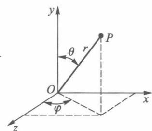
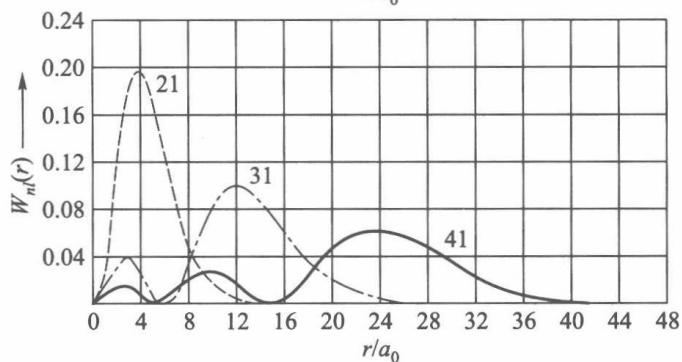
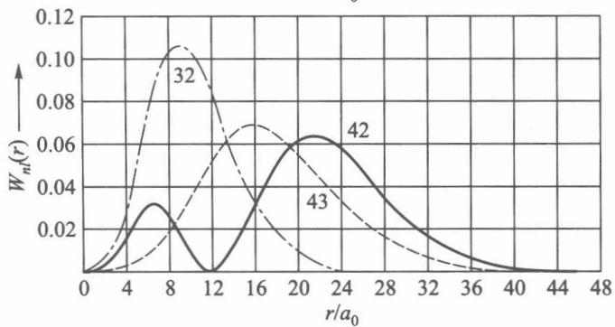
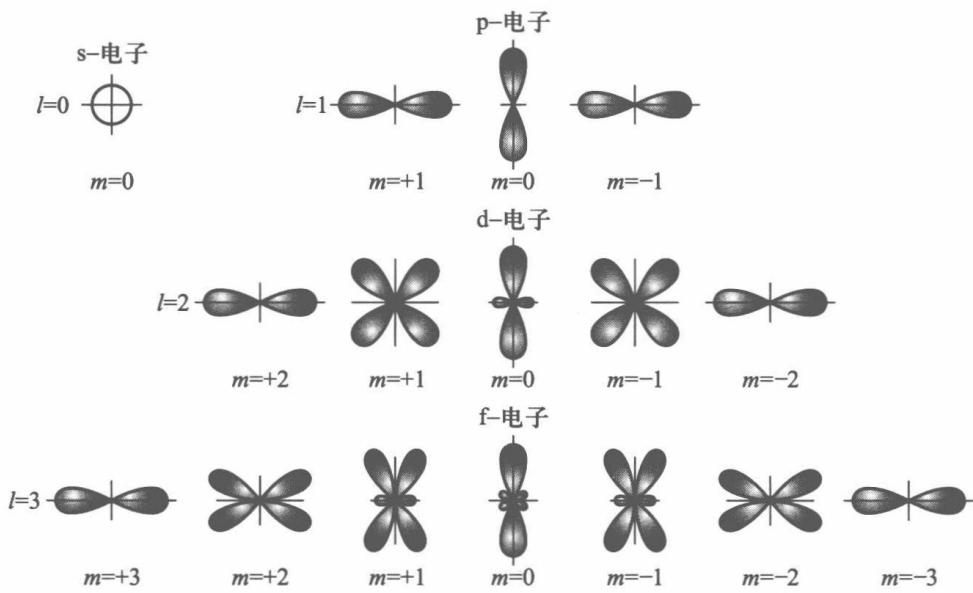
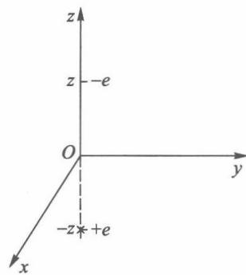
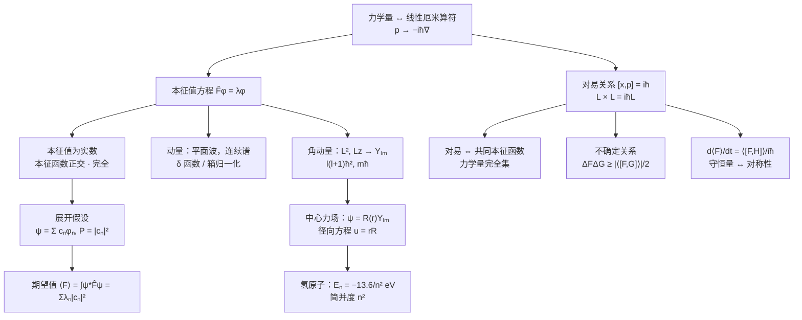

# 第 3 章 量子力学中的力学量

!!! tip "本章目标"

    1. 掌握“力学量用线性厄米算符表示”这一基本假设，会写出坐标、动量、角动量、哈密顿量等算符。
    2. 会求动量算符、角动量算符 $\hat L_z$、$\hat L^2$ 的本征值和本征函数，记住球谐函数 $Y_{lm}$ 的性质。
    3. 掌握氢原子的求解思路和结果：能级 $E_n$、简并度 $n^2$、径向函数 $R_{nl}$、概率分布。
    4. 掌握厄米算符的性质：本征值为实数，本征函数正交、完全。
    5. 会把波函数按力学量的本征函数展开，求测量值的概率分布和期望值。
    6. 掌握对易关系与“同时有确定值”的条件，会推导和使用不确定关系。
    7. 会用 $\dfrac{\dd\langle F\rangle}{\dd t}=\dfrac{1}{\ii\hbar}\langle[\hat F,\hat H]\rangle+\left\langle\dfrac{\partial\hat F}{\partial t}\right\rangle$ 判断守恒量。

**本章在全书中的位置。** 第 2 章只回答了“粒子在哪里”（$\lvert\psi\rvert^2$）。本章回答“测量动量、角动量、能量会得到什么”。答案的数学结构是线性代数：**力学量 = 厄米算符（矩阵），测量值 = 本征值，测量概率 = 态矢量在本征矢上的投影的模方**。本章是全书最核心的一章，第 4 章的表象理论、第 5 章的微扰论、第 7 章的自旋都建立在它之上。

!!! info "本章的线性代数对照表"

    | 线性代数（有限维） | 量子力学 | 本章位置 |
    |---|---|---|
    | 厄米矩阵 $A=A^\dagger$ | 厄米算符 $\hat F^\dagger=\hat F$ | 3.1 |
    | 厄米矩阵的特征值是实数 | 测量值是实数 | 3.1 |
    | 不同特征值的特征向量正交 | 本征函数正交 | 3.4 |
    | 特征向量组成一组基 | 本征函数系完全 | 3.4 |
    | 向量按基展开 $\vv v=\sum c_n\vv e_n$ | $\psi=\sum c_n\phi_n$，$P(\lambda_n)=\lvert c_n\rvert^2$ | 3.5 |
    | 两矩阵可同时对角化 $\Leftrightarrow$ 对易 | 两力学量可同时确定 $\Leftrightarrow$ 对易 | 3.6 |

---

## 3.1 表示力学量的算符

### 3.1.1 从期望值看出算符

处于 $\psi(\vv r)$ 的粒子，坐标的**期望值**（平均值）按统计解释是

$$\langle x\rangle=\bar x=\int\psi^*(\vv r)\,x\,\psi(\vv r)\,\dd\tau .$$

动量的期望值要用动量分布 $c(\vv p)$ 计算：$\langle\vv p\rangle=\int c^*(\vv p)\,\vv p\,c(\vv p)\,\dd^3p$。把 $c(\vv p)=\dfrac{1}{(2\pi\hbar)^{3/2}}\int\psi\,\ee^{-\ii\vv p\cdot\vv r/\hbar}\dd\tau$ 代入，利用 $\vv p\,\ee^{\ii\vv p\cdot\vv r/\hbar}=-\ii\hbar\nabla\ee^{\ii\vv p\cdot\vv r/\hbar}$ 并分部积分，得到

$$\langle\vv p\rangle=\int\psi^*(\vv r)\left(-\ii\hbar\nabla\right)\psi(\vv r)\,\dd\tau .$$

不必先求 $c(\vv p)$，只要把 $\vv p$ 换成**算符** $\hat{\vv p}=-\ii\hbar\nabla$，夹在 $\psi^*$ 和 $\psi$ 之间积分即可。推广到一般力学量：

!!! theorem "基本假设 3.1（力学量的算符表示）"

    量子力学中的力学量用**线性厄米算符**表示。经典力学量 $F(\vv r,\vv p)$ 对应的算符由**替换** $\vv p\to\hat{\vv p}=-\ii\hbar\nabla$ 得到：$\hat F=F(\vv r,-\ii\hbar\nabla)$。在归一化态 $\psi$ 中力学量的期望值为

    $$\langle F\rangle=\int\psi^*\hat F\psi\,\dd\tau\equiv\mel{\psi}{\hat F}{\psi}.$$

常用算符：

| 力学量 | 经典表达式 | 算符（坐标表象） |
|---|---|---|
| 坐标 | $\vv r$ | $\hat{\vv r}=\vv r$ |
| 动量 | $\vv p$ | $\hat{\vv p}=-\ii\hbar\nabla$ |
| 动能 | $p^2/2m$ | $\hat T=-\dfrac{\hbar^2}{2m}\nabla^2$ |
| 能量（哈密顿量） | $p^2/2m+U$ | $\hat H=-\dfrac{\hbar^2}{2m}\nabla^2+U(\vv r)$ |
| 角动量 | $\vv L=\vv r\times\vv p$ | $\hat{\vv L}=-\ii\hbar\,\vv r\times\nabla$ |

!!! warning "替换规则的限制"

    当经典表达式中出现 $xp_x$ 这样的乘积时，因为 $\hat x\hat p_x\neq\hat p_x\hat x$，替换结果不唯一，而且 $\hat x\hat p_x$ 不是厄米的。通常取对称化形式 $\tfrac12(\hat x\hat p_x+\hat p_x\hat x)$。没有经典对应的力学量（如自旋，第 7 章）则不能用替换规则得到。

### 3.1.2 算符的基本运算

!!! definition "定义 3.1（线性算符、对易子、厄米算符）"

    1. **线性算符**：$\hat F(c_1\psi_1+c_2\psi_2)=c_1\hat F\psi_1+c_2\hat F\psi_2$。量子力学的算符都是线性的（与态叠加原理相容）。
    2. **算符之积**：$(\hat A\hat B)\psi=\hat A(\hat B\psi)$。一般 $\hat A\hat B\neq\hat B\hat A$，定义**对易子** $[\hat A,\hat B]=\hat A\hat B-\hat B\hat A$。若 $[\hat A,\hat B]=0$，称 $\hat A,\hat B$ 对易。
    3. **厄米共轭**：$\hat F^\dagger$ 定义为对任意 $\psi,\phi$ 有 $\displaystyle\int\psi^*\hat F^\dagger\phi\,\dd\tau=\int(\hat F\psi)^*\phi\,\dd\tau$。
    4. **厄米算符**：$\hat F^\dagger=\hat F$，即
        $$\int\psi^*\hat F\phi\,\dd\tau=\int(\hat F\psi)^*\phi\,\dd\tau\qquad\text{对一切}\ \psi,\phi.$$

!!! example "例题 3.1"

    证明 (1) $\hat p_x=-\ii\hbar\dfrac{\partial}{\partial x}$ 是厄米算符；(2) $\dfrac{\partial}{\partial x}$ 不是厄米算符；(3) $[\hat x,\hat p_x]=\ii\hbar$。

    **解。** (1) 分部积分，边界项因 $\psi,\phi\to0$（$x\to\pm\infty$）而消失：

    $$\int\psi^*\left(-\ii\hbar\frac{\partial\phi}{\partial x}\right)\dd x=\ii\hbar\int\frac{\partial\psi^*}{\partial x}\phi\,\dd x=\int\left(-\ii\hbar\frac{\partial\psi}{\partial x}\right)^*\phi\,\dd x .$$

    (2) 同样的计算给出 $\int\psi^*\partial_x\phi=-\int(\partial_x\psi)^*\phi$，多一个负号，所以 $\partial_x$ 是**反厄米**的。正是因子 $-\ii$ 使 $\hat p_x$ 成为厄米算符。

    (3) 作用在任意 $\psi$ 上：$[\hat x,\hat p_x]\psi=x(-\ii\hbar\psi')-(-\ii\hbar)(x\psi)'=\ii\hbar\psi$。

!!! theorem "定理 3.1（厄米算符的本征值是实数）"

    若 $\hat F$ 厄米，$\hat F\psi=\lambda\psi$，则 $\lambda$ 是实数。厄米算符在任何态中的期望值也是实数。

    *证明：* 由厄米性 $\int\psi^*\hat F\psi\,\dd\tau=\int(\hat F\psi)^*\psi\,\dd\tau$，即 $\lambda\int\lvert\psi\rvert^2=\lambda^*\int\lvert\psi\rvert^2$，所以 $\lambda=\lambda^*$。

测量值必须是实数，这就是要求力学量算符厄米的原因。

!!! definition "定义 3.2（本征值方程）"

    $\hat F\psi=\lambda\psi$ 叫算符 $\hat F$ 的**本征值方程**，$\lambda$ 叫本征值，$\psi$ 叫属于 $\lambda$ 的本征函数。若属于同一本征值有 $f$ 个线性无关的本征函数，称该本征值 **$f$ 度简并**。

    **基本假设 3.2：** 当体系处于 $\hat F$ 的本征态 $\psi$ 时，测量力学量 $F$ **一定**得到本征值 $\lambda$。一般地，测量 $F$ 的可能值就是 $\hat F$ 的全部本征值（3.5 节）。

---

## 3.2 动量算符和角动量算符

### 3.2.1 动量算符

本征值方程 $-\ii\hbar\nabla\psi_{\vv p}=\vv p\,\psi_{\vv p}$ 的解是平面波

$$\psi_{\vv p}(\vv r)=C\,\ee^{\ii\vv p\cdot\vv r/\hbar}.$$

$\vv p$ 可取任意实数矢量（取复数时 $\psi$ 在无穷远发散），**本征值组成连续谱**。$\lvert\psi_{\vv p}\rvert^2=\lvert C\rvert^2$ 处处相同，不能按 $\int\lvert\psi\rvert^2=1$ 归一化，有两种处理办法：

**（1）$\delta$ 函数归一化。** 取 $C=(2\pi\hbar)^{-3/2}$，则

$$\int\psi_{\vv p'}^*(\vv r)\psi_{\vv p}(\vv r)\,\dd\tau=\delta(\vv p-\vv p'),$$

其中用到 $\displaystyle\frac{1}{2\pi}\int_{-\infty}^{\infty}\ee^{\ii kx}\dd x=\delta(k)$。$\delta$ 函数是“连续指标的克罗内克 $\delta_{mn}$”。

**（2）箱归一化。** 把粒子限制在边长 $L$ 的立方体内，加**周期性边界条件** $\psi(x+L)=\psi(x)$ 等，则 $p_xL/\hbar=2\pi n_x$，

$$p_x=\frac{2\pi\hbar n_x}{L},\quad n_x=0,\pm1,\pm2,\dots;\qquad \psi_{\vv p}=\frac{1}{L^{3/2}}\ee^{\ii\vv p\cdot\vv r/\hbar}.$$

动量变成分立的，可以正常归一化。$L\to\infty$ 时相邻 $p$ 值的间隔 $2\pi\hbar/L\to0$，回到连续谱。固体物理中计算电子态密度用的就是这种方法。

### 3.2.2 角动量算符

$\hat{\vv L}=\hat{\vv r}\times\hat{\vv p}$ 的分量为

$$\hat L_x=y\hat p_z-z\hat p_y,\qquad \hat L_y=z\hat p_x-x\hat p_z,\qquad \hat L_z=x\hat p_y-y\hat p_x,\qquad \hat L^2=\hat L_x^2+\hat L_y^2+\hat L_z^2 .$$

（这里各项中的坐标和动量分量不同，彼此对易，所以没有排序问题。）

<figure markdown>
{ width="220" }
<figcaption>图 3-1　球坐标 $(r,\theta,\varphi)$（图源：教材）</figcaption>
</figure>

角动量问题在球坐标中最简单。变换后（推导见教材附录）：

$$\hat L_z=-\ii\hbar\frac{\partial}{\partial\varphi},\qquad \hat L^2=-\hbar^2\left[\frac{1}{\sin\theta}\frac{\partial}{\partial\theta}\left(\sin\theta\frac{\partial}{\partial\theta}\right)+\frac{1}{\sin^2\theta}\frac{\partial^2}{\partial\varphi^2}\right].$$

$\hat L^2$ 只含角度，正是拉普拉斯算符的角度部分：$\nabla^2=\dfrac{1}{r^2}\dfrac{\partial}{\partial r}\left(r^2\dfrac{\partial}{\partial r}\right)-\dfrac{\hat L^2}{\hbar^2r^2}$。

**$\hat L_z$ 的本征值问题。** $-\ii\hbar\Phi'(\varphi)=L_z\Phi$ 的解是 $\Phi=C\,\ee^{\ii L_z\varphi/\hbar}$。波函数单值要求 $\Phi(\varphi+2\pi)=\Phi(\varphi)$，所以 $L_z=m\hbar$：

$$\Phi_m(\varphi)=\frac{1}{\sqrt{2\pi}}\ee^{\ii m\varphi},\qquad L_z=m\hbar,\qquad m=0,\pm1,\pm2,\dots$$

又一次，量子化来自边界条件（这里是周期性）。

**$\hat L^2$ 的本征值问题。** $\hat L^2Y=\lambda\hbar^2Y$ 分离变量后，$\theta$ 部分是连带勒让德方程。要求解在 $\theta=0,\pi$ 处有限，得 $\lambda=l(l+1)$，$l=0,1,2,\dots$，且 $\lvert m\rvert\leqslant l$。

!!! theorem "定理 3.2（$\hat L^2$ 与 $\hat L_z$ 的共同本征函数：球谐函数）"

    $$\hat L^2Y_{lm}=l(l+1)\hbar^2Y_{lm},\qquad \hat L_zY_{lm}=m\hbar Y_{lm},$$

    $$Y_{lm}(\theta,\varphi)=(-1)^mN_{lm}P_l^m(\cos\theta)\,\ee^{\ii m\varphi}\ (m\geqslant0),\qquad Y_{l,-m}=(-1)^mY_{lm}^*,\qquad N_{lm}=\sqrt{\frac{(l-m)!\,(2l+1)}{(l+m)!\,4\pi}},$$

    $l=0,1,2,\dots$（**角量子数**），$m=0,\pm1,\dots,\pm l$（**磁量子数**）。正交归一：$\displaystyle\int_0^{\pi}\!\!\int_0^{2\pi}Y_{lm}^*Y_{l'm'}\sin\theta\,\dd\theta\,\dd\varphi=\delta_{ll'}\delta_{mm'}$。

    $\hat L^2$ 的本征值 $l(l+1)\hbar^2$ 是 $(2l+1)$ 度简并的。

前几个球谐函数：

$$Y_{00}=\frac{1}{\sqrt{4\pi}};\qquad Y_{10}=\sqrt{\frac{3}{4\pi}}\cos\theta,\quad Y_{1,\pm1}=\mp\sqrt{\frac{3}{8\pi}}\sin\theta\,\ee^{\pm\ii\varphi};$$

$$Y_{20}=\sqrt{\frac{5}{16\pi}}(3\cos^2\theta-1),\quad Y_{2,\pm1}=\mp\sqrt{\frac{15}{8\pi}}\sin\theta\cos\theta\,\ee^{\pm\ii\varphi},\quad Y_{2,\pm2}=\sqrt{\frac{15}{32\pi}}\sin^2\theta\,\ee^{\pm2\ii\varphi}.$$

$l=0,1,2,3,\dots$ 的态依次叫 s, p, d, f, … 态。宇称：$Y_{lm}(\pi-\theta,\varphi+\pi)=(-1)^lY_{lm}(\theta,\varphi)$。

<figure class="video" markdown>
<video controls preload="metadata" width="100%" poster="assets/posters/C3_AngularMomentum.jpg"><source src="assets/videos/C3_AngularMomentum.mp4" type="video/mp4"></video>
<figcaption>动画 3-1　$l=2$ 的角动量矢量模型：$\lvert\vv L\rvert=\sqrt6\hbar$，$L_z$ 只能取 $-2\hbar,\dots,2\hbar$ 五个值，$\vv L$ 永远不会完全沿 $z$ 轴。</figcaption>
</figure>

!!! info "直觉：为什么 $\lvert\vv L\rvert$ 是 $\sqrt{l(l+1)}\hbar$ 而不是 $l\hbar$"

    如果 $\lvert\vv L\rvert=l\hbar$，在 $m=l$ 的态中 $\vv L$ 就恰好沿 $z$ 轴，$L_x=L_y=0$ 三个分量同时确定。但 3.6 节会看到 $\hat L_x,\hat L_y,\hat L_z$ 互不对易，不能同时确定。多出来的 $l(l+1)-l^2=l$ 正好是 $\langle L_x^2+L_y^2\rangle/\hbar^2$ 的最小值。

---

## 3.3 氢原子

### 3.3.1 中心力场与径向方程

电子在核的库仑场 $U(r)=-\dfrac{Ze^2}{4\pi\varepsilon_0r}$ 中运动（氢原子 $Z=1$）。核与电子的两体问题可以分离出质心运动，剩下相对运动，相当于一个质量为**约化质量** $\mu=\dfrac{m_em_N}{m_e+m_N}\approx m_e$ 的粒子在 $U(r)$ 中运动。下面直接把 $\mu$ 记作 $m$。

**分离变量。** 对任意中心力场 $U(r)$，由 $\nabla^2$ 的球坐标形式，

$$\hat H=-\frac{\hbar^2}{2m}\frac{1}{r^2}\frac{\partial}{\partial r}\left(r^2\frac{\partial}{\partial r}\right)+\frac{\hat L^2}{2mr^2}+U(r).$$

$\hat H$ 的角度部分只有 $\hat L^2$，所以 $\hat H,\hat L^2,\hat L_z$ 两两对易，可取共同本征函数 $\psi=R(r)Y_{lm}(\theta,\varphi)$。代入并令 $u(r)=rR(r)$：

$$-\frac{\hbar^2}{2m}u''+\left[U(r)+\frac{l(l+1)\hbar^2}{2mr^2}\right]u=Eu,\qquad u(0)=0 .$$

这是一个**一维问题**，粒子在“有效势” $U_{\mathrm{eff}}=U+\dfrac{l(l+1)\hbar^2}{2mr^2}$ 中运动，第二项是**离心势垒**。所有中心力场问题（氢原子、三维谐振子、球形势阱、第 6 章分波法）都归结为这个径向方程。

### 3.3.2 氢原子的能级和波函数

对库仑势，径向方程的求解方法和谐振子类似：先找渐近行为（$r\to\infty$ 时 $u\sim\ee^{-\beta r}$，$\beta=\sqrt{-2mE}/\hbar$；$r\to0$ 时 $u\sim r^{l+1}$），剥离后得到合流超几何方程，要求级数中断以保证束缚态有限，得到量子化条件。

!!! theorem "定理 3.3（氢原子及类氢离子的能级）"

    $$E_n=-\frac{m}{2\hbar^2}\left(\frac{Ze^2}{4\pi\varepsilon_0}\right)^2\frac{1}{n^2}=-\frac{Z^2e^2}{8\pi\varepsilon_0a_0}\frac{1}{n^2}=-\frac{13.6\ \mathrm{eV}\cdot Z^2}{n^2},\qquad a_0=\frac{4\pi\varepsilon_0\hbar^2}{me^2}=0.0529\ \mathrm{nm},$$

    **主量子数** $n=n_r+l+1=1,2,3,\dots$，$n_r=0,1,2,\dots$ 是径向量子数（$R_{nl}$ 的节点数）。对给定 $n$，$l=0,1,\dots,n-1$；对给定 $l$，$m=-l,\dots,l$。

    波函数 $\psi_{nlm}(r,\theta,\varphi)=R_{nl}(r)Y_{lm}(\theta,\varphi)$。能级 $E_n$ 的**简并度**为

    $$\sum_{l=0}^{n-1}(2l+1)=n^2 .$$

能级公式与玻尔理论完全相同，但现在是从薛定谔方程严格推出的，而且多了玻尔理论没有的信息：每个能级有 $n^2$ 个不同的态。

前几个径向函数（$Z=1$；类氢离子把 $a_0$ 换成 $a_0/Z$）：

$$R_{10}=\frac{2}{a_0^{3/2}}\ee^{-r/a_0},\qquad R_{20}=\frac{1}{\sqrt2\,a_0^{3/2}}\left(1-\frac{r}{2a_0}\right)\ee^{-r/2a_0},\qquad R_{21}=\frac{1}{2\sqrt6\,a_0^{3/2}}\frac{r}{a_0}\ee^{-r/2a_0},$$

$$R_{30}=\frac{2}{3\sqrt3\,a_0^{3/2}}\left(1-\frac{2r}{3a_0}+\frac{2r^2}{27a_0^2}\right)\ee^{-r/3a_0},\quad R_{31}=\frac{8}{27\sqrt6\,a_0^{3/2}}\frac{r}{a_0}\left(1-\frac{r}{6a_0}\right)\ee^{-r/3a_0},\quad R_{32}=\frac{4}{81\sqrt{30}\,a_0^{3/2}}\frac{r^2}{a_0^2}\ee^{-r/3a_0}.$$

归一化：$\displaystyle\int_0^\infty R_{nl}^2r^2\dd r=1$。

!!! info "简并的来源：两种对称性"

    - **$m$ 简并**（$2l+1$ 重）：任何中心力场都有，来自空间各向同性（$z$ 轴可以随便选）。
    - **$l$ 简并**（同一 $n$ 下不同 $l$ 能量相同）：库仑势 $1/r$ 特有的“偶然简并”，来自一个隐藏的守恒量（龙格–楞次矢量）。碱金属原子中价电子感受到的不是纯库仑势，$l$ 简并就被解除了；第 7 章的精细结构会进一步解除它。

### 3.3.3 电子的概率分布

**径向分布。** 在半径 $r\sim r+\dd r$ 的球壳内找到电子的概率

$$W_{nl}(r)\,\dd r=R_{nl}^2(r)\,r^2\,\dd r .$$

<figure class="video" markdown>
<video controls preload="metadata" width="100%" poster="assets/posters/C3_HydrogenRadial.jpg"><source src="assets/videos/C3_HydrogenRadial.mp4" type="video/mp4"></video>
<figcaption>动画 3-2　氢原子径向概率密度 $W_{nl}=r^2R_{nl}^2$：节点数 $n-l-1$；$l=n-1$ 时只有一个峰，位于 $r=n^2a_0$。</figcaption>
</figure>

<figure markdown>
{ width="300" }
<figcaption>图 3-2　$n=2$ 的径向概率分布（图源：教材）</figcaption>
</figure>
<figure markdown>
{ width="300" }
<figcaption>图 3-3　$n=3$ 的径向概率分布（图源：教材）</figcaption>
</figure>

**角向分布。** 在方向 $(\theta,\varphi)$ 的立体角 $\dd\Omega$ 内找到电子的概率是 $\lvert Y_{lm}\rvert^2\dd\Omega$。由于 $\lvert\ee^{\ii m\varphi}\rvert=1$，**角分布绕 $z$ 轴旋转对称**，只依赖 $\theta$。

<figure markdown>
{ width="380" }
<figcaption>图 3-4　$\lvert Y_{lm}\rvert^2$ 的角向分布（图源：教材）</figcaption>
</figure>

<figure class="video" markdown>
<video controls preload="metadata" width="100%" poster="assets/posters/C3_HydrogenOrbitals.jpg"><source src="assets/videos/C3_HydrogenOrbitals.mp4" type="video/mp4"></video>
<figcaption>动画 3-3　氢原子“电子云” $\lvert\psi_{nlm}\rvert^2$ 在 $xz$ 平面的截面（亮处概率大）。$m\neq0$ 的态在 $z$ 轴上为零，呈“甜甜圈”状。</figcaption>
</figure>

!!! example "例题 3.2"

    求氢原子基态中电子的 (1) 最概然半径；(2) $\langle r\rangle$；(3) 势能和动能的期望值。

    **解。** $\psi_{100}=\dfrac{1}{\sqrt{\pi a_0^3}}\ee^{-r/a_0}$，$W_{10}(r)=\dfrac{4}{a_0^3}r^2\ee^{-2r/a_0}$。

    (1) $\dfrac{\dd W}{\dd r}=0\Rightarrow2r-\dfrac{2r^2}{a_0}=0$，$r=a_0$：最概然半径正是玻尔半径。

    (2) 用 $\displaystyle\int_0^\infty r^n\ee^{-\beta r}\dd r=\frac{n!}{\beta^{n+1}}$：$\langle r\rangle=\dfrac{4}{a_0^3}\cdot\dfrac{3!}{(2/a_0)^4}=\dfrac32a_0$。（平均值大于最概然值，因为分布向大 $r$ 拖尾。）

    (3) $\left\langle\dfrac1r\right\rangle=\dfrac{4}{a_0^3}\cdot\dfrac{1!}{(2/a_0)^2}=\dfrac1{a_0}$，$\langle U\rangle=-\dfrac{e^2}{4\pi\varepsilon_0a_0}=-27.2\ \mathrm{eV}$。

    $\langle T\rangle=E_1-\langle U\rangle=-13.6+27.2=13.6\ \mathrm{eV}$。满足**位力定理** $2\langle T\rangle=-\langle U\rangle$（对 $1/r$ 势普遍成立）。

!!! example "例题 3.3（教材例题：导体平面上方的电子）"

    电子置于接地大导体平面上方，受导体静电吸引。求 (1) 电子能级；(2) 基态电子与平面的平均距离。

    <figure markdown>
    { width="160" }
    </figure>

    **解。** 用**镜像法**（见[电磁场与电磁波 · 第 3 章](https://cockroach-f.github.io/em-fields-waves/ch3.html)），导体平面的作用等效于 $-z$ 处的像电荷 $+e$。电子受吸引力 $f=-\dfrac{e^2}{4\pi\varepsilon_0(2z)^2}$。把电子从无穷远移到 $z$ 处，势能为

    $$U(z)=-\frac{e^2}{16\pi\varepsilon_0z}\quad(z>0);\qquad \psi=0\quad(z\leqslant0).$$

    分离变量 $\psi=X(x)Y(y)Z(z)$，$x,y$ 方向是自由运动，$E_x+E_y=\dfrac{\hbar^2(k_x^2+k_y^2)}{2m}$。$z$ 方向：

    $$-\frac{\hbar^2}{2m}Z''-\frac{e^2}{16\pi\varepsilon_0z}Z=E_zZ,\qquad Z(0)=0 .$$

    这与氢原子 $l=0$ 的径向方程（$u(0)=0$）完全相同，只是 $e^2\to e^2/4$。于是能级缩小为 $1/16$，长度尺度放大为 $a=4a_0$：

    $$E_z^{(n)}=-\frac{m}{32\hbar^2}\left(\frac{e^2}{4\pi\varepsilon_0}\right)^2\frac1{n^2}=-\frac{0.85\ \mathrm{eV}}{n^2},\qquad E=E_z^{(n)}+\frac{\hbar^2(k_x^2+k_y^2)}{2m}.$$

    (2) 基态 $Z_1=\dfrac{2z}{a^{3/2}}\ee^{-z/a}$，$\langle z\rangle=\dfrac{4}{a^3}\displaystyle\int_0^\infty z^3\ee^{-2z/a}\dd z=\dfrac{4}{a^3}\cdot\dfrac{3!}{(2/a)^4}=\dfrac32a=6a_0\approx0.32\ \mathrm{nm}$。

    这类束缚在表面附近的电子态叫**镜像势态**，在液氦表面和金属表面上都已观察到。

---

## 3.4 厄米算符本征函数的正交性

!!! theorem "定理 3.4（正交性）"

    厄米算符属于**不同本征值**的本征函数相互正交：若 $\hat F\phi_m=\lambda_m\phi_m$，$\hat F\phi_n=\lambda_n\phi_n$，$\lambda_m\neq\lambda_n$，则

    $$\ip{\phi_m}{\phi_n}=\int\phi_m^*\phi_n\,\dd\tau=0 .$$

??? proof "证明"

    由厄米性：$\int\phi_m^*\hat F\phi_n\,\dd\tau=\int(\hat F\phi_m)^*\phi_n\,\dd\tau$，即 $\lambda_n\int\phi_m^*\phi_n=\lambda_m^*\int\phi_m^*\phi_n=\lambda_m\int\phi_m^*\phi_n$（$\lambda_m$ 为实数）。所以 $(\lambda_n-\lambda_m)\int\phi_m^*\phi_n=0$，而 $\lambda_n\neq\lambda_m$。

归一化后得到**正交归一系**：

$$\int\phi_m^*\phi_n\,\dd\tau=\delta_{mn}\ (\text{分立谱}),\qquad \int\phi_\lambda^*\phi_{\lambda'}\,\dd\tau=\delta(\lambda-\lambda')\ (\text{连续谱}).$$

**简并情形。** 属于同一本征值的 $f$ 个本征函数不一定正交，但它们的任意线性组合仍是该本征值的本征函数，总可以重新组合成 $f$ 个正交的函数。

!!! example "例题 3.4（教材例题：施密特正交化）"

    能级 $E$ 有 3 个线性无关但不正交的简并态 $\psi_1,\psi_2,\psi_3$，把它们构成正交归一的波函数。

    **解。** 这就是线性代数中的格拉姆–施密特正交化，记 $\ip{\psi_i}{\psi_j}=\int\psi_i^*\psi_j\dd x$：

    1. $\varphi_1=\psi_1/\sqrt{\ip{\psi_1}{\psi_1}}$；
    2. $\varphi_2'=\psi_2-\ip{\varphi_1}{\psi_2}\varphi_1$（减去在 $\varphi_1$ 上的投影），$\varphi_2=\varphi_2'/\sqrt{\ip{\varphi_2'}{\varphi_2'}}$；
    3. $\varphi_3'=\psi_3-\ip{\varphi_1}{\psi_3}\varphi_1-\ip{\varphi_2}{\psi_3}\varphi_2$，$\varphi_3=\varphi_3'/\sqrt{\ip{\varphi_3'}{\varphi_3'}}$。

    每一步都是“减去在已有方向上的投影，再归一化”。$n$ 重简并同理。

!!! theorem "定理 3.5（完全性，作为基本假设）"

    力学量算符的本征函数组成**完全系**：任意（满足同样边界条件的）波函数都可以按它展开，

    $$\psi(\vv r)=\sum_nc_n\phi_n(\vv r)+\int c_\lambda\phi_\lambda(\vv r)\,\dd\lambda,\qquad c_n=\ip{\phi_n}{\psi}=\int\phi_n^*\psi\,\dd\tau .$$

    完全性的等价形式（**封闭关系**）：$\sum_n\phi_n(\vv r)\phi_n^*(\vv r')=\delta(\vv r-\vv r')$。

    傅里叶级数（$\ee^{\ii nx}$）、傅里叶积分（$\ee^{\ii kx}$）、勒让德多项式展开都是这个定理的特例。

---

## 3.5 算符与力学量的关系

现在可以把测量理论完整地说出来了。

!!! theorem "基本假设 3.3（测量的概率解释）"

    设 $\hat F$ 的正交归一本征函数系为 $\{\phi_n\}$，$\hat F\phi_n=\lambda_n\phi_n$。体系处于归一化态 $\psi=\sum_nc_n\phi_n$ 时：

    1. 测量 $F$ 的可能值是本征值 $\lambda_1,\lambda_2,\dots$ 之一；
    2. 得到 $\lambda_n$ 的概率是 $\lvert c_n\rvert^2=\lvert\ip{\phi_n}{\psi}\rvert^2$，且 $\sum_n\lvert c_n\rvert^2=1$；
    3. 期望值 $\langle F\rangle=\sum_n\lambda_n\lvert c_n\rvert^2=\int\psi^*\hat F\psi\,\dd\tau$。

    连续谱时 $\lvert c_\lambda\rvert^2\dd\lambda$ 是测量值在 $\lambda\sim\lambda+\dd\lambda$ 内的概率。

**两种算期望值的方法等价**：把 $\psi=\sum c_n\phi_n$ 代入 $\int\psi^*\hat F\psi$，利用 $\hat F\phi_n=\lambda_n\phi_n$ 和正交归一性，直接得 $\sum\lambda_n\lvert c_n\rvert^2$。

!!! info "几何图像"

    $\ket\psi$ 是单位向量，$\{\ket{\phi_n}\}$ 是一组正交归一基。$c_n$ 是 $\ket\psi$ 在第 $n$ 个基矢上的投影，$\sum\lvert c_n\rvert^2=1$ 是“勾股定理”。测量 $F$ 时，态“随机地落到”某个本征矢上，落到 $\ket{\phi_n}$ 的概率等于投影长度的平方。测量后态就变成 $\ket{\phi_n}$（**波函数坍缩**），立即再测一次必然还得 $\lambda_n$。

!!! example "例题 3.5（教材例题：氢原子基态的动量分布）"

    求氢原子处于基态时电子动量的概率分布。

    **解。** 按动量本征函数展开，$c(\vv p)=\displaystyle\int\psi_{\vv p}^*\psi_{100}\,\dd\tau$。取 $z$ 轴沿 $\vv p$：

    $$c(\vv p)=\frac{1}{(2\pi\hbar)^{3/2}\sqrt{\pi a_0^3}}\int_0^\infty\!\!\int_{-1}^{1}\!\!\int_0^{2\pi}\ee^{-r/a_0}\ee^{-\ii pr\cos\theta/\hbar}r^2\,\dd\varphi\,\dd(\cos\theta)\,\dd r .$$

    对 $\varphi$ 积分得 $2\pi$；对 $\cos\theta$ 积分得 $\dfrac{2\hbar\sin(pr/\hbar)}{pr}$；最后

    $$\int_0^\infty r\,\ee^{-r/a_0}\sin\frac{pr}{\hbar}\dd r=\Im\frac{1}{(1/a_0-\ii p/\hbar)^2}=\frac{2p/(\hbar a_0)}{(1/a_0^2+p^2/\hbar^2)^2}.$$

    整理得
    $$\lvert c(\vv p)\rvert^2=\frac{8a_0^3\hbar^5}{\pi^2\left(a_0^2p^2+\hbar^2\right)^4}.$$

    只与 $p=\lvert\vv p\rvert$ 有关。动量大小在 $p\sim p+\dd p$ 内的概率要乘以动量空间球壳体积 $4\pi p^2\dd p$：

    $$w(p)\,\dd p=\frac{32}{\pi}\left(\frac{\hbar}{a_0}\right)^5\frac{p^2\,\dd p}{\left(\hbar^2/a_0^2+p^2\right)^4}.$$

    最概然动量 $p=\hbar/(\sqrt3a_0)$，动量尺度约 $\hbar/a_0$——这正是 $\Delta x\sim a_0$ 时不确定关系所要求的。

!!! example "例题 3.6"

    宽为 $a$ 的无限深方势阱（$0<x<a$）中，粒子处于 $\psi(x)=Ax(a-x)$。求能量的概率分布和期望值（教材习题 3.8）。

    **解。** 归一化：$A^2\displaystyle\int_0^ax^2(a-x)^2\dd x=A^2\frac{a^5}{30}=1$，$A=\sqrt{30/a^5}$。

    按 $\phi_n=\sqrt{2/a}\sin(n\pi x/a)$ 展开，利用 $\displaystyle\int_0^ax(a-x)\sin\frac{n\pi x}{a}\dd x=\frac{2a^3}{n^3\pi^3}\left[1-(-1)^n\right]$：

    $$c_n=\sqrt{\frac{30}{a^5}}\sqrt{\frac2a}\cdot\frac{4a^3}{n^3\pi^3}=\frac{8\sqrt{15}}{n^3\pi^3}\ (n\ \text{奇}),\qquad c_n=0\ (n\ \text{偶}).$$

    测得 $E_n=\dfrac{n^2\pi^2\hbar^2}{2ma^2}$ 的概率 $\lvert c_n\rvert^2=\dfrac{960}{n^6\pi^6}$（$n$ 奇）。$\lvert c_1\rvert^2=960/\pi^6\approx0.9986$：抛物线和 $\sin$ 非常像。偶数项为零是因为 $\psi$ 关于阱中心对称（偶宇称），只与奇 $n$ 的本征函数有重叠。

    期望值直接用算符算最快：

    $$\langle E\rangle=\int_0^a\psi^*\left(-\frac{\hbar^2}{2m}\frac{\dd^2}{\dd x^2}\right)\psi\,\dd x=\frac{\hbar^2}{2m}\cdot2A^2\int_0^ax(a-x)\dd x=\frac{\hbar^2}{m}\cdot\frac{30}{a^5}\cdot\frac{a^3}{6}=\frac{5\hbar^2}{ma^2}.$$

    略大于 $E_1=\dfrac{\pi^2\hbar^2}{2ma^2}\approx\dfrac{4.93\hbar^2}{ma^2}$，符合“任何态的平均能量不低于基态能量”（第 5 章变分法的出发点）。

---

## 3.6 算符的对易关系　两力学量同时有确定值的条件

### 3.6.1 基本对易关系

!!! theorem "定理 3.6（基本对易关系）"

    $$[\hat x_\alpha,\hat p_\beta]=\ii\hbar\,\delta_{\alpha\beta},\qquad [\hat x_\alpha,\hat x_\beta]=0,\qquad [\hat p_\alpha,\hat p_\beta]=0\qquad(\alpha,\beta=x,y,z).$$

    角动量：
    $$[\hat L_x,\hat L_y]=\ii\hbar\hat L_z,\quad [\hat L_y,\hat L_z]=\ii\hbar\hat L_x,\quad [\hat L_z,\hat L_x]=\ii\hbar\hat L_y\qquad(\text{简写}\ \hat{\vv L}\times\hat{\vv L}=\ii\hbar\hat{\vv L}),$$
    $$[\hat L^2,\hat L_\alpha]=0 .$$

计算对易子常用的代数恒等式（与矩阵完全一样）：

$$[\hat A,\hat B\hat C]=[\hat A,\hat B]\hat C+\hat B[\hat A,\hat C],\qquad [\hat A\hat B,\hat C]=\hat A[\hat B,\hat C]+[\hat A,\hat C]\hat B .$$

!!! example "例题 3.7"

    计算 (1) $[\hat x,\hat p_x^2]$；(2) $[\hat L_z,\hat x]$；(3) $[\hat x,f(\hat p_x)]$ 与 $[\hat p_x,U(x)]$。

    **解。** (1) $[\hat x,\hat p_x^2]=[\hat x,\hat p_x]\hat p_x+\hat p_x[\hat x,\hat p_x]=2\ii\hbar\hat p_x$。

    (2) $[\hat L_z,x]=[x\hat p_y-y\hat p_x,x]=-y[\hat p_x,x]=\ii\hbar y$。同理 $[\hat L_z,y]=-\ii\hbar x$，$[\hat L_z,z]=0$。

    (3) 推广 (1)：$[\hat x,f(\hat p_x)]=\ii\hbar f'(\hat p_x)$，$[\hat p_x,U(x)]=-\ii\hbar U'(x)$。$\hat x$ 对 $\hat p$ 的作用像“$\ii\hbar\partial_p$”，$\hat p$ 对 $x$ 的作用像“$-\ii\hbar\partial_x$”。

### 3.6.2 同时有确定值的条件

!!! theorem "定理 3.7（共同本征函数定理）"

    两个力学量算符 $\hat F,\hat G$ 有组成完全系的共同本征函数 $\iff[\hat F,\hat G]=0$。

    物理意义：$F$ 和 $G$ 能同时有确定值（在共同本征态中同时测量都得确定结果）的充要条件是二者对易。

??? proof "证明要点"

    （⇒）若 $\hat F\phi_n=\lambda_n\phi_n$、$\hat G\phi_n=\mu_n\phi_n$ 且 $\{\phi_n\}$ 完全，则对任意 $\psi=\sum c_n\phi_n$，$(\hat F\hat G-\hat G\hat F)\psi=\sum c_n(\lambda_n\mu_n-\mu_n\lambda_n)\phi_n=0$。

    （⇐，非简并情形）若 $\hat F\phi=\lambda\phi$，则 $\hat F(\hat G\phi)=\hat G\hat F\phi=\lambda(\hat G\phi)$，$\hat G\phi$ 也是 $\hat F$ 属于 $\lambda$ 的本征函数。不简并时只能 $\hat G\phi=\mu\phi$。简并时可在简并子空间内把 $\hat G$ 对角化。

    这与线性代数中“两个可对角化矩阵可同时对角化当且仅当它们对易”完全一致。

**例子。**

- $\hat x$ 与 $\hat p_x$ 不对易：坐标和同方向动量不能同时确定。但 $\hat x$ 与 $\hat p_y$ 对易，可以同时确定。
- $\hat L_x,\hat L_y,\hat L_z$ 互不对易，但每个都与 $\hat L^2$ 对易：可以同时确定 $L^2$ 和**一个**分量（习惯取 $L_z$），这就是 $Y_{lm}$。

!!! definition "定义 3.3（力学量完全集）"

    为完全确定体系的状态（使共同本征函数不再简并）所需的一组相互对易的力学量，叫**力学量完全集**。例如：

    - 一维自由粒子：$\{\hat p_x\}$；三维自由粒子：$\{\hat p_x,\hat p_y,\hat p_z\}$；
    - 氢原子（不计自旋）：$\{\hat H,\hat L^2,\hat L_z\}$，共同本征函数 $\psi_{nlm}$，用量子数 $(n,l,m)$ 标记。

---

## 3.7 不确定关系

!!! theorem "定理 3.8（不确定关系）"

    设 $[\hat F,\hat G]=\ii\hat k$（$\hat k$ 为厄米算符或常数），$\Delta F=\sqrt{\langle(\hat F-\langle F\rangle)^2\rangle}$ 为均方根偏差，则在任何态中

    $$\Delta F\cdot\Delta G\geqslant\frac{\lvert\langle\hat k\rangle\rvert}{2}=\frac12\left\lvert\langle[\hat F,\hat G]\rangle\right\rvert .$$

    特别地，$\Delta x\cdot\Delta p_x\geqslant\dfrac\hbar2$。

??? proof "证明"

    令 $\Delta\hat F=\hat F-\langle F\rangle$，$\Delta\hat G=\hat G-\langle G\rangle$，仍有 $[\Delta\hat F,\Delta\hat G]=\ii\hat k$。对任意实数 $\xi$ 构造积分

    $$I(\xi)=\int\left\lvert(\xi\Delta\hat F-\ii\Delta\hat G)\psi\right\rvert^2\dd\tau\geqslant0 .$$

    利用厄米性展开：$I(\xi)=\xi^2\langle(\Delta F)^2\rangle-\ii\xi\langle[\Delta\hat F,\Delta\hat G]\rangle+\langle(\Delta G)^2\rangle=\xi^2(\Delta F)^2+\xi\langle\hat k\rangle+(\Delta G)^2\geqslant0$。

    关于 $\xi$ 的二次式恒非负，判别式 $\langle\hat k\rangle^2-4(\Delta F)^2(\Delta G)^2\leqslant0$，即得结论。（这本质上是施瓦茨不等式 $\lvert\ip{a}{b}\rvert^2\leqslant\ip aa\ip bb$。）

<figure class="video" markdown>
<video controls preload="metadata" width="100%" poster="assets/posters/C3_Uncertainty.jpg"><source src="assets/videos/C3_Uncertainty.mp4" type="video/mp4"></video>
<figcaption>动画 3-4　高斯态的坐标分布与动量分布此消彼长，$\Delta x\,\Delta p$ 始终等于 $\hbar/2$（不确定关系取等号）。</figcaption>
</figure>

!!! info "直觉：不确定关系是波动性的必然结果"

    $\psi(x)$ 与 $c(p)$ 是傅里叶变换对。一个信号的时宽 $\Delta t$ 与带宽 $\Delta\omega$ 满足 $\Delta t\,\Delta\omega\geqslant\tfrac12$（时宽–带宽积），乘以 $\hbar$ 就是 $\Delta x\,\Delta p\geqslant\hbar/2$。所以不确定关系**不是测量仪器不够精密**，而是“粒子同时有确定的位置和动量”这个概念本身对波不成立。高斯函数是时宽–带宽积最小的信号，对应取等号的**最小不确定态**。

!!! example "例题 3.8"

    (1) 验证谐振子基态满足 $\Delta x\,\Delta p=\hbar/2$；(2) 用不确定关系估计谐振子和氢原子的基态能量。

    **解。** (1) 基态 $\psi_0=\sqrt{\alpha/\sqrt\pi}\,\ee^{-\alpha^2x^2/2}$ 是偶函数，$\langle x\rangle=\langle p\rangle=0$。$\langle x^2\rangle=\dfrac{1}{2\alpha^2}$，$\langle p^2\rangle=\hbar^2\displaystyle\int\lvert\psi_0'\rvert^2\dd x=\dfrac{\hbar^2\alpha^2}{2}$。$\Delta x\,\Delta p=\sqrt{\dfrac{1}{2\alpha^2}\cdot\dfrac{\hbar^2\alpha^2}{2}}=\dfrac\hbar2$。

    (2) 谐振子：$E=\dfrac{\langle p^2\rangle}{2m}+\dfrac12m\omega^2\langle x^2\rangle\geqslant\dfrac{\hbar^2}{8m(\Delta x)^2}+\dfrac12m\omega^2(\Delta x)^2\geqslant2\sqrt{\dfrac{\hbar^2}{8m}\cdot\dfrac{m\omega^2}{2}}=\dfrac12\hbar\omega$，恰好是精确值。

    氢原子：取 $p\sim\hbar/r$，$E(r)\approx\dfrac{\hbar^2}{2mr^2}-\dfrac{e^2}{4\pi\varepsilon_0r}$，对 $r$ 求极小：$r=\dfrac{4\pi\varepsilon_0\hbar^2}{me^2}=a_0$，$E_{\min}=-\dfrac{me^4}{2(4\pi\varepsilon_0)^2\hbar^2}=-13.6\ \mathrm{eV}$。这种估计在数量级上可靠（这里恰好得到精确值是巧合）。它也说明了**原子为什么稳定**：电子若落向核，$\Delta x$ 变小，动能 $\sim\hbar^2/2mr^2$ 增长得比势能更快。

---

## 3.8 力学量期望值随时间的变化　守恒定律

!!! theorem "定理 3.9（期望值的时间演化）"

    $$\frac{\dd\langle F\rangle}{\dd t}=\left\langle\frac{\partial\hat F}{\partial t}\right\rangle+\frac{1}{\ii\hbar}\left\langle[\hat F,\hat H]\right\rangle .$$

    *证明：* $\dfrac{\dd}{\dd t}\int\Psi^*\hat F\Psi=\int\Psi^*\dfrac{\partial\hat F}{\partial t}\Psi+\int\left(\dfrac{\hat H\Psi}{\ii\hbar}\right)^*\hat F\Psi+\int\Psi^*\hat F\dfrac{\hat H\Psi}{\ii\hbar}$，再用 $\hat H$ 的厄米性把第二项写成 $-\dfrac{1}{\ii\hbar}\int\Psi^*\hat H\hat F\Psi$。

!!! definition "定义 3.4（守恒量）"

    若 $\hat F$ 不显含时间且 $[\hat F,\hat H]=0$，则 $\dfrac{\dd\langle F\rangle}{\dd t}=0$，$F$ 叫**守恒量**（运动积分）。更强的结论：在守恒量的本征函数上展开，各概率 $\lvert c_n(t)\rvert^2$ 都不随时间改变。

| 守恒量 | 条件 | 对应的对称性 |
|---|---|---|
| 能量 $H$ | $\hat H$ 不显含 $t$ | 时间平移不变 |
| 动量 $\vv p$ | 自由粒子（$U$ 为常数） | 空间平移不变 |
| 角动量 $\vv L$、$L^2$ | 中心力场 $U(r)$ | 空间转动不变 |
| 宇称 $\hat P$ | $U(-\vv r)=U(\vv r)$ | 空间反演不变 |

**守恒量与对称性**是一一对应的（诺特定理的量子版本），这是物理学最深刻的结论之一。

!!! theorem "定理 3.10（埃伦费斯特定理）"

    取 $\hat F=\hat x$ 和 $\hat p$：

    $$\frac{\dd\langle x\rangle}{\dd t}=\frac{\langle p\rangle}{m},\qquad \frac{\dd\langle p\rangle}{\dd t}=-\left\langle\frac{\partial U}{\partial x}\right\rangle .$$

    期望值在形式上满足牛顿方程。当波包足够窄、$\langle U'(x)\rangle\approx U'(\langle x\rangle)$ 时，波包中心的运动就是经典轨道——这就是经典力学作为量子力学极限的含义。

!!! warning "易错点"

    - **本征态 ≠ 任意态。** 只有在 $\hat F$ 的本征态中 $F$ 才有确定值；一般态中只能谈概率和期望值。
    - **期望值不一定是可能的测量值。** 例如例题 3.6 中 $\langle E\rangle=5\hbar^2/ma^2$ 不是任何 $E_n$。
    - **展开系数要用归一化的本征函数**计算，并检查 $\sum\lvert c_n\rvert^2=1$；初态没有归一化时先归一化。
    - **$L^2$ 的本征值是 $l(l+1)\hbar^2$**，不是 $l^2\hbar^2$；$L_z$ 的本征值是 $m\hbar$，$\lvert m\rvert\leqslant l$。
    - **氢原子简并度是 $n^2$**（不计自旋）；计入自旋后是 $2n^2$。
    - 不确定关系中的 $\Delta F$ 是标准差，不是“测量误差”；$\Delta x\Delta p\geqslant\hbar/2$ 不是 $\geqslant\hbar$ 或 $h$（数量级估计时可以粗略写 $\Delta x\Delta p\sim\hbar$）。
    - 守恒量不一定处于本征态：守恒的是概率分布，不是“取确定值”。

---

## 知识点归纳总结

### 知识地图

### 核心公式

| 内容 | 公式 |
|---|---|
| 期望值 | $\langle F\rangle=\int\psi^*\hat F\psi\,\dd\tau=\sum_n\lambda_n\lvert c_n\rvert^2$ |
| 厄米算符 | $\int\psi^*\hat F\phi\,\dd\tau=\int(\hat F\psi)^*\phi\,\dd\tau$ |
| 动量本征函数 | $\psi_{\vv p}=(2\pi\hbar)^{-3/2}\ee^{\ii\vv p\cdot\vv r/\hbar}$，$\ip{\psi_{\vv p'}}{\psi_{\vv p}}=\delta(\vv p-\vv p')$ |
| 角动量（球坐标） | $\hat L_z=-\ii\hbar\partial_\varphi$，$\hat L^2Y_{lm}=l(l+1)\hbar^2Y_{lm}$，$\hat L_zY_{lm}=m\hbar Y_{lm}$ |
| 径向方程 | $-\dfrac{\hbar^2}{2m}u''+\left[U+\dfrac{l(l+1)\hbar^2}{2mr^2}\right]u=Eu$，$u=rR$ |
| 氢原子 | $E_n=-\dfrac{e^2}{8\pi\varepsilon_0a_0n^2}$，$n=n_r+l+1$，简并度 $n^2$ |
| 氢原子基态 | $\psi_{100}=\dfrac{1}{\sqrt{\pi a_0^3}}\ee^{-r/a_0}$，$\langle r\rangle=\tfrac32a_0$，$\langle 1/r\rangle=1/a_0$ |
| 基本对易关系 | $[\hat x_\alpha,\hat p_\beta]=\ii\hbar\delta_{\alpha\beta}$，$[\hat L_x,\hat L_y]=\ii\hbar\hat L_z$，$[\hat L^2,\hat L_\alpha]=0$ |
| 不确定关系 | $\Delta F\Delta G\geqslant\tfrac12\lvert\langle[\hat F,\hat G]\rangle\rvert$，$\Delta x\Delta p\geqslant\hbar/2$ |
| 时间演化 | $\dfrac{\dd\langle F\rangle}{\dd t}=\left\langle\dfrac{\partial\hat F}{\partial t}\right\rangle+\dfrac{1}{\ii\hbar}\langle[\hat F,\hat H]\rangle$ |
| 常用积分 | $\int_0^\infty r^n\ee^{-\beta r}\dd r=\dfrac{n!}{\beta^{n+1}}$，$\int_{-\infty}^\infty x^2\ee^{-\lambda x^2}\dd x=\dfrac{\sqrt\pi}{2\lambda^{3/2}}$ |

### 方法归纳

**“测量得到什么、概率多大”的标准解法：**

1. 归一化初态 $\psi$；
2. 写出被测力学量的正交归一本征函数 $\{\phi_n\}$ 和本征值 $\{\lambda_n\}$；
3. 展开：能“看出来”就直接拆（如练习 5 中 $\psi$ 已是 $Y_{lm}$ 的组合；$\sin^2kx$ 用三角恒等式拆成 $\ee^{\pm2\ii kx}$），否则算 $c_n=\int\phi_n^*\psi\,\dd\tau$；
4. 概率 $\lvert c_n\rvert^2$（连续谱为概率密度），检查 $\sum=1$；
5. 期望值 $\sum\lambda_n\lvert c_n\rvert^2$，或直接 $\int\psi^*\hat F\psi$。

**对易子计算：** 化为基本对易关系 + 乘积恒等式；或作用在任意试探函数 $\psi$ 上直接算。

**判断守恒量：** 算 $[\hat F,\hat H]$，或看 $\hat H$ 有什么对称性。

---

## 练习题

!!! example "练习 1（教材习题 3.1）"

    线性谐振子处在基态 $\psi(x)=\sqrt{\dfrac{\alpha}{\sqrt\pi}}\exp\left(-\dfrac{\alpha^2x^2}{2}-\dfrac{\ii}{2}\omega t\right)$，求 (1) 势能期望值；(2) 动能期望值；(3) 动量的概率分布函数。

    ??? success "答案"

        (1) $\langle x^2\rangle=\dfrac{\alpha}{\sqrt\pi}\displaystyle\int x^2\ee^{-\alpha^2x^2}\dd x=\dfrac{1}{2\alpha^2}$，$\langle U\rangle=\dfrac12m\omega^2\cdot\dfrac{\hbar}{2m\omega}=\dfrac14\hbar\omega$。

        (2) $\langle T\rangle=E_0-\langle U\rangle=\dfrac14\hbar\omega$（也可直接算 $\langle p^2\rangle/2m$）。动能与势能平分总能量，这是谐振子位力定理。

        (3) $c(p)=\dfrac{1}{\sqrt{2\pi\hbar}}\displaystyle\int\psi\,\ee^{-\ii px/\hbar}\dd x=\dfrac{1}{\sqrt{\alpha\hbar\sqrt\pi}}\ee^{-p^2/2\alpha^2\hbar^2}$（略去时间相因子），

        $\lvert c(p)\rvert^2=\dfrac{1}{\alpha\hbar\sqrt\pi}\ee^{-p^2/\alpha^2\hbar^2}$，仍是高斯分布。

!!! example "练习 2（教材习题 3.2）"

    氢原子处在基态 $\psi=\dfrac{1}{\sqrt{\pi a_0^3}}\ee^{-r/a_0}$，求 (1) $\langle r\rangle$；(2) 势能 $-\dfrac{e^2}{4\pi\varepsilon_0r}$ 的期望值；(3) 最概然半径；(4) 动能期望值；(5) 动量的概率分布函数。

    ??? success "答案"

        见例题 3.2 与例题 3.5：(1) $\tfrac32a_0$；(2) $-\dfrac{e^2}{4\pi\varepsilon_0a_0}=-27.2\ \mathrm{eV}$；(3) $a_0$；(4) $\dfrac{e^2}{8\pi\varepsilon_0a_0}=13.6\ \mathrm{eV}$；(5) $\lvert c(\vv p)\rvert^2=\dfrac{8a_0^3\hbar^5}{\pi^2(a_0^2p^2+\hbar^2)^4}$。

        (4) 也可以直接算 $\langle T\rangle=-\dfrac{\hbar^2}{2m}\int\psi\nabla^2\psi\,\dd\tau=\dfrac{\hbar^2}{2m}\int\lvert\nabla\psi\rvert^2\dd\tau=\dfrac{\hbar^2}{2ma_0^2}$，等于 $13.6\ \mathrm{eV}$。

!!! example "练习 3（教材习题 3.5）"

    刚性转子转动惯量为 $I$，经典能量 $H=\dfrac{L^2}{2I}$。求下列情况下的定态能量和波函数：(1) 绕固定轴转动；(2) 绕固定点转动。

    ??? success "答案"

        (1) $\hat H=\dfrac{\hat L_z^2}{2I}=-\dfrac{\hbar^2}{2I}\dfrac{\dd^2}{\dd\varphi^2}$，$\psi_m=\dfrac{1}{\sqrt{2\pi}}\ee^{\ii m\varphi}$，$E_m=\dfrac{m^2\hbar^2}{2I}$，$m=0,\pm1,\pm2,\dots$；$m\neq0$ 的能级二重简并（顺、逆时针转）。

        (2) $\hat H=\dfrac{\hat L^2}{2I}$，$\psi=Y_{lm}(\theta,\varphi)$，$E_l=\dfrac{l(l+1)\hbar^2}{2I}$，$l=0,1,2,\dots$，$(2l+1)$ 度简并。双原子分子的转动光谱就是这样的能级结构，相邻跃迁频率等间距。

!!! example "练习 4（教材习题 3.6、3.11）"

    $t=0$ 时粒子的状态为 $\psi(x)=A\left[\sin^2kx+\dfrac12\cos kx\right]$，求此时动量的可能值、概率、期望值和动能期望值。

    ??? success "答案"

        用 $\sin^2kx=\dfrac12-\dfrac14(\ee^{2\ii kx}+\ee^{-2\ii kx})$，$\cos kx=\dfrac12(\ee^{\ii kx}+\ee^{-\ii kx})$：

        $$\psi=A\left[\frac12-\frac14\ee^{2\ii kx}-\frac14\ee^{-2\ii kx}+\frac14\ee^{\ii kx}+\frac14\ee^{-\ii kx}\right].$$

        动量可能值 $0,\pm2\hbar k,\pm\hbar k$，概率正比于系数模方 $\tfrac14:\tfrac1{16}:\tfrac1{16}:\tfrac1{16}:\tfrac1{16}$，归一化后为 $P(0)=\dfrac12$，$P(\pm2\hbar k)=P(\pm\hbar k)=\dfrac18$。

        $\langle p\rangle=0$（对称）。$\langle T\rangle=\dfrac{1}{2m}\left[\dfrac14(2\hbar k)^2+\dfrac14(\hbar k)^2\right]=\dfrac{5\hbar^2k^2}{8m}$。

        （平面波不可归一化，这里按箱归一化理解：把 $\ee^{\ii nkx}$ 看成正交基。）

!!! example "练习 5（教材习题 3.9）"

    氢原子处于 $\psi=\dfrac12R_{21}Y_{10}-\dfrac{\sqrt3}{2}R_{21}Y_{1,-1}$，求能量、角动量平方、角动量 $z$ 分量的可能值、概率和期望值。

    ??? success "答案"

        $\psi$ 已归一化（$\tfrac14+\tfrac34=1$）。两项都有 $n=2,l=1$：

        - 能量：只有 $E_2=-\dfrac{e^2}{32\pi\varepsilon_0a_0}=-3.4\ \mathrm{eV}$，概率 1；
        - $L^2$：只有 $2\hbar^2$，概率 1；
        - $L_z$：$0$（概率 $\tfrac14$）或 $-\hbar$（概率 $\tfrac34$），$\langle L_z\rangle=-\dfrac34\hbar$。

!!! example "练习 6（教材习题 3.10）"

    粒子在硬壁球形空腔 $U=0$（$r<a$），$U=\infty$（$r\geqslant a$）中运动，求 $l=0$ 的能级和定态波函数，并说明 $l\neq0$ 时能级如何确定。

    ??? success "答案"

        $l=0$：$u''+k^2u=0$，$u(0)=0\Rightarrow u=A\sin kr$；$u(a)=0\Rightarrow ka=n\pi$。

        $$E_{n0}=\frac{n^2\pi^2\hbar^2}{2ma^2},\qquad \psi_{n00}=\frac{1}{\sqrt{2\pi a}}\frac{\sin(n\pi r/a)}{r}.$$

        （归一化：$4\pi A^2\int_0^a\sin^2kr\,\dd r=2\pi aA^2=1$。）

        $l\neq0$：$R_l(r)=j_l(kr)$（球贝塞尔函数），能级由 $j_l(ka)=0$ 的根 $x_{nl}$ 决定：$E_{nl}=\dfrac{\hbar^2x_{nl}^2}{2ma^2}$。$l$ 越大，离心势垒越高，能量越高（如 $x_{11}\approx4.49>\pi$）。

!!! example "练习 7（教材习题 3.12）"

    粒子处于 $\psi(x)=\left(\dfrac{1}{2\pi\xi^2}\right)^{1/4}\exp\left[\dfrac{\ii}{\hbar}p_0x-\dfrac{x^2}{4\xi^2}\right]$，求动量期望值和 $(\Delta x)^2(\Delta p)^2$。

    ??? success "答案"

        $\lvert\psi\rvert^2=\dfrac{1}{\sqrt{2\pi}\xi}\ee^{-x^2/2\xi^2}$，故 $\langle x\rangle=0$，$(\Delta x)^2=\xi^2$。

        $\hat p\psi=\left(p_0+\dfrac{\ii\hbar x}{2\xi^2}\right)\psi$，$\langle p\rangle=p_0$（虚部项为奇函数积分为零）。

        $\langle p^2\rangle=\int\lvert\hat p\psi\rvert^2\dd x=p_0^2+\dfrac{\hbar^2}{4\xi^4}\langle x^2\rangle=p_0^2+\dfrac{\hbar^2}{4\xi^2}$，$(\Delta p)^2=\dfrac{\hbar^2}{4\xi^2}$。

        $(\Delta x)^2(\Delta p)^2=\dfrac{\hbar^2}{4}$，取最小值。

!!! example "练习 8"

    证明：在 $\hat L_z$ 的本征态 $Y_{lm}$ 中，$\langle L_x\rangle=\langle L_y\rangle=0$，且 $\langle L_x^2\rangle=\langle L_y^2\rangle=\dfrac{l(l+1)-m^2}{2}\hbar^2$。

    ??? success "答案"

        由 $[\hat L_y,\hat L_z]=\ii\hbar\hat L_x$：$\ii\hbar\langle L_x\rangle=\mel{lm}{\hat L_y\hat L_z-\hat L_z\hat L_y}{lm}=m\hbar\langle L_y\rangle-m\hbar\langle L_y\rangle=0$（$\hat L_z$ 厄米，作用到左边的 bra 上也给出 $m\hbar$）。同理 $\langle L_y\rangle=0$。

        $\langle L_x^2+L_y^2\rangle=\langle L^2-L_z^2\rangle=[l(l+1)-m^2]\hbar^2$。绕 $z$ 轴的转动对称性使 $\langle L_x^2\rangle=\langle L_y^2\rangle$，各占一半。

        即使 $m=l$，$\langle L_x^2+L_y^2\rangle=l\hbar^2>0$：这就是动画 3-1 中 $\vv L$ 不能完全指向 $z$ 轴的定量说法。
