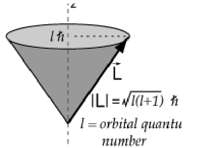
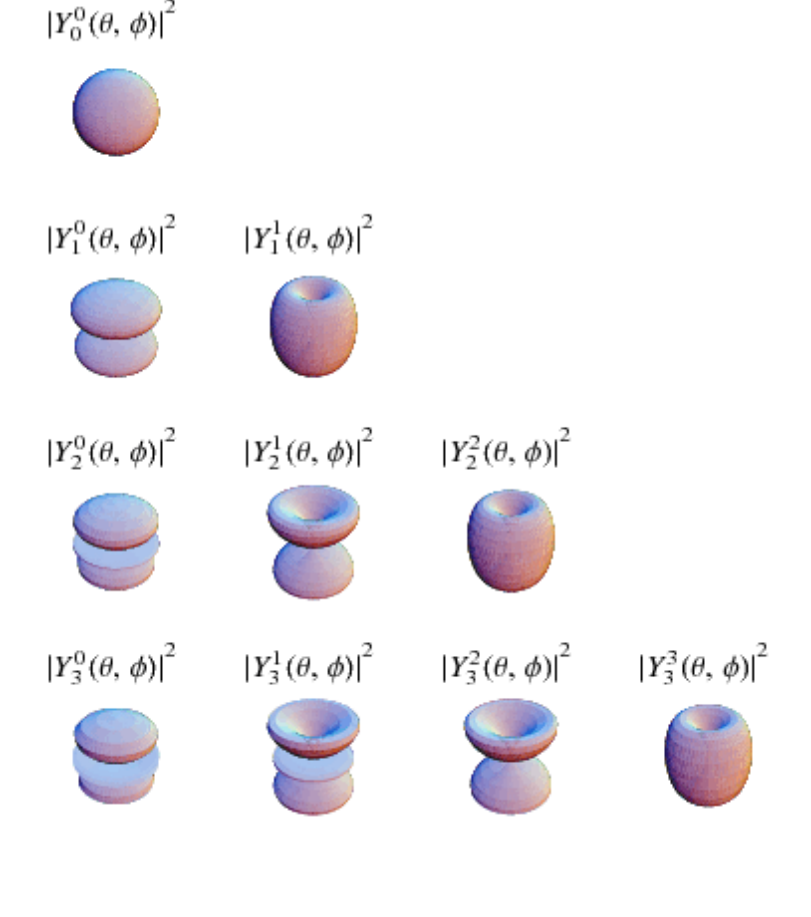
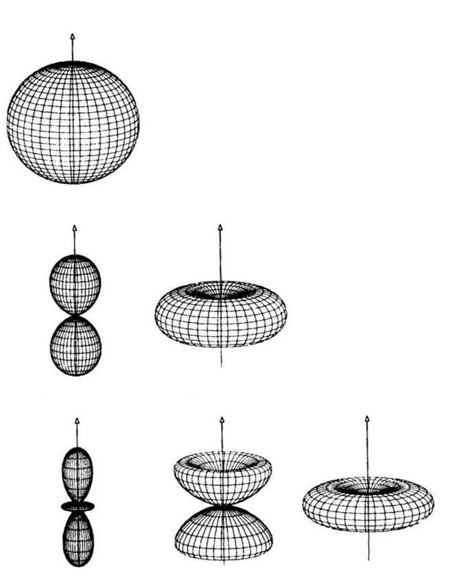
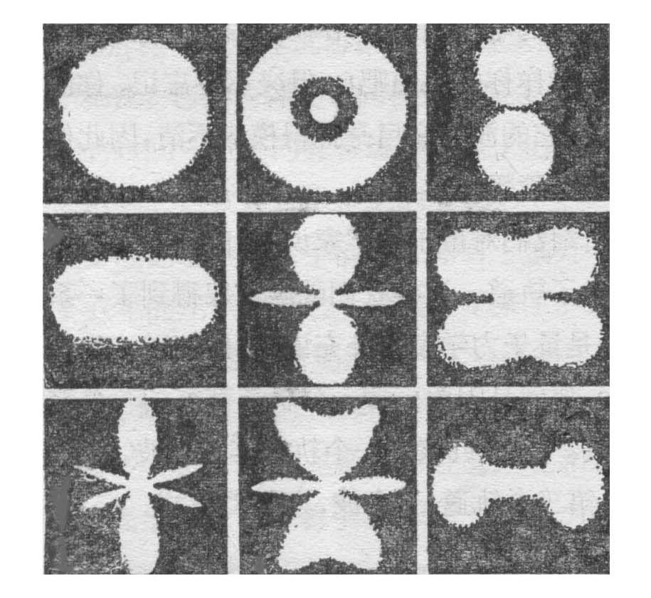
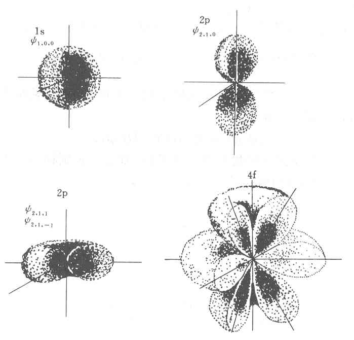
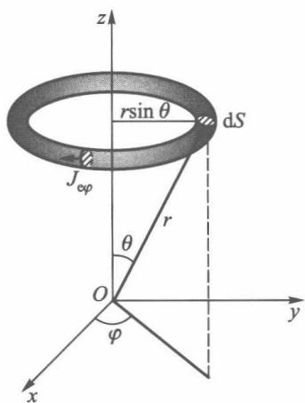
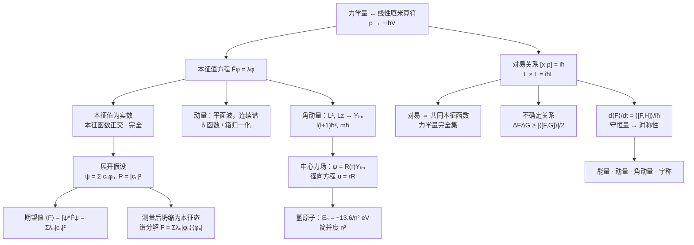

# 第 3 章 量子力学中的力学量

!!! note "本章学习范围"

    3.1–3.7（算符、动量与角动量、氢原子、厄米算符与测量、对易关系、不确定关系）是重点。3.8 期望值随时间的变化是延伸，可以跳过。

!!! tip "本章目标"

    1. 掌握“力学量用线性厄米算符表示”这一基本假设，会写出坐标、动量、角动量、哈密顿量等算符。
    2. 会求动量算符、角动量算符 $\hat L_z$、$\hat L^2$ 的本征值和本征函数，记住球谐函数 $Y_{lm}$ 的性质。
    3. 掌握氢原子的求解思路和结果：能级 $E_n$、简并度 $n^2$、径向函数 $R_{nl}$、概率分布。
    4. 掌握厄米算符的性质：本征值为实数，本征函数正交、完全。
    5. 会把波函数按力学量的本征函数展开，求测量值的概率分布和期望值。
    6. 掌握对易关系与“同时有确定值”的条件，会推导和使用不确定关系。
    7. （延伸）会用 $\dfrac{\dd\langle F\rangle}{\dd t}=\dfrac{1}{\ii\hbar}\langle[\hat F,\hat H]\rangle+\left\langle\dfrac{\partial\hat F}{\partial t}\right\rangle$ 判断守恒量。选学。

**本章在全书中的位置。** [第 2 章](ch2.md)只回答了“粒子在哪里”（$\lvert\psi\rvert^2$）。本章回答“测量动量、角动量、能量会得到什么”。答案的数学结构是线性代数：**力学量 = 厄米算符（矩阵），测量值 = 本征值，测量概率 = 态矢量在本征矢上的投影的模方**。本章是全书最核心的一章，[第 4 章](ch4.md)的表象理论、[第 5 章](ch5.md)的微扰论、[第 7 章](ch7.md)的自旋都建立在它之上。

!!! info "本章的线性代数对照表"

    | 线性代数（有限维） | 量子力学 | 本章位置 |
    |---|---|---|
    | 厄米矩阵 $A=A^\dagger$ | 厄米算符 $\hat F^\dagger=\hat F$ | 3.1 |
    | 厄米矩阵的特征值是实数 | 测量值是实数 | 3.1 |
    | 不同特征值的特征向量正交 | 本征函数正交 | 3.4 |
    | 特征向量组成一组基 | 本征函数系完全 | 3.4 |
    | 向量按基展开 $\vv v=\sum c_n\vv e_n$ | $\psi=\sum c_n\phi_n$，$P(\lambda_n)=\lvert c_n\rvert^2$ | 3.5 |
    | 两矩阵可同时对角化 $\Leftrightarrow$ 对易 | 两力学量可同时确定 $\Leftrightarrow$ 对易 | 3.6 |

---

## 3.1 表示力学量的算符

### 3.1.1 从期望值看出算符

处于 $\psi(\vv r)$ 的粒子，坐标的**期望值**（平均值）按统计解释是

$$\langle x\rangle=\bar x=\int\psi^*(\vv r)\,x\,\psi(\vv r)\,\dd\tau .$$

动量的期望值要用动量分布 $c(\vv p)$ 计算：$\langle\vv p\rangle=\int c^*(\vv p)\,\vv p\,c(\vv p)\,\dd^3p$。把 $c(\vv p)=\dfrac{1}{(2\pi\hbar)^{3/2}}\int\psi\,\ee^{-\ii\vv p\cdot\vv r/\hbar}\dd\tau$ 代入，利用 $\vv p\,\ee^{\ii\vv p\cdot\vv r/\hbar}=-\ii\hbar\nabla\ee^{\ii\vv p\cdot\vv r/\hbar}$ 并分部积分，得到

$$\langle\vv p\rangle=\int\psi^*(\vv r)\left(-\ii\hbar\nabla\right)\psi(\vv r)\,\dd\tau .$$

不必先求 $c(\vv p)$，只要把 $\vv p$ 换成**算符** $\hat{\vv p}=-\ii\hbar\nabla$，夹在 $\psi^*$ 和 $\psi$ 之间积分即可。推广到一般力学量：

!!! theorem "基本假设 3.1（力学量的算符表示）"

    量子力学中的力学量用**线性厄米算符**表示。经典力学量 $F(\vv r,\vv p)$ 对应的算符由**替换** $\vv p\to\hat{\vv p}=-\ii\hbar\nabla$ 得到：$\hat F=F(\vv r,-\ii\hbar\nabla)$。在归一化态 $\psi$ 中力学量的期望值为

    $$\langle F\rangle=\int\psi^*\hat F\psi\,\dd\tau\equiv\mel{\psi}{\hat F}{\psi}.$$

!!! info "狄拉克记号：本书与教材记号对照"

    教材用积分写内积，本书同时给出狄拉克（Dirac）记号，二者完全等价，[第 4 章](ch4.md)会系统讲解：

    | 教材写法 | 狄拉克记号 | 含义 |
    |---|---|---|
    | $\psi(\vv r)$ | $\ket\psi$（右矢），$\psi(\vv r)=\ip{\vv r}{\psi}$ | 态矢量 |
    | $(\phi,\psi)=\int\phi^*\psi\,\dd\tau$ | $\ip{\phi}{\psi}$ | 内积（投影） |
    | $\int\phi^*\hat F\psi\,\dd\tau$ | $\mel{\phi}{\hat F}{\psi}$ | 矩阵元 |
    | $\overline F=\int\psi^*\hat F\psi\,\dd\tau$ | $\expval{\hat F}=\mel{\psi}{\hat F}{\psi}$ | 期望值 |
    | $\int\psi^*\hat F\phi\,\dd\tau=\int(\hat F\psi)^*\phi\,\dd\tau$ | $\mel{\psi}{\hat F}{\phi}=\mel{\phi}{\hat F}{\psi}^*$ | 厄米性 |

    把 $\ket\psi$ 想成一个（无穷维的）列向量，$\bra\phi$ 是它的共轭转置（行向量），$\hat F$ 是矩阵，所有公式就和线性代数一模一样。教材中的期望值记号 $\overline F$ 与 $\langle F\rangle$ 含义相同。

常用算符：

| 力学量 | 经典表达式 | 算符（坐标表象） |
|---|---|---|
| 坐标 | $\vv r$ | $\hat{\vv r}=\vv r$ |
| 动量 | $\vv p$ | $\hat{\vv p}=-\ii\hbar\nabla$ |
| 动能 | $p^2/2m$ | $\hat T=-\dfrac{\hbar^2}{2m}\nabla^2$ |
| 能量（哈密顿量） | $p^2/2m+U$ | $\hat H=-\dfrac{\hbar^2}{2m}\nabla^2+U(\vv r)$ |
| 角动量 | $\vv L=\vv r\times\vv p$ | $\hat{\vv L}=-\ii\hbar\,\vv r\times\nabla$ |

!!! warning "替换规则的限制"

    当经典表达式中出现 $xp_x$ 这样的乘积时，因为 $\hat x\hat p_x\neq\hat p_x\hat x$，替换结果不唯一，而且 $\hat x\hat p_x$ 不是厄米的。通常取对称化形式 $\tfrac12(\hat x\hat p_x+\hat p_x\hat x)$。没有经典对应的力学量（如自旋，第 7 章）则不能用替换规则得到。

### 3.1.2 算符的基本运算

!!! definition "定义 3.1（线性算符、对易子、厄米算符）"

    1. **线性算符**：$\hat F(c_1\psi_1+c_2\psi_2)=c_1\hat F\psi_1+c_2\hat F\psi_2$。量子力学的算符都是线性的（与态叠加原理相容）。
    2. **算符之积**：$(\hat A\hat B)\psi=\hat A(\hat B\psi)$。一般 $\hat A\hat B\neq\hat B\hat A$，定义**对易子** $[\hat A,\hat B]=\hat A\hat B-\hat B\hat A$。若 $[\hat A,\hat B]=0$，称 $\hat A,\hat B$ 对易。
    3. **厄米共轭**：$\hat F^\dagger$ 定义为对任意 $\psi,\phi$ 有 $\displaystyle\int\psi^*\hat F^\dagger\phi\,\dd\tau=\int(\hat F\psi)^*\phi\,\dd\tau$。
    4. **厄米算符**：$\hat F^\dagger=\hat F$，即
        $$\int\psi^*\hat F\phi\,\dd\tau=\int(\hat F\psi)^*\phi\,\dd\tau\qquad\text{对一切}\ \psi,\phi.$$

教材 3.1 节系统列出了算符的运算规则，汇总如下（$u$ 为任意函数，内积 $(u,v)=\int u^*v\,\dd\tau=\ip uv$）：

| 运算 | 定义 | 要点 |
|---|---|---|
| 相等 | $\hat Fu=\hat Gu$ 对一切 $u$ 成立 $\Rightarrow\hat F=\hat G$ | 必须对**任意**函数成立 |
| 单位算符 | $\hat Iu=u$ | 对应单位矩阵 |
| 和 | $(\hat F+\hat G)u=\hat Fu+\hat Gu$ | 满足交换律、结合律 |
| 积 | $(\hat F\hat G)u=\hat F(\hat Gu)$ | 一般 $\hat F\hat G\neq\hat G\hat F$，从右往左依次作用 |
| 逆 | $\hat Fu=v$ 唯一确定 $u$ 时，$\hat F^{-1}v=u$ | $(\hat F\hat G)^{-1}=\hat G^{-1}\hat F^{-1}$ |
| 复共轭 $\hat F^*$ | 把 $\hat F$ 表达式中的复数换成共轭 | $\hat p_x^*=-\hat p_x$ |
| 转置 $\widetilde F$ | $(u,\widetilde Fv)=(v^*,\hat Fu^*)$ | $\widetilde{\partial_x}=-\partial_x$，$\widetilde{\hat F\hat G}=\widetilde G\,\widetilde F$ |
| 厄米共轭 $\hat F^\dagger$ | $(u,\hat F^\dagger v)=(\hat Fu,v)$ | $\hat F^\dagger=\widetilde F^{\,*}$，$(\hat F\hat G)^\dagger=\hat G^\dagger\hat F^\dagger$ |

矩阵对照：转置 $\leftrightarrow A^{\mathrm T}$，复共轭 $\leftrightarrow A^*$，厄米共轭 $\leftrightarrow A^\dagger=(A^{\mathrm T})^*$。

!!! example "例题 3.1"

    证明 (1) $\hat p_x=-\ii\hbar\dfrac{\partial}{\partial x}$ 是厄米算符；(2) $\dfrac{\partial}{\partial x}$ 不是厄米算符；(3) $[\hat x,\hat p_x]=\ii\hbar$。

    **解。** (1) 分部积分，边界项因 $\psi,\phi\to0$（$x\to\pm\infty$）而消失：

    $$\int\psi^*\left(-\ii\hbar\frac{\partial\phi}{\partial x}\right)\dd x=\ii\hbar\int\frac{\partial\psi^*}{\partial x}\phi\,\dd x=\int\left(-\ii\hbar\frac{\partial\psi}{\partial x}\right)^*\phi\,\dd x .$$

    (2) 同样的计算给出 $\int\psi^*\partial_x\phi=-\int(\partial_x\psi)^*\phi$，多一个负号，所以 $\partial_x$ 是**反厄米**的。正是因子 $-\ii$ 使 $\hat p_x$ 成为厄米算符。

    (3) 作用在任意 $\psi$ 上：$[\hat x,\hat p_x]\psi=x(-\ii\hbar\psi')-(-\ii\hbar)(x\psi)'=\ii\hbar\psi$。

!!! example "例题 3.2"

    设 $\hat A,\hat B$ 都是厄米算符。证明：(1) $\hat A\hat B$ 厄米 $\iff[\hat A,\hat B]=0$；(2) $\ii[\hat A,\hat B]$ 和 $\tfrac12(\hat A\hat B+\hat B\hat A)$ 总是厄米的。由此说明经典量 $xp_x$ 应该对应哪个算符。

    **解。** (1) $(\hat A\hat B)^\dagger=\hat B^\dagger\hat A^\dagger=\hat B\hat A$，它等于 $\hat A\hat B$ 当且仅当二者对易。

    (2) $\big(\ii[\hat A,\hat B]\big)^\dagger=-\ii(\hat B\hat A-\hat A\hat B)=\ii[\hat A,\hat B]$；$\big(\hat A\hat B+\hat B\hat A\big)^\dagger=\hat B\hat A+\hat A\hat B$。

    $\hat x,\hat p_x$ 都厄米但不对易，所以 $\hat x\hat p_x$ 不厄米：$(\hat x\hat p_x)^\dagger=\hat p_x\hat x=\hat x\hat p_x-\ii\hbar$。物理上应取对称化的 $\tfrac12(\hat x\hat p_x+\hat p_x\hat x)$。结论 (2) 在 3.7 节证明不确定关系时还会用到：$[\hat F,\hat G]=\ii\hat k$ 中的 $\hat k$ 一定是厄米的。

!!! theorem "定理 3.1（厄米算符的本征值是实数）"

    若 $\hat F$ 厄米，$\hat F\psi=\lambda\psi$，则 $\lambda$ 是实数。厄米算符在任何态中的期望值也是实数。

    *证明：* 由厄米性 $\int\psi^*\hat F\psi\,\dd\tau=\int(\hat F\psi)^*\psi\,\dd\tau$，即 $\lambda\int\lvert\psi\rvert^2=\lambda^*\int\lvert\psi\rvert^2$，所以 $\lambda=\lambda^*$。

测量值必须是实数，这就是要求力学量算符厄米的原因。

!!! definition "定义 3.2（本征值方程）"

    $\hat F\psi=\lambda\psi$ 叫算符 $\hat F$ 的**本征值方程**，$\lambda$ 叫本征值，$\psi$ 叫属于 $\lambda$ 的本征函数。若属于同一本征值有 $f$ 个线性无关的本征函数，称该本征值 **$f$ 度简并**。

    **基本假设 3.2：** 当体系处于 $\hat F$ 的本征态 $\psi$ 时，测量力学量 $F$ **一定**得到本征值 $\lambda$。一般地，测量 $F$ 的可能值就是 $\hat F$ 的全部本征值（3.5 节）。

---

## 3.2 动量算符和角动量算符

### 3.2.1 动量算符

本征值方程 $-\ii\hbar\nabla\psi_{\vv p}=\vv p\,\psi_{\vv p}$ 的解是平面波

$$\psi_{\vv p}(\vv r)=C\,\ee^{\ii\vv p\cdot\vv r/\hbar}.$$

$\vv p$ 可取任意实数矢量（取复数时 $\psi$ 在无穷远发散），**本征值组成连续谱**。$\lvert\psi_{\vv p}\rvert^2=\lvert C\rvert^2$ 处处相同，不能按 $\int\lvert\psi\rvert^2=1$ 归一化，有两种处理办法：

**（1）$\delta$ 函数归一化。** 取 $C=(2\pi\hbar)^{-3/2}$，则

$$\int\psi_{\vv p'}^*(\vv r)\psi_{\vv p}(\vv r)\,\dd\tau=\delta(\vv p-\vv p'),$$

其中用到 $\displaystyle\frac{1}{2\pi}\int_{-\infty}^{\infty}\ee^{\ii kx}\dd x=\delta(k)$。$\delta$ 函数是“连续指标的克罗内克 $\delta_{mn}$”。

**（2）箱归一化。** 把粒子限制在边长 $L$ 的立方体内，加**周期性边界条件** $\psi(x+L)=\psi(x)$ 等，则 $p_xL/\hbar=2\pi n_x$，

$$p_x=\frac{2\pi\hbar n_x}{L},\quad n_x=0,\pm1,\pm2,\dots;\qquad \psi_{\vv p}=\frac{1}{L^{3/2}}\ee^{\ii\vv p\cdot\vv r/\hbar}.$$

动量变成分立的，可以正常归一化。$L\to\infty$ 时相邻 $p$ 值的间隔 $2\pi\hbar/L\to0$，回到连续谱。固体物理中计算电子态密度用的就是这种方法。

### 3.2.2 角动量算符

$\hat{\vv L}=\hat{\vv r}\times\hat{\vv p}$ 的分量为

$$\hat L_x=y\hat p_z-z\hat p_y,\qquad \hat L_y=z\hat p_x-x\hat p_z,\qquad \hat L_z=x\hat p_y-y\hat p_x,\qquad \hat L^2=\hat L_x^2+\hat L_y^2+\hat L_z^2 .$$

（这里各项中的坐标和动量分量不同，彼此对易，所以没有排序问题。）

<figure markdown>
{ width="220" }
<figcaption>图 3-1　球坐标 $(r,\theta,\varphi)$（图源：教材）</figcaption>
</figure>

角动量问题在球坐标中最简单。变换后（推导见教材附录）：

$$\hat L_z=-\ii\hbar\frac{\partial}{\partial\varphi},\qquad \hat L^2=-\hbar^2\left[\frac{1}{\sin\theta}\frac{\partial}{\partial\theta}\left(\sin\theta\frac{\partial}{\partial\theta}\right)+\frac{1}{\sin^2\theta}\frac{\partial^2}{\partial\varphi^2}\right].$$

$\hat L^2$ 只含角度，正是拉普拉斯算符的角度部分：$\nabla^2=\dfrac{1}{r^2}\dfrac{\partial}{\partial r}\left(r^2\dfrac{\partial}{\partial r}\right)-\dfrac{\hat L^2}{\hbar^2r^2}$。

**$\hat L_z$ 的本征值问题。** $-\ii\hbar\Phi'(\varphi)=L_z\Phi$ 的解是 $\Phi=C\,\ee^{\ii L_z\varphi/\hbar}$。波函数单值要求 $\Phi(\varphi+2\pi)=\Phi(\varphi)$，所以 $L_z=m\hbar$：

$$\Phi_m(\varphi)=\frac{1}{\sqrt{2\pi}}\ee^{\ii m\varphi},\qquad L_z=m\hbar,\qquad m=0,\pm1,\pm2,\dots$$

又一次，量子化来自边界条件（这里是周期性）。

**$\hat L^2$ 的本征值问题。** $\hat L^2Y=\lambda\hbar^2Y$ 分离变量后，$\theta$ 部分是连带勒让德方程。要求解在 $\theta=0,\pi$ 处有限，得 $\lambda=l(l+1)$，$l=0,1,2,\dots$，且 $\lvert m\rvert\leqslant l$。

!!! theorem "定理 3.2（$\hat L^2$ 与 $\hat L_z$ 的共同本征函数：球谐函数）"

    $$\hat L^2Y_{lm}=l(l+1)\hbar^2Y_{lm},\qquad \hat L_zY_{lm}=m\hbar Y_{lm},$$

    $$Y_{lm}(\theta,\varphi)=(-1)^mN_{lm}P_l^m(\cos\theta)\,\ee^{\ii m\varphi}\ (m\geqslant0),\qquad Y_{l,-m}=(-1)^mY_{lm}^*,\qquad N_{lm}=\sqrt{\frac{(l-m)!\,(2l+1)}{(l+m)!\,4\pi}},$$

    $l=0,1,2,\dots$（**角量子数**），$m=0,\pm1,\dots,\pm l$（**磁量子数**）。正交归一：$\displaystyle\int_0^{\pi}\!\!\int_0^{2\pi}Y_{lm}^*Y_{l'm'}\sin\theta\,\dd\theta\,\dd\varphi=\delta_{ll'}\delta_{mm'}$。

    $\hat L^2$ 的本征值 $l(l+1)\hbar^2$ 是 $(2l+1)$ 度简并的。

前几个球谐函数：

$$Y_{00}=\frac{1}{\sqrt{4\pi}};\qquad Y_{10}=\sqrt{\frac{3}{4\pi}}\cos\theta,\quad Y_{1,\pm1}=\mp\sqrt{\frac{3}{8\pi}}\sin\theta\,\ee^{\pm\ii\varphi};$$

$$Y_{20}=\sqrt{\frac{5}{16\pi}}(3\cos^2\theta-1),\quad Y_{2,\pm1}=\mp\sqrt{\frac{15}{8\pi}}\sin\theta\cos\theta\,\ee^{\pm\ii\varphi},\quad Y_{2,\pm2}=\sqrt{\frac{15}{32\pi}}\sin^2\theta\,\ee^{\pm2\ii\varphi}.$$

$l=0,1,2,3,\dots$ 的态依次叫 s, p, d, f, … 态。宇称：$Y_{lm}(\pi-\theta,\varphi+\pi)=(-1)^lY_{lm}(\theta,\varphi)$。

<figure class="video" markdown>
<video controls preload="metadata" width="100%" poster="assets/posters/C3_SphericalHarmonics.jpg"><source src="assets/videos/C3_SphericalHarmonics.mp4" type="video/mp4"></video>
<figcaption>动画 3-1　球谐函数的角分布 $\lvert Y_{lm}\rvert^2$（$l=0,1,2$）：与 $\varphi$ 无关，都是绕 $z$ 轴的旋转体；把 $\pm m$ 叠加成实函数就得到 $p_x$、$d_{z^2}$、$d_{xy}$ 等“轨道”形状。</figcaption>
</figure>

!!! example "例题 3.3【HUST 870 2014、2015、2017】"

    证明 $\psi=(x+\ii y)f(r)$ 是 $\hat L_z$ 和 $\hat L^2$ 的共同本征函数，并求本征值（$f$ 为 $r$ 的任意函数）。

    **解法一（直角坐标）。** $\hat L_z=-\ii\hbar\left(x\dfrac{\partial}{\partial y}-y\dfrac{\partial}{\partial x}\right)$。由于 $\hat L_z$ 只含角度导数，$\hat L_zf(r)=0$，所以

    $$\hat L_z\psi=f(r)\,(-\ii\hbar)(x\cdot\ii-y\cdot1)=\hbar(x+\ii y)f(r)=\hbar\,\psi .$$

    **解法二（球坐标，更快）。** $x+\ii y=r\sin\theta\,\ee^{\ii\varphi}=-\sqrt{\tfrac{8\pi}{3}}\,rY_{11}$，于是 $\psi=-\sqrt{\tfrac{8\pi}{3}}\,rf(r)\,Y_{11}$，立即得

    $$\hat L_z\psi=\hbar\,\psi,\qquad\hat L^2\psi=2\hbar^2\psi\quad(l=1,\ m=1).$$

    **规律：** 把 $x\pm\ii y\propto r\sin\theta\,\ee^{\pm\ii\varphi}$、$z=r\cos\theta$ 换成 $Y_{1,\pm1}$、$Y_{10}$，是判断“谁是角动量本征函数”的标准手法。

<figure class="video" markdown>
<video controls preload="metadata" width="100%" poster="assets/posters/C3_AngularMomentum.jpg"><source src="assets/videos/C3_AngularMomentum.mp4" type="video/mp4"></video>
<figcaption>动画 3-2　$l=2$ 的角动量矢量模型：$\lvert\vv L\rvert=\sqrt6\hbar$，$L_z$ 只能取 $-2\hbar,\dots,2\hbar$ 五个值，$\vv L$ 永远不会完全沿 $z$ 轴。</figcaption>
</figure>

!!! info "直觉：为什么 $\lvert\vv L\rvert$ 是 $\sqrt{l(l+1)}\hbar$ 而不是 $l\hbar$"

    如果 $\lvert\vv L\rvert=l\hbar$，在 $m=l$ 的态中 $\vv L$ 就恰好沿 $z$ 轴，$L_x=L_y=0$ 三个分量同时确定。但 3.6 节会看到 $\hat L_x,\hat L_y,\hat L_z$ 互不对易，不能同时确定。多出来的 $l(l+1)-l^2=l$ 正好是 $\langle L_x^2+L_y^2\rangle/\hbar^2$ 的最小值。

    <figure markdown>
    { width="230" }
    <figcaption>图 3-2　角动量矢量模型：$\vv L$ 长 $\sqrt{l(l+1)}\,\hbar$，在 $z$ 轴上的投影最大只有 $l\hbar$（$m=l$），只能落在圆锥面上（图源：季燕江《量子力学》讲义 QMUSTB 图 5.5）</figcaption>
    </figure>

    在 $Y_{lm}$ 中，$\vv L$ 的 $z$ 分量确定为 $m\hbar$，横向分量“均匀分布在锥口圆周上”：

    $$\langle L_x\rangle=\langle L_y\rangle=0,\qquad\langle L_x^2\rangle=\langle L_y^2\rangle=\tfrac12\big[l(l+1)-m^2\big]\hbar^2\ (>0),$$

    证明见练习 8。

!!! tip "解题模板：先把算符写成 $\hat L^2$、$\hat L_z$ 的函数，再读出本征值"

    若 $\hat H=f(\hat L^2,\hat L_z)$（只含 $\hat L^2$、$\hat L_z$ 及常数），则 $Y_{lm}$ 自动是它的本征函数：

    $$\hat HY_{lm}=f\big(l(l+1)\hbar^2,\ m\hbar\big)\,Y_{lm}.$$

    这就是线性代数中的“谱映射”：若 $A\vv v=\lambda\vv v$，则 $f(A)\vv v=f(\lambda)\vv v$。关键一步是**改写**：用 $\hat L_x^2+\hat L_y^2=\hat L^2-\hat L_z^2$ 消去 $\hat L_x$、$\hat L_y$；中心力场的 $\hat H$ 中角度部分写成 $\hat L^2/2mr^2$ 也是同一个思路（3.3 节）。

!!! example "例题 3.4【HUST 870 2001、2013】"

    对称陀螺（转子）的哈密顿量为 $\hat H=\dfrac{1}{2I_1}(\hat L_x^2+\hat L_y^2)+\dfrac{1}{2I_2}\hat L_z^2$，求能量本征值和本征函数。

    **解。** 按模板改写：

    $$\hat H=\frac{\hat L^2}{2I_1}+\left(\frac{1}{2I_2}-\frac{1}{2I_1}\right)\hat L_z^2 .$$

    $\hat H$ 是 $\hat L^2$、$\hat L_z$ 的函数，本征函数为 $Y_{lm}$，本征值

    $$E_{lm}=\frac{l(l+1)\hbar^2}{2I_1}+\left(\frac{1}{2I_2}-\frac{1}{2I_1}\right)m^2\hbar^2,\qquad l=0,1,2,\dots;\ m=0,\pm1,\dots,\pm l .$$

    $E$ 只依赖 $m^2$，所以 $m\neq0$ 时 $\pm m$ 二重简并。$I_1=I_2=I$ 时退化为球形转子 $E_l=\dfrac{l(l+1)\hbar^2}{2I}$，简并度升为 $2l+1$（练习 3）。对称性越高，简并越大。

!!! warning "易错点（3.2 节）"

    - 动量本征函数 $\ee^{\ii\vv p\cdot\vv r/\hbar}$ **不能**按 $\int\lvert\psi\rvert^2\dd\tau=1$ 归一化，只能 $\delta$ 函数归一化或箱归一化；箱归一化时 $p_x=2\pi\hbar n_x/L$，$n_x$ 可取负整数和零。
    - $L_z=m\hbar$ 中 $m$ 是**整数**，来自波函数单值条件 $\Phi(\varphi+2\pi)=\Phi(\varphi)$；磁量子数 $m$ 与质量 $m$ 符号相同，计算时注意区分。
    - $Y_{lm}$ 的归一化积分要带上 $\sin\theta$：$\dd\Omega=\sin\theta\,\dd\theta\,\dd\varphi$。

---

## 3.3 氢原子

### 3.3.1 中心力场与径向方程

电子在核的库仑场 $U(r)=-\dfrac{Ze^2}{4\pi\varepsilon_0r}$ 中运动（氢原子 $Z=1$）。核与电子的两体问题可以分离出质心运动，剩下相对运动，相当于一个质量为**约化质量** $\mu=\dfrac{m_em_N}{m_e+m_N}\approx m_e$ 的粒子在 $U(r)$ 中运动。下面直接把 $\mu$ 记作 $m$。

**分离变量。** 对任意中心力场 $U(r)$，由 $\nabla^2$ 的球坐标形式，

$$\hat H=-\frac{\hbar^2}{2m}\frac{1}{r^2}\frac{\partial}{\partial r}\left(r^2\frac{\partial}{\partial r}\right)+\frac{\hat L^2}{2mr^2}+U(r).$$

$\hat H$ 的角度部分只有 $\hat L^2$，所以 $\hat H,\hat L^2,\hat L_z$ 两两对易，可取共同本征函数 $\psi=R(r)Y_{lm}(\theta,\varphi)$。代入并令 $u(r)=rR(r)$：

$$-\frac{\hbar^2}{2m}u''+\left[U(r)+\frac{l(l+1)\hbar^2}{2mr^2}\right]u=Eu,\qquad u(0)=0 .$$

这是一个**一维问题**，粒子在“有效势” $U_{\mathrm{eff}}=U+\dfrac{l(l+1)\hbar^2}{2mr^2}$ 中运动，第二项是**离心势垒**。所有中心力场问题（氢原子、三维谐振子、球形势阱、第 6 章分波法）都归结为这个径向方程。

### 3.3.2 氢原子的能级和波函数

对库仑势，径向方程的求解方法和谐振子类似：先找渐近行为（$r\to\infty$ 时 $u\sim\ee^{-\beta r}$，$\beta=\sqrt{-2mE}/\hbar$；$r\to0$ 时 $u\sim r^{l+1}$），剥离后得到合流超几何方程，要求级数中断以保证束缚态有限，得到量子化条件。

!!! theorem "定理 3.3（氢原子及类氢离子的能级）"

    $$E_n=-\frac{m}{2\hbar^2}\left(\frac{Ze^2}{4\pi\varepsilon_0}\right)^2\frac{1}{n^2}=-\frac{Z^2e^2}{8\pi\varepsilon_0a_0}\frac{1}{n^2}=-\frac{13.6\ \mathrm{eV}\cdot Z^2}{n^2},\qquad a_0=\frac{4\pi\varepsilon_0\hbar^2}{me^2}=0.0529\ \mathrm{nm},$$

    **主量子数** $n=n_r+l+1=1,2,3,\dots$，$n_r=0,1,2,\dots$ 是径向量子数（$R_{nl}$ 的节点数）。对给定 $n$，$l=0,1,\dots,n-1$；对给定 $l$，$m=-l,\dots,l$。

    波函数 $\psi_{nlm}(r,\theta,\varphi)=R_{nl}(r)Y_{lm}(\theta,\varphi)$。能级 $E_n$ 的**简并度**为

    $$\sum_{l=0}^{n-1}(2l+1)=n^2 .$$

能级公式与玻尔理论完全相同，但现在是从薛定谔方程严格推出的，而且多了玻尔理论没有的信息：每个能级有 $n^2$ 个不同的态。

$n\to\infty$ 时 $E_\infty=0$，电子脱离原子核，所以**电离能** $-E_1=13.6\ \mathrm{eV}$。电子从 $E_n$ 跃迁到 $E_{n'}$（$n>n'$）辐射的光频率为

$$\nu=\frac{E_n-E_{n'}}{h}=R_\infty c\left(\frac{1}{n'^2}-\frac{1}{n^2}\right),\qquad R_\infty=\frac{-E_1}{hc}=1.097\,373\,156\,8\times10^{7}\ \mathrm{m^{-1}},$$

这就是第 1 章的**巴耳末公式**，$R_\infty$ 是里德伯常量（下标 $\infty$ 表示把核质量看成无穷大）。例如 $n=3\to2$：$1/\lambda=R_\infty\cdot\tfrac{5}{36}$，$\lambda\approx656\ \mathrm{nm}$，即红色的 $\mathrm H_\alpha$ 线。理论值与光谱实验高度吻合，是量子力学最早的决定性检验之一。

前几个径向函数（$Z=1$；类氢离子把 $a_0$ 换成 $a_0/Z$）：

$$R_{10}=\frac{2}{a_0^{3/2}}\ee^{-r/a_0},\qquad R_{20}=\frac{1}{\sqrt2\,a_0^{3/2}}\left(1-\frac{r}{2a_0}\right)\ee^{-r/2a_0},\qquad R_{21}=\frac{1}{2\sqrt6\,a_0^{3/2}}\frac{r}{a_0}\ee^{-r/2a_0},$$

$$R_{30}=\frac{2}{3\sqrt3\,a_0^{3/2}}\left(1-\frac{2r}{3a_0}+\frac{2r^2}{27a_0^2}\right)\ee^{-r/3a_0},\quad R_{31}=\frac{8}{27\sqrt6\,a_0^{3/2}}\frac{r}{a_0}\left(1-\frac{r}{6a_0}\right)\ee^{-r/3a_0},\quad R_{32}=\frac{4}{81\sqrt{30}\,a_0^{3/2}}\frac{r^2}{a_0^2}\ee^{-r/3a_0}.$$

归一化：$\displaystyle\int_0^\infty R_{nl}^2r^2\dd r=1$。

!!! info "简并的来源：两种对称性"

    - **$m$ 简并**（$2l+1$ 重）：任何中心力场都有，来自空间各向同性（$z$ 轴可以随便选）。
    - **$l$ 简并**（同一 $n$ 下不同 $l$ 能量相同）：库仑势 $1/r$ 特有的“偶然简并”，来自一个隐藏的守恒量（龙格–楞次矢量）。碱金属原子中价电子感受到的不是纯库仑势，$l$ 简并就被解除了；第 7 章的精细结构会进一步解除它。

### 3.3.3 电子的概率分布

**径向分布。** 在半径 $r\sim r+\dd r$ 的球壳内找到电子的概率

$$W_{nl}(r)\,\dd r=R_{nl}^2(r)\,r^2\,\dd r .$$

<figure class="video" markdown>
<video controls preload="metadata" width="100%" poster="assets/posters/C3_HydrogenRadial.jpg"><source src="assets/videos/C3_HydrogenRadial.mp4" type="video/mp4"></video>
<figcaption>动画 3-3　氢原子径向概率密度 $W_{nl}=r^2R_{nl}^2$：节点数 $n-l-1$；$l=n-1$ 时只有一个峰，位于 $r=n^2a_0$。</figcaption>
</figure>

<figure markdown>
{ width="300" }
<figcaption>图 3-3　$n=2$ 的径向概率分布（图源：教材）</figcaption>
</figure>
<figure markdown>
{ width="300" }
<figcaption>图 3-4　$n=3$ 的径向概率分布（图源：教材）</figcaption>
</figure>

**角向分布。** 在方向 $(\theta,\varphi)$ 的立体角 $\dd\Omega$ 内找到电子的概率是 $\lvert Y_{lm}\rvert^2\dd\Omega$。由于 $\lvert\ee^{\ii m\varphi}\rvert=1$，**角分布绕 $z$ 轴旋转对称**，只依赖 $\theta$。

<figure markdown>
{ width="380" }
<figcaption>图 3-5　$\lvert Y_{lm}\rvert^2$ 的角向分布（图源：教材）</figcaption>
</figure>

<figure markdown>
{ width="300" }
<figcaption>图 3-6　$\lvert Y_{lm}\rvert^2$ 的立体图（$l=0\sim3$，$m\geqslant0$）：都绕 $z$ 轴旋转对称（图源：季燕江《量子力学》讲义 QMUSTB 图 5.4）</figcaption>
</figure>
<figure markdown>
{ width="260" }
<figcaption>图 3-7　$\lvert Y_{lm}\rvert^2$ 的极坐标网格图（$l=0,1,2$），从上到下依次为 s、p、d 态（图源：上海交通大学《大学物理》课件）</figcaption>
</figure>

<figure class="video" markdown>
<video controls preload="metadata" width="100%" poster="assets/posters/C3_HydrogenOrbitals.jpg"><source src="assets/videos/C3_HydrogenOrbitals.mp4" type="video/mp4"></video>
<figcaption>动画 3-4　氢原子“电子云” $\lvert\psi_{nlm}\rvert^2$ 在 $xz$ 平面的截面（亮处概率大）。$m\neq0$ 的态在 $z$ 轴上为零，呈“甜甜圈”状。</figcaption>
</figure>

<figure markdown>
{ width="320" }
<figcaption>图 3-8　氢原子不同 $(n,l,m)$ 态的电子云截面照片式图像，可与动画对照（图源：上海交通大学《大学物理》课件）</figcaption>
</figure>
<figure markdown>
{ width="300" }
<figcaption>图 3-9　1s、2p（$m=0$ 与 $m=\pm1$）、4f 态电子云的点密度图（图源：上海交通大学《大学物理》课件）</figcaption>
</figure>

!!! example "例题 3.5"

    求氢原子基态中电子的 (1) 最概然半径；(2) $\langle r\rangle$；(3) 势能和动能的期望值。

    **解。** $\psi_{100}=\dfrac{1}{\sqrt{\pi a_0^3}}\ee^{-r/a_0}$，$W_{10}(r)=\dfrac{4}{a_0^3}r^2\ee^{-2r/a_0}$。

    (1) $\dfrac{\dd W}{\dd r}=0\Rightarrow2r-\dfrac{2r^2}{a_0}=0$，$r=a_0$：最概然半径正是玻尔半径。

    (2) 用 $\displaystyle\int_0^\infty r^n\ee^{-\beta r}\dd r=\frac{n!}{\beta^{n+1}}$：$\langle r\rangle=\dfrac{4}{a_0^3}\cdot\dfrac{3!}{(2/a_0)^4}=\dfrac32a_0$。（平均值大于最概然值，因为分布向大 $r$ 拖尾。）

    (3) $\left\langle\dfrac1r\right\rangle=\dfrac{4}{a_0^3}\cdot\dfrac{1!}{(2/a_0)^2}=\dfrac1{a_0}$，$\langle U\rangle=-\dfrac{e^2}{4\pi\varepsilon_0a_0}=-27.2\ \mathrm{eV}$。

    $\langle T\rangle=E_1-\langle U\rangle=-13.6+27.2=13.6\ \mathrm{eV}$。满足**位力定理** $2\langle T\rangle=-\langle U\rangle$（对 $1/r$ 势普遍成立）。

!!! example "例题 3.6（教材例题：导体平面上方的电子）"

    电子置于接地大导体平面上方，受导体静电吸引。求 (1) 电子能级；(2) 基态电子与平面的平均距离。

    <figure markdown>
    { width="160" }
    </figure>

    **解。** 用**镜像法**（见[电磁场与电磁波 · 第 3 章](https://cockroach-f.github.io/em-fields-waves/ch3.html)），导体平面的作用等效于 $-z$ 处的像电荷 $+e$。电子受吸引力 $f=-\dfrac{e^2}{4\pi\varepsilon_0(2z)^2}$。把电子从无穷远移到 $z$ 处，势能为

    $$U(z)=-\frac{e^2}{16\pi\varepsilon_0z}\quad(z>0);\qquad \psi=0\quad(z\leqslant0).$$

    分离变量 $\psi=X(x)Y(y)Z(z)$，$x,y$ 方向是自由运动，$E_x+E_y=\dfrac{\hbar^2(k_x^2+k_y^2)}{2m}$。$z$ 方向：

    $$-\frac{\hbar^2}{2m}Z''-\frac{e^2}{16\pi\varepsilon_0z}Z=E_zZ,\qquad Z(0)=0 .$$

    这与氢原子 $l=0$ 的径向方程（$u(0)=0$）完全相同，只是 $e^2\to e^2/4$。于是能级缩小为 $1/16$，长度尺度放大为 $a=4a_0$：

    $$E_z^{(n)}=-\frac{m}{32\hbar^2}\left(\frac{e^2}{4\pi\varepsilon_0}\right)^2\frac1{n^2}=-\frac{0.85\ \mathrm{eV}}{n^2},\qquad E=E_z^{(n)}+\frac{\hbar^2(k_x^2+k_y^2)}{2m}.$$

    (2) 基态 $Z_1=\dfrac{2z}{a^{3/2}}\ee^{-z/a}$，$\langle z\rangle=\dfrac{4}{a^3}\displaystyle\int_0^\infty z^3\ee^{-2z/a}\dd z=\dfrac{4}{a^3}\cdot\dfrac{3!}{(2/a)^4}=\dfrac32a=6a_0\approx0.32\ \mathrm{nm}$。

    这类束缚在表面附近的电子态叫**镜像势态**，在液氦表面和金属表面上都已观察到。

!!! example "例题 3.7（教材习题 3.3、3.4：氢原子的电流与磁矩）"

    (1) 证明氢原子处于 $\psi_{nlm}$ 时电子的电流密度只有 $\varphi$ 分量 $J_{e\varphi}=-\dfrac{e\hbar m}{m_er\sin\theta}\lvert\psi_{nlm}\rvert^2$；(2) 求原子磁矩 $M_z$ 与磁旋比 $M_z/L_z$。

    <figure markdown>
    { width="160" }
    </figure>

    **解。** (1) 电流密度 = 电荷 $(-e)$ × 概率流密度（第 2 章）：$\vv J_e=-e\cdot\dfrac{\ii\hbar}{2m_e}(\psi\nabla\psi^*-\psi^*\nabla\psi)$。$\psi_{nlm}=R_{nl}(r)\Theta_{lm}(\theta)\ee^{\ii m\varphi}$ 中 $R,\Theta$ 是实函数，所以 $r$、$\theta$ 方向的导数给出 $\psi\partial\psi^*-\psi^*\partial\psi=0$，$J_{er}=J_{e\theta}=0$。$\varphi$ 方向梯度为 $\dfrac{1}{r\sin\theta}\dfrac{\partial}{\partial\varphi}$：

    $$\psi\frac{\partial\psi^*}{\partial\varphi}-\psi^*\frac{\partial\psi}{\partial\varphi}=-2\ii m\lvert\psi\rvert^2\ \Rightarrow\ J_{e\varphi}=-e\frac{\ii\hbar}{2m_e}\cdot\frac{-2\ii m\lvert\psi\rvert^2}{r\sin\theta}=-\frac{e\hbar m}{m_er\sin\theta}\lvert\psi\rvert^2 .$$

    (2) 电流沿绕 $z$ 轴的圆周流动。截面 $\dd S$ 的细圆环电流 $\dd I=J_{e\varphi}\dd S$，所围面积 $\pi(r\sin\theta)^2$，磁矩 $\dd M_z=\pi r^2\sin^2\theta\,\dd I$（方向见[电磁场与电磁波 · 第 4 章磁偶极子](https://cockroach-f.github.io/em-fields-waves/ch4.html)）。对子午面积分，$\dd\tau=2\pi r\sin\theta\,\dd S$：

    $$M_z=-\frac{e\hbar m}{m_e}\int\pi r\sin\theta\,\lvert\psi\rvert^2\dd S=-\frac{e\hbar m}{2m_e}\int\lvert\psi\rvert^2\dd\tau=-\frac{me\hbar}{2m_e},\qquad\frac{M_z}{L_z}=-\frac{e}{2m_e}.$$

    $\mu_{\mathrm B}=\dfrac{e\hbar}{2m_e}$ 叫**玻尔磁子**。s 态（$m=0$）没有轨道磁矩。第 7 章会看到，自旋磁矩的磁旋比是这个值的 2 倍。

!!! warning "易错点（3.3 节）"

    - 径向概率密度是 $r^2R_{nl}^2$，**不要漏掉 $r^2$**；$\lvert\psi\rvert^2$ 本身在 $r=0$ 处最大（1s 态），而径向概率在 $r=a_0$ 处最大，二者不矛盾。
    - 最概然半径（$a_0$）、平均半径（$\tfrac32a_0$）、$\langle1/r\rangle^{-1}$（$a_0$）是不同的量。
    - 节点数：$R_{nl}$ 的径向节点 $n-l-1$ 个，$Y_{lm}$ 的角向节面 $l$ 个，共 $n-1$ 个。
    - 不同 $(n,l)$ 的 $R_{nl}$ 只有在**相同 $l$** 时才按 $\int R_{nl}R_{n'l}r^2\dd r=\delta_{nn'}$ 正交。

---

## 3.4 厄米算符本征函数的正交性

!!! theorem "定理 3.4（正交性）"

    厄米算符属于**不同本征值**的本征函数相互正交：若 $\hat F\phi_m=\lambda_m\phi_m$，$\hat F\phi_n=\lambda_n\phi_n$，$\lambda_m\neq\lambda_n$，则

    $$\ip{\phi_m}{\phi_n}=\int\phi_m^*\phi_n\,\dd\tau=0 .$$

??? proof "证明"

    由厄米性：$\int\phi_m^*\hat F\phi_n\,\dd\tau=\int(\hat F\phi_m)^*\phi_n\,\dd\tau$，即 $\lambda_n\int\phi_m^*\phi_n=\lambda_m^*\int\phi_m^*\phi_n=\lambda_m\int\phi_m^*\phi_n$（$\lambda_m$ 为实数）。所以 $(\lambda_n-\lambda_m)\int\phi_m^*\phi_n=0$，而 $\lambda_n\neq\lambda_m$。

归一化后得到**正交归一系**：

$$\int\phi_m^*\phi_n\,\dd\tau=\delta_{mn}\ (\text{分立谱}),\qquad \int\phi_\lambda^*\phi_{\lambda'}\,\dd\tau=\delta(\lambda-\lambda')\ (\text{连续谱}).$$

**简并情形。** 属于同一本征值的 $f$ 个本征函数不一定正交，但它们的任意线性组合仍是该本征值的本征函数，总可以重新组合成 $f$ 个正交的函数。

教材列举的正交归一系（都是厄米算符的本征函数）：

| 本征函数系 | 算符 | 正交归一关系 |
|---|---|---|
| 谐振子 $\psi_n=N_n\ee^{-\alpha^2x^2/2}H_n(\alpha x)$ | $\hat H$ | $\int_{-\infty}^{\infty}\psi_m\psi_n\,\dd x=\delta_{mn}$ |
| 无限深势阱 $\sqrt{2/a}\,\sin\dfrac{n\pi x}{a}$ | $\hat H$ | $\int_0^a\psi_m\psi_n\,\dd x=\delta_{mn}$ |
| $\Phi_m=\dfrac{1}{\sqrt{2\pi}}\ee^{\ii m\varphi}$ | $\hat L_z$ | $\int_0^{2\pi}\Phi_m^*\Phi_{m'}\dd\varphi=\delta_{mm'}$ |
| 球谐函数 $Y_{lm}$ | $\hat L^2,\hat L_z$ | $\int Y_{lm}^*Y_{l'm'}\dd\Omega=\delta_{ll'}\delta_{mm'}$ |
| 氢原子 $\psi_{nlm}=R_{nl}Y_{lm}$ | $\hat H,\hat L^2,\hat L_z$ | $\int\psi_{nlm}^*\psi_{n'l'm'}\dd\tau=\delta_{nn'}\delta_{ll'}\delta_{mm'}$ |
| 平面波 $(2\pi\hbar)^{-3/2}\ee^{\ii\vv p\cdot\vv r/\hbar}$ | $\hat{\vv p}$ | $\int\psi_{\vv p'}^*\psi_{\vv p}\dd\tau=\delta(\vv p-\vv p')$ |

!!! example "例题 3.8（教材例题：施密特正交化）"

    能级 $E$ 有 3 个线性无关但不正交的简并态 $\psi_1,\psi_2,\psi_3$，把它们构成正交归一的波函数。

    **解。** 这就是线性代数中的格拉姆–施密特正交化，记 $\ip{\psi_i}{\psi_j}=\int\psi_i^*\psi_j\dd x$：

    1. $\varphi_1=\psi_1/\sqrt{\ip{\psi_1}{\psi_1}}$；
    2. $\varphi_2'=\psi_2-\ip{\varphi_1}{\psi_2}\varphi_1$（减去在 $\varphi_1$ 上的投影），$\varphi_2=\varphi_2'/\sqrt{\ip{\varphi_2'}{\varphi_2'}}$；
    3. $\varphi_3'=\psi_3-\ip{\varphi_1}{\psi_3}\varphi_1-\ip{\varphi_2}{\psi_3}\varphi_2$，$\varphi_3=\varphi_3'/\sqrt{\ip{\varphi_3'}{\varphi_3'}}$。

    每一步都是“减去在已有方向上的投影，再归一化”。$n$ 重简并同理。

!!! theorem "定理 3.5（完全性，作为基本假设）"

    力学量算符的本征函数组成**完全系**：任意（满足同样边界条件的）波函数都可以按它展开，

    $$\psi(\vv r)=\sum_nc_n\phi_n(\vv r)+\int c_\lambda\phi_\lambda(\vv r)\,\dd\lambda,\qquad c_n=\ip{\phi_n}{\psi}=\int\phi_n^*\psi\,\dd\tau .$$

    完全性的等价形式（**封闭关系**）：$\sum_n\phi_n(\vv r)\phi_n^*(\vv r')=\delta(\vv r-\vv r')$，狄拉克记号写作 $\sum_n\ket{\phi_n}\bra{\phi_n}=\hat I$。

    傅里叶级数（$\ee^{\ii nx}$）、傅里叶积分（$\ee^{\ii kx}$）、勒让德多项式展开都是这个定理的特例。

---

## 3.5 算符与力学量的关系

现在可以把测量理论完整地说出来了。

!!! theorem "基本假设 3.3（测量的概率解释）"

    设 $\hat F$ 的正交归一本征函数系为 $\{\phi_n\}$，$\hat F\phi_n=\lambda_n\phi_n$。体系处于归一化态 $\psi=\sum_nc_n\phi_n$ 时：

    1. 测量 $F$ 的可能值是本征值 $\lambda_1,\lambda_2,\dots$ 之一；
    2. 得到 $\lambda_n$ 的概率是 $\lvert c_n\rvert^2=\lvert\ip{\phi_n}{\psi}\rvert^2$，且 $\sum_n\lvert c_n\rvert^2=1$；
    3. 期望值 $\langle F\rangle=\sum_n\lambda_n\lvert c_n\rvert^2=\int\psi^*\hat F\psi\,\dd\tau$。

    连续谱时 $\lvert c_\lambda\rvert^2\dd\lambda$ 是测量值在 $\lambda\sim\lambda+\dd\lambda$ 内的概率。

**两种算期望值的方法等价**：把 $\psi=\sum c_n\phi_n$ 代入 $\int\psi^*\hat F\psi$，利用 $\hat F\phi_n=\lambda_n\phi_n$ 和正交归一性，直接得 $\sum\lambda_n\lvert c_n\rvert^2$。

<figure class="video" markdown>
<video controls preload="metadata" width="100%" poster="assets/posters/C3_Measurement.jpg"><source src="assets/videos/C3_Measurement.mp4" type="video/mp4"></video>
<figcaption>动画 3-5　先把 $\psi=\sqrt{30/a^5}\,x(a-x)$ 按势阱本征函数展开（部分和迅速收敛）；再对 $\psi=\tfrac{1}{\sqrt2}\phi_1+\tfrac12\phi_2+\tfrac12\phi_3$ 测量能量：单次结果随机，测后坍缩为本征态；大量重复后频率趋于 $\lvert c_n\rvert^2$。</figcaption>
</figure>

!!! info "几何图像"

    $\ket\psi$ 是单位向量，$\{\ket{\phi_n}\}$ 是一组正交归一基。$c_n$ 是 $\ket\psi$ 在第 $n$ 个基矢上的投影，$\sum\lvert c_n\rvert^2=1$ 是“勾股定理”。测量 $F$ 时，态“随机地落到”某个本征矢上，落到 $\ket{\phi_n}$ 的概率等于投影长度的平方。测量后态就变成 $\ket{\phi_n}$（**波函数坍缩**），立即再测一次必然还得 $\lambda_n$。

用狄拉克记号，展开就是插入单位算符：$\ket\psi=\hat I\ket\psi=\sum_n\ket{\phi_n}\ip{\phi_n}{\psi}$。$\hat P_n=\ket{\phi_n}\bra{\phi_n}$ 是投影到第 $n$ 个本征矢的**投影算符**，得到 $\lambda_n$ 的概率 $=\mel{\psi}{\hat P_n}{\psi}$。算符本身可以写成**谱分解** $\hat F=\sum_n\lambda_n\ket{\phi_n}\bra{\phi_n}$——这正是厄米矩阵的对角化 $A=U\Lambda U^\dagger$。简并时，$P(\lambda)$ 要把属于 $\lambda$ 的所有本征矢的 $\lvert c\rvert^2$ 加起来。

!!! example "例题 3.9（教材例题：氢原子基态的动量分布）"

    求氢原子处于基态时电子动量的概率分布。

    **解。** 按动量本征函数展开，$c(\vv p)=\displaystyle\int\psi_{\vv p}^*\psi_{100}\,\dd\tau$。取 $z$ 轴沿 $\vv p$：

    $$c(\vv p)=\frac{1}{(2\pi\hbar)^{3/2}\sqrt{\pi a_0^3}}\int_0^\infty\!\!\int_{-1}^{1}\!\!\int_0^{2\pi}\ee^{-r/a_0}\ee^{-\ii pr\cos\theta/\hbar}r^2\,\dd\varphi\,\dd(\cos\theta)\,\dd r .$$

    对 $\varphi$ 积分得 $2\pi$；对 $\cos\theta$ 积分得 $\dfrac{2\hbar\sin(pr/\hbar)}{pr}$；最后

    $$\int_0^\infty r\,\ee^{-r/a_0}\sin\frac{pr}{\hbar}\dd r=\Im\frac{1}{(1/a_0-\ii p/\hbar)^2}=\frac{2p/(\hbar a_0)}{(1/a_0^2+p^2/\hbar^2)^2}.$$

    整理得
    $$\lvert c(\vv p)\rvert^2=\frac{8a_0^3\hbar^5}{\pi^2\left(a_0^2p^2+\hbar^2\right)^4}.$$

    只与 $p=\lvert\vv p\rvert$ 有关。动量大小在 $p\sim p+\dd p$ 内的概率要乘以动量空间球壳体积 $4\pi p^2\dd p$：

    $$w(p)\,\dd p=\frac{32}{\pi}\left(\frac{\hbar}{a_0}\right)^5\frac{p^2\,\dd p}{\left(\hbar^2/a_0^2+p^2\right)^4}.$$

    最概然动量 $p=\hbar/(\sqrt3a_0)$，动量尺度约 $\hbar/a_0$——这正是 $\Delta x\sim a_0$ 时不确定关系所要求的。

!!! example "例题 3.10"

    宽为 $a$ 的无限深方势阱（$0<x<a$）中，粒子处于 $\psi(x)=Ax(a-x)$。求能量的概率分布和期望值（教材习题 3.8）。

    **解。** 归一化：$A^2\displaystyle\int_0^ax^2(a-x)^2\dd x=A^2\frac{a^5}{30}=1$，$A=\sqrt{30/a^5}$。

    按 $\phi_n=\sqrt{2/a}\sin(n\pi x/a)$ 展开，利用 $\displaystyle\int_0^ax(a-x)\sin\frac{n\pi x}{a}\dd x=\frac{2a^3}{n^3\pi^3}\left[1-(-1)^n\right]$：

    $$c_n=\sqrt{\frac{30}{a^5}}\sqrt{\frac2a}\cdot\frac{4a^3}{n^3\pi^3}=\frac{8\sqrt{15}}{n^3\pi^3}\ (n\ \text{奇}),\qquad c_n=0\ (n\ \text{偶}).$$

    测得 $E_n=\dfrac{n^2\pi^2\hbar^2}{2ma^2}$ 的概率 $\lvert c_n\rvert^2=\dfrac{960}{n^6\pi^6}$（$n$ 奇）。$\lvert c_1\rvert^2=960/\pi^6\approx0.9986$：抛物线和 $\sin$ 非常像。偶数项为零是因为 $\psi$ 关于阱中心对称（偶宇称），只与奇 $n$ 的本征函数有重叠。

    期望值直接用算符算最快：

    $$\langle E\rangle=\int_0^a\psi^*\left(-\frac{\hbar^2}{2m}\frac{\dd^2}{\dd x^2}\right)\psi\,\dd x=\frac{\hbar^2}{2m}\cdot2A^2\int_0^ax(a-x)\dd x=\frac{\hbar^2}{m}\cdot\frac{30}{a^5}\cdot\frac{a^3}{6}=\frac{5\hbar^2}{ma^2}.$$

    略大于 $E_1=\dfrac{\pi^2\hbar^2}{2ma^2}\approx\dfrac{4.93\hbar^2}{ma^2}$，符合“任何态的平均能量不低于基态能量”（第 5 章变分法的出发点）。

!!! example "例题 3.11【HUST 870 2014、2017】"

    粒子处于 $\psi(\vv r)=(x+y+z)f(r)$（$f$ 使 $\psi$ 归一化）。求 $L^2$ 和 $L_z$ 的可能测值、概率和期望值。

    **解。** 用例题 3.3 的手法把角度部分写成球谐函数。$\sin\theta\,\ee^{\pm\ii\varphi}=\mp\sqrt{\tfrac{8\pi}{3}}Y_{1,\pm1}$，$\cos\theta=\sqrt{\tfrac{4\pi}{3}}Y_{10}$，于是

    $$x+y+z=r\left[\tfrac{1-\ii}{2}\sin\theta\,\ee^{\ii\varphi}+\tfrac{1+\ii}{2}\sin\theta\,\ee^{-\ii\varphi}+\cos\theta\right]=r\sqrt{\tfrac{4\pi}{3}}\left[\tfrac{-1+\ii}{\sqrt2}Y_{11}+\tfrac{1+\ii}{\sqrt2}Y_{1,-1}+Y_{10}\right].$$

    三个系数的模方都是 $1$，相等。所以

    - $L^2$：只有 $l=1$，测值 $2\hbar^2$，概率 1；
    - $L_z$：$\hbar,\ 0,\ -\hbar$ 的概率各为 $\tfrac13$，$\langle L_z\rangle=0$。

    （结果与 $f(r)$ 无关：径向部分只影响能量等量，不影响角动量的测量。）$x+y+z=\sqrt3\,\vv n\cdot\vv r$ 是沿 $\vv n=(1,1,1)/\sqrt3$ 方向的“$p$ 轨道”，它是 $\vv n\cdot\hat{\vv L}$ 属于 0 的本征态，但不是 $\hat L_z$ 的本征态。

!!! example "例题 3.12（线性代数视角：$l=1$ 时的 $\hat L_x$ 矩阵）"

    已知升降算符 $\hat L_\pm=\hat L_x\pm\ii\hat L_y$ 满足 $\hat L_\pm Y_{lm}=\hbar\sqrt{(l\mp m)(l\pm m+1)}\,Y_{l,m\pm1}$（第 4 章证明）。在基 $\{Y_{11},Y_{10},Y_{1,-1}\}$ 下写出 $\hat L_x$ 的矩阵，求其本征值；并求处于 $Y_{10}$ 时测量 $L_x$ 的结果。

    **解。** $\hat L_x=\tfrac12(\hat L_++\hat L_-)$，非零矩阵元只有 $\mel{1,m\pm1}{\hat L_x}{1,m}=\tfrac{\hbar}{2}\sqrt2=\tfrac{\hbar}{\sqrt2}$：

    $$L_x=\frac{\hbar}{\sqrt2}\begin{pmatrix}0&1&0\\1&0&1\\0&1&0\end{pmatrix},\qquad\det(L_x-\lambda I)=-\lambda(\lambda^2-\hbar^2)=0\ \Rightarrow\ \lambda=\hbar,0,-\hbar .$$

    这是一个厄米（实对称）矩阵，本征值是实数，且与 $L_z$ 的本征值相同——$x$ 轴和 $z$ 轴本来就没有区别。归一化本征矢：

    $$\lambda=\hbar:\ \tfrac12(1,\sqrt2,1)^{\mathrm T};\qquad\lambda=0:\ \tfrac1{\sqrt2}(1,0,-1)^{\mathrm T};\qquad\lambda=-\hbar:\ \tfrac12(1,-\sqrt2,1)^{\mathrm T}.$$

    三者两两正交（定理 3.4）。$Y_{10}=(0,1,0)^{\mathrm T}$，投影系数为 $\tfrac{\sqrt2}{2},0,-\tfrac{\sqrt2}{2}$，所以 $P(\hbar)=P(-\hbar)=\tfrac12$，$P(0)=0$，$\langle L_x\rangle=0$，$\langle L_x^2\rangle=\hbar^2$。处在 $L_z$ 的本征态，$L_x$ 就不确定——这正是 3.6 节要讲的“不对易”。

---

## 3.6 算符的对易关系　两力学量同时有确定值的条件

### 3.6.1 基本对易关系

!!! theorem "定理 3.6（基本对易关系）"

    $$[\hat x_\alpha,\hat p_\beta]=\ii\hbar\,\delta_{\alpha\beta},\qquad [\hat x_\alpha,\hat x_\beta]=0,\qquad [\hat p_\alpha,\hat p_\beta]=0\qquad(\alpha,\beta=x,y,z).$$

    角动量：
    $$[\hat L_x,\hat L_y]=\ii\hbar\hat L_z,\quad [\hat L_y,\hat L_z]=\ii\hbar\hat L_x,\quad [\hat L_z,\hat L_x]=\ii\hbar\hat L_y\qquad(\text{简写}\ \hat{\vv L}\times\hat{\vv L}=\ii\hbar\hat{\vv L}),$$
    $$[\hat L^2,\hat L_\alpha]=0 .$$

计算对易子常用的代数恒等式（与矩阵完全一样）：

$$[\hat A,\hat B\hat C]=[\hat A,\hat B]\hat C+\hat B[\hat A,\hat C],\qquad [\hat A\hat B,\hat C]=\hat A[\hat B,\hat C]+[\hat A,\hat C]\hat B .$$

!!! example "例题 3.13"

    计算 (1) $[\hat x,\hat p_x^2]$；(2) $[\hat L_z,\hat x]$；(3) $[\hat x,f(\hat p_x)]$ 与 $[\hat p_x,U(x)]$。

    **解。** (1) $[\hat x,\hat p_x^2]=[\hat x,\hat p_x]\hat p_x+\hat p_x[\hat x,\hat p_x]=2\ii\hbar\hat p_x$。

    (2) $[\hat L_z,x]=[x\hat p_y-y\hat p_x,x]=-y[\hat p_x,x]=\ii\hbar y$。同理 $[\hat L_z,y]=-\ii\hbar x$，$[\hat L_z,z]=0$。

    (3) 推广 (1)：$[\hat x,f(\hat p_x)]=\ii\hbar f'(\hat p_x)$，$[\hat p_x,U(x)]=-\ii\hbar U'(x)$。$\hat x$ 对 $\hat p$ 的作用像“$\ii\hbar\partial_p$”，$\hat p$ 对 $x$ 的作用像“$-\ii\hbar\partial_x$”。

!!! example "例题 3.14【HUST 870 2017】"

    证明 (1) $[\hat L_\alpha,\hat x_\beta]=\ii\hbar\,\varepsilon_{\alpha\beta\gamma}\hat x_\gamma$；(2) $\hat{\vv r}\times\hat{\vv L}+\hat{\vv L}\times\hat{\vv r}=2\ii\hbar\,\hat{\vv r}$。

    **解。** (1) 例题 3.13(2) 已得 $[\hat L_z,x]=\ii\hbar y$，$[\hat L_z,y]=-\ii\hbar x$，$[\hat L_z,z]=0$，轮换 $x\to y\to z\to x$ 即得一般式（$\varepsilon_{\alpha\beta\gamma}$ 为列维–奇维塔符号，$\varepsilon_{xyz}=1$）。动量同理：$[\hat L_\alpha,\hat p_\beta]=\ii\hbar\,\varepsilon_{\alpha\beta\gamma}\hat p_\gamma$，角动量本身：$[\hat L_\alpha,\hat L_\beta]=\ii\hbar\,\varepsilon_{\alpha\beta\gamma}\hat L_\gamma$。凡是“矢量算符”都满足这一形式。

    (2) 看 $x$ 分量：

    $$(\hat{\vv r}\times\hat{\vv L}+\hat{\vv L}\times\hat{\vv r})_x=(y\hat L_z-z\hat L_y)+(\hat L_yz-\hat L_zy)=[\hat L_y,z]-[\hat L_z,y]=\ii\hbar x-(-\ii\hbar x)=2\ii\hbar x .$$

    $y,z$ 分量轮换可得。注意经典力学中 $\vv r\times\vv L+\vv L\times\vv r=0$，右边的 $2\ii\hbar\hat{\vv r}$ 完全来自算符不对易。

<figure class="video" markdown>
<video controls preload="metadata" width="100%" poster="assets/posters/C3_Commutator.jpg"><source src="assets/videos/C3_Commutator.mp4" type="video/mp4"></video>
<figcaption>动画 3-6　同一本书先绕 $x$ 轴再绕 $y$ 轴转 $90^\circ$，与先绕 $y$ 再绕 $x$ 结果不同。角动量是转动的生成元，转动的不可交换性就是 $[\hat L_x,\hat L_y]=\ii\hbar\hat L_z$。</figcaption>
</figure>

### 3.6.2 同时有确定值的条件

!!! theorem "定理 3.7（共同本征函数定理）"

    两个力学量算符 $\hat F,\hat G$ 有组成完全系的共同本征函数 $\iff[\hat F,\hat G]=0$。

    物理意义：$F$ 和 $G$ 能同时有确定值（在共同本征态中同时测量都得确定结果）的充要条件是二者对易。

??? proof "证明要点"

    （⇒）若 $\hat F\phi_n=\lambda_n\phi_n$、$\hat G\phi_n=\mu_n\phi_n$ 且 $\{\phi_n\}$ 完全，则对任意 $\psi=\sum c_n\phi_n$，$(\hat F\hat G-\hat G\hat F)\psi=\sum c_n(\lambda_n\mu_n-\mu_n\lambda_n)\phi_n=0$。

    （⇐，非简并情形）若 $\hat F\phi=\lambda\phi$，则 $\hat F(\hat G\phi)=\hat G\hat F\phi=\lambda(\hat G\phi)$，$\hat G\phi$ 也是 $\hat F$ 属于 $\lambda$ 的本征函数。不简并时只能 $\hat G\phi=\mu\phi$。简并时可在简并子空间内把 $\hat G$ 对角化。

    这与线性代数中“两个可对角化矩阵可同时对角化当且仅当它们对易”完全一致。

**例子。**

- $\hat x$ 与 $\hat p_x$ 不对易：坐标和同方向动量不能同时确定。但 $\hat x$ 与 $\hat p_y$ 对易，可以同时确定。
- $\hat L_x,\hat L_y,\hat L_z$ 互不对易，但每个都与 $\hat L^2$ 对易：可以同时确定 $L^2$ 和**一个**分量（习惯取 $L_z$），这就是 $Y_{lm}$。

!!! definition "定义 3.3（力学量完全集）"

    为完全确定体系的状态（使共同本征函数不再简并）所需的一组相互对易的力学量，叫**力学量完全集**。例如：

    - 一维自由粒子：$\{\hat p_x\}$；三维自由粒子：$\{\hat p_x,\hat p_y,\hat p_z\}$；
    - 氢原子（不计自旋）：$\{\hat H,\hat L^2,\hat L_z\}$，共同本征函数 $\psi_{nlm}$，用量子数 $(n,l,m)$ 标记。

!!! warning "易错点（3.6 节）"

    - **对易没有传递性。** $\partial_x$ 与 $\partial_y$ 对易，$\partial_y$ 与 $x$ 对易，但 $\partial_x$ 与 $x$ 不对易。$\hat L_x$、$\hat L_z$ 都与 $\hat L^2$ 对易，但 $\hat L_x$ 与 $\hat L_z$ 不对易。
    - **对易 $\Rightarrow$ 存在**一组共同本征函数，**不是**说 $\hat F$ 的每个本征函数都是 $\hat G$ 的本征函数。例如 $\tfrac1{\sqrt2}(Y_{11}+Y_{10})$ 是 $\hat L^2$ 的本征函数，却不是 $\hat L_z$ 的本征函数（简并造成的）。
    - **不对易的两个算符也可能有个别共同本征函数。** 例如 $Y_{00}$ 同时是 $\hat L_x,\hat L_y,\hat L_z$ 属于 0 的本征函数，但它们没有组成完全系的共同本征函数。
    - 计算对易子时让它作用在任意函数 $\psi$ 上，**不要漏掉求导时作用到 $\psi$ 上的项**。

---

## 3.7 不确定关系

!!! theorem "定理 3.8（不确定关系）"

    设 $[\hat F,\hat G]=\ii\hat k$（$\hat k$ 为厄米算符或常数），$\Delta F=\sqrt{\langle(\hat F-\langle F\rangle)^2\rangle}$ 为均方根偏差，则在任何态中

    $$\Delta F\cdot\Delta G\geqslant\frac{\lvert\langle\hat k\rangle\rvert}{2}=\frac12\left\lvert\langle[\hat F,\hat G]\rangle\right\rvert .$$

    特别地，$\Delta x\cdot\Delta p_x\geqslant\dfrac\hbar2$。

??? proof "证明"

    令 $\Delta\hat F=\hat F-\langle F\rangle$，$\Delta\hat G=\hat G-\langle G\rangle$，仍有 $[\Delta\hat F,\Delta\hat G]=\ii\hat k$。对任意实数 $\xi$ 构造积分

    $$I(\xi)=\int\left\lvert(\xi\Delta\hat F-\ii\Delta\hat G)\psi\right\rvert^2\dd\tau\geqslant0 .$$

    利用厄米性展开：$I(\xi)=\xi^2\langle(\Delta F)^2\rangle-\ii\xi\langle[\Delta\hat F,\Delta\hat G]\rangle+\langle(\Delta G)^2\rangle=\xi^2(\Delta F)^2+\xi\langle\hat k\rangle+(\Delta G)^2\geqslant0$。

    关于 $\xi$ 的二次式恒非负，判别式 $\langle\hat k\rangle^2-4(\Delta F)^2(\Delta G)^2\leqslant0$，即得结论。（这本质上是施瓦茨不等式 $\lvert\ip{a}{b}\rvert^2\leqslant\ip aa\ip bb$。）

<figure class="video" markdown>
<video controls preload="metadata" width="100%" poster="assets/posters/C3_Uncertainty.jpg"><source src="assets/videos/C3_Uncertainty.mp4" type="video/mp4"></video>
<figcaption>动画 3-7　高斯态的坐标分布与动量分布此消彼长，$\Delta x\,\Delta p$ 始终等于 $\hbar/2$（不确定关系取等号）。</figcaption>
</figure>

!!! info "直觉：不确定关系是波动性的必然结果"

    $\psi(x)$ 与 $c(p)$ 是傅里叶变换对。一个信号的时宽 $\Delta t$ 与带宽 $\Delta\omega$ 满足 $\Delta t\,\Delta\omega\geqslant\tfrac12$（时宽–带宽积），乘以 $\hbar$ 就是 $\Delta x\,\Delta p\geqslant\hbar/2$。所以不确定关系**不是测量仪器不够精密**，而是“粒子同时有确定的位置和动量”这个概念本身对波不成立。高斯函数是时宽–带宽积最小的信号，对应取等号的**最小不确定态**。

!!! example "例题 3.15"

    验证谐振子基态满足 $\Delta x\,\Delta p=\hbar/2$。

    **解。** 基态 $\psi_0=\sqrt{\alpha/\sqrt\pi}\,\ee^{-\alpha^2x^2/2}$ 是偶函数，$\langle x\rangle=\langle p\rangle=0$。$\langle x^2\rangle=\dfrac{1}{2\alpha^2}$，$\langle p^2\rangle=\hbar^2\displaystyle\int\lvert\psi_0'\rvert^2\dd x=\dfrac{\hbar^2\alpha^2}{2}$。$\Delta x\,\Delta p=\sqrt{\dfrac{1}{2\alpha^2}\cdot\dfrac{\hbar^2\alpha^2}{2}}=\dfrac\hbar2$。

!!! tip "三行估算：用不确定关系估计基态能量【HUST 870 2004、2016；教材习题 3.13】"

    **谐振子。** ① 基态 $\langle x\rangle=\langle p\rangle=0$，所以 $\langle x^2\rangle=(\Delta x)^2$，$\langle p^2\rangle=(\Delta p)^2\geqslant\dfrac{\hbar^2}{4(\Delta x)^2}$；
    ② $\langle E\rangle\geqslant\dfrac{\hbar^2}{8m(\Delta x)^2}+\dfrac12m\omega^2(\Delta x)^2$；
    ③ 对 $(\Delta x)^2$ 求极小（或用均值不等式）：$(\Delta x)^2=\dfrac{\hbar}{2m\omega}$，$E_{\min}=\dfrac12\hbar\omega$。零点能就是不确定关系要求的最小能量。

    **氢原子。** ① 电子局限在尺度 $r$ 内，$p\sim\hbar/r$；
    ② $E(r)\approx\dfrac{\hbar^2}{2mr^2}-\dfrac{e^2}{4\pi\varepsilon_0r}$；
    ③ $\dfrac{\dd E}{\dd r}=0\Rightarrow r=\dfrac{4\pi\varepsilon_0\hbar^2}{me^2}=a_0$，$E_{\min}=-\dfrac{me^4}{2(4\pi\varepsilon_0)^2\hbar^2}=-13.6\ \mathrm{eV}$。

    这种估计只保证数量级（$p\sim\hbar/r$ 中的系数取法不同，结果会差一个常数因子；这里恰好得到精确值是巧合）。它也说明了**原子为什么稳定**：电子若落向核，$r$ 变小，动能 $\sim\hbar^2/2mr^2$ 比势能 $\sim-1/r$ 增长得更快。

**角动量分量的不确定关系。** 由 $[\hat L_x,\hat L_y]=\ii\hbar\hat L_z$，

$$\overline{(\Delta L_x)^2}\;\overline{(\Delta L_y)^2}\geqslant\frac{\hbar^2}{4}\overline{L_z}^{\,2}.$$

在 $Y_{lm}$ 中右边为 $\dfrac{m^2\hbar^4}{4}$；而由练习 8，左边实际等于 $\left[\dfrac{l(l+1)-m^2}{2}\right]^2\hbar^4$。因为 $l(l+1)-m^2\geqslant\lvert m\rvert$，不等式成立，$\lvert m\rvert=l$ 时取等号。

!!! warning "易错点（3.7 节）"

    - 不确定关系的**右边依赖于态**（$\langle\hat k\rangle$ 要在所给的态中求）。$\hat L_x,\hat L_y$ 在 $m=0$ 的态中右边为零，并不是说它们此时可以同时确定。
    - 它约束的是同一个态的**两个标准差**（对大量全同体系分别测 $F$ 和测 $G$ 的统计离散），不是一次测量的误差。
    - $\Delta x\,\Delta p_y\geqslant0$：不同方向的坐标和动量对易，没有限制。

---

## 3.8 力学量期望值随时间的变化　守恒定律

!!! warning "延伸 · 选学"
    本章的重点到不确定关系为止。这一节复习时可以跳过。

!!! theorem "定理 3.9（期望值的时间演化）"

    $$\frac{\dd\langle F\rangle}{\dd t}=\left\langle\frac{\partial\hat F}{\partial t}\right\rangle+\frac{1}{\ii\hbar}\left\langle[\hat F,\hat H]\right\rangle .$$

    *证明：* $\dfrac{\dd}{\dd t}\int\Psi^*\hat F\Psi=\int\Psi^*\dfrac{\partial\hat F}{\partial t}\Psi+\int\left(\dfrac{\hat H\Psi}{\ii\hbar}\right)^*\hat F\Psi+\int\Psi^*\hat F\dfrac{\hat H\Psi}{\ii\hbar}$，再用 $\hat H$ 的厄米性把第二项写成 $-\dfrac{1}{\ii\hbar}\int\Psi^*\hat H\hat F\Psi$。

!!! definition "定义 3.4（守恒量）"

    若 $\hat F$ 不显含时间且 $[\hat F,\hat H]=0$，则 $\dfrac{\dd\langle F\rangle}{\dd t}=0$，$F$ 叫**守恒量**（运动积分）。更强的结论：在守恒量的本征函数上展开，各概率 $\lvert c_n(t)\rvert^2$ 都不随时间改变。

| 守恒量 | 条件 | 对应的对称性 |
|---|---|---|
| 能量 $H$ | $\hat H$ 不显含 $t$ | 时间平移不变 |
| 动量 $\vv p$ | 自由粒子（$U$ 为常数） | 空间平移不变 |
| 角动量 $\vv L$、$L^2$ | 中心力场 $U(r)$ | 空间转动不变 |
| 宇称 $\hat P$ | $U(-\vv r)=U(\vv r)$ | 空间反演不变 |

**宇称守恒（教材重点）。** 定义**宇称算符** $\hat P\psi(\vv r,t)=\psi(-\vv r,t)$（空间反演）。$\hat P^2\psi=\psi$，所以 $\hat P^2$ 的本征值是 1，$\hat P$ 的本征值是 $\pm1$：$\hat P\psi=+\psi$ 叫**偶宇称**，$\hat P\psi=-\psi$ 叫**奇宇称**。若 $\hat H(-\vv r)=\hat H(\vv r)$，则对任意 $\psi$，

$$\hat P\hat H(\vv r)\psi(\vv r)=\hat H(-\vv r)\psi(-\vv r)=\hat H(\vv r)\hat P\psi(\vv r)\ \Rightarrow\ [\hat P,\hat H]=0 ,$$

宇称是守恒量，能量本征函数可以取确定的宇称，且宇称不随时间改变。谐振子 $\psi_n$ 的宇称为 $(-1)^n$，氢原子 $\psi_{nlm}$ 的宇称为 $(-1)^l$（由 $Y_{lm}$ 决定）。宇称没有经典对应，是纯量子的力学量。

**守恒量与对称性**是一一对应的（诺特定理的量子版本）：一个不可观测量的对称性（绝对位置、绝对方向、绝对时刻、左右）导致一个可观测量的守恒，这是物理学最深刻的结论之一。

!!! info "守恒量 ≠ 定态：两个容易混淆的“不随时间变”"

    | | 守恒量 $F$ | 定态 $\Psi=\psi_E\ee^{-\ii Et/\hbar}$ |
    |---|---|---|
    | 是谁的性质 | **算符**的性质：$[\hat F,\hat H]=0$，$\partial_t\hat F=0$ | **态**的性质：能量本征态 |
    | 什么不变 | 在**任意态**中，$F$ 的期望值和测值概率分布不变 | 在**这个态**中，任意（不显含 $t$ 的）力学量的期望值和概率分布不变 |
    | 例子 | 氢原子中 $L^2$、$L_z$ 在任何叠加态中的分布都不变 | 氢原子处于 $\psi_{nlm}$ 时 $\langle x\rangle$ 也不变 |

    守恒量的量子数（如 $n,l,m$）叫**好量子数**，可以用来标记状态。

!!! example "例题 3.16"

    宽为 $a$ 的无限深势阱中，$t=0$ 时粒子处于 $\psi=\tfrac1{\sqrt2}(\phi_1+\phi_2)$。求 $\langle H\rangle$、$\langle x\rangle$ 随时间的变化，并说明哪些量守恒。

    **解。** $\Psi(x,t)=\tfrac1{\sqrt2}\left(\phi_1\ee^{-\ii E_1t/\hbar}+\phi_2\ee^{-\ii E_2t/\hbar}\right)$。

    - 能量：$P(E_1)=P(E_2)=\tfrac12$ 不随时间变，$\langle H\rangle=\tfrac12(E_1+E_2)=\dfrac{5\pi^2\hbar^2}{4ma^2}$。$\hat H$ 不显含时间，能量守恒。
    - 坐标：$\langle x\rangle=\tfrac12(x_{11}+x_{22})+x_{12}\cos\omega t$，其中 $x_{11}=x_{22}=\tfrac a2$，$\omega=\dfrac{E_2-E_1}{\hbar}=\dfrac{3\pi^2\hbar}{2ma^2}$，
      $$x_{12}=\frac2a\int_0^ax\sin\frac{\pi x}{a}\sin\frac{2\pi x}{a}\dd x=-\frac{16a}{9\pi^2}\ \Rightarrow\ \langle x\rangle=\frac a2-\frac{16a}{9\pi^2}\cos\omega t .$$
      粒子在阱中左右“晃动”，$[\hat x,\hat H]\neq0$，$x$ 不守恒。验证埃伦费斯特定理：$m\dd\langle x\rangle/\dd t=\langle p\rangle\neq0$。
    - 关于阱中心的宇称：$\phi_1$ 偶、$\phi_2$ 奇，势对中心对称，宇称守恒，$P(+1)=P(-1)=\tfrac12$ 始终不变，但态本身没有确定宇称。

    这个例子同时说明：**叠加态不是定态**（$\langle x\rangle$ 变化），而**守恒量的分布在非定态中也不变**。

!!! theorem "定理 3.10（埃伦费斯特定理）"

    取 $\hat F=\hat x$ 和 $\hat p$：

    $$\frac{\dd\langle x\rangle}{\dd t}=\frac{\langle p\rangle}{m},\qquad \frac{\dd\langle p\rangle}{\dd t}=-\left\langle\frac{\partial U}{\partial x}\right\rangle .$$

    期望值在形式上满足牛顿方程。当波包足够窄、$\langle U'(x)\rangle\approx U'(\langle x\rangle)$ 时，波包中心的运动就是经典轨道——这就是经典力学作为量子力学极限的含义。

!!! warning "本章易错点汇总"

    - **本征态 ≠ 任意态。** 只有在 $\hat F$ 的本征态中 $F$ 才有确定值；一般态中只能谈概率和期望值。
    - **期望值不一定是可能的测量值。** 例如例题 3.10 中 $\langle E\rangle=5\hbar^2/ma^2$ 不是任何 $E_n$。
    - **展开系数要用归一化的本征函数**计算，并检查 $\sum\lvert c_n\rvert^2=1$；初态没有归一化时先归一化。
    - **$L^2$ 的本征值是 $l(l+1)\hbar^2$**，不是 $l^2\hbar^2$；$L_z$ 的本征值是 $m\hbar$，$\lvert m\rvert\leqslant l$。
    - **氢原子简并度是 $n^2$**（不计自旋）；计入自旋后是 $2n^2$。
    - 不确定关系中的 $\Delta F$ 是标准差，不是“测量误差”；$\Delta x\Delta p\geqslant\hbar/2$ 不是 $\geqslant\hbar$ 或 $h$（数量级估计时可以粗略写 $\Delta x\Delta p\sim\hbar$）。
    - 守恒量不一定处于本征态：守恒的是概率分布，不是“取确定值”。
    - 求测值概率时，**简并本征值要把所有对应本征态的概率加起来**；不同表示（$\sin\theta\cos\varphi$ 与 $Y_{1,\pm1}$）之间换算时注意归一化因子。

---

## 知识点归纳总结

### 知识地图

### 核心公式

| 内容 | 公式 |
|---|---|
| 期望值 | $\langle F\rangle=\int\psi^*\hat F\psi\,\dd\tau=\sum_n\lambda_n\lvert c_n\rvert^2$ |
| 厄米算符 | $\int\psi^*\hat F\phi\,\dd\tau=\int(\hat F\psi)^*\phi\,\dd\tau$ |
| 动量本征函数 | $\psi_{\vv p}=(2\pi\hbar)^{-3/2}\ee^{\ii\vv p\cdot\vv r/\hbar}$，$\ip{\psi_{\vv p'}}{\psi_{\vv p}}=\delta(\vv p-\vv p')$ |
| 角动量（球坐标） | $\hat L_z=-\ii\hbar\partial_\varphi$，$\hat L^2Y_{lm}=l(l+1)\hbar^2Y_{lm}$，$\hat L_zY_{lm}=m\hbar Y_{lm}$ |
| 径向方程 | $-\dfrac{\hbar^2}{2m}u''+\left[U+\dfrac{l(l+1)\hbar^2}{2mr^2}\right]u=Eu$，$u=rR$ |
| 氢原子 | $E_n=-\dfrac{e^2}{8\pi\varepsilon_0a_0n^2}$，$n=n_r+l+1$，简并度 $n^2$ |
| 巴耳末公式 | $\nu=R_\infty c\left(\dfrac1{n'^2}-\dfrac1{n^2}\right)$，$R_\infty=-E_1/hc$ |
| 磁矩 | $M_z=-m\mu_{\mathrm B}$，$\mu_{\mathrm B}=\dfrac{e\hbar}{2m_e}$，$M_z/L_z=-\dfrac{e}{2m_e}$ |
| 低阶球谐 | $x\pm\ii y\propto rY_{1,\pm1}$，$z\propto rY_{10}$；宇称 $(-1)^l$ |
| 氢原子基态 | $\psi_{100}=\dfrac{1}{\sqrt{\pi a_0^3}}\ee^{-r/a_0}$，$\langle r\rangle=\tfrac32a_0$，$\langle 1/r\rangle=1/a_0$ |
| 基本对易关系 | $[\hat x_\alpha,\hat p_\beta]=\ii\hbar\delta_{\alpha\beta}$，$[\hat L_x,\hat L_y]=\ii\hbar\hat L_z$，$[\hat L^2,\hat L_\alpha]=0$ |
| 不确定关系 | $\Delta F\Delta G\geqslant\tfrac12\lvert\langle[\hat F,\hat G]\rangle\rvert$，$\Delta x\Delta p\geqslant\hbar/2$ |
| 投影与谱分解 | $P(\lambda_n)=\lvert\ip{\phi_n}{\psi}\rvert^2$，$\sum_n\ket{\phi_n}\bra{\phi_n}=\hat I$，$\hat F=\sum_n\lambda_n\ket{\phi_n}\bra{\phi_n}$ |
| 宇称 | $\hat P\psi(\vv r)=\psi(-\vv r)$，本征值 $\pm1$，$\hat H(-\vv r)=\hat H(\vv r)\Rightarrow[\hat P,\hat H]=0$ |
| 时间演化 | $\dfrac{\dd\langle F\rangle}{\dd t}=\left\langle\dfrac{\partial\hat F}{\partial t}\right\rangle+\dfrac{1}{\ii\hbar}\langle[\hat F,\hat H]\rangle$ |
| 常用积分 | $\int_0^\infty r^n\ee^{-\beta r}\dd r=\dfrac{n!}{\beta^{n+1}}$，$\int_{-\infty}^\infty x^2\ee^{-\lambda x^2}\dd x=\dfrac{\sqrt\pi}{2\lambda^{3/2}}$ |

### 方法归纳

**“测量得到什么、概率多大”的标准解法：**

1. 归一化初态 $\psi$；
2. 写出被测力学量的正交归一本征函数 $\{\phi_n\}$ 和本征值 $\{\lambda_n\}$；
3. 展开：能“看出来”就直接拆（如练习 5 中 $\psi$ 已是 $Y_{lm}$ 的组合；$\sin^2kx$ 用三角恒等式拆成 $\ee^{\pm2\ii kx}$），否则算 $c_n=\int\phi_n^*\psi\,\dd\tau$；
4. 概率 $\lvert c_n\rvert^2$（连续谱为概率密度），检查 $\sum=1$；
5. 期望值 $\sum\lambda_n\lvert c_n\rvert^2$，或直接 $\int\psi^*\hat F\psi$。

**角动量测量题：** 把角度部分中的 $x\pm\ii y$、$z$ 换成 $Y_{1,\pm1}$、$Y_{10}$（高阶用 $Y_{2m}$），直接读出系数（例题 3.11）。

**有限维（矩阵）题：** 写出算符在给定基下的矩阵 → 解久期方程求本征值 → 求归一化本征矢 → 态矢量与本征矢做内积得概率（例题 3.12）。

**对易子计算：** 化为基本对易关系 + 乘积恒等式；或作用在任意试探函数 $\psi$ 上直接算。

**判断守恒量：** 算 $[\hat F,\hat H]$，或看 $\hat H$ 有什么对称性（平移 → 动量，转动 → 角动量，反演 → 宇称）。

**数量级估计：** 用 $\Delta x\,\Delta p\sim\hbar$ 把能量写成尺度 $r$ 的函数再求极小（例题 3.15）。

---

## 练习题

!!! example "练习 1（教材习题 3.1）"

    线性谐振子处在基态 $\psi(x)=\sqrt{\dfrac{\alpha}{\sqrt\pi}}\exp\left(-\dfrac{\alpha^2x^2}{2}-\dfrac{\ii}{2}\omega t\right)$，求 (1) 势能期望值；(2) 动能期望值；(3) 动量的概率分布函数。

    ??? success "答案"

        (1) $\langle x^2\rangle=\dfrac{\alpha}{\sqrt\pi}\displaystyle\int x^2\ee^{-\alpha^2x^2}\dd x=\dfrac{1}{2\alpha^2}$，$\langle U\rangle=\dfrac12m\omega^2\cdot\dfrac{\hbar}{2m\omega}=\dfrac14\hbar\omega$。

        (2) $\langle T\rangle=E_0-\langle U\rangle=\dfrac14\hbar\omega$（也可直接算 $\langle p^2\rangle/2m$）。动能与势能平分总能量，这是谐振子位力定理。

        (3) $c(p)=\dfrac{1}{\sqrt{2\pi\hbar}}\displaystyle\int\psi\,\ee^{-\ii px/\hbar}\dd x=\dfrac{1}{\sqrt{\alpha\hbar\sqrt\pi}}\ee^{-p^2/2\alpha^2\hbar^2}$（略去时间相因子），

        $\lvert c(p)\rvert^2=\dfrac{1}{\alpha\hbar\sqrt\pi}\ee^{-p^2/\alpha^2\hbar^2}$，仍是高斯分布。

!!! example "练习 2（教材习题 3.7）"

    一维运动粒子的状态是 $\psi(x)=Ax\ee^{-\lambda x}$（$x\geqslant0$），$\psi=0$（$x<0$），$\lambda>0$。求 (1) 粒子动量的概率分布函数；(2) 动量期望值。

    ??? success "答案"

        归一化：$A^2\displaystyle\int_0^\infty x^2\ee^{-2\lambda x}\dd x=\frac{A^2}{4\lambda^3}=1$，$A=2\lambda^{3/2}$。

        (1) $c(p)=\dfrac{1}{\sqrt{2\pi\hbar}}\displaystyle\int_0^\infty Ax\,\ee^{-(\lambda+\ii p/\hbar)x}\dd x=\frac{A}{\sqrt{2\pi\hbar}}\frac{1}{(\lambda+\ii p/\hbar)^2}$，

        $$\lvert c(p)\rvert^2=\frac{2\lambda^3\hbar^3}{\pi\left(\lambda^2\hbar^2+p^2\right)^2}.$$

        检验：$\int_{-\infty}^{\infty}\dfrac{\dd p}{(p^2+b^2)^2}=\dfrac{\pi}{2b^3}$，$b=\lambda\hbar$，积分为 1。

        (2) $\lvert c(p)\rvert^2$ 是 $p$ 的偶函数，$\langle p\rangle=0$。也可以直接看出：$\psi$ 是实函数，$\int\psi(-\ii\hbar\psi')\dd x=-\tfrac{\ii\hbar}{2}[\psi^2]_0^\infty=0$。**实波函数（束缚态）的动量期望值总是零。**

!!! example "练习 3（教材习题 3.5）【HUST 870 2007】"

    刚性转子转动惯量为 $I$，经典能量 $H=\dfrac{L^2}{2I}$。求下列情况下的定态能量和波函数：(1) 绕固定轴转动；(2) 绕固定点转动。

    ??? success "答案"

        (1) $\hat H=\dfrac{\hat L_z^2}{2I}=-\dfrac{\hbar^2}{2I}\dfrac{\dd^2}{\dd\varphi^2}$，$\psi_m=\dfrac{1}{\sqrt{2\pi}}\ee^{\ii m\varphi}$，$E_m=\dfrac{m^2\hbar^2}{2I}$，$m=0,\pm1,\pm2,\dots$；$m\neq0$ 的能级二重简并（顺、逆时针转）。

        (2) $\hat H=\dfrac{\hat L^2}{2I}$，$\psi=Y_{lm}(\theta,\varphi)$，$E_l=\dfrac{l(l+1)\hbar^2}{2I}$，$l=0,1,2,\dots$，$(2l+1)$ 度简并。双原子分子的转动光谱就是这样的能级结构，相邻跃迁频率等间距。

!!! example "练习 4（教材习题 3.6）【HUST 870 2015、2024】"

    $t=0$ 时粒子的状态为 $\psi(x)=A\left[\sin^2kx+\dfrac12\cos kx\right]$，求此时动量的可能值、概率、期望值和动能期望值。

    ??? success "答案"

        用 $\sin^2kx=\dfrac12-\dfrac14(\ee^{2\ii kx}+\ee^{-2\ii kx})$，$\cos kx=\dfrac12(\ee^{\ii kx}+\ee^{-\ii kx})$：

        $$\psi=A\left[\frac12-\frac14\ee^{2\ii kx}-\frac14\ee^{-2\ii kx}+\frac14\ee^{\ii kx}+\frac14\ee^{-\ii kx}\right].$$

        动量可能值 $0,\pm2\hbar k,\pm\hbar k$，概率正比于系数模方 $\tfrac14:\tfrac1{16}:\tfrac1{16}:\tfrac1{16}:\tfrac1{16}$，归一化后为 $P(0)=\dfrac12$，$P(\pm2\hbar k)=P(\pm\hbar k)=\dfrac18$。

        $\langle p\rangle=0$（对称）。$\langle T\rangle=\dfrac{1}{2m}\left[\dfrac14(2\hbar k)^2+\dfrac14(\hbar k)^2\right]=\dfrac{5\hbar^2k^2}{8m}$。

        （平面波不可归一化，这里按箱归一化理解：把 $\ee^{\ii nkx}$ 看成正交基。）

!!! example "练习 5（教材习题 3.9）【HUST 870 2006、2007】"

    氢原子处于 $\psi=\dfrac12R_{21}Y_{10}-\dfrac{\sqrt3}{2}R_{21}Y_{1,-1}$，求能量、角动量平方、角动量 $z$ 分量的可能值、概率和期望值。

    ??? success "答案"

        $\psi$ 已归一化（$\tfrac14+\tfrac34=1$）。两项都有 $n=2,l=1$：

        - 能量：只有 $E_2=-\dfrac{e^2}{32\pi\varepsilon_0a_0}=-3.4\ \mathrm{eV}$，概率 1；
        - $L^2$：只有 $2\hbar^2$，概率 1；
        - $L_z$：$0$（概率 $\tfrac14$）或 $-\hbar$（概率 $\tfrac34$），$\langle L_z\rangle=-\dfrac34\hbar$。

!!! example "练习 6（教材习题 3.10）"

    粒子在硬壁球形空腔 $U=0$（$r<a$），$U=\infty$（$r\geqslant a$）中运动，求 $l=0$ 的能级和定态波函数，并说明 $l\neq0$ 时能级如何确定。

    ??? success "答案"

        $l=0$：$u''+k^2u=0$，$u(0)=0\Rightarrow u=A\sin kr$；$u(a)=0\Rightarrow ka=n\pi$。

        $$E_{n0}=\frac{n^2\pi^2\hbar^2}{2ma^2},\qquad \psi_{n00}=\frac{1}{\sqrt{2\pi a}}\frac{\sin(n\pi r/a)}{r}.$$

        （归一化：$4\pi A^2\int_0^a\sin^2kr\,\dd r=2\pi aA^2=1$。）

        $l\neq0$：$R_l(r)=j_l(kr)$（球贝塞尔函数），能级由 $j_l(ka)=0$ 的根 $x_{nl}$ 决定：$E_{nl}=\dfrac{\hbar^2x_{nl}^2}{2ma^2}$。$l$ 越大，离心势垒越高，能量越高（如 $x_{11}\approx4.49>\pi$）。

!!! example "练习 7（教材习题 3.12）"

    粒子处于 $\psi(x)=\left(\dfrac{1}{2\pi\xi^2}\right)^{1/4}\exp\left[\dfrac{\ii}{\hbar}p_0x-\dfrac{x^2}{4\xi^2}\right]$，求动量期望值和 $(\Delta x)^2(\Delta p)^2$。

    ??? success "答案"

        $\lvert\psi\rvert^2=\dfrac{1}{\sqrt{2\pi}\xi}\ee^{-x^2/2\xi^2}$，故 $\langle x\rangle=0$，$(\Delta x)^2=\xi^2$。

        $\hat p\psi=\left(p_0+\dfrac{\ii\hbar x}{2\xi^2}\right)\psi$，$\langle p\rangle=p_0$（虚部项为奇函数积分为零）。

        $\langle p^2\rangle=\int\lvert\hat p\psi\rvert^2\dd x=p_0^2+\dfrac{\hbar^2}{4\xi^4}\langle x^2\rangle=p_0^2+\dfrac{\hbar^2}{4\xi^2}$，$(\Delta p)^2=\dfrac{\hbar^2}{4\xi^2}$。

        $(\Delta x)^2(\Delta p)^2=\dfrac{\hbar^2}{4}$，取最小值。

!!! example "练习 8"

    证明：在 $\hat L_z$ 的本征态 $Y_{lm}$ 中，$\langle L_x\rangle=\langle L_y\rangle=0$，且 $\langle L_x^2\rangle=\langle L_y^2\rangle=\dfrac{l(l+1)-m^2}{2}\hbar^2$。

    ??? success "答案"

        由 $[\hat L_y,\hat L_z]=\ii\hbar\hat L_x$：$\ii\hbar\langle L_x\rangle=\mel{lm}{\hat L_y\hat L_z-\hat L_z\hat L_y}{lm}=m\hbar\langle L_y\rangle-m\hbar\langle L_y\rangle=0$（$\hat L_z$ 厄米，作用到左边的 bra 上也给出 $m\hbar$）。同理 $\langle L_y\rangle=0$。

        $\langle L_x^2+L_y^2\rangle=\langle L^2-L_z^2\rangle=[l(l+1)-m^2]\hbar^2$。绕 $z$ 轴的转动对称性使 $\langle L_x^2\rangle=\langle L_y^2\rangle$，各占一半。

        即使 $m=l$，$\langle L_x^2+L_y^2\rangle=l\hbar^2>0$：这就是动画 3-2 中 $\vv L$ 不能完全指向 $z$ 轴的定量说法。

---

## 真题精选

下面的题目选自华中科技大学 870 量子力学历年真题，与本章内容直接相关，标签中是出现年份。与上面例题、练习重复的题已在原处标注。

!!! example "真题 1【HUST 870 2003、2004、2010、2012、2015、2016】升降算符"

    令 $\hat L_\pm=\hat L_x\pm\ii\hat L_y$。(1) 求 $[\hat L^2,\hat L_\pm]$ 和 $[\hat L_z,\hat L_\pm]$；(2) 证明 $\hat L_\pm Y_{lm}$ 仍是 $\hat L^2$、$\hat L_z$ 的本征函数，求本征值并说明物理意义。

    ??? success "答案"

        (1) $\hat L^2$ 与各分量都对易，所以 $[\hat L^2,\hat L_\pm]=0$。

        $$[\hat L_z,\hat L_\pm]=[\hat L_z,\hat L_x]\pm\ii[\hat L_z,\hat L_y]=\ii\hbar\hat L_y\pm\ii(-\ii\hbar\hat L_x)=\pm\hbar(\hat L_x\pm\ii\hat L_y)=\pm\hbar\hat L_\pm .$$

        (2) $\hat L^2(\hat L_\pm Y_{lm})=\hat L_\pm\hat L^2Y_{lm}=l(l+1)\hbar^2(\hat L_\pm Y_{lm})$；

        $$\hat L_z(\hat L_\pm Y_{lm})=(\hat L_\pm\hat L_z\pm\hbar\hat L_\pm)Y_{lm}=(m\pm1)\hbar\,(\hat L_\pm Y_{lm}).$$

        $\hat L_\pm$ 不改变 $l$，只把 $m$ 升高或降低 1，故称升、降算符。因为 $\lvert m\rvert\leqslant l$，“梯子”必须在两端中断：$\hat L_+Y_{ll}=0$，$\hat L_-Y_{l,-l}=0$。归一化后 $\hat L_\pm Y_{lm}=\hbar\sqrt{(l\mp m)(l\pm m+1)}\,Y_{l,m\pm1}$（例题 3.12 用过），第 4 章会用它构造角动量矩阵。

!!! example "真题 2【HUST 870 2009、2011、2014、2015】厄米性与本征函数的判断"

    (1) $\dfrac{\dd}{\dd x}$ 和 $\ii\dfrac{\dd}{\dd x}$ 是否为厄米算符？(2) $x^2$、$\ee^x$、$\sin x+\cos x$ 是否为 $\dfrac{\dd^2}{\dd x^2}$ 的本征函数？若是，求本征值。

    ??? success "答案"

        (1) 分部积分（边界项为零）：$\displaystyle\int\psi^*\frac{\dd\phi}{\dd x}\dd x=-\int\Big(\frac{\dd\psi}{\dd x}\Big)^*\phi\,\dd x$，即 $\big(\tfrac{\dd}{\dd x}\big)^\dagger=-\tfrac{\dd}{\dd x}$，是**反厄米**算符，不能表示力学量。$\big(\ii\tfrac{\dd}{\dd x}\big)^\dagger=(-\ii)\big(-\tfrac{\dd}{\dd x}\big)=\ii\tfrac{\dd}{\dd x}$，是厄米算符（$\hat p_x=-\ii\hbar\tfrac{\dd}{\dd x}$ 同理，见例题 3.1）。

        (2) $(x^2)''=2$，不正比于 $x^2$，不是本征函数；$(\ee^x)''=\ee^x$，是，本征值 1；$(\sin x+\cos x)''=-(\sin x+\cos x)$，是，本征值 $-1$。

!!! example "真题 3【HUST 870 2003、2004、2005、2009、2015、2018、2020】对易子计算"

    计算：(1) $[x^3,\tfrac{\dd}{\dd x}]$；(2) $[\hat p_x,\ee^{\alpha x}]$；(3) 若 $[\hat A,\hat B]=1$，求 $[\hat A,\hat B^n]$；(4) $[\hat x,\hat p_x^2f(x)]$；(5) $[\hat L_x,\hat p^2]$。

    ??? success "答案"

        (1) 作用于任意 $\psi$：$x^3\psi'-(x^3\psi)'=-3x^2\psi$，所以 $[x^3,\tfrac{\dd}{\dd x}]=-3x^2$。

        (2) $[\hat p_x,f(x)]=-\ii\hbar f'(x)$，故 $[\hat p_x,\ee^{\alpha x}]=-\ii\hbar\alpha\,\ee^{\alpha x}$。

        (3) 归纳：$[\hat A,\hat B^n]=[\hat A,\hat B^{n-1}]\hat B+\hat B^{n-1}[\hat A,\hat B]=[\hat A,\hat B^{n-1}]\hat B+\hat B^{n-1}$，由 $n=1$ 成立推得 $[\hat A,\hat B^n]=n\hat B^{n-1}$。

        (4) $[\hat x,\hat p_x^2f]=[\hat x,\hat p_x^2]f+\hat p_x^2[\hat x,f]=2\ii\hbar\,\hat p_xf(x)$（$\hat x$ 与 $f(x)$ 对易）。

        (5) $\hat{\vv L}$ 与任何标量算符（$\hat p^2$、$r$、$\hat{\vv r}\cdot\hat{\vv p}$）对易，$[\hat L_x,\hat p^2]=0$。直接验证：$[\hat L_x,\hat p^2]=\sum_\beta\big([\hat L_x,\hat p_\beta]\hat p_\beta+\hat p_\beta[\hat L_x,\hat p_\beta]\big)=2\ii\hbar\sum_\beta\varepsilon_{x\beta\gamma}\hat p_\gamma\hat p_\beta=0$（反对称乘对称）。

!!! example "真题 4【HUST 870 2012、2013、2001】$Y_{lm}$ 态中 $L_x$ 的期望值与涨落"

    证明在 $Y_{lm}$ 中 $\langle L_x\rangle=\langle L_y\rangle=0$，并求 $(\Delta L_x)^2$。

    ??? success "答案"

        **升降算符法：** $\hat L_x=\tfrac12(\hat L_++\hat L_-)$，$\hat L_\pm Y_{lm}\propto Y_{l,m\pm1}$ 与 $Y_{lm}$ 正交，所以 $\langle L_x\rangle=0$；同理 $\langle L_y\rangle=0$。（对易子法见练习 8。）

        $\langle L_x^2\rangle=\langle L_y^2\rangle=\tfrac12\langle L^2-L_z^2\rangle=\tfrac12[l(l+1)-m^2]\hbar^2$，所以 $(\Delta L_x)^2=\tfrac12[l(l+1)-m^2]\hbar^2$，而 $(\Delta L_z)^2=0$。

!!! example "真题 5【HUST 870 2005、2016】$\psi=c_1Y_{11}+c_2Y_{20}$ 的角动量测量"

    设 $\lvert c_1\rvert^2+\lvert c_2\rvert^2=1$。求 $L_z$、$L^2$ 的可能值、概率和期望值；再求 $L_x$ 的可能值和概率。

    ??? success "答案"

        - $L_z$：$\hbar$（概率 $\lvert c_1\rvert^2$）或 $0$（概率 $\lvert c_2\rvert^2$），$\langle L_z\rangle=\lvert c_1\rvert^2\hbar$。
        - $L^2$：$2\hbar^2$（概率 $\lvert c_1\rvert^2$）或 $6\hbar^2$（概率 $\lvert c_2\rvert^2$），$\langle L^2\rangle=(2\lvert c_1\rvert^2+6\lvert c_2\rvert^2)\hbar^2$。
        - $L_x$：$\hat L_x$ 与 $\hat L^2$ 对易，可以在 $l=1$ 和 $l=2$ 两个子空间里分别对角化，不同 $l$ 之间不干涉。$l=1$ 子空间用例题 3.12 的本征矢：$Y_{11}=(1,0,0)^{\mathrm T}$ 的投影为 $\tfrac12,\tfrac1{\sqrt2},\tfrac12$，得 $L_x=\hbar,0,-\hbar$ 的概率 $\tfrac14,\tfrac12,\tfrac14$。$l=2$ 子空间同理（$5\times5$ 矩阵），$Y_{20}$ 中 $L_x=\pm2\hbar,\pm\hbar,0$ 的概率为 $\tfrac38,0,\tfrac14$（各 $\pm$ 号分别）。合起来：

        $$P(L_x=\pm2\hbar)=\tfrac38\lvert c_2\rvert^2,\quad P(\pm\hbar)=\tfrac14\lvert c_1\rvert^2,\quad P(0)=\tfrac12\lvert c_1\rvert^2+\tfrac14\lvert c_2\rvert^2 .$$

        检验：总和 $=\lvert c_1\rvert^2+\lvert c_2\rvert^2=1$，且 $\langle L_x\rangle=0$，与真题 4 一致。

!!! example "真题 6【HUST 870 2007、2013】势阱和谐振子中的不确定关系"

    (1) 宽 $a$ 的无限深势阱基态中，$(\Delta x)^2(\Delta p)^2=?$ 是否满足不确定关系？(2) 谐振子第 $n$ 个本征态中呢？

    ??? success "答案"

        (1) 由对称性 $\langle x\rangle=\tfrac a2$，$\langle x^2\rangle=a^2\left(\tfrac13-\tfrac{1}{2\pi^2}\right)$，所以 $(\Delta x)^2=\dfrac{a^2(\pi^2-6)}{12\pi^2}$；$\langle p\rangle=0$（实波函数），$\langle p^2\rangle=2mE_1=\dfrac{\pi^2\hbar^2}{a^2}$。

        $$(\Delta x)^2(\Delta p)^2=\frac{\pi^2-6}{12}\hbar^2\approx0.32\hbar^2>\frac{\hbar^2}{4},$$

        满足不确定关系。

        (2) 宇称给出 $\langle x\rangle=\langle p\rangle=0$；$\langle x^2\rangle=\left(n+\tfrac12\right)\dfrac{\hbar}{m\omega}$，$\langle p^2\rangle=\left(n+\tfrac12\right)m\hbar\omega$（由位力定理，动能、势能各占 $E_n$ 的一半）。所以 $(\Delta x)^2(\Delta p)^2=\left(n+\tfrac12\right)^2\hbar^2\geqslant\dfrac{\hbar^2}{4}$，只有基态取等号——基态是最小不确定态。

!!! example "真题 7【HUST 870 2019、2020、2022、2024】期望值随时间的变化"

    证明 $\dfrac{\dd\overline F}{\dd t}=\overline{\dfrac{\partial\hat F}{\partial t}}+\dfrac{1}{\ii\hbar}\overline{[\hat F,\hat H]}$；说明定态中不显含时间的力学量，期望值和测值概率都不随时间变化；并由此导出埃伦费斯特定理。

    ??? success "答案"

        证明见定理 3.9：对 $\overline F=\int\Psi^*\hat F\Psi\,\dd\tau$ 求导，用 $\ii\hbar\partial_t\Psi=\hat H\Psi$ 和 $\hat H$ 的厄米性 $\int(\hat H\Psi)^*\hat F\Psi=\int\Psi^*\hat H\hat F\Psi$。

        定态 $\Psi=\psi\,\ee^{-\ii Et/\hbar}$：$\overline F=\int\psi^*\hat F\psi\,\dd\tau$，相因子消去；$c_n(t)=\int\phi_n^*\Psi\,\dd\tau=c_n(0)\ee^{-\ii Et/\hbar}$，$\lvert c_n\rvert^2$ 不变。这一结论**不要求** $F$ 是守恒量。

        令 $\hat F=\hat{\vv p}$：$\dfrac{\dd\overline{\vv p}}{\dd t}=\dfrac{1}{\ii\hbar}\overline{[\hat{\vv p},U]}=-\overline{\nabla U}$，即埃伦费斯特定理（定理 3.10）。

!!! example "真题 8【HUST 870 2014、2015、2017】角动量本征函数的判断"

    (1) $\phi=x+y+z$ 是否为 $\hat L^2$ 的本征函数？(2) 证明 $y+\ii z$、$z+\ii x$、$x+\ii y$ 分别是 $\hat L_x$、$\hat L_y$、$\hat L_z$ 属于本征值 $\hbar$ 的本征函数。

    ??? success "答案"

        (1) 是。由例题 3.11，$\phi$ 的角向部分是 $Y_{11}$、$Y_{10}$、$Y_{1,-1}$ 的线性组合，都属于 $l=1$；$\hat L^2$ 只作用于角度，所以 $\hat L^2\phi=2\hbar^2\phi$。

        (2) $x+\ii y=r\sin\theta\,\ee^{\ii\varphi}$，$\hat L_z=-\ii\hbar\partial_\varphi$，故 $\hat L_z(x+\ii y)=\hbar(x+\ii y)$（例题 3.3）。$\hat L_x,\hat L_y,\hat L_z$ 与 $x,y,z$ 同时轮换 $x\to y\to z\to x$ 时公式形式不变，所以 $\hat L_x(y+\ii z)=\hbar(y+\ii z)$，$\hat L_y(z+\ii x)=\hbar(z+\ii x)$。
