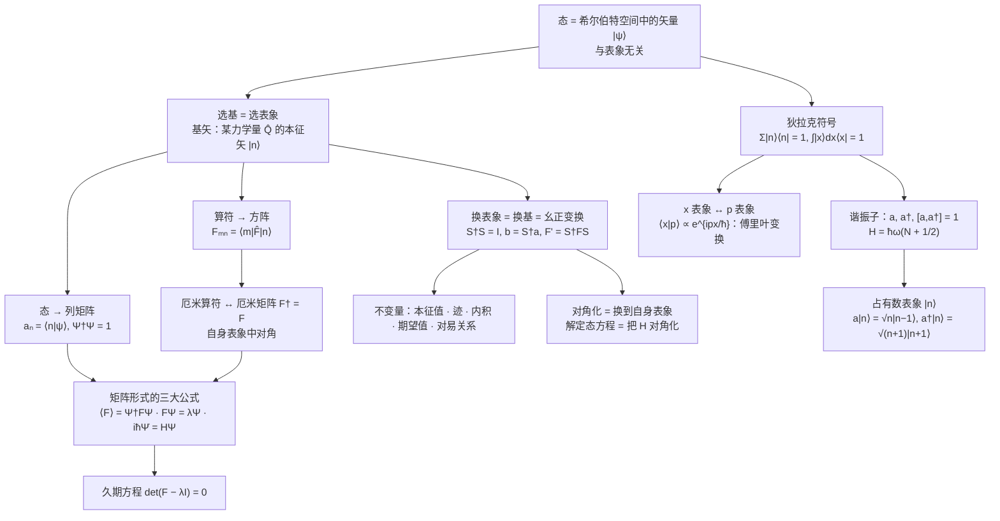

# 第 4 章 态和力学量的表象

!!! tip "本章目标"

    1. 理解**表象 = 选一组基**：同一个态在不同表象中有不同的“波函数”（分量），但描写的是同一个态。
    2. 会在坐标表象与动量表象之间互换（傅里叶变换），会写出 $\hat x,\hat p$ 在动量表象中的形式。
    3. 会求算符在给定表象中的矩阵 $F_{mn}=\mel{m}{\hat F}{n}$，知道厄米算符对应厄米矩阵、算符在自身表象中是对角矩阵。
    4. 会用矩阵写期望值、本征值方程（久期方程）和薛定谔方程，能求解二能级、$l=1$ 角动量这类有限维问题。
    5. 掌握幺正变换 $F'=S^\dagger FS$、$b=S^\dagger a$，知道哪些量在表象变换下不变。
    6. 熟练使用狄拉克符号：右矢、左矢、内积、封闭性 $\sum_n\ket n\bra n=1$、矩阵元。
    7. 会用升降算符 $\hat a,\hat a^\dagger$ 处理线性谐振子，掌握占有数表象。

**本章在全书中的位置。** 第 2、3 章一直用坐标的函数 $\psi(\vv r)$ 描写状态，用作用在它上面的微分算符表示力学量。这只是一种“坐标系”下的写法。第 3 章已经看到，力学量就是厄米算符，态可以按本征函数展开，这正是线性代数的结构。本章把这层结构挑明：**态是希尔伯特空间中的矢量，选一个力学量的本征矢作基就是选一个表象；态的分量排成列矩阵，力学量写成方阵，换表象就是换基（幺正变换）**。有了这套语言，第 5 章的微扰论（矩阵元 $H'_{mn}$）、第 7 章的自旋（$2\times2$ 矩阵）都可以直接用矩阵计算。

!!! info "本章的几何对照表"

    | 三维几何 | 量子力学 | 本章位置 |
    |---|---|---|
    | 矢量 $\vv A$（与坐标系无关） | 态矢量 $\ket\psi$（与表象无关） | 4.1、4.5 |
    | 正交单位矢 $\vv i,\vv j,\vv k$ | 某力学量 $\hat Q$ 的正交归一本征矢 $\{\ket n\}$ | 4.1 |
    | 分量 $A_x=\vv i\cdot\vv A$ | 波函数 $a_n=\ip{n}{\psi}$ | 4.1、4.5 |
    | 线性变换 $\leftrightarrow$ 矩阵 | 算符 $\hat F\leftrightarrow$ 矩阵 $F_{mn}=\mel{m}{\hat F}{n}$ | 4.2 |
    | 旋转坐标系：正交矩阵，长度不变 | 换表象：幺正矩阵，概率不变 | 4.4 |
    | 直角坐标、球坐标…… | 坐标表象、动量表象、能量表象、角动量表象…… | 全章 |
    | 三维 | 无穷维（希尔伯特空间） | 4.1 |

---

## 4.1 态的表象

### 4.1.1 同一个态，换成动量来写

设体系的状态在坐标表象中由 $\Psi(x,t)$ 描写。动量本征函数

$$\psi_p(x)=\frac{1}{(2\pi\hbar)^{1/2}}\ee^{\ii px/\hbar}\tag{4.1.1}$$

组成完全系（第 3 章，$\delta$ 函数归一化），所以 $\Psi$ 可以按它展开：

$$\Psi(x,t)=\int c(p,t)\,\psi_p(x)\,\dd p,\qquad c(p,t)=\int\psi_p^*(x)\,\Psi(x,t)\,\dd x .\tag{4.1.2}$$

把 $\psi_p$ 代进去就是一对**傅里叶变换**：

$$c(p,t)=\frac{1}{\sqrt{2\pi\hbar}}\int_{-\infty}^{\infty}\Psi(x,t)\,\ee^{-\ii px/\hbar}\,\dd x,\qquad
\Psi(x,t)=\frac{1}{\sqrt{2\pi\hbar}}\int_{-\infty}^{\infty}c(p,t)\,\ee^{\ii px/\hbar}\,\dd p .\tag{4.1.3}$$

若 $\Psi$ 归一化，则由帕塞瓦尔定理

$$\int\lvert\Psi(x,t)\rvert^2\dd x=\int\lvert c(p,t)\rvert^2\dd p=1 .\tag{4.1.4}$$

$\lvert\Psi\rvert^2\dd x$ 是测量坐标落在 $[x,x+\dd x]$ 的概率，$\lvert c\rvert^2\dd p$ 是测量动量落在 $[p,p+\dd p]$ 的概率（第 3 章展开假设）。已知 $\Psi$ 就能求出 $c$，反之亦然，两者包含**完全相同的信息**。于是：

!!! definition "定义 4.1（坐标表象与动量表象）"

    $\Psi(x,t)$ 是态在**坐标表象**中的波函数，$c(p,t)$ 是**同一个态**在**动量表象**中的波函数。量子力学中态和力学量的具体表示方式称为**表象**。

!!! info "与复变函数讲义的联系"

    (4.1.3) 式就是傅里叶变换对，只是把角频率 $\omega$（或波数 $k$）换成了 $p/\hbar$，并把 $\dfrac{1}{2\pi}$ 对称地拆成两个 $\dfrac{1}{\sqrt{2\pi\hbar}}$。傅里叶变换的定义、帕塞瓦尔等式、“时域越窄频域越宽”的展宽定理，见[复变函数讲义第 8 章 傅里叶变换](https://cockroach-f.github.io/complex-functions/ch8.html)。坐标—动量的不确定关系 $\Delta x\Delta p\geqslant\hbar/2$ 正是信号处理中“时宽—带宽积”下限在量子力学中的版本。

**两个特殊的态。** 动量为 $p'$ 的自由粒子 $\Psi=\psi_{p'}(x)\ee^{-\ii E_{p'}t/\hbar}$，代入 (4.1.2) 式：

$$c(p,t)=\int\psi_p^*(x)\psi_{p'}(x)\,\dd x\;\ee^{-\ii E_{p'}t/\hbar}=\delta(p-p')\,\ee^{-\ii E_{p'}t/\hbar}.\tag{4.1.5}$$

在坐标表象中它是处处等幅的平面波，在动量表象中却是集中在 $p=p'$ 的 $\delta$ 函数。同样，坐标算符的本征函数在坐标表象中是 $\delta$ 函数：

$$x\,\delta(x-x')=x'\,\delta(x-x').\tag{4.1.6}$$

**规律：任何力学量的本征态，在它自己的表象中都是“一个尖峰”（离散谱时是只有一个分量为 1 的列矩阵）。** 在别的表象中它才“摊开”。

!!! example "例题 4.1　高斯波包的动量表象"

    求 $\psi(x)=(2\pi\sigma^2)^{-1/4}\exp\left(-\dfrac{x^2}{4\sigma^2}+\dfrac{\ii p_0x}{\hbar}\right)$ 在动量表象中的波函数，并求 $\Delta x\,\Delta p$。

    **解。** 代入 (4.1.3) 式，配方 $-\dfrac{x^2}{4\sigma^2}-\dfrac{\ii(p-p_0)x}{\hbar}=-\dfrac{1}{4\sigma^2}\left[x+\dfrac{2\ii\sigma^2(p-p_0)}{\hbar}\right]^2-\dfrac{\sigma^2(p-p_0)^2}{\hbar^2}$，再用 $\displaystyle\int_{-\infty}^{\infty}\ee^{-u^2/4\sigma^2}\dd u=2\sqrt\pi\,\sigma$：

    $$c(p)=\frac{(2\pi\sigma^2)^{-1/4}}{\sqrt{2\pi\hbar}}\cdot2\sqrt\pi\,\sigma\,\ee^{-\sigma^2(p-p_0)^2/\hbar^2}=\left(\frac{2\sigma^2}{\pi\hbar^2}\right)^{1/4}\exp\left[-\frac{\sigma^2(p-p_0)^2}{\hbar^2}\right].$$

    $\lvert\psi\rvert^2\propto\ee^{-x^2/2\sigma^2}$，方差 $\sigma^2$，故 $\Delta x=\sigma$；$\lvert c\rvert^2\propto\ee^{-2\sigma^2(p-p_0)^2/\hbar^2}$，方差 $\hbar^2/4\sigma^2$，故 $\Delta p=\dfrac{\hbar}{2\sigma}$。

    $$\Delta x\,\Delta p=\frac{\hbar}{2},$$

    高斯波包恰好取到不确定关系的下限。另外，坐标表象中的相因子 $\ee^{\ii p_0x/\hbar}$ 在动量表象中变成平移 $p\to p-p_0$（傅里叶变换的**频移性质**）。

<figure class="video" markdown>
<video controls preload="metadata" width="100%" poster="assets/posters/C4_FourierPair.jpg"><source src="assets/videos/C4_FourierPair.mp4" type="video/mp4"></video>
<figcaption>动画 4-1　同一个高斯态在坐标表象与动量表象中的样子：把 $\lvert\psi(x)\rvert^2$ 压窄，$\lvert c(p)\rvert^2$ 就变宽，$\Delta x\Delta p$ 始终等于 $\hbar/2$；乘相因子 $\ee^{\ii p_0x/\hbar}$ 只让 $c(p)$ 整体平移。</figcaption>
</figure>

### 4.1.2 任意力学量 $\hat Q$ 的表象：态 = 列矩阵

把上面的做法推广到任一力学量 $\hat Q$。先设 $\hat Q$ 只有分立谱：$\hat Qu_n(x)=Q_nu_n(x)$，$\int u_m^*u_n\,\dd x=\delta_{mn}$。按完全系展开

$$\Psi(x,t)=\sum_na_n(t)\,u_n(x),\qquad a_n(t)=\int u_n^*(x)\,\Psi(x,t)\,\dd x .\tag{4.1.7}$$

代入归一化条件，利用正交归一性：

$$\int\lvert\Psi\rvert^2\dd x=\sum_{m,n}a_m^*a_n\int u_m^*u_n\,\dd x=\sum_n\lvert a_n(t)\rvert^2=1 .\tag{4.1.8}$$

$\lvert a_n\rvert^2$ 是测量 $Q$ 得到 $Q_n$ 的概率。数列 $a_1,a_2,\dots$ 就是这个态在 **$\hat Q$ 表象中的波函数**，排成列矩阵：

$$\Psi=\begin{pmatrix}a_1(t)\\a_2(t)\\\vdots\\a_n(t)\\\vdots\end{pmatrix},\qquad
\Psi^\dagger=\left(a_1^*(t),a_2^*(t),\dots,a_n^*(t),\dots\right),\qquad \Psi^\dagger\Psi=1 .\tag{4.1.9}$$

若 $\hat Q$ 既有分立谱 $Q_n$ 又有连续谱 $q$（如氢原子的能量：束缚态分立，电离态连续），则

$$\Psi=\sum_na_nu_n+\int a_q\,u_q\,\dd q,\qquad \sum_n\lvert a_n\rvert^2+\int\lvert a_q\rvert^2\dd q=1,\tag{4.1.10}$$

列矩阵中除了可数的分量 $a_n$ 外，还有“连续编号”的分量 $a_q$，仍记作 $\Psi^\dagger\Psi=1$。

### 4.1.3 几何图像：表象就是坐标系

同一个矢量 $\vv A$ 可以用直角分量 $(A_x,A_y,A_z)$ 表示，也可以用球坐标分量表示；分量不同，矢量是同一个。量子力学完全类似：

- 态 $\Psi$ 是一个**态矢量**；
- 选定 $\hat Q$ 表象，就是选 $\hat Q$ 的本征函数 $\{u_n\}$ 作为**基矢**（相当于 $\vv i,\vv j,\vv k$）；
- $a_n$ 是态矢量沿基矢 $u_n$ 的**分量**（投影），$\sum\lvert a_n\rvert^2=1$ 就是“长度为 1”；
- 基矢有无穷多个，态矢量所在的空间是无穷维的复矢量空间，称为**希尔伯特空间**。

坐标表象的“基矢”是 $\delta(x-x')$（以 $x'$ 编号，连续），分量就是 $\Psi(x')$ 本身；动量表象的基矢是 $\psi_p(x)$，分量是 $c(p)$。常用的还有**能量表象**（基矢 = 定态 $\psi_n$）和**角动量表象**（基矢 = $Y_{lm}$）。

!!! example "例题 4.2　能量表象中的列矩阵"

    一维无限深势阱（$0<x<a$）中粒子处于 $\Psi(x,0)=\dfrac{1}{\sqrt2}\left[\psi_1(x)+\ii\,\psi_2(x)\right]$，$\psi_n=\sqrt{\dfrac2a}\sin\dfrac{n\pi x}{a}$。写出它在能量表象中的波函数（$t=0$ 及任意 $t$），并求 $\langle H\rangle$。

    **解。** 能量表象的基矢就是 $\psi_1,\psi_2,\dots$，分量直接读出：

    $$\Psi(0)=\frac{1}{\sqrt2}\begin{pmatrix}1\\\ii\\0\\\vdots\end{pmatrix},\qquad
    \Psi(t)=\frac{1}{\sqrt2}\begin{pmatrix}\ee^{-\ii E_1t/\hbar}\\\ii\,\ee^{-\ii E_2t/\hbar}\\0\\\vdots\end{pmatrix},\qquad E_n=\frac{n^2\pi^2\hbar^2}{2ma^2}.$$

    $\Psi^\dagger\Psi=\tfrac12+\tfrac12=1$。测得 $E_1$、$E_2$ 的概率各为 $\tfrac12$，$\langle H\rangle=\tfrac12(E_1+E_2)=\dfrac{5\pi^2\hbar^2}{4ma^2}$。

    在坐标表象中写这个态需要两个正弦函数相加，在能量表象中只是一个两分量的列矩阵，而且时间演化只是给每个分量乘相因子。**选对表象，问题就变简单**，这就是本章的主旨。

---
## 4.2 算符的矩阵表示

### 4.2.1 矩阵元 $F_{mn}$ 的来历

设算符 $\hat F$ 把 $\Psi$ 变成 $\Phi$：$\Phi(x,t)=\hat F\Psi(x,t)$。在 $\hat Q$ 表象中把两边都展开，$\Psi=\sum_ma_mu_m$，$\Phi=\sum_mb_mu_m$：

$$\sum_mb_m\,u_m(x)=\sum_ma_m\,\hat Fu_m(x).$$

左乘 $u_n^*(x)$ 并对 $x$ 积分，左边用正交归一性只剩 $b_n$：

$$b_n=\sum_mF_{nm}\,a_m,\qquad F_{nm}\equiv\int u_n^*(x)\,\hat F\,u_m(x)\,\dd x .$$

!!! definition "定义 4.2（算符在 $\hat Q$ 表象中的矩阵）"

    算符 $\hat F$ 在 $\hat Q$ 表象中由矩阵 $F=(F_{nm})$ 表示，

    $$F_{nm}=\int u_n^*(x)\,\hat F\,u_m(x)\,\dd x\equiv\mel{n}{\hat F}{m},$$

    方程 $\Phi=\hat F\Psi$ 在该表象中写成矩阵乘法

    $$\begin{pmatrix}b_1\\b_2\\\vdots\end{pmatrix}=\begin{pmatrix}F_{11}&F_{12}&\cdots\\F_{21}&F_{22}&\cdots\\\vdots&\vdots&\ddots\end{pmatrix}\begin{pmatrix}a_1\\a_2\\\vdots\end{pmatrix},\qquad\text{即}\quad\Phi=F\Psi .$$

**怎样读这个矩阵。** 第 $m$ 列是 $\hat Fu_m$ 按基矢展开的系数：$\hat Fu_m=\sum_nF_{nm}u_n$。也就是说，**把每个基矢“喂”给算符，得到的结果按基矢分解，系数排成一列，所有列拼起来就是矩阵**。这与线性代数中“线性变换在一组基下的矩阵”的定义完全相同。

!!! theorem "定理 4.1（厄米算符 $\Leftrightarrow$ 厄米矩阵）"

    若 $\hat F$ 是厄米算符，则它在任何表象中的矩阵满足

    $$F_{nm}^*=F_{mn},\qquad\text{即}\quad F^\dagger=F\quad\left(F^\dagger\equiv\tilde F^*\right).$$

    *证明：* $F_{nm}^*=\displaystyle\int u_n(\hat Fu_m)^*\dd x=\int(\hat Fu_m)^*u_n\,\dd x\overset{\text{厄米}}{=}\int u_m^*\hat Fu_n\,\dd x=F_{mn}$。

所以厄米矩阵的对角元都是实数，关于对角线的两个元素互为共轭。

!!! theorem "定理 4.2（算符在自身表象中是对角矩阵）"

    $$Q_{nm}=\int u_n^*\hat Qu_m\,\dd x=Q_m\int u_n^*u_m\,\dd x=Q_m\,\delta_{nm},$$

    对角元就是本征值。例如在能量表象中 $H=\mathrm{diag}(E_1,E_2,\dots)$。

若 $\hat Q$ 只有连续谱 $q$，以上讨论把求和换成积分即可，矩阵的行列用连续指标编号：$F_{qq'}=\int u_q^*\hat Fu_{q'}\,\dd x$。

<figure class="video" markdown>
<video controls preload="metadata" width="100%" poster="assets/posters/C4_OperatorMatrix.jpg"><source src="assets/videos/C4_OperatorMatrix.mp4" type="video/mp4"></video>
<figcaption>动画 4-2　谐振子能量表象中 $\hat x$ 的矩阵：第 $n$ 列是 $\hat x\ket n$ 的分量；厄米矩阵关于对角线共轭对称；换成 $\hat H$ 自身的表象，矩阵变成对角的。</figcaption>
</figure>

### 4.2.2 坐标和动量在动量表象中的形式

动量表象中，态由 $c(p)$ 描写。$\hat p$ 在自身表象中是“乘以 $p$”（对角），$\hat x$ 呢？计算 $\hat x\Psi$ 的动量表象分量：

$$\int\psi_p^*(x)\,x\,\Psi(x)\,\dd x=\int\left[\ii\hbar\frac{\partial}{\partial p}\psi_p^*(x)\right]\Psi(x)\,\dd x=\ii\hbar\frac{\partial}{\partial p}c(p),$$

这里用了 $x\,\ee^{-\ii px/\hbar}=\ii\hbar\dfrac{\partial}{\partial p}\ee^{-\ii px/\hbar}$。于是有一张“对偶”的表：

| 表象 | 波函数 | $\hat x$ | $\hat p$ | $[\hat x,\hat p]$ |
|---|---|---|---|---|
| 坐标表象 | $\psi(x)$ | $x$ | $-\ii\hbar\dfrac{\partial}{\partial x}$ | $\ii\hbar$ |
| 动量表象 | $c(p)$ | $\ii\hbar\dfrac{\partial}{\partial p}$ | $p$ | $\ii\hbar$ |

对易关系在两个表象中相同（读者可以把 $[\ii\hbar\partial_p,p]$ 作用在任意 $c(p)$ 上验证）。这不是巧合：**对易关系是算符本身的性质，与表象无关**。哈密顿量 $\hat H=\dfrac{\hat p^2}{2m}+U(\hat x)$ 在动量表象中为

$$\hat H=\frac{p^2}{2m}+U\!\left(\ii\hbar\frac{\partial}{\partial p}\right).$$

!!! example "例题 4.3　谐振子在动量表象中的薛定谔方程"

    写出线性谐振子在动量表象中的定态方程，并说明它的解与坐标表象中的解有什么关系。

    **解。** $U=\tfrac12m\omega^2x^2\to-\tfrac12m\omega^2\hbar^2\dfrac{\partial^2}{\partial p^2}$，

    $$\left[\frac{p^2}{2m}-\frac{m\omega^2\hbar^2}{2}\frac{\dd^2}{\dd p^2}\right]c(p)=E\,c(p).$$

    令 $\eta=\dfrac{p}{\sqrt{m\omega\hbar}}$，方程化为 $\dfrac{\dd^2c}{\dd\eta^2}+\left(\dfrac{2E}{\hbar\omega}-\eta^2\right)c=0$，与坐标表象中的方程（$\xi=\sqrt{m\omega/\hbar}\,x$）**形式完全相同**。所以能级同样是 $E_n=(n+\tfrac12)\hbar\omega$，本征函数是同样的厄米函数，只是把 $\xi$ 换成 $\eta$（再差一个相因子 $(-\ii)^n$，见练习 3）。谐振子的 $x$ 与 $p$ 地位对称，这一点在 4.6 节的升降算符中看得更清楚。

!!! example "例题 4.4　$l=1$ 的角动量矩阵"

    在 $(\hat L^2,\hat L_z)$ 的共同表象中，取 $l=1$ 的子空间，基矢按 $m=1,0,-1$ 排列。求 $L^2$、$L_z$、$L_x$、$L_y$ 的矩阵。（已知 $\hat L_\pm=\hat L_x\pm\ii\hat L_y$ 满足 $\hat L_\pm Y_{lm}=\hbar\sqrt{l(l+1)-m(m\pm1)}\,Y_{l,m\pm1}$。）

    **解。** $\hat L^2$ 和 $\hat L_z$ 在自身表象中是对角的：

    $$L^2=2\hbar^2\begin{pmatrix}1&0&0\\0&1&0\\0&0&1\end{pmatrix},\qquad L_z=\hbar\begin{pmatrix}1&0&0\\0&0&0\\0&0&-1\end{pmatrix}.$$

    $l=1$ 时 $\hat L_+Y_{1,0}=\sqrt2\hbar Y_{11}$，$\hat L_+Y_{1,-1}=\sqrt2\hbar Y_{10}$，$\hat L_+Y_{11}=0$，所以 $L_+$ 只有对角线上方一条非零：

    $$L_+=\sqrt2\hbar\begin{pmatrix}0&1&0\\0&0&1\\0&0&0\end{pmatrix},\qquad L_-=L_+^\dagger=\sqrt2\hbar\begin{pmatrix}0&0&0\\1&0&0\\0&1&0\end{pmatrix}.$$

    由 $\hat L_x=\tfrac12(\hat L_++\hat L_-)$，$\hat L_y=\tfrac{1}{2\ii}(\hat L_+-\hat L_-)$：

    $$L_x=\frac{\hbar}{\sqrt2}\begin{pmatrix}0&1&0\\1&0&1\\0&1&0\end{pmatrix},\qquad L_y=\frac{\hbar}{\sqrt2}\begin{pmatrix}0&-\ii&0\\\ii&0&-\ii\\0&\ii&0\end{pmatrix}.$$

    都是厄米矩阵。可以直接用矩阵乘法验证 $L_xL_y-L_yL_x=\ii\hbar L_z$ 和 $L_x^2+L_y^2+L_z^2=2\hbar^2I$。$L_x,L_y$ 不对角，因为 $\hat L_x,\hat L_y$ 与 $\hat L_z$ 不对易，没有共同本征矢。

!!! warning "易错点：矩阵元的下标顺序"

    $F_{nm}=\displaystyle\int u_n^*\hat Fu_m\,\dd x$：**行号 $n$ 跟着取共轭的那个（左边），列号 $m$ 跟着被算符作用的那个（右边）**。写反了就得到 $F$ 的转置；对厄米矩阵而言是 $F^*$，复矩阵元（如 $L_y$、$\hat p$ 的矩阵元）的符号就会全错。

---

## 4.3 量子力学公式的矩阵表述

前几章的三个核心公式（期望值、本征值方程、薛定谔方程）都可以“翻译”到任一 $\hat Q$ 表象。以分立谱为例，记 $\Psi=(a_1,a_2,\dots)^{\mathrm T}$。

**（1）期望值。** 把 $\Psi=\sum_na_nu_n$、$\Psi^*=\sum_ma_m^*u_m^*$ 代入 $\langle F\rangle=\int\Psi^*\hat F\Psi\,\dd x$：

$$\langle F\rangle=\sum_{m,n}a_m^*F_{mn}a_n=\Psi^\dagger F\Psi .$$

**（2）本征值方程。** $\hat F\Psi=\lambda\Psi$ 变成 $F\Psi=\lambda\Psi$，即齐次线性方程组 $\sum_n(F_{mn}-\lambda\delta_{mn})a_n=0$。有非零解的条件是系数行列式为零：

$$\det\left(F_{mn}-\lambda\delta_{mn}\right)=\begin{vmatrix}F_{11}-\lambda&F_{12}&\cdots\\F_{21}&F_{22}-\lambda&\cdots\\\vdots&\vdots&\ddots\end{vmatrix}=0 .$$

这叫**久期方程**。它的根 $\lambda_1,\lambda_2,\dots$ 就是本征值，把每个 $\lambda_i$ 代回方程组得到对应的本征矢。**求解微分方程的本征值问题，变成了求矩阵特征值的代数问题。**

**（3）薛定谔方程。** 把展开式代入 $\ii\hbar\partial_t\Psi=\hat H\Psi$，左乘 $u_m^*$ 积分：

$$\ii\hbar\frac{\dd a_m}{\dd t}=\sum_nH_{mn}a_n,\qquad\text{即}\quad\ii\hbar\frac{\dd\Psi}{\dd t}=H\Psi,\quad H_{mn}=\int u_m^*\hat Hu_n\,\dd x .$$

偏微分方程变成了一组耦合的常微分方程。若取能量表象，$H$ 对角，各分量互不耦合，$a_n(t)=a_n(0)\ee^{-\ii E_nt/\hbar}$；若取别的表象，$H$ 的非对角元会让各分量之间来回“转移概率”。

!!! example "例题 4.5　久期方程求 $L_x$ 的本征值和本征矢"

    用例题 4.4 中 $l=1$ 的 $L_x$ 矩阵，求 $\hat L_x$ 的本征值和归一化本征矢。

    **解。** 记 $\lambda=\mu\hbar$，久期方程

    $$\begin{vmatrix}-\mu&\tfrac{1}{\sqrt2}&0\\\tfrac{1}{\sqrt2}&-\mu&\tfrac{1}{\sqrt2}\\0&\tfrac{1}{\sqrt2}&-\mu\end{vmatrix}=-\mu^3+\mu=0\ \Rightarrow\ \mu=1,0,-1 .$$

    本征值 $\hbar,0,-\hbar$，与 $L_z$ 的本征值相同（$x$ 轴和 $z$ 轴没有区别，这是必然的）。代回方程组 $\tfrac{1}{\sqrt2}a_2=\mu a_1$，$\tfrac{1}{\sqrt2}(a_1+a_3)=\mu a_2$，$\tfrac{1}{\sqrt2}a_2=\mu a_3$，并归一化：

    $$\lambda=\hbar:\ \frac12\begin{pmatrix}1\\\sqrt2\\1\end{pmatrix};\qquad
    \lambda=0:\ \frac{1}{\sqrt2}\begin{pmatrix}1\\0\\-1\end{pmatrix};\qquad
    \lambda=-\hbar:\ \frac12\begin{pmatrix}1\\-\sqrt2\\1\end{pmatrix}.$$

    三个本征矢两两正交（厄米矩阵的必然结果）。物理含义：在 $L_x=\hbar$ 的态中测 $L_z$，得 $\hbar,0,-\hbar$ 的概率分别为 $\tfrac14,\tfrac12,\tfrac14$。

!!! example "例题 4.6　二能级体系"

    某体系只需考虑两个态 $\ket1,\ket2$，在这组基下 $H=\begin{pmatrix}E_1&V\\V&E_2\end{pmatrix}$（$V$ 为实数）。(1) 求能级；(2) 若 $E_1=E_2=E_0$，$t=0$ 时体系处于 $\ket1$，求 $t$ 时刻处于 $\ket2$ 的概率。

    **解。** (1) 久期方程 $(E_1-E)(E_2-E)-V^2=0$：

    $$E_\pm=\frac{E_1+E_2}{2}\pm\sqrt{\left(\frac{E_1-E_2}{2}\right)^2+V^2}.$$

    耦合 $V$ 让两个能级**互相排斥**：$E_+$ 比 $\max(E_1,E_2)$ 高，$E_-$ 比 $\min(E_1,E_2)$ 低。第 5 章的简并微扰、第 7 章的自旋在磁场中都是这个模型。

    (2) $E_1=E_2=E_0$ 时，本征矢为 $\ket\pm=\tfrac{1}{\sqrt2}(\ket1\pm\ket2)$，$E_\pm=E_0\pm V$。初态 $\ket1=\tfrac{1}{\sqrt2}(\ket++\ket-)$，

    $$\ket{\Psi(t)}=\frac{1}{\sqrt2}\left(\ee^{-\ii(E_0+V)t/\hbar}\ket++\ee^{-\ii(E_0-V)t/\hbar}\ket-\right)=\ee^{-\ii E_0t/\hbar}\left[\cos\frac{Vt}{\hbar}\ket1-\ii\sin\frac{Vt}{\hbar}\ket2\right].$$

    $$P_2(t)=\sin^2\frac{Vt}{\hbar}.$$

    体系在两个态之间以角频率 $2V/\hbar$ 来回振荡。也可以直接解矩阵形式的薛定谔方程 $\ii\hbar\dot a_1=E_0a_1+Va_2$，$\ii\hbar\dot a_2=Va_1+E_0a_2$，结果相同。氨分子中氮原子在平面两侧的翻转、中微子振荡，都是这一模型。

---
## 4.4 幺正变换

选什么表象取决于问题：能量表象让时间演化最简单，动量表象让自由粒子最简单，$(\hat L^2,\hat L_z)$ 表象让中心力场的角向部分最简单。所以常常需要**从一个表象换到另一个表象**。

### 4.4.1 变换矩阵 $S$

设 $\hat A$ 的正交归一本征函数为 $\psi_1,\psi_2,\dots$（$A$ 表象），$\hat B$ 的为 $\varphi_1,\varphi_2,\dots$（$B$ 表象）。把新基矢按旧基矢展开：

$$\varphi_\beta(x)=\sum_nS_{n\beta}\,\psi_n(x),\qquad S_{n\beta}=\int\psi_n^*(x)\,\varphi_\beta(x)\,\dd x .$$

$S$ 叫**变换矩阵**，它的**第 $\beta$ 列就是新基矢 $\varphi_\beta$ 在旧表象中的分量**。把展开式代入新基矢的正交归一条件：

$$\delta_{\alpha\beta}=\int\varphi_\alpha^*\varphi_\beta\,\dd x=\sum_{m,n}S_{m\alpha}^*S_{n\beta}\,\delta_{mn}=\sum_m(S^\dagger)_{\alpha m}S_{m\beta}=(S^\dagger S)_{\alpha\beta}.$$

!!! theorem "定理 4.3（表象变换是幺正变换）"

    变换矩阵满足

    $$S^\dagger S=SS^\dagger=I,\qquad\text{即}\quad S^\dagger=S^{-1}.$$

    满足此式的矩阵称为**幺正矩阵**，相应的变换称为**幺正变换**。幺正矩阵的各列（各行）是一组正交归一的矢量。

（$SS^\dagger=I$ 由旧基矢可以反过来按新基矢展开得到；有限维时 $S^\dagger S=I$ 已蕴含 $SS^\dagger=I$。）幺正条件 $S^\dagger=S^{-1}$ 与厄米条件 $F^\dagger=F$ 是两回事：幺正矩阵一般不是厄米矩阵。实数的幺正矩阵就是正交矩阵，也就是**转动**。

### 4.4.2 态和算符的变换公式

**态。** 同一个态 $u=\sum_na_n\psi_n=\sum_\alpha b_\alpha\varphi_\alpha$，用 $\varphi_\alpha^*$ 乘并积分：

$$b_\alpha=\int\varphi_\alpha^*u\,\dd x=\sum_mS_{m\alpha}^*a_m=(S^\dagger a)_\alpha,\qquad\text{即}\quad b=S^\dagger a=S^{-1}a .$$

**算符。** 把 $\varphi_\beta=\sum_nS_{n\beta}\psi_n$ 代入 $F'_{\alpha\beta}=\int\varphi_\alpha^*\hat F\varphi_\beta\,\dd x$：

$$F'_{\alpha\beta}=\sum_{m,n}S_{m\alpha}^*F_{mn}S_{n\beta},\qquad\text{即}\quad F'=S^\dagger FS=S^{-1}FS .$$

!!! warning "易错点：$b=S^\dagger a$ 而不是 $b=Sa$"

    $S$ 的列是“新基矢在旧基下的分量”，它把**基矢**从旧变到新；**分量**的变换方向正好相反，要用 $S^\dagger$。这和几何里一样：坐标轴逆时针转 $\theta$，矢量的分量相当于顺时针转 $\theta$。记忆方法：$b_\alpha=\ip{\varphi_\alpha}{u}$ 是“新基矢与态的内积”，新基矢在左边要取共轭，所以出现 $S^*$，即 $S^\dagger$。

<figure class="video" markdown>
<video controls preload="metadata" width="100%" poster="assets/posters/C4_BasisChange.jpg"><source src="assets/videos/C4_BasisChange.mp4" type="video/mp4"></video>
<figcaption>动画 4-3　表象变换 = 基矢转动：同一个态矢量 $\ket\psi$ 在转动的基 $\{\ket1,\ket2\}$ 下分量不断变化，但 $\lvert c_1\rvert^2+\lvert c_2\rvert^2$ 始终为 1；基矢转到与 $\ket\psi$ 同向时，$\ket\psi$ 在该表象中只剩一个分量。</figcaption>
</figure>

### 4.4.3 幺正变换下的不变量

!!! theorem "定理 4.4（幺正变换不改变的量）"

    1. **本征值不变。** 若 $Fa=\lambda a$，左乘 $S^{-1}$ 并在 $F$ 与 $a$ 之间插入 $SS^{-1}=I$：$(S^{-1}FS)(S^{-1}a)=\lambda(S^{-1}a)$，即 $F'b=\lambda b$。
    2. **迹不变。** $\Tr F'=\Tr(S^{-1}FS)=\Tr(SS^{-1}F)=\Tr F$（利用 $\Tr(AB)=\Tr(BA)$）。同理行列式 $\det F'=\det F$。
    3. **内积（从而归一化、概率）不变。** $b_1^\dagger b_2=a_1^\dagger SS^\dagger a_2=a_1^\dagger a_2$。
    4. **期望值不变。** $b^\dagger F'b=a^\dagger SS^\dagger FSS^\dagger a=a^\dagger Fa$。
    5. **算符关系不变。** $(FG)'=S^\dagger FSS^\dagger GS=F'G'$，所以对易关系 $[\hat x,\hat p]=\ii\hbar$ 等在任何表象中形式相同。

物理上可观测的东西（测量值、概率、期望值）都不随表象变化，**表象只是描述的工具**。

**对角化 = 换到自身表象。** 若 $B$ 表象恰是 $\hat F$ 自身的表象，$F'$ 是对角矩阵，对角元就是本征值。因此“求本征值”等价于“找一个幺正矩阵 $S$ 使 $S^\dagger FS$ 对角”，$S$ 的各列就是 $F$ 的归一化本征矢。解定态薛定谔方程，就是把 $\hat H$ 从坐标表象变换到能量表象。

!!! example "例题 4.7　把一个 $2\times2$ 厄米矩阵对角化"

    在某表象中 $F=\begin{pmatrix}0&-\ii\\\ii&0\end{pmatrix}$。(1) 求本征值和本征矢，写出对角化它的幺正矩阵 $S$；(2) 态 $a=\begin{pmatrix}1\\0\end{pmatrix}$ 在 $F$ 表象中的波函数是什么？测量 $F$ 的结果如何？

    **解。** (1) $\det\begin{pmatrix}-\lambda&-\ii\\\ii&-\lambda\end{pmatrix}=\lambda^2-1=0$，$\lambda=\pm1$。

    $\lambda=1$：$-\ii a_2=a_1$，取 $\dfrac{1}{\sqrt2}\begin{pmatrix}1\\\ii\end{pmatrix}$；$\lambda=-1$：$\dfrac{1}{\sqrt2}\begin{pmatrix}1\\-\ii\end{pmatrix}$。以它们为列：

    $$S=\frac{1}{\sqrt2}\begin{pmatrix}1&1\\\ii&-\ii\end{pmatrix},\qquad S^\dagger S=I,\qquad S^\dagger FS=\begin{pmatrix}1&0\\0&-1\end{pmatrix}.$$

    验证不变量：$\Tr F=0=1+(-1)$，$\det F=-1=1\times(-1)$。

    (2) $b=S^\dagger a=\dfrac{1}{\sqrt2}\begin{pmatrix}1&-\ii\\1&\ii\end{pmatrix}\begin{pmatrix}1\\0\end{pmatrix}=\dfrac{1}{\sqrt2}\begin{pmatrix}1\\1\end{pmatrix}$。测量 $F$ 得 $+1$、$-1$ 的概率各 $\tfrac12$，$\langle F\rangle=0$。直接用旧表象算 $a^\dagger Fa=F_{11}=0$，结果一致。（这个矩阵就是第 7 章的泡利矩阵 $\sigma_y$。）

!!! example "例题 4.8　坐标表象 $\to$ 动量表象也是幺正变换"

    说明 4.1 节的傅里叶变换是“连续指标”的幺正变换。

    **解。** 旧基（坐标表象）以 $x$ 编号，新基 $\psi_p$ 以 $p$ 编号，变换矩阵的“矩阵元”是新基矢在旧表象中的分量：

    $$S_{xp}=\psi_p(x)=\frac{1}{\sqrt{2\pi\hbar}}\ee^{\ii px/\hbar}.$$

    幺正性：$(S^\dagger S)_{p'p}=\displaystyle\int S_{xp'}^*S_{xp}\,\dd x=\frac{1}{2\pi\hbar}\int\ee^{\ii(p-p')x/\hbar}\dd x=\delta(p-p')$，即连续指标的单位矩阵。

    态的变换 $b=S^\dagger a$：$c(p)=\displaystyle\int S^*_{xp}\,\psi(x)\,\dd x=\frac{1}{\sqrt{2\pi\hbar}}\int\ee^{-\ii px/\hbar}\psi(x)\,\dd x$，正是 (4.1.3) 式。帕塞瓦尔定理 $\int\lvert\psi\rvert^2\dd x=\int\lvert c\rvert^2\dd p$ 就是“幺正变换保持长度”。

---
## 4.5 狄拉克符号

几何中常用矢量形式 $\vv F=m\vv a$ 讨论问题而不指明坐标系，算具体数值时才取分量。量子力学也可以这样：态和算符先写成与表象无关的抽象形式，需要时再向某个表象“投影”。这套记号由狄拉克引入。

### 4.5.1 右矢、左矢与内积

!!! definition "定义 4.3（右矢、左矢、内积）"

    1. **右矢** $\ket\psi$：表示一个态，是与表象无关的抽象矢量。本征态常用本征值或量子数标记：$\ket x$、$\ket p$、$\ket{E_n}$ 或 $\ket n$、$\ket{lm}$ 等。
    2. **左矢** $\bra\psi=\ket\psi^\dagger$：右矢的厄米共轭，属于对偶空间。
    3. **内积**（标积）：
    $$\ip{\psi}{\varphi}=\int\psi^*(x)\,\varphi(x)\,\dd x,\qquad\ip{\psi}{\varphi}^*=\ip{\varphi}{\psi}.$$
    $\ip{\psi}{\varphi}=0$ 称两态正交，$\ip{\psi}{\psi}=1$ 称归一化。

注意 $\ip{\psi}{\varphi}$ 是一个**数**，而 $\ket\varphi\bra\psi$ 是一个**算符**（外积）：它作用在 $\ket\chi$ 上给出 $\ket\varphi\ip{\psi}{\chi}$，即“沿 $\ket\varphi$ 方向、长度为 $\ip{\psi}{\chi}$ 的矢量”。

### 4.5.2 表象中的分量与封闭性

设 $\hat F\ket n=f_n\ket n$，$\ip{n}{n'}=\delta_{nn'}$。任一态按这组基展开 $\ket\psi=\sum_na_n\ket n$，左乘 $\bra{n'}$：

$$a_n=\ip{n}{\psi}.$$

**态矢量在某基矢上的投影，就是它在该表象中的波函数。** 特别地，坐标表象和动量表象中

$$\psi(x)=\ip{x}{\psi},\qquad c(p)=\ip{p}{\psi},\qquad \ip{x}{p}=\frac{1}{\sqrt{2\pi\hbar}}\ee^{\ii px/\hbar}.$$

在 $\hat F$ 表象中，基矢就是列矩阵 $\ket1=(1,0,0,\dots)^{\mathrm T}$、$\ket2=(0,1,0,\dots)^{\mathrm T}$……，$\ket\psi$ 对应列矩阵 $(\ip{1}{\psi},\ip{2}{\psi},\dots)^{\mathrm T}$。

把 $a_n=\ip{n}{\psi}$ 代回展开式：$\ket\psi=\sum_n\ket n\ip{n}{\psi}$。由于 $\ket\psi$ 任意，

!!! theorem "定理 4.5（封闭性 / 单位算符的分解）"

    $$\sum_n\ket n\bra n=1;\qquad\int\ket x\,\dd x\,\bra x=1;\qquad\int\ket p\,\dd p\,\bra p=1;\qquad\sum_n\ket n\bra n+\int\ket q\,\dd q\,\bra q=1\ (\text{混合谱}).$$

    在坐标表象中写出来就是完全性条件：$\ip{x}{x'}=\sum_n\ip{x}{n}\ip{n}{x'}$，即 $\displaystyle\sum_nu_n(x)\,u_n^*(x')=\delta(x-x')$。

$P_n=\ket n\bra n$ 是向 $\ket n$ 方向的**投影算符**，满足 $P_n^2=P_n$；封闭性说的是“所有方向上的投影加起来还原整个矢量”。**在任何地方插入一个 1 并展开成 $\sum\ket n\bra n$，是狄拉克符号中最常用的技巧**，表象变换、矩阵元计算都靠它。

### 4.5.3 算符的矩阵元

设 $\ket B=\hat F\ket A$。在 $\ket B$ 和 $\ket A$ 前各插入一个 $\sum_n\ket n\bra n$，再左乘 $\bra m$：

$$\ip{m}{B}=\sum_n\mel{m}{\hat F}{n}\ip{n}{A},$$

$F_{mn}=\mel{m}{\hat F}{n}$ 就是 4.2 节的矩阵元。在其中插入坐标表象的 1：

$$\mel{m}{\hat F}{n}=\iint\ip{m}{x'}\,\mel{x'}{\hat F}{x}\,\ip{x}{n}\,\dd x'\dd x,$$

$$\mel{x'}{\hat F}{x}=\hat F\!\left(x',-\ii\hbar\frac{\partial}{\partial x'}\right)\delta(x'-x),$$

积掉 $x'$ 后回到 $F_{mn}=\int u_m^*\hat Fu_n\,\dd x$。从 $\ket B=\hat F\ket A$ 取厄米共轭得 $\bra B=\bra A\hat F^\dagger$，厄米算符时 $\bra B=\bra A\hat F$。

!!! example "例题 4.9　用狄拉克符号推导坐标表象中的动量算符"

    已知 $\hat p\ket p=p\ket p$，$\ip{x}{p}=\dfrac{1}{\sqrt{2\pi\hbar}}\ee^{\ii px/\hbar}$。证明 $\mel{x}{\hat p}{\psi}=-\ii\hbar\dfrac{\partial}{\partial x}\ip{x}{\psi}$。

    **解。** 在 $\hat p$ 右边插入动量表象的 1：

    $$\mel{x}{\hat p}{\psi}=\int\mel{x}{\hat p}{p}\ip{p}{\psi}\dd p=\int p\,\ip{x}{p}\ip{p}{\psi}\dd p=\int\left(-\ii\hbar\frac{\partial}{\partial x}\ip{x}{p}\right)\ip{p}{\psi}\dd p=-\ii\hbar\frac{\partial}{\partial x}\ip{x}{\psi}.$$

    最后一步把 1 又“收回去”。同样可得 $\mel{p}{\hat x}{\psi}=\ii\hbar\dfrac{\partial}{\partial p}\ip{p}{\psi}$，与 4.2.2 节一致。**$-\ii\hbar\partial_x$ 不是额外的假设，而是“动量本征态在坐标表象中是平面波”这一事实在坐标表象中的体现。**

!!! example "例题 4.10　表象变换的狄拉克写法"

    用封闭性重写 4.4 节的变换公式。

    **解。** 设旧基 $\{\ket n\}$，新基 $\{\ket\alpha\}$。在 $\ip{\alpha}{u}$ 中插入旧基的 1：

    $$b_\alpha=\ip{\alpha}{u}=\sum_n\ip{\alpha}{n}\ip{n}{u}=\sum_nS^*_{n\alpha}a_n,\qquad S_{n\alpha}=\ip{n}{\alpha}.$$

    在 $\mel{\alpha}{\hat F}{\beta}$ 中插入两次旧基的 1：

    $$F'_{\alpha\beta}=\sum_{m,n}\ip{\alpha}{m}\mel{m}{\hat F}{n}\ip{n}{\beta}=(S^\dagger FS)_{\alpha\beta}.$$

    幺正性 $S^\dagger S=I$ 就是 $\sum_n\ip{\alpha}{n}\ip{n}{\beta}=\ip{\alpha}{\beta}=\delta_{\alpha\beta}$。4.4 节一页的推导在这里只有一行，这就是狄拉克符号的好处。

### 4.5.4 两种写法对照

| 坐标表象中的写法 | 狄拉克符号 |
|---|---|
| $\psi(x)$ | $\ip{x}{\psi}$ |
| $\hat F\psi(x)=\Phi(x)$ | $\hat F\ket\psi=\ket\Phi$ |
| $\ii\hbar\dfrac{\partial}{\partial t}\Psi(x,t)=\hat H\Psi(x,t)$ | $\ii\hbar\dfrac{\dd}{\dd t}\ket{\Psi(t)}=\hat H\ket{\Psi(t)}$ |
| $\hat Hu_n(x)=E_nu_n(x)$ | $\hat H\ket n=E_n\ket n$ |
| $\int u_n^*u_m\,\dd x=\delta_{nm}$ | $\ip{n}{m}=\delta_{nm}$ |
| $\psi(x)=\sum_na_nu_n(x)$，$a_n=\int u_n^*\psi\,\dd x$ | $\ket\psi=\sum_n\ket n\ip{n}{\psi}$ |
| $\sum_nu_n(x)u_n^*(x')=\delta(x-x')$ | $\sum_n\ket n\bra n=1$ |
| $\langle F\rangle=\int\psi^*\hat F\psi\,\dd x$ | $\langle F\rangle=\mel{\psi}{\hat F}{\psi}$ |
| $F_{mn}=\int u_m^*\hat Fu_n\,\dd x$ | $F_{mn}=\mel{m}{\hat F}{n}$ |

!!! warning "易错点：态矢量与波函数"

    $\ket\psi$ 与表象无关；$\psi(x)=\ip{x}{\psi}$ 和 $c(p)=\ip{p}{\psi}$ 是它在两个表象中的分量，是两个**不同的函数**，不能写成“$\psi(p)$ 就是把 $\psi(x)$ 中的 $x$ 换成 $p$”。同理 $\ket x$ 是坐标本征态，不是“$x$ 乘以某个态”；$\ip{x}{x'}=\delta(x-x')$，不能归一化为 1。

---
## 4.6 线性谐振子与占有数表象

2.7 节在坐标表象中解微分方程得到谐振子能级 $E_n=\left(n+\tfrac12\right)\hbar\omega$。现在换一个角度，**只用对易关系**就能得到同样的结果，并引出一个新的表象：占有数表象。这是“二次量子化”最简单的例子。

### 4.6.1 升降算符

!!! definition "定义 4.4（湮没算符与产生算符）"

    $$\hat a=\sqrt{\frac{m\omega}{2\hbar}}\left(\hat x+\frac{\ii}{m\omega}\hat p\right),\qquad
    \hat a^\dagger=\sqrt{\frac{m\omega}{2\hbar}}\left(\hat x-\frac{\ii}{m\omega}\hat p\right).$$

    用 $\xi=\alpha x$（$\alpha=\sqrt{m\omega/\hbar}$）写成坐标表象形式：$\hat a=\dfrac{1}{\sqrt2}\left(\xi+\dfrac{\partial}{\partial\xi}\right)$，$\hat a^\dagger=\dfrac{1}{\sqrt2}\left(\xi-\dfrac{\partial}{\partial\xi}\right)$。

$\hat a^\dagger\neq\hat a$，所以 $\hat a$ **不是厄米算符**，不代表可观测量。反解得

$$\hat x=\sqrt{\frac{\hbar}{2m\omega}}\left(\hat a+\hat a^\dagger\right),\qquad
\hat p=\ii\sqrt{\frac{m\omega\hbar}{2}}\left(\hat a^\dagger-\hat a\right).$$

**对易关系。** 由 $[\hat x,\hat p]=\ii\hbar$：

$$[\hat a,\hat a^\dagger]=\frac{m\omega}{2\hbar}\left(-\frac{\ii}{m\omega}[\hat x,\hat p]+\frac{\ii}{m\omega}[\hat p,\hat x]\right)=\frac{m\omega}{2\hbar}\cdot\frac{2\hbar}{m\omega}=1,\qquad[\hat a,\hat a]=[\hat a^\dagger,\hat a^\dagger]=0 .$$

**哈密顿量。** $\hat a^\dagger\hat a=\dfrac{m\omega}{2\hbar}\left(\hat x^2+\dfrac{\hat p^2}{m^2\omega^2}+\dfrac{\ii}{m\omega}[\hat x,\hat p]\right)=\dfrac{1}{\hbar\omega}\left(\dfrac{\hat p^2}{2m}+\dfrac12m\omega^2\hat x^2\right)-\dfrac12$，所以

$$\hat H=\hbar\omega\left(\hat a^\dagger\hat a+\frac12\right)=\hbar\omega\left(\hat N+\frac12\right),\qquad\hat N\equiv\hat a^\dagger\hat a .$$

### 4.6.2 只用代数求能谱

!!! theorem "定理 4.6（$\hat N$ 的本征值是非负整数）"

    $\hat N=\hat a^\dagger\hat a$ 的本征值为 $n=0,1,2,\dots$，且

    $$\hat a\ket n=\sqrt n\,\ket{n-1},\qquad\hat a^\dagger\ket n=\sqrt{n+1}\,\ket{n+1},\qquad\hat a\ket0=0 .$$

    *证明：* (1) 由 $[\hat a,\hat a^\dagger]=1$ 得 $[\hat N,\hat a]=-\hat a$，$[\hat N,\hat a^\dagger]=\hat a^\dagger$。若 $\hat N\ket\nu=\nu\ket\nu$，则

    $$\hat N(\hat a\ket\nu)=(\hat a\hat N-\hat a)\ket\nu=(\nu-1)\,\hat a\ket\nu,\qquad \hat N(\hat a^\dagger\ket\nu)=(\nu+1)\,\hat a^\dagger\ket\nu .$$

    $\hat a$ 把本征值降 1，$\hat a^\dagger$ 升 1，所以叫**降算符、升算符**（或湮没、产生算符）。

    (2) $\nu=\mel{\nu}{\hat a^\dagger\hat a}{\nu}=\lVert\hat a\ket\nu\rVert^2\geqslant0$。反复用 $\hat a$ 降下去本征值会变负，矛盾，除非在某一步得到零矢量。$\hat a\ket{\nu_0}=0$ 意味着 $\nu_0=\lVert\hat a\ket{\nu_0}\rVert^2=0$，所以梯子的底是 $\nu=0$，而且只有从整数出发才能恰好落到 0：本征值为 $n=0,1,2,\dots$

    (3) 归一化系数：$\lVert\hat a\ket n\rVert^2=n$，$\lVert\hat a^\dagger\ket n\rVert^2=\mel{n}{\hat a\hat a^\dagger}{n}=\mel{n}{\hat N+1}{n}=n+1$，取正实数相位即得上式。

于是 $E_n=\left(n+\tfrac12\right)\hbar\omega$，与 2.7 节解微分方程的结果相同，但**没有解任何微分方程**。所有激发态由基态逐级“升”上来：

$$\ket n=\frac{1}{\sqrt n}\hat a^\dagger\ket{n-1}=\cdots=\frac{1}{\sqrt{n!}}\left(\hat a^\dagger\right)^n\ket0 .$$

**物理图像。** 能量只能以 $\hbar\omega$ 为单位增减，可以把每个 $\hbar\omega$ 看成一个“粒子”（量子）：$\ket n$ 表示有 $n$ 个量子，$\hat N$ 是**粒子数算符**，$\hat a$ 消灭一个量子，$\hat a^\dagger$ 产生一个量子。电磁场的每个模式就是一个谐振子，这时的“量子”就是光子；晶格振动的量子是声子。$\hat a\ket0=0$：基态再也降不下去，零点能 $\tfrac12\hbar\omega$ 无法去除。

!!! example "例题 4.11　由 $\hat a\ket0=0$ 求基态和第一激发态波函数"

    **解。** 在坐标表象中 $\hat a\ket0=0$ 是一阶方程 $\left(\xi+\dfrac{\dd}{\dd\xi}\right)\psi_0=0$，解得 $\psi_0=C\ee^{-\xi^2/2}$，归一化 $\psi_0(x)=\dfrac{\sqrt\alpha}{\pi^{1/4}}\ee^{-\alpha^2x^2/2}$。

    $$\psi_1=\hat a^\dagger\psi_0=\frac{1}{\sqrt2}\left(\xi-\frac{\dd}{\dd\xi}\right)\frac{\sqrt\alpha}{\pi^{1/4}}\ee^{-\xi^2/2}=\frac{\sqrt\alpha}{\pi^{1/4}}\sqrt2\,\xi\,\ee^{-\xi^2/2}=\sqrt{\frac{\alpha}{2\sqrt\pi}}\,2\alpha x\,\ee^{-\alpha^2x^2/2},$$

    与 2.7 节 $\psi_1=N_1\ee^{-\xi^2/2}H_1(\xi)$（$N_1=\sqrt{\alpha/2\sqrt\pi}$，$H_1=2\xi$）一致。二阶微分方程变成一阶方程，基态一步得到，激发态只需求导。

### 4.6.3 占有数表象

以 $\{\ket n\}$ 为基矢的表象叫**占有数表象**（粒子数表象），它就是谐振子的能量表象。由 $\hat a\ket n=\sqrt n\ket{n-1}$ 等得矩阵元

$$\mel{n'}{\hat a}{n}=\sqrt n\,\delta_{n',n-1},\qquad\mel{n'}{\hat a^\dagger}{n}=\sqrt{n+1}\,\delta_{n',n+1},$$

行列按 $n=0,1,2,\dots$ 排列：

$$a=\begin{pmatrix}0&\sqrt1&0&0&\cdots\\0&0&\sqrt2&0&\cdots\\0&0&0&\sqrt3&\cdots\\\vdots&\vdots&\vdots&\vdots&\ddots\end{pmatrix},\qquad
a^\dagger=\begin{pmatrix}0&0&0&\cdots\\\sqrt1&0&0&\cdots\\0&\sqrt2&0&\cdots\\0&0&\sqrt3&\cdots\\\vdots&\vdots&\vdots&\ddots\end{pmatrix},\qquad
N=\begin{pmatrix}0&&&\\&1&&\\&&2&\\&&&\ddots\end{pmatrix}.$$

$a$ 只有对角线**上方**一条非零，$a^\dagger$ 只有**下方**一条非零（互为厄米共轭）。于是 $\hat x\propto\hat a+\hat a^\dagger$ 在能量表象中是三对角、对角元为零的矩阵（动画 4-2）。

<figure class="video" markdown>
<video controls preload="metadata" width="100%" poster="assets/posters/C4_Ladder.jpg"><source src="assets/videos/C4_Ladder.mp4" type="video/mp4"></video>
<figcaption>动画 4-4　升降算符在等间距能级间“爬梯子”：$\hat a^\dagger$ 每次升一级、带系数 $\sqrt{n+1}$，$\hat a$ 每次降一级、带系数 $\sqrt n$，到 $\ket0$ 时 $\hat a\ket0=0$；右侧是占有数表象中的矩阵。</figcaption>
</figure>

!!! example "例题 4.12　用升降算符算矩阵元和期望值"

    求谐振子 (1) $\mel{m}{\hat x}{n}$；(2) 在 $\ket n$ 中的 $\langle x^2\rangle$、$\langle p^2\rangle$ 和 $\Delta x\Delta p$。

    **解。** (1) $\mel{m}{\hat x}{n}=\sqrt{\dfrac{\hbar}{2m\omega}}\left(\sqrt n\,\delta_{m,n-1}+\sqrt{n+1}\,\delta_{m,n+1}\right)$。只有 $m=n\pm1$ 不为零，这就是谐振子偶极跃迁的**选择定则** $\Delta n=\pm1$（第 5 章）。

    (2) $\hat x^2=\dfrac{\hbar}{2m\omega}\left(\hat a^2+\hat a^{\dagger2}+\hat a\hat a^\dagger+\hat a^\dagger\hat a\right)$，前两项改变 $n$，期望值为零；$\hat a\hat a^\dagger+\hat a^\dagger\hat a=2\hat N+1$。所以

    $$\langle x^2\rangle_n=\frac{\hbar}{2m\omega}(2n+1),\qquad\langle p^2\rangle_n=\frac{m\omega\hbar}{2}(2n+1).$$

    $\langle x\rangle=\langle p\rangle=0$，故 $\Delta x\,\Delta p=\left(n+\tfrac12\right)\hbar$，基态取下限 $\hbar/2$。同时 $\langle T\rangle=\langle U\rangle=\tfrac12E_n$（位力定理）。全程只用了代数，没有算一个积分。

!!! example "例题 4.13　叠加态中 $\langle x\rangle$ 的振荡"

    $t=0$ 时谐振子处于 $\ket\psi=\dfrac{1}{\sqrt2}(\ket0+\ket1)$，求 $\langle x\rangle(t)$。

    **解。** $\ket{\psi(t)}=\dfrac{1}{\sqrt2}\left(\ee^{-\ii\omega t/2}\ket0+\ee^{-3\ii\omega t/2}\ket1\right)$。只有 $\mel{0}{\hat x}{1}=\mel{1}{\hat x}{0}=\sqrt{\hbar/2m\omega}$ 非零：

    $$\langle x\rangle(t)=\frac12\sqrt{\frac{\hbar}{2m\omega}}\left(\ee^{-\ii\omega t}+\ee^{\ii\omega t}\right)=\sqrt{\frac{\hbar}{2m\omega}}\cos\omega t .$$

    期望值以经典频率 $\omega$ 振荡，正是两能级差 $\hbar\omega/\hbar$。定态中 $\langle x\rangle$ 不随时间变，只有不同能量的定态叠加才会“动起来”。

### 4.6.4 玻色子算符与费米子算符

满足对易关系 $[\hat a,\hat a^\dagger]=1$ 的算符称为**玻色子算符**。还有一类满足**反对易**关系的算符，称为**费米子算符**：

$$\{\hat a,\hat a^\dagger\}\equiv\hat a\hat a^\dagger+\hat a^\dagger\hat a=1,\qquad\{\hat a,\hat a\}=\{\hat a^\dagger,\hat a^\dagger\}=0 .$$

后者意味着 $\hat a^{\dagger2}=0$：不能在同一个态上产生两个粒子，这就是泡利不相容原理（第 8 章）。玻色子遵从玻色—爱因斯坦统计（可以发生玻色—爱因斯坦凝聚），费米子遵从费米—狄拉克统计。有趣的是，两种算符满足相同的关系

$$[\hat a,\hat N]=\hat a,\qquad[\hat a^\dagger,\hat N]=-\hat a^\dagger .$$

以费米子为例：$[\hat a^\dagger,\hat a^\dagger\hat a]=\hat a^\dagger\hat a^\dagger\hat a-\hat a^\dagger\hat a\hat a^\dagger=0-\hat a^\dagger(1-\hat a^\dagger\hat a)=-\hat a^\dagger$。所以两种情况下 $\hat a$ 都把粒子数减 1、$\hat a^\dagger$ 都加 1；区别只在于费米子的 $\hat N$ 满足 $\hat N^2=\hat N$，本征值只能是 0 或 1（练习 8）。

---

## 易错点汇总

!!! warning "易错点"

    1. **表象不同，态相同。** $\psi(x)$、$c(p)$、$(a_1,a_2,\dots)^{\mathrm T}$ 描写同一个态，测量概率、期望值不随表象改变；不要把“换表象”误认为“态变了”。
    2. **矩阵元下标顺序。** $F_{mn}=\mel{m}{\hat F}{n}$，行号对应左矢（取共轭）。写反就得到 $F^{\mathrm T}$，对复矩阵元会出错。
    3. **$b=S^\dagger a$，$F'=S^\dagger FS$。** $S$ 的列是新基矢在旧表象中的分量；分量变换用 $S^\dagger$，不是 $S$。
    4. **$\hat x$ 在动量表象中是 $+\ii\hbar\partial_p$。** 与 $\hat p=-\ii\hbar\partial_x$ 差一个符号，记法：两者都必须保证 $[\hat x,\hat p]=\ii\hbar$。
    5. **$\hat a$、$\hat a^\dagger$ 不是厄米算符**，不是力学量；系数是 $\hat a\ket n=\sqrt n\ket{n-1}$、$\hat a^\dagger\ket n=\sqrt{n+1}\ket{n+1}$，不要把两个根号对调；$\hat a\ket0=0$（零矢量），不是 $\ket0$ 也不是 $\ket{-1}$。
    6. **连续谱的基矢不能归一化为 1**：$\ip{x}{x'}=\delta(x-x')$，$\ip{p}{p'}=\delta(p-p')$；封闭性中的求和要换成积分。

---
## 知识点归纳总结

### 知识地图

### 核心公式

| 内容 | 公式 |
|---|---|
| 动量表象波函数 | $c(p,t)=\dfrac{1}{\sqrt{2\pi\hbar}}\displaystyle\int\Psi(x,t)\,\ee^{-\ii px/\hbar}\dd x$，$\int\lvert\Psi\rvert^2\dd x=\int\lvert c\rvert^2\dd p$ |
| $\hat Q$ 表象中的态 | $a_n=\ip{n}{\Psi}=\int u_n^*\Psi\,\dd x$，$\Psi=(a_1,a_2,\dots)^{\mathrm T}$，$\Psi^\dagger\Psi=1$ |
| 算符的矩阵 | $F_{mn}=\mel{m}{\hat F}{n}=\int u_m^*\hat Fu_n\,\dd x$；厄米：$F^\dagger=F$；自身表象：$Q_{mn}=Q_m\delta_{mn}$ |
| 动量表象中的算符 | $\hat x=\ii\hbar\,\partial/\partial p$，$\hat p=p$ |
| 期望值 / 本征方程 / 薛定谔方程 | $\langle F\rangle=\Psi^\dagger F\Psi$；$\det(F-\lambda I)=0$；$\ii\hbar\,\dd\Psi/\dd t=H\Psi$ |
| 幺正变换 | $S_{n\beta}=\ip{\psi_n}{\varphi_\beta}$，$S^\dagger S=I$，$b=S^\dagger a$，$F'=S^\dagger FS$ |
| 不变量 | 本征值、$\Tr F$、$\det F$、内积、期望值、对易关系 |
| 狄拉克符号 | $\ip{\psi}{\varphi}^*=\ip{\varphi}{\psi}$，$\sum_n\ket n\bra n=1$，$\int\ket x\dd x\bra x=1$，$\ip{x}{p}=\dfrac{\ee^{\ii px/\hbar}}{\sqrt{2\pi\hbar}}$ |
| 升降算符 | $\hat a=\sqrt{\dfrac{m\omega}{2\hbar}}\left(\hat x+\dfrac{\ii\hat p}{m\omega}\right)$，$[\hat a,\hat a^\dagger]=1$，$\hat H=\hbar\omega\left(\hat N+\tfrac12\right)$ |
| 占有数表象 | $\hat a\ket n=\sqrt n\ket{n-1}$，$\hat a^\dagger\ket n=\sqrt{n+1}\ket{n+1}$，$\ket n=\dfrac{(\hat a^\dagger)^n}{\sqrt{n!}}\ket0$ |
| $\hat x,\hat p$ 用升降算符 | $\hat x=\sqrt{\dfrac{\hbar}{2m\omega}}(\hat a+\hat a^\dagger)$，$\hat p=\ii\sqrt{\dfrac{m\omega\hbar}{2}}(\hat a^\dagger-\hat a)$ |
| 谐振子常用结果 | $\langle x^2\rangle_n=\dfrac{\hbar}{2m\omega}(2n+1)$，$\langle p^2\rangle_n=\dfrac{m\omega\hbar}{2}(2n+1)$，$\Delta x\Delta p=(n+\tfrac12)\hbar$ |

### 方法归纳

**求算符在某表象中的矩阵：**

1. 写出该表象的正交归一基 $\{u_n\}$（某力学量的本征函数）；
2. 能用代数就用代数：先把 $\hat F$ 作用到基矢上，按基矢分解（如 $\hat L_\pm Y_{lm}$、$\hat a^\dagger\ket n$），系数排成列；
3. 否则直接积分 $F_{mn}=\int u_m^*\hat Fu_n\,\dd x$；技巧：$\hat p$ 的矩阵元可以用 $\hat p=\dfrac{\ii m}{\hbar}[\hat H,\hat x]$ 由 $\hat x$ 的矩阵元得到（练习 2）；
4. 检查：厄米算符的矩阵必须是厄米的；自身表象中必须是对角的。

**矩阵力学求本征值：** 久期方程 $\det(F-\lambda I)=0\to$ 本征值；逐个代回求本征矢并归一化 $\to$ 以本征矢为列组成 $S$，则 $S^\dagger FS$ 对角。用 $\Tr$、$\det$ 不变验算。

**测量问题（矩阵版）：** 把态写成被测量的表象中的分量 $b=S^\dagger a$（或直接 $b_\alpha=\ip{\alpha}{\psi}$），$\lvert b_\alpha\rvert^2$ 是概率。

**谐振子问题：** 一律把 $\hat x,\hat p$ 换成 $\hat a,\hat a^\dagger$，只保留 $\hat a$ 与 $\hat a^\dagger$ 个数相等（$\Delta n=0$）的项求期望值；用 $\hat a\hat a^\dagger=\hat N+1$ 化简。

---

## 练习题

!!! example "练习 1（教材习题 4.1）"

    求动量表象中角动量 $L_x$ 的矩阵元和 $L_x^2$ 的矩阵元。

    ??? success "答案"

        $\hat L_x=\hat y\hat p_z-\hat z\hat p_y$。动量表象中 $\hat p_z=p_z$，$\hat y=\ii\hbar\,\partial/\partial p_y$，所以作用在 $c(\vv p)$ 上

        $$\hat L_x=\ii\hbar\left(p_z\frac{\partial}{\partial p_y}-p_y\frac{\partial}{\partial p_z}\right).$$

        矩阵元（以 $\vv p'$、$\vv p$ 为连续的行、列指标）：

        $$(L_x)_{\vv p'\vv p}=\mel{\vv p'}{\hat L_x}{\vv p}=\ii\hbar\left(p'_z\frac{\partial}{\partial p'_y}-p'_y\frac{\partial}{\partial p'_z}\right)\delta(\vv p'-\vv p),$$

        $$(L_x^2)_{\vv p'\vv p}=-\hbar^2\left(p'_z\frac{\partial}{\partial p'_y}-p'_y\frac{\partial}{\partial p'_z}\right)^2\delta(\vv p'-\vv p).$$

        形式与坐标表象中的 $\hat L_x=-\ii\hbar(y\partial_z-z\partial_y)$ 相似，只是 $\vv r\leftrightarrow\vv p$ 并差一个符号。

!!! example "练习 2（教材习题 4.2）"

    求一维无限深方势阱（$0<x<a$）中粒子的坐标和动量在能量表象中的矩阵元。

    ??? success "答案"

        基矢 $\psi_n=\sqrt{2/a}\,\sin(n\pi x/a)$。

        **坐标。** $x_{nn}=\dfrac2a\displaystyle\int_0^ax\sin^2\frac{n\pi x}{a}\dd x=\dfrac a2$。$m\neq n$ 时用积化和差和 $\displaystyle\int_0^ax\cos\frac{k\pi x}{a}\dd x=\frac{a^2[(-1)^k-1]}{k^2\pi^2}$：

        $$x_{mn}=\frac{a}{\pi^2}\left[(-1)^{m+n}-1\right]\left[\frac{1}{(m-n)^2}-\frac{1}{(m+n)^2}\right]=\begin{cases}0,&m+n\ \text{偶}\\[4pt]-\dfrac{8amn}{\pi^2(m^2-n^2)^2},&m+n\ \text{奇}\end{cases}$$

        **动量。** 用 $[\hat H,\hat x]=-\dfrac{\ii\hbar}{\mu}\hat p$（$\mu$ 为粒子质量），取矩阵元：$p_{mn}=\dfrac{\ii\mu}{\hbar}(E_m-E_n)x_{mn}$，$E_n=\dfrac{n^2\pi^2\hbar^2}{2\mu a^2}$：

        $$p_{nn}=0,\qquad p_{mn}=\begin{cases}0,&m+n\ \text{偶}\\[4pt]-\dfrac{4\ii\hbar mn}{a(m^2-n^2)},&m+n\ \text{奇}\end{cases}$$

        例如 $x_{12}=x_{21}=-\dfrac{16a}{9\pi^2}$，$p_{12}=\dfrac{8\ii\hbar}{3a}=p_{21}^*$，矩阵是厄米的。（直接积分 $-\ii\hbar\int\psi_m\psi_n'\,\dd x$ 结果相同。）

!!! example "练习 3（教材习题 4.3）"

    求动量表象中线性谐振子的能量本征函数。

    ??? success "答案"

        由例题 4.3，动量表象中的方程与坐标表象中形式相同（$\xi\to\eta=p/\alpha\hbar$，$\alpha=\sqrt{m\omega/\hbar}$），能级仍为 $(n+\tfrac12)\hbar\omega$。确定相因子最好直接做傅里叶变换：厄米函数 $\ee^{-\xi^2/2}H_n(\xi)$ 的傅里叶变换是 $(-\ii)^n\ee^{-\eta^2/2}H_n(\eta)$，于是

        $$c_n(p)=(-\ii)^n\left(\frac{1}{\alpha\hbar\sqrt\pi\,2^nn!}\right)^{1/2}\exp\left(-\frac{p^2}{2\alpha^2\hbar^2}\right)H_n\!\left(\frac{p}{\alpha\hbar}\right).$$

        $n=0$ 时与第 3 章练习 1 的结果一致。归一化可用 $\dd p=\alpha\hbar\,\dd\eta$ 验证。

!!! example "练习 4（教材习题 4.4）"

    求线性谐振子哈密顿量在动量表象中的矩阵元。

    ??? success "答案"

        $\mel{p'}{\hat p^2}{p}=p^2\delta(p'-p)$，$\mel{p'}{\hat x^2}{p}=\left(\ii\hbar\dfrac{\partial}{\partial p'}\right)^2\ip{p'}{p}=-\hbar^2\dfrac{\partial^2}{\partial p'^2}\delta(p'-p)$，所以

        $$H_{p'p}=\frac{p^2}{2m}\delta(p'-p)-\frac{m\omega^2\hbar^2}{2}\frac{\partial^2}{\partial p'^2}\delta(p'-p).$$

        动能部分对角，势能部分由 $\delta$ 函数的导数给出，只联系“无限接近”的 $p'$ 与 $p$。

!!! example "练习 5（教材习题 4.5）"

    已知在 $(\hat L^2,\hat L_z)$ 的共同表象中（$l=1$），$L_x=\dfrac{\hbar}{\sqrt2}\begin{pmatrix}0&1&0\\1&0&1\\0&1&0\end{pmatrix}$，$L_y=\dfrac{\hbar}{\sqrt2}\begin{pmatrix}0&-\ii&0\\\ii&0&-\ii\\0&\ii&0\end{pmatrix}$。求它们的本征值和归一化本征矢，并将 $L_x$、$L_y$ 对角化。

    ??? success "答案"

        $L_x$ 见例题 4.5。$L_y$：久期方程同样是 $-\mu^3+\mu=0$，本征值 $\hbar,0,-\hbar$，

        $$\hbar:\ \frac12\begin{pmatrix}1\\\ii\sqrt2\\-1\end{pmatrix};\qquad 0:\ \frac{1}{\sqrt2}\begin{pmatrix}1\\0\\1\end{pmatrix};\qquad -\hbar:\ \frac12\begin{pmatrix}1\\-\ii\sqrt2\\-1\end{pmatrix}.$$

        以本征矢为列组成幺正矩阵：

        $$S_x=\begin{pmatrix}\tfrac12&\tfrac{1}{\sqrt2}&\tfrac12\\\tfrac{1}{\sqrt2}&0&-\tfrac{1}{\sqrt2}\\\tfrac12&-\tfrac{1}{\sqrt2}&\tfrac12\end{pmatrix},\qquad
        S_y=\begin{pmatrix}\tfrac12&\tfrac{1}{\sqrt2}&\tfrac12\\\tfrac{\ii}{\sqrt2}&0&-\tfrac{\ii}{\sqrt2}\\-\tfrac12&\tfrac{1}{\sqrt2}&-\tfrac12\end{pmatrix},$$

        $$S_x^\dagger L_xS_x=S_y^\dagger L_yS_y=\hbar\begin{pmatrix}1&0&0\\0&0&0\\0&0&-1\end{pmatrix}.$$

        验算：$\Tr L_y=0=\hbar+0-\hbar$。

!!! example "练习 6（教材习题 4.6）"

    求连续性方程的矩阵表示。

    ??? success "答案"

        在 $\hat Q$ 表象中 $\Psi=\sum_na_n(t)u_n(\vv r)$。定义两个以 $\vv r$ 为参数的矩阵

        $$\Delta_{mn}(\vv r)=u_m^*(\vv r)u_n(\vv r),\qquad \vv J_{mn}(\vv r)=\frac{\ii\hbar}{2\mu}\left(u_n\nabla u_m^*-u_m^*\nabla u_n\right),$$

        则 $\rho=\lvert\Psi\rvert^2=\Psi^\dagger\Delta\Psi$，$\vv J=\Psi^\dagger\vv J\Psi$，连续性方程写为

        $$\frac{\partial}{\partial t}\left(\Psi^\dagger\Delta\Psi\right)+\nabla\cdot\left(\Psi^\dagger\vv J\Psi\right)=0 .$$

        对全空间积分，$\int\Delta_{mn}\dd\tau=\delta_{mn}$，散度项为零，得到整体形式 $\dfrac{\dd}{\dd t}(\Psi^\dagger\Psi)=0$。它也可以直接由矩阵薛定谔方程得到：$\ii\hbar\dfrac{\dd}{\dd t}(\Psi^\dagger\Psi)=\Psi^\dagger(H-H^\dagger)\Psi=0$，**概率守恒正是 $H$ 厄米的结果**。

!!! example "练习 7"

    谐振子：(1) 求动量在占有数表象中的矩阵元 $\mel{m}{\hat p}{n}$；(2) 求基态中 $\langle x^4\rangle$。

    ??? success "答案"

        (1) $\mel{m}{\hat p}{n}=\ii\sqrt{\dfrac{m\omega\hbar}{2}}\left(\sqrt{n+1}\,\delta_{m,n+1}-\sqrt n\,\delta_{m,n-1}\right)$。矩阵是三对角的，上方为负虚数、下方为正虚数，满足 $p_{mn}=p_{nm}^*$。

        (2) $\langle x^4\rangle_0=\left(\dfrac{\hbar}{2m\omega}\right)^2\mel{0}{(\hat a+\hat a^\dagger)^4}{0}$。展开后只有先升两次再降两次、且每一步都不越过 $\ket0$ 的项有贡献：$\hat a\hat a\hat a^\dagger\hat a^\dagger$ 给 $\sqrt1\sqrt2\cdot\sqrt2\sqrt1=2$，$\hat a\hat a^\dagger\hat a\hat a^\dagger$ 给 $1$，合计 3：

        $$\langle x^4\rangle_0=3\left(\frac{\hbar}{2m\omega}\right)^2.$$

        与高斯积分 $\langle x^4\rangle=3\sigma^4$（$\sigma^2=\hbar/2m\omega$）一致。第 5 章用微扰论处理非谐振子 $\lambda x^4$ 时就需要这个结果。

!!! example "练习 8"

    (1) 证明玻色子算符满足 $[\hat a,(\hat a^\dagger)^n]=n(\hat a^\dagger)^{n-1}$，并由此验证 $\ket n=\dfrac{(\hat a^\dagger)^n}{\sqrt{n!}}\ket0$ 是 $\hat N$ 的本征值为 $n$ 的归一化本征矢。(2) 若 $\hat a,\hat a^\dagger$ 满足费米子反对易关系，证明 $\hat N=\hat a^\dagger\hat a$ 满足 $\hat N^2=\hat N$，因而本征值只能是 0 或 1。

    ??? success "答案"

        (1) 归纳：$n=1$ 即 $[\hat a,\hat a^\dagger]=1$。设对 $n$ 成立，则 $[\hat a,(\hat a^\dagger)^{n+1}]=[\hat a,(\hat a^\dagger)^n]\hat a^\dagger+(\hat a^\dagger)^n[\hat a,\hat a^\dagger]=(n+1)(\hat a^\dagger)^n$。于是 $\hat N(\hat a^\dagger)^n\ket0=\hat a^\dagger[\hat a,(\hat a^\dagger)^n]\ket0=n(\hat a^\dagger)^n\ket0$（用了 $\hat a\ket0=0$）。归一化：$\mel{0}{\hat a^n(\hat a^\dagger)^n}{0}=n\mel{0}{\hat a^{n-1}(\hat a^\dagger)^{n-1}}{0}=\cdots=n!$。

        (2) $\hat N^2=\hat a^\dagger\hat a\hat a^\dagger\hat a=\hat a^\dagger(1-\hat a^\dagger\hat a)\hat a=\hat a^\dagger\hat a-(\hat a^\dagger)^2\hat a^2=\hat N$（$\hat a^2=\tfrac12\{\hat a,\hat a\}=0$）。若 $\hat N\ket\nu=\nu\ket\nu$，则 $\nu^2=\nu$，$\nu=0$ 或 $1$：一个费米子态最多被一个粒子占据。
