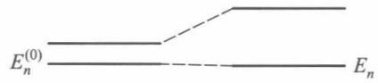
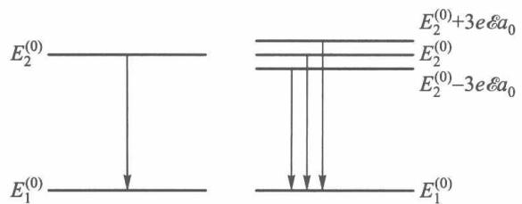
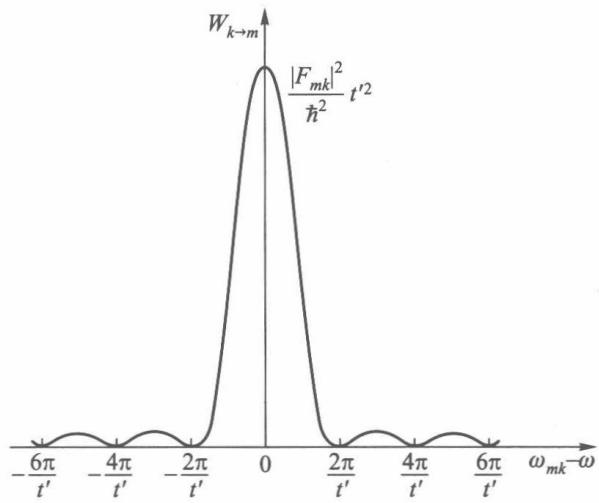
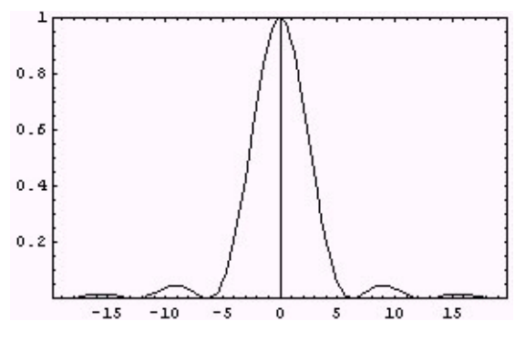
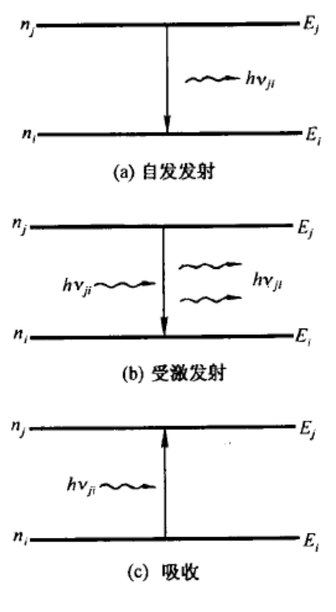

# 第 5 章 微扰理论

!!! note "本章学习范围"

    重点是非简并与简并微扰、一级斯塔克效应、含时微扰、爱因斯坦系数（激光）和选择定则。变分法和氦原子基态（5.4、5.5）是延伸，可以跳过。

!!! tip "本章目标"

    1. 掌握**非简并定态微扰**的一级、二级能量修正和一级波函数修正，会判断微扰论是否适用；
    2. 掌握**简并微扰**：会写出简并子空间里的微扰矩阵，解久期方程，求出“正确的”零级波函数；
    3. 会用简并微扰算氢原子 $n=2$ 能级的**一级斯塔克效应**；
    4. （延伸）理解变分原理 $\overline H\ge E_0$。变分法和氦原子基态属于选学。
    5. 掌握**含时微扰**的一级跃迁振幅，会推导常微扰下的 $\sin^2$ 公式、**费米黄金定则**和周期微扰下的共振条件；
    6. 理解光的吸收、受激发射、自发发射与**爱因斯坦系数**，会用**电偶极选择定则** $\Delta l=\pm1,\ \Delta m=0,\pm1$ 判断跃迁是否允许。

**本章在全书中的位置。** 第 2、3 章能精确求解的只有方势阱、谐振子、氢原子等少数模型；第 4 章告诉我们，“求解薛定谔方程”等价于“在某个表象里把哈密顿矩阵对角化”。本章的全部方法都建立在这句话上：

- **定态微扰**（§5.1—§5.3）：已知 $\hat H^{(0)}$ 的本征基，在这组基里 $\hat H=\hat H^{(0)}+\hat H'$ 的矩阵**几乎是对角的**，把它近似对角化；
- **变分法**（§5.4—§5.5）：不要求 $\hat H'$ 小，只用“任何态的平均能量都不低于基态能量”；
- **含时微扰**（§5.6—§5.9）：$\hat H'(t)$ 随时间变化时，问的不再是“能级是多少”，而是“从一个能级**跳到**另一个能级的概率有多大”——这是光谱、激光和第 6 章散射的基础。

---

## 5.1 非简并定态微扰理论

### 5.1.1 问题的提法

!!! definition "定义 5.1（定态微扰问题）"

    设体系哈密顿算符不显含时间，且可以拆成两部分

    $$\hat H=\hat H^{(0)}+\hat H',$$

    其中 $\hat H^{(0)}$ 的本征值和正交归一本征函数已知：$\hat H^{(0)}\psi_n^{(0)}=E_n^{(0)}\psi_n^{(0)}$；$\hat H'$ 相对于 $\hat H^{(0)}$ 是“小量”，称为**微扰**。要求的是 $\hat H\psi_n=E_n\psi_n$ 的近似解。若 $E_n^{(0)}$ 只对应一个本征函数，称为**非简并**情形。

<figure markdown>
{ width="360" }
<figcaption>图 5.1　受微扰后，能级由 $E_n^{(0)}$ 移到 $E_n$。</figcaption>
</figure>

为了按“小”的程度分出各级方程，写 $\hat H'=\lambda\hat H^{(1)}$（$\lambda$ 是记账用的小参量，最后令 $\lambda=1$），并把本征值和本征函数展成 $\lambda$ 的幂级数：

$$E_n=E_n^{(0)}+\lambda E_n^{(1)}+\lambda^2E_n^{(2)}+\cdots,\qquad \psi_n=\psi_n^{(0)}+\lambda\psi_n^{(1)}+\lambda^2\psi_n^{(2)}+\cdots$$

代入 $\hat H\psi_n=E_n\psi_n$，比较 $\lambda$ 同次幂的系数：

$$
\begin{aligned}
\lambda^0:&\quad (\hat H^{(0)}-E_n^{(0)})\psi_n^{(0)}=0,\\
\lambda^1:&\quad (\hat H^{(0)}-E_n^{(0)})\psi_n^{(1)}=-(\hat H'-E_n^{(1)})\psi_n^{(0)},\\
\lambda^2:&\quad (\hat H^{(0)}-E_n^{(0)})\psi_n^{(2)}=-(\hat H'-E_n^{(1)})\psi_n^{(1)}+E_n^{(2)}\psi_n^{(0)}.
\end{aligned}
$$

### 5.1.2 一级、二级修正公式

记**微扰矩阵元**

$$H'_{mn}=\int\psi_m^{(0)*}\,\hat H'\,\psi_n^{(0)}\,\mathrm{d}V=\langle m|\hat H'|n\rangle ,\qquad H'_{mn}=H'^{*}_{nm}.$$

!!! theorem "定理 5.1（非简并定态微扰公式）"

    设 $E_n^{(0)}$ 非简并，则

    $$E_n=E_n^{(0)}+H'_{nn}+\sum_{m\ne n}\frac{|H'_{mn}|^2}{E_n^{(0)}-E_m^{(0)}}+\cdots,$$

    $$\psi_n=\psi_n^{(0)}+\sum_{m\ne n}\frac{H'_{mn}}{E_n^{(0)}-E_m^{(0)}}\,\psi_m^{(0)}+\cdots$$

    即：**一级能量修正**是微扰在零级态中的期望值 $E_n^{(1)}=H'_{nn}$；**二级能量修正** $E_n^{(2)}=\sum_m'|H'_{mn}|^2/(E_n^{(0)}-E_m^{(0)})$；**一级波函数修正**把其他零级态以权重 $H'_{mn}/(E_n^{(0)}-E_m^{(0)})$ 混进来。（$\sum'$ 表示不含 $m=n$ 的项。）

??? proof "推导"

    **一级能量。** 用 $\psi_n^{(0)*}$ 左乘 $\lambda^1$ 方程并积分。由于 $\hat H^{(0)}$ 厄米、$E_n^{(0)}$ 为实数，

    $$\int\psi_n^{(0)*}(\hat H^{(0)}-E_n^{(0)})\psi_n^{(1)}\,\mathrm{d}V=\int\big[(\hat H^{(0)}-E_n^{(0)})\psi_n^{(0)}\big]^*\psi_n^{(1)}\,\mathrm{d}V=0,$$

    所以 $0=E_n^{(1)}-H'_{nn}$，即 $E_n^{(1)}=H'_{nn}$。

    **一级波函数。** 若 $\psi_n^{(1)}$ 是解，则 $\psi_n^{(1)}+a\psi_n^{(0)}$ 也是解；这一自由度只改变总波函数的相因子和归一化，可选 $a$ 使展开式不含 $\psi_n^{(0)}$：$\psi_n^{(1)}=\sum_l' a_l^{(1)}\psi_l^{(0)}$。代入 $\lambda^1$ 方程，左乘 $\psi_m^{(0)*}$（$m\ne n$）积分，利用正交归一性：

    $$(E_m^{(0)}-E_n^{(0)})a_m^{(1)}=-H'_{mn}\ \Rightarrow\ a_m^{(1)}=\frac{H'_{mn}}{E_n^{(0)}-E_m^{(0)}}.$$

    **二级能量。** 用 $\psi_n^{(0)*}$ 左乘 $\lambda^2$ 方程积分，左边同样为零；右边 $E_n^{(1)}\langle n|\psi_n^{(1)}\rangle=0$（因为 $\psi_n^{(1)}$ 不含 $\psi_n^{(0)}$），于是

    $$E_n^{(2)}=\sum_l' a_l^{(1)}H'_{nl}=\sum_l'\frac{H'_{nl}H'_{ln}}{E_n^{(0)}-E_l^{(0)}}=\sum_l'\frac{|H'_{ln}|^2}{E_n^{(0)}-E_l^{(0)}}. \qquad\blacksquare$$

!!! info "直觉：微扰论就是“几乎对角的矩阵”的近似对角化"

    在 $\hat H^{(0)}$ 的本征基 $\{|n\rangle\}$ 下，

    $$H=\begin{pmatrix}E_1^{(0)}+H'_{11}&H'_{12}&\cdots\\H'_{21}&E_2^{(0)}+H'_{22}&\cdots\\\vdots&\vdots&\ddots\end{pmatrix}.$$

    - 只保留**对角元**，就得到一级能量 $E_n^{(0)}+H'_{nn}$；
    - **非对角元**把能级 $n$ 和 $m$ “耦合”起来，它们的效果要经过一次“出去 $n\to m$、再回来 $m\to n$”，所以是 $|H'_{mn}|^2$ 除以能量差——这就是二级修正。

    两条重要推论：(1) **基态的二级修正总是负的**（分母 $E_0^{(0)}-E_m^{(0)}<0$）；(2) 两个能级通过 $H'_{mn}$ 耦合时，下面的被**推下**、上面的被**推上**——“**能级排斥**”。这和电路里两个耦合谐振回路的频率被“推开”是同一个线性代数事实。题目里可以用“所有能级的二级修正之和为零”来自检：每一对耦合对 $n,m$ 的贡献大小相等、符号相反。

!!! info "从二能级精确解“猜”出二级微扰"

    最简单的微扰问题只有两个能级，可以严格对角化。设

    $$H=\begin{pmatrix}E_1&\Delta\\\Delta&E_2\end{pmatrix},\qquad \lvert\Delta\rvert\ll\lvert E_1-E_2\rvert.$$

    精确本征值是

    $$E_\pm=\frac{E_1+E_2}{2}\pm\frac12\sqrt{(E_1-E_2)^2+4\Delta^2}.$$

    令 $\varepsilon=4\Delta^2/(E_1-E_2)^2$，把 $\sqrt{1+\varepsilon}$ 展开到一阶：$\sqrt{1+\varepsilon}\approx1+\varepsilon/2$，立即得到

    $$E_+\approx E_1+\frac{\Delta^2}{E_1-E_2},\qquad E_-\approx E_2+\frac{\Delta^2}{E_2-E_1}.$$

    这正是定理 5.1 的二级公式。由此可见：

    1. 二级微扰就是精确解按 $\Delta$ 展开到 $\Delta^2$ 阶的结果；
    2. 耦合使两条能级互相推开，低的更低、高的更高；
    3. 适用条件 $\lvert\Delta\rvert\ll\lvert E_1-E_2\rvert$ 就是展开参数 $\varepsilon\ll1$——一旦 $\Delta$ 大到与能级间距相当，抛物线型的二级近似就会与精确曲线分道扬镳（见下面的动画，以及动画 5-2 的回避交叉）。

    “给一个几乎对角的小矩阵，先求精确解，再与二级微扰比较”是最常见的题型，做法就是上面这一段。

<figure class="video" markdown>
<video controls preload="metadata" width="100%" poster="assets/posters/C5_PerturbMatrix.jpg"><source src="assets/videos/C5_PerturbMatrix.mp4" type="video/mp4"></video>
<figcaption>动画 5-1　三能级矩阵 $H^{(0)}+\lambda H'$：实线是精确本征值，彩色虚线是一级近似，白色虚线是二级近似。$\lambda$ 小时二级近似几乎与精确值重合；$\lambda$ 变大，偏差逐渐显现。</figcaption>
</figure>

### 5.1.3 适用条件

级数收敛要求后面的项远小于前面的项。由一级波函数修正的系数得到

!!! success "微扰论适用条件"

    $$\left|\frac{H'_{mn}}{E_n^{(0)}-E_m^{(0)}}\right|\ll1\qquad(E_m^{(0)}\neq E_n^{(0)}).$$

    “小”是**相对于能级间距**而言的：同样大小的 $\hat H'$，对间距大的低能级是小微扰，对间距小的高能级（如氢原子 $E_n\propto1/n^2$，$n$ 大时能级密集）就不再是小微扰。

### 5.1.4 例题

!!! example "例题 5.1（带电谐振子在弱电场中，教材例题）"

    电荷为 $q$ 的线性谐振子受沿 $+x$ 方向的恒定弱电场 $\mathcal E$ 作用，用微扰法求能量和波函数，并与精确解比较。

    **解。** $\hat H=\hat H^{(0)}+\hat H'$，$\hat H^{(0)}=\hbar\omega(\hat a^\dagger\hat a+\tfrac12)$，$\hat H'=-q\mathcal E x=-q\mathcal E\sqrt{\dfrac{\hbar}{2m\omega}}(\hat a^\dagger+\hat a)$（用第 4 章 §4.6 的产生、湮没算符）。由 $\hat a^\dagger|n\rangle=\sqrt{n+1}|n+1\rangle$，$\hat a|n\rangle=\sqrt n|n-1\rangle$：

    $$H'_{mn}=-q\mathcal E\sqrt{\frac{\hbar}{2m\omega}}\left(\sqrt{n+1}\,\delta_{m,n+1}+\sqrt n\,\delta_{m,n-1}\right).$$

    **一级修正** $E_n^{(1)}=H'_{nn}=0$（$x$ 是奇算符，在有确定宇称的态中期望值为零）。

    **二级修正**只有 $m=n\pm1$ 两项，能量差分别为 $\mp\hbar\omega$：

    $$E_n^{(2)}=\frac{q^2\mathcal E^2\hbar}{2m\omega}\left[\frac{n+1}{-\hbar\omega}+\frac{n}{\hbar\omega}\right]=-\frac{q^2\mathcal E^2}{2m\omega^2}.$$

    **一级波函数**

    $$\psi_n^{(1)}=q\mathcal E\sqrt{\frac{1}{2\hbar m\omega^3}}\left[\sqrt{n+1}\,\psi_{n+1}^{(0)}-\sqrt n\,\psi_{n-1}^{(0)}\right]\quad(n=0\text{ 时只有第一项}).$$

    **精确解。** 配方：$\frac12m\omega^2x^2-q\mathcal Ex=\frac12m\omega^2\left(x-\frac{q\mathcal E}{m\omega^2}\right)^2-\frac{q^2\mathcal E^2}{2m\omega^2}$。体系仍是谐振子，平衡位置右移 $q\mathcal E/(m\omega^2)$，每个能级都下降 $\frac{q^2\mathcal E^2}{2m\omega^2}$——与二级微扰结果**完全一致**（更高级修正全为零）。感应偶极矩 $q\langle x\rangle=\frac{q^2\mathcal E}{m\omega^2}$，**极化率** $\alpha=\frac{q^2}{m\omega^2}$。

    这正是电磁场课程里“电子弹簧模型”给出的介质极化率：经典图像与量子微扰论在这里给出同一个答案。

!!! example "例题 5.2（半边加台阶的无限深势阱）"

    宽 $a$ 的无限深势阱 $0<x<a$ 中，在右半边 $a/2<x<a$ 加一个小台阶 $V_0$。求各能级的一级修正。

    **解。** $\psi_n^{(0)}=\sqrt{2/a}\sin\frac{n\pi x}{a}$，

    $$E_n^{(1)}=\frac2a\int_{a/2}^{a}V_0\sin^2\frac{n\pi x}{a}\,\mathrm{d}x=\frac{2V_0}{a}\left[\frac x2-\frac{a}{4n\pi}\sin\frac{2n\pi x}{a}\right]_{a/2}^{a}=\frac{V_0}{2}.$$

    每个能级都升高 $V_0/2$：粒子在每个定态中“一半时间”待在右半边。适用条件 $|H'_{mn}|\ll|E_n^{(0)}-E_m^{(0)}|$ 要求 $V_0\ll\pi^2\hbar^2/(2ma^2)$。

!!! warning "易错点"

    - 公式里的 $H'_{mn}$ 必须用 **$\hat H^{(0)}$ 的归一化本征函数**计算，不是 $\hat H$ 的。
    - 二级修正分母是 $E_n^{(0)}-E_m^{(0)}$（**自己减别人**），顺序反了符号就错；基态的二级修正必为负。
    - 一级修正为零（常见于奇宇称微扰）时，必须算二级修正，不能说“能量不变”。
    - 公式只适用于**非简并**能级；若存在 $E_m^{(0)}=E_n^{(0)}$ 而 $H'_{mn}\ne0$，分母为零，必须改用 §5.2。

---

## 5.2 简并情况下的微扰理论

### 5.2.1 困难在哪里

设 $E_n^{(0)}$ 是 $k$ 度简并的：$\hat H^{(0)}\phi_i=E_n^{(0)}\phi_i$（$i=1,\dots,k$）。在这个 $k$ 维**简并子空间**里，$\hat H^{(0)}$ 就是常数 $E_n^{(0)}$ 乘单位矩阵，任何线性组合都是它的本征函数——零级波函数**不能事先确定**。哪一组组合“正确”，要由微扰来挑选。

### 5.2.2 久期方程

把零级波函数写成 $\psi_n^{(0)}=\sum_{i=1}^kc_i^{(0)}\phi_i$，代入 $\lambda^1$ 方程，左乘 $\phi_l^*$ 积分（左边仍为零），得到

!!! theorem "定理 5.2（简并微扰：久期方程）"

    零级系数满足齐次线性方程组

    $$\sum_{i=1}^{k}\left(H'_{li}-E_n^{(1)}\delta_{li}\right)c_i^{(0)}=0,\qquad l=1,2,\dots,k,\qquad H'_{li}=\int\phi_l^*\hat H'\phi_i\,\mathrm{d}V.$$

    非零解条件为**久期方程**

    $$\det\left|H'_{li}-E_n^{(1)}\delta_{li}\right|=0 .$$

    它的 $k$ 个根 $E_{nj}^{(1)}$ 就是一级能量修正，$E_{nj}=E_n^{(0)}+E_{nj}^{(1)}$。根互不相同时简并**完全消除**；有重根时只**部分消除**。把每个根代回方程组解出 $c_i^{(0)}$，得到对应的零级波函数。

!!! info "直觉：在简并子空间里把 $\hat H'$ 对角化"

    久期方程就是 $k\times k$ 厄米矩阵 $(H'_{li})$ 的**特征方程**：一级修正 = 它的本征值，零级波函数 = 它的本征矢。第 4 章说“求本征值 = 矩阵对角化”，这里只是把对角化限制在简并子空间里做。

    **实用技巧（好量子数）。** 如果能找到一个与 $\hat H'$ 和 $\hat H^{(0)}$ 都对易的算符，并用它的本征态作简并子空间的基，那么 $\hat H'$ 在这组基里**已经是对角的**，可以直接读出一级修正。§5.3 中 $\hat L_z$ 把矩阵分块，§7.5 精细结构用耦合表象，都是这个技巧。

<figure class="video" markdown>
<video controls preload="metadata" width="100%" poster="assets/posters/C5_AvoidedCrossing.jpg"><source src="assets/videos/C5_AvoidedCrossing.mp4" type="video/mp4"></video>
<figcaption>动画 5-2　两能级模型 $H=\begin{pmatrix}\varepsilon&V\\V&-\varepsilon\end{pmatrix}$：耦合 $V$ 把能级交叉变成间隙 $2|V|$ 的回避交叉。远离简并点时本征态接近 $|a\rangle$ 或 $|b\rangle$（非简并微扰适用）；在简并点，本征态是 $\frac1{\sqrt2}(|a\rangle\pm|b\rangle)$，只能由对角化得到。</figcaption>
</figure>

!!! example "例题 5.3（二维各向同性谐振子的第一激发态）"

    二维各向同性谐振子 $\hat H^{(0)}=\frac{\hat p_x^2+\hat p_y^2}{2m}+\frac12m\omega^2(x^2+y^2)$ 受微扰 $\hat H'=\lambda xy$（$\lambda$ 小）。求第一激发态的一级能量修正和零级波函数。

    **解。** $E_{n_xn_y}^{(0)}=(n_x+n_y+1)\hbar\omega$。第一激发态 $E^{(0)}=2\hbar\omega$ 二重简并：$\phi_1=|1,0\rangle$，$\phi_2=|0,1\rangle$。

    由 $\langle1|x|0\rangle=\sqrt{\hbar/(2m\omega)}$，$\langle0|x|0\rangle=\langle1|x|1\rangle=0$：

    $$H'_{11}=\lambda\langle1|x|1\rangle\langle0|y|0\rangle=0=H'_{22},\qquad H'_{12}=\lambda\langle1|x|0\rangle\langle0|y|1\rangle=\frac{\lambda\hbar}{2m\omega}.$$

    久期方程 $\begin{vmatrix}-E^{(1)}&\frac{\lambda\hbar}{2m\omega}\\\frac{\lambda\hbar}{2m\omega}&-E^{(1)}\end{vmatrix}=0$，得 $E^{(1)}=\pm\dfrac{\lambda\hbar}{2m\omega}$。

    对应零级波函数 $\frac{1}{\sqrt2}(|1,0\rangle\pm|0,1\rangle)$。几何上看，$xy=\frac12(u^2-v^2)$，其中 $u,v$ 是沿 $45^\circ$ 方向的坐标：微扰让两个对角方向的“弹簧”一软一硬，正确的零级态就是沿这两个方向振动的态。

!!! example "例题 5.4（矩阵形式的微扰问题——简并与非简并同时出现）"

    设体系哈密顿量在某表象中的矩阵为（$\varepsilon\ll1$）

    $$H=\begin{pmatrix}1&2\varepsilon&0\\2\varepsilon&2+\varepsilon&\sqrt2\,\varepsilon\\0&\sqrt2\,\varepsilon&2+2\varepsilon\end{pmatrix}.$$

    用微扰论求能量：非简并能级求到二级、波函数求到一级；简并能级求到一级。

    **解**　拆成 $H^{(0)}=\operatorname{diag}(1,2,2)$ 与 $H'=\varepsilon\begin{pmatrix}0&2&0\\2&1&\sqrt2\\0&\sqrt2&2\end{pmatrix}$。$E_1^{(0)}=1$ 非简并，$E_2^{(0)}=E_3^{(0)}=2$ 二重简并。

    **非简并能级** $E_1$：$E_1^{(1)}=H'_{11}=0$，

    $$E_1^{(2)}=\frac{|H'_{21}|^2}{E_1^{(0)}-E_2^{(0)}}+\frac{|H'_{31}|^2}{E_1^{(0)}-E_3^{(0)}}=\frac{4\varepsilon^2}{1-2}+0=-4\varepsilon^2,\qquad E_1\approx1-4\varepsilon^2 ;$$

    $$\psi_1\approx\psi_1^{(0)}+\frac{H'_{21}}{E_1^{(0)}-E_2^{(0)}}\psi_2^{(0)}=\begin{pmatrix}1\\-2\varepsilon\\0\end{pmatrix}.$$

    **简并能级**：在 $\{\psi_2^{(0)},\psi_3^{(0)}\}$ 子空间内

    $$\begin{vmatrix}\varepsilon-E^{(1)}&\sqrt2\,\varepsilon\\\sqrt2\,\varepsilon&2\varepsilon-E^{(1)}\end{vmatrix}=E^{(1)}\big(E^{(1)}-3\varepsilon\big)=0,$$

    所以 $E\approx2$（零级态 $\frac{1}{\sqrt3}(\sqrt2\,\psi_2^{(0)}-\psi_3^{(0)})$）和 $E\approx2+3\varepsilon$（零级态 $\frac{1}{\sqrt3}(\psi_2^{(0)}+\sqrt2\,\psi_3^{(0)})$）。

    **检验**：三个近似本征值之和 $1-4\varepsilon^2+2+2+3\varepsilon=5+3\varepsilon-4\varepsilon^2$，与 $\operatorname{Tr}H=5+3\varepsilon$ 只差 $O(\varepsilon^2)$——差额正是简并能级被 $E_1$ “推上去”的二级修正 $+4\varepsilon^2$ 分到 $E_2,E_3$ 上。这类“给矩阵、分块处理”的题目是期末最常见的题型：**先看对角元判断简并，非简并块用公式，简并块解小久期方程**。

!!! warning "易错点"

    - 简并时**不能**直接套非简并公式（分母为零）；也不能随便选 $\phi_i$ 当零级波函数。
    - 久期方程只用**简并子空间内部**的矩阵元 $H'_{li}$，不涉及其他能级。
    - 若久期方程有重根，零级波函数在对应子空间内仍可任意组合（如 §5.3 的 $\psi_{21,\pm1}$）。

---

## 5.3 氢原子的一级斯塔克效应

氢原子置于沿 $z$ 轴的均匀外电场 $\mathcal E$ 中（**斯塔克效应**）。电子电荷 $-e$，附加势能

$$\hat H'=e\boldsymbol{\mathcal E}\cdot\boldsymbol r=e\mathcal E z=e\mathcal E r\cos\theta .$$

通常实验室电场（$\lesssim10^{7}\ \mathrm{V/m}$）远小于原子内部电场（$\sim10^{11}\ \mathrm{V/m}$），可以当作微扰。

**基态** $n=1$ 不简并，$H'_{11}=e\mathcal E\langle100|z|100\rangle=0$（奇宇称），没有一级效应。

**$n=2$ 能级**四重简并（第 3 章 §3.3）：

$$\phi_1=\psi_{200},\quad \phi_2=\psi_{210},\quad \phi_3=\psi_{211},\quad \phi_4=\psi_{21,-1},$$

$$\psi_{200}=\frac{1}{4\sqrt{2\pi a_0^3}}\left(2-\frac{r}{a_0}\right)e^{-r/2a_0},\qquad \psi_{210}=\frac{1}{4\sqrt{2\pi a_0^3}}\frac{r}{a_0}e^{-r/2a_0}\cos\theta .$$

### 5.3.1 微扰矩阵

两条对称性论证让 16 个矩阵元中 14 个为零：

- **$\varphi$ 积分**：$z$ 与 $\varphi$ 无关，$\int_0^{2\pi}e^{\mathrm i(m-m')\varphi}\mathrm{d}\varphi=0$（$m\neq m'$），所以只有 $\Delta m=0$ 的元可能非零；
- **宇称**：$z$ 是奇算符，只连接宇称相反的态，$\Delta l=\pm1$；对角元全为零。

剩下 $H'_{12}=H'_{21}$。角向积分：$Y_{00}\cos\theta=\frac1{\sqrt3}Y_{10}$，故 $\int Y_{00}\cos\theta\,Y_{10}\,\mathrm{d}\Omega=\frac1{\sqrt3}$。径向积分（令 $\rho=r/a_0$）：

$$H'_{12}=\frac{e\mathcal E}{\sqrt3}\int_0^\infty R_{20}R_{21}\,r^3\,\mathrm{d}r=\frac{e\mathcal Ea_0}{24}\int_0^\infty(2-\rho)\rho^4e^{-\rho}\,\mathrm{d}\rho=\frac{e\mathcal Ea_0}{24}(2\cdot4!-5!)=-3e\mathcal Ea_0 .$$

### 5.3.2 久期方程与结果

$$\begin{vmatrix}-E^{(1)}&-3e\mathcal Ea_0&0&0\\-3e\mathcal Ea_0&-E^{(1)}&0&0\\0&0&-E^{(1)}&0\\0&0&0&-E^{(1)}\end{vmatrix}=\big(E^{(1)}\big)^2\left[\big(E^{(1)}\big)^2-(3e\mathcal Ea_0)^2\right]=0 .$$

!!! theorem "结论（氢原子 $n=2$ 的一级斯塔克效应）"

    | 一级修正 | 零级波函数 | 电偶极矩 $\boldsymbol p=-e\langle\boldsymbol r\rangle$ |
    |---|---|---|
    | $+3e\mathcal Ea_0$ | $\frac1{\sqrt2}(\psi_{200}-\psi_{210})$ | 与 $\boldsymbol{\mathcal E}$ 反平行，大小 $3ea_0$ |
    | $-3e\mathcal Ea_0$ | $\frac1{\sqrt2}(\psi_{200}+\psi_{210})$ | 与 $\boldsymbol{\mathcal E}$ 平行，大小 $3ea_0$ |
    | $0$（二重） | $\psi_{211},\ \psi_{21,-1}$ 的任意组合 | 垂直于 $\boldsymbol{\mathcal E}$ |

    四重简并能级分裂为三个，简并**部分**消除；能移与 $\mathcal E$ 成**正比**（线性斯塔克效应）。

<figure markdown>
{ width="460" }
<figcaption>图 5.2　左：无外场时 $n=2\to n=1$ 只有一条谱线；右：外电场中 $n=2$ 分裂为三，谱线也分裂为三条（间隔 $3e\mathcal Ea_0$）。</figcaption>
</figure>

<figure class="video" markdown>
<video controls preload="metadata" width="100%" poster="assets/posters/C5_Stark.jpg"><source src="assets/videos/C5_Stark.mp4" type="video/mp4"></video>
<figcaption>动画 5-3　一级斯塔克效应：电场增大，$n=2$ 能级线性分裂；右侧是两个零级态在 $xz$ 平面的电子密度，2s 与 2p$_0$ 叠加后电子云偏向一侧，就像一个永久电偶极子。</figcaption>
</figure>

!!! info "为什么氢原子有“线性”斯塔克效应，其他原子没有？"

    能量对 $\mathcal E$ 线性，等价于态具有不随场变化的**永久**偶极矩 $\boldsymbol p$（$\Delta E=-\boldsymbol p\cdot\boldsymbol{\mathcal E}$）。有确定宇称的态不可能有永久偶极矩；氢原子特殊在 2s 与 2p **偶然简并**（库仑势特有），电场一来，它们可以零代价地混合成没有确定宇称的态。碱金属原子中 $E_{ns}\ne E_{np}$，只能出现 $\propto\mathcal E^2$ 的二级效应（感应偶极矩，同例题 5.1）。

!!! warning "易错点"

    - 电子电荷为 $-e$，势能是 $+e\mathcal Ez$；偶极矩是 $-e\langle\boldsymbol r\rangle$，方向别弄反。
    - 角向积分别漏掉 $1/\sqrt3$；径向积分别漏掉 $r^2$ 体积元（被积函数是 $R_{20}\,r\,R_{21}\,r^2$）。
    - “分裂为三条”是能级数；$0$ 那条仍二重简并。

---

## 5.4 变分法

!!! warning "延伸 · 选学"
    变分法和后面的 5.5 可以一起跳过。

微扰论要求 $\hat H^{(0)}$ 可解且 $\hat H'$ 小。两个条件都不满足时，基态能量还有一个强有力的工具。

!!! theorem "定理 5.3（变分原理）"

    设 $\hat H$ 的最低本征值为 $E_0$。对任意（满足边界条件的）波函数 $\psi$，

    $$\overline H\equiv\frac{\int\psi^*\hat H\psi\,\mathrm{d}V}{\int\psi^*\psi\,\mathrm{d}V}\ \ge\ E_0,$$

    等号当且仅当 $\psi$ 是基态波函数时成立。

??? proof "证明"

    把归一化的 $\psi$ 按 $\hat H$ 的本征函数展开 $\psi=\sum_na_n\psi_n$，$\sum|a_n|^2=1$：

    $$\overline H=\sum_{m,n}a_m^*a_nE_n\delta_{mn}=\sum_n|a_n|^2E_n\ \ge\ E_0\sum_n|a_n|^2=E_0 .\qquad\blacksquare$$

    $\overline H$ 是本征值的**加权平均**，权重非负、和为 1，平均值当然不低于最小值。线性代数里它就是**瑞利商**：厄米矩阵的瑞利商的最小值等于最小本征值。

!!! success "变分法的步骤"

    1. 根据物理图像选含参数 $\lambda$ 的**尝试波函数** $\psi(\lambda)$（满足边界条件、对称性，形状尽量像真解）；
    2. 计算 $\overline H(\lambda)$；
    3. 由 $\dfrac{\mathrm{d}\overline H}{\mathrm{d}\lambda}=0$ 求极小值 $\overline H(\lambda_0)$，它就是 $E_0$ 的**上界**近似；$\psi(\lambda_0)$ 是近似基态波函数。

    能量的误差是波函数误差的**二阶小量**：波函数只要“大致像”，能量就相当准。

!!! example "例题 5.5（用高斯函数估计氢原子基态）"

    取尝试函数 $\psi=e^{-\alpha r^2}$，求氢原子基态能量的变分估计。

    **解。** 记 $k=\dfrac{e^2}{4\pi\varepsilon_0}$。用高斯积分 $\int_0^\infty r^{2}e^{-2\alpha r^2}\mathrm{d}r$ 等可得

    $$\langle T\rangle=\frac{3\hbar^2\alpha}{2m},\qquad \langle V\rangle=-k\left\langle\frac1r\right\rangle=-2k\sqrt{\frac{2\alpha}{\pi}} .$$

    $\overline H(\alpha)=A\alpha-B\sqrt\alpha$（$A=\frac{3\hbar^2}{2m}$，$B=2k\sqrt{2/\pi}$），极小值在 $\sqrt\alpha=\frac{B}{2A}$，

    $$\overline H_{\min}=-\frac{B^2}{4A}=-\frac{8}{3\pi}\cdot\frac{mk^2}{2\hbar^2}=-\frac{8}{3\pi}\times13.6\ \mathrm{eV}\approx-11.5\ \mathrm{eV}.$$

    比精确值 $-13.6\ \mathrm{eV}$ 高（上界），误差约 15%：高斯函数在原点没有尖峰、在远处衰减太快，形状不够像。若改用 $e^{-r/b}$ 作尝试函数，变分结果恰为精确值。

!!! info "联系：线性变分 = 矩阵本征值问题"

    若尝试函数取有限个已知函数的线性组合 $\psi=\sum_{i=1}^Nc_i\chi_i$，令 $\overline H$ 对 $c_i$ 取极值，得到 $N\times N$ 广义本征值问题 $\mathbf H\boldsymbol c=E\,\mathbf S\boldsymbol c$。这就是量子化学和第 8 章海特勒–伦敦法的基础，也是有限元法里“刚度矩阵、质量矩阵”的同一套数学。

---

## 5.5 氦原子基态（变分法）

!!! warning "延伸 · 选学"
    氦原子基态能量的计算可以跳过。

氦原子：核电荷 $2e$（视为不动），两个电子。

$$\hat H=-\frac{\hbar^2}{2m}(\nabla_1^2+\nabla_2^2)-\frac{2e^2}{4\pi\varepsilon_0r_1}-\frac{2e^2}{4\pi\varepsilon_0r_2}+\frac{e^2}{4\pi\varepsilon_0r_{12}} .$$

若去掉最后一项（电子间排斥），两个电子各自在 $Z=2$ 的类氢原子中运动，基态是两个 1s 函数之积。电子互相**屏蔽**核电荷，所以把 $Z$ 当作变分参数：

$$\Psi(\boldsymbol r_1,\boldsymbol r_2)=\frac{Z^3}{\pi a_0^3}e^{-Z(r_1+r_2)/a_0}.$$

三部分期望值（以 $\frac{e^2}{4\pi\varepsilon_0a_0}$ 为单位）：

| 项 | 结果 | 说明 |
|---|---|---|
| 动能 | $Z^2$ | 两个 1s 电子，各 $Z^2/2$ |
| 核吸引 | $-4Z$ | 核电荷是 $2$ 而不是 $Z$：$2\times(-2)\times Z$ |
| 电子互斥 | $\frac58Z$ | 见下 |

**互斥积分**用 $\frac1{r_{12}}$ 的勒让德展开 $\frac{1}{r_{12}}=\sum_l\frac{r_<^l}{r_>^{l+1}}P_l(\cos\Theta)$，球对称分布只留下 $l=0$ 项：

$$\frac{1}{r_{12}}\ \to\ \frac{1}{r_>}=\frac{1}{\max(r_1,r_2)} .$$

这正是电磁场中**球壳定理**：球对称电荷壳在外部的电位如同电荷集中在球心，在内部为常数（见 §8.4 图 8.4 的算法）。积分得 $\frac{5Z}{8}$。

$$\overline H(Z)=\frac{e^2}{4\pi\varepsilon_0a_0}\left(Z^2-4Z+\frac58Z\right)=\frac{e^2}{4\pi\varepsilon_0a_0}\left(Z^2-\frac{27}{8}Z\right).$$

由 $\mathrm{d}\overline H/\mathrm{d}Z=0$：$Z_{\min}=\dfrac{27}{16}\approx1.69$，

$$E_0\approx-\left(\frac{27}{16}\right)^2\frac{e^2}{4\pi\varepsilon_0a_0}=-2.85\,\frac{e^2}{4\pi\varepsilon_0a_0}\approx-77.5\ \mathrm{eV}.$$

<figure class="video" markdown>
<video controls preload="metadata" width="100%" poster="assets/posters/C5_Helium.jpg"><source src="assets/videos/C5_Helium.mp4" type="video/mp4"></video>
<figcaption>动画 5-4　氦原子基态：$\overline H(Z)=Z^2-\frac{27}{8}Z$。在 $Z=2$ 处的值 $-2.75$ 恰好就是一级微扰的结果（§8.4），曲线最低点 $Z=27/16$ 给出 $-2.85$，更接近实验值 $-2.904$。</figcaption>
</figure>

!!! info "两种方法的联系"

    一级微扰（§8.4）= 用**未屏蔽**的零级波函数 $Z=2$ 求 $\langle\hat H\rangle$ = 变分曲线在 $Z=2$ 的值。变分法让 $Z$ 自由调整，必然不会更差。物理上：每个电子“看到”的核电荷是 $2-\frac{5}{16}$，另一个电子屏蔽掉了约 $0.31$ 个电荷。

---

## 5.6 与时间有关的微扰理论

### 5.6.1 跃迁振幅方程

设 $\hat H(t)=\hat H_0+\hat H'(t)$，$\hat H_0\phi_n=\epsilon_n\phi_n$ 已知。把 $\Psi$ 按 $\hat H_0$ 的**定态** $\Phi_n=\phi_ne^{-\mathrm i\epsilon_nt/\hbar}$ 展开：

$$\Psi(t)=\sum_na_n(t)\Phi_n .$$

若没有微扰，$a_n$ 为常数；微扰使 $a_n$ 缓慢变化。代入 $\mathrm i\hbar\partial_t\Psi=\hat H\Psi$，消去 $\hat H_0$ 部分，左乘 $\Phi_m^*$ 积分，得到**精确**的方程组

$$\mathrm i\hbar\frac{\mathrm{d}a_m}{\mathrm{d}t}=\sum_na_n(t)\,H'_{mn}(t)\,e^{\mathrm i\omega_{mn}t},\qquad \omega_{mn}=\frac{\epsilon_m-\epsilon_n}{\hbar}\ (\text{玻尔频率}).$$

### 5.6.2 一级近似

设 $t=0$ 时体系处于 $\Phi_k$：$a_n(0)=\delta_{nk}$。零级近似下右边取 $a_n=\delta_{nk}$，积分得

!!! theorem "定理 5.4（一级跃迁振幅与跃迁概率）"

    $$a_m^{(1)}(t)=\frac{1}{\mathrm i\hbar}\int_0^tH'_{mk}(t')\,e^{\mathrm i\omega_{mk}t'}\,\mathrm{d}t',\qquad W_{k\to m}(t)=\big|a_m^{(1)}(t)\big|^2\quad(m\ne k).$$

    适用条件：$W_{k\to m}\ll1$，即初态几乎没有被“掏空”。

!!! info "直觉：跃迁振幅 = 微扰在玻尔频率处的傅里叶分量"

    把积分上限推到 $t\to\infty$，$a_m^{(1)}\propto\int H'_{mk}(t)e^{\mathrm i\omega_{mk}t}\mathrm{d}t$——就是 $H'_{mk}(t)$ 在频率 $\omega_{mk}$ 处的**频谱**。微扰的频谱里没有 $\omega_{mk}$ 成分，就引不起 $k\to m$ 跃迁。这和“用含 $f_0$ 分量的信号才能激励谐振频率为 $f_0$ 的 LC 回路”是一回事：原子是一组谐振器，频率为 $\omega_{mk}$，“耦合强度”是 $H'_{mk}$。

!!! example "例题 5.6（随时间指数衰减的电场，教材习题 5.5）"

    基态氢原子处于均匀电场 $\mathcal E(t)=\mathcal E_0e^{-t/\tau}$（$t\ge0$，沿 $z$ 轴）中。求长时间后处于 2p 态的概率。

    **解。** $\hat H'=e\mathcal E(t)z$。由选择定则（§5.9），只有 $m=0$ 的 $\psi_{210}$ 有非零矩阵元：

    $$z_{210,100}=\int\psi_{210}^*\,r\cos\theta\,\psi_{100}\,\mathrm{d}V=\frac{128\sqrt2}{243}a_0\approx0.745\,a_0 .$$

    $$a_{210}(\infty)=\frac{e\mathcal E_0z_{21}}{\mathrm i\hbar}\int_0^\infty e^{-t/\tau}e^{\mathrm i\omega_{21}t}\mathrm{d}t=\frac{e\mathcal E_0z_{21}}{\mathrm i\hbar}\cdot\frac{1}{1/\tau-\mathrm i\omega_{21}},$$

    $$W_{1\mathrm s\to2\mathrm p}=\frac{e^2\mathcal E_0^2|z_{21}|^2}{\hbar^2\left(\omega_{21}^2+\tau^{-2}\right)}=\frac{2^{15}}{3^{10}}\cdot\frac{e^2\mathcal E_0^2a_0^2}{\hbar^2\left(\omega_{21}^2+\tau^{-2}\right)},\qquad \omega_{21}=\frac{3}{4}\cdot\frac{13.6\ \mathrm{eV}}{\hbar}.$$

    **讨论。** $\tau\to0$（突然的脉冲）时 $W$ 趋于零：其实是 $\mathcal E_0\tau$ 有限时脉冲越短频谱越宽；$\tau\omega_{21}\gg1$（缓慢变化）时 $W\propto1/\omega_{21}^2$ 且很小——**绝热**变化不引起跃迁。频谱 $1/(1/\tau-\mathrm i\omega)$ 就是一阶 RC 低通的频率响应。

---

## 5.7 跃迁概率

### 5.7.1 常微扰：$\sin^2$ 公式

设 $\hat H'$ 在 $0\le t'\le t$ 内不随时间变化。由定理 5.4，

$$a_m^{(1)}(t)=-\frac{H'_{mk}}{\hbar}\cdot\frac{e^{\mathrm i\omega_{mk}t}-1}{\omega_{mk}},\qquad W_{k\to m}(t)=\frac{4|H'_{mk}|^2}{\hbar^2}\cdot\frac{\sin^2(\omega_{mk}t/2)}{\omega_{mk}^2}.$$

把它看成 $\omega_{mk}$ 的函数（图 5.3）：

- 主峰在 $\omega_{mk}=0$（**能量守恒**的方向），峰高 $\propto t^2$；
- 主峰宽度 $\Delta\omega_{mk}\sim\dfrac{4\pi}{t}$，随时间变窄；
- 曲线下面积 $\propto t$。

<figure markdown>
{ width="440" }
<figcaption>图 5.3　作用时间为 $t'$ 时，跃迁概率对 $\omega_{mk}-\omega$ 的分布：主峰宽 $\sim2\pi/t'$。</figcaption>
</figure>

<figure markdown>
{ width="440" }
<figcaption>图 5.4　函数 $\sin^2(\omega_{mk}t/2)/\omega_{mk}^2$ 的形状：主峰在 $\omega_{mk}=0$，两侧有逐渐衰减的次峰。峰高 $\propto t^2$，宽度 $\propto 1/t$，曲线下面积 $\propto t$，由此自然引出跃迁速率和费米黄金定则。（图源：QMUSTB）</figcaption>
</figure>

!!! theorem "引理（$\delta$ 函数的一种表示）"

    $$\lim_{t\to\infty}\frac{\sin^2xt}{\pi tx^2}=\delta(x).$$

    证明：$x\ne0$ 时极限为 $0$；$x=0$ 时趋于 $\infty$；且对任意 $t$，令 $u=xt$，

    $$\int_{-\infty}^{\infty}\frac{\sin^2xt}{\pi tx^2}\,\mathrm{d}x=\frac1\pi\int_{-\infty}^{\infty}\frac{\sin^2u}{u^2}\,\mathrm{d}u=1 .$$

    最后一个积分可以用留数定理计算（对 $\frac{1-e^{2\mathrm iz}}{2z^2}$ 取上半平面围道并绕开原点的极点），见[复变函数讲义第 5 章 §5.3 留数在定积分计算中的应用](https://cockroach-f.github.io/complex-functions/ch5.html)。

### 5.7.2 费米黄金定则

若末态 $m$ 是**连续分布**的（如电离后的自由电子），以 $\rho(m)\,\mathrm{d}\epsilon_m$ 表示能量在 $\epsilon_m\sim\epsilon_m+\mathrm{d}\epsilon_m$ 中的末态数（**态密度**），总跃迁概率要对末态求和：

$$W=\int\big|a_m^{(1)}\big|^2\rho(m)\,\mathrm{d}\epsilon_m=\frac{4}{\hbar}\int|H'_{mk}|^2\rho(m)\frac{\sin^2(\omega_{mk}t/2)}{\omega_{mk}^2}\,\mathrm{d}\omega_{mk}.$$

$t$ 足够大时，由引理 $\frac{\sin^2(\omega t/2)}{\omega^2}\to\frac{\pi t}{2}\delta(\omega)$；$|H'_{mk}|^2\rho$ 随 $\epsilon_m$ 平滑变化，可提到积分外：

!!! theorem "定理 5.5（费米黄金定则）"

    常微扰作用下，由分立初态 $k$ 跃迁到连续末态的**单位时间跃迁概率**为

    $$w=\frac{W}{t}=\frac{2\pi}{\hbar}\,|H'_{mk}|^2\,\rho(m),$$

    其中 $H'_{mk}$、$\rho(m)$ 取在 $\epsilon_m=\epsilon_k$（能量守恒）处。

<figure class="video" markdown>
<video controls preload="metadata" width="100%" poster="assets/posters/C5_GoldenRule.jpg"><source src="assets/videos/C5_GoldenRule.mp4" type="video/mp4"></video>
<figcaption>动画 5-5　左：$\frac{\sin^2(\omega t/2)}{(\omega/2)^2}$ 随 $t$ 增大，峰高 $\propto t^2$、峰宽 $\propto1/t$；右：除以 $t$ 后曲线下面积恒为 $2\pi$，形状收缩成 $2\pi\delta(\omega)$。对连续末态积分时概率 $\propto t$，所以跃迁“速率”是常数。</figcaption>
</figure>

!!! warning "为什么概率先 $\propto t^2$、后又 $\propto t$？"

    对**单个**精确共振的末态，$W\propto t^2$（振幅 $\propto t$ 的相干累积）；对**一群**连续分布的末态，只有宽度 $\sim1/t$ 内的末态能跟上，数目 $\propto1/t$，于是 $t^2\times\frac1t=t$。黄金定则只适用于后一种情况，并且要求 $t$ 足够长（峰远窄于 $\rho$、$H'$ 的变化尺度）又足够短（$W\ll1$）。

**自由粒子末态的态密度。** 用边长 $L$ 的箱归一化 $\phi_{\boldsymbol p}=L^{-3/2}e^{\mathrm i\boldsymbol p\cdot\boldsymbol r/\hbar}$，动量取值间隔 $2\pi\hbar/L$，动量空间每个态占体积 $(2\pi\hbar/L)^3$。动量大小在 $p\sim p+\mathrm{d}p$、方向在立体角 $\mathrm{d}\Omega$ 内的态数为 $\left(\frac{L}{2\pi\hbar}\right)^3p^2\,\mathrm{d}p\,\mathrm{d}\Omega$；由 $\epsilon=\frac{p^2}{2m}$，$\mathrm{d}\epsilon=\frac pm\mathrm{d}p$：

$$\rho(m)=\left(\frac{L}{2\pi\hbar}\right)^3mp\,\mathrm{d}\Omega .$$

第 6 章将用它推出玻恩近似。

### 5.7.3 周期微扰：共振吸收与发射

设 $\hat H'(t)=\hat F\left(e^{\mathrm i\omega t}+e^{-\mathrm i\omega t}\right)$（即 $2\hat F\cos\omega t$），代入定理 5.4：

$$a_m(t)=-\frac{F_{mk}}{\hbar}\left[\frac{e^{\mathrm i(\omega_{mk}+\omega)t}-1}{\omega_{mk}+\omega}+\frac{e^{\mathrm i(\omega_{mk}-\omega)t}-1}{\omega_{mk}-\omega}\right].$$

只有当某个分母接近零时振幅才随时间增长，因此只在**共振**条件

$$\omega\approx\pm\omega_{mk}\qquad\Longleftrightarrow\qquad\epsilon_m=\epsilon_k\pm\hbar\omega$$

下才有明显跃迁：$+$ 号是**吸收**（$\epsilon_m>\epsilon_k$），$-$ 号是**受激发射**（$\epsilon_m<\epsilon_k$）。只保留共振项，同 §5.7.1 的推导：

!!! theorem "定理 5.6（周期微扰的跃迁速率）"

    $$w_{k\to m}=\frac{2\pi}{\hbar}|F_{mk}|^2\,\delta(\epsilon_m-\epsilon_k\mp\hbar\omega).$$

    因为 $\hat F$ 厄米，$|F_{mk}|=|F_{km}|$，所以 $w_{k\to m}=w_{m\to k}$：**吸收与受激发射的概率相等**（细致平衡）。

### 5.7.4 能量–时间不确定关系

微扰只作用 $t'$ 时间，跃迁谱线主峰宽 $\Delta\omega_{mk}\sim1/t'$。初态能量确定，于是末态能量“不确定”$\Delta E_m=\hbar\Delta\omega_{mk}$：

$$\Delta E\,\Delta t\sim\hbar .$$

信号与系统的语言：一段长 $T$ 的正弦波，频谱宽度 $\sim1/T$。量子力学里频率就是能量除以 $\hbar$。

---

## 5.8 光的发射和吸收

### 5.8.1 爱因斯坦系数

考虑能级 $\epsilon_k<\epsilon_m$，$\hbar\omega_{mk}=\epsilon_m-\epsilon_k$。光场频率 $\omega\sim\omega+\mathrm{d}\omega$ 内的能量密度为 $I(\omega)\mathrm{d}\omega$。

!!! definition "定义 5.2（爱因斯坦系数）"

    - **自发发射系数** $A_{mk}$：无外场时，单位时间内原子由 $\epsilon_m$ 自发跃迁到 $\epsilon_k$ 的概率；
    - **受激发射系数** $B_{mk}$：单位时间受激跃迁 $m\to k$ 的概率为 $B_{mk}I(\omega_{mk})$；
    - **吸收系数** $B_{km}$：单位时间吸收跃迁 $k\to m$ 的概率为 $B_{km}I(\omega_{mk})$。

<figure markdown>
{ width="280" }
<figcaption>图 5.5　光与原子相互作用的三个过程：(a) 自发发射（与外场无关）；(b) 受激发射（外场光子诱发，末态多一个全同光子）；(c) 吸收。细致平衡要求 $B_{mk}=B_{km}$，再与普朗克公式比较就定出 $A$ 与 $B$ 的关系。（图源：QMUSTB）</figcaption>
</figure>

!!! theorem "定理 5.7（爱因斯坦关系）"

    $$B_{mk}=B_{km},\qquad A_{mk}=\frac{\hbar\omega_{mk}^3}{\pi^2c^3}B_{mk}.$$

??? proof "推导（热平衡）"

    温度 $T$ 下原子与辐射平衡：$N_m\left[A_{mk}+B_{mk}I\right]=N_kB_{km}I$。玻尔兹曼分布 $N_k/N_m=e^{\hbar\omega_{mk}/k_BT}$，解出

    $$I(\omega_{mk})=\frac{A_{mk}/B_{km}}{e^{\hbar\omega_{mk}/k_BT}-B_{mk}/B_{km}} .$$

    它必须与普朗克公式 $I(\omega)=\frac{\hbar\omega^3}{\pi^2c^3}\cdot\frac{1}{e^{\hbar\omega/k_BT}-1}$（即 $\rho(\nu)=\frac{8\pi h\nu^3}{c^3}\frac{1}{e^{h\nu/k_BT}-1}$，$\rho(\nu)=2\pi I(\omega)$）对一切 $T$ 相同，比较即得。$\blacksquare$

### 5.8.2 用微扰论计算 $B$：电偶极近似

光波电场 $\mathcal E_x=\mathcal E_0\cos\left(\frac{2\pi z}{\lambda}-\omega t\right)$。两条近似：

1. **忽略磁场作用**：$U_{\mathcal B}/U_{\mathcal E}\sim\frac{e\hbar\mathcal B/m}{e\mathcal Ea_0}\sim\frac{1}{\hbar c}\frac{e^2}{4\pi\varepsilon_0}=\alpha\approx\frac1{137}$；
2. **长波近似**：原子线度 $a_0\sim10^{-10}\ \mathrm m\ll\lambda\sim10^{-6}\ \mathrm m$，原子范围内电场均匀，$\mathcal E_x\approx\mathcal E_0\cos\omega t$。

于是 $\hat H'=ex\mathcal E_0\cos\omega t$，$\hat F=\frac12e\mathcal E_0x$。由定理 5.6 和时间平均能量密度 $I=\frac12\varepsilon_0\mathcal E_0^2$，对频谱积分，再对各向同性、无规偏振取平均（$|x_{mk}|^2\to\frac13|\boldsymbol r_{mk}|^2$）：

!!! theorem "定理 5.8（电偶极跃迁的爱因斯坦系数）"

    $$B_{mk}=B_{km}=\frac{\pi e^2}{3\varepsilon_0\hbar^2}|\boldsymbol r_{mk}|^2,\qquad A_{mk}=\frac{e^2\omega_{mk}^3}{3\pi\varepsilon_0\hbar c^3}|\boldsymbol r_{mk}|^2,$$

    其中 $|\boldsymbol r_{mk}|^2=|x_{mk}|^2+|y_{mk}|^2+|z_{mk}|^2$，$e\boldsymbol r_{mk}$ 是**跃迁电偶极矩**。

    单个原子的自发辐射功率 $\hbar\omega_{mk}A_{mk}=\dfrac{e^2\omega_{mk}^4}{3\pi\varepsilon_0c^3}|\boldsymbol r_{mk}|^2$；$N_m$ 个原子的谱线强度 $J_{mk}=N_m\hbar\omega_{mk}A_{mk}$。

!!! info "与经典电偶极辐射的对照"

    电磁场课程中，振荡电偶极子 $p(t)=p_0\cos\omega t$ 的平均辐射功率为 $P=\dfrac{p_0^2\omega^4}{12\pi\varepsilon_0c^3}$。取 $p_0=2e|\boldsymbol r_{mk}|$，正好得到上面的 $\hbar\omega A_{mk}$。所以“原子在 $m,k$ 两态之间跃迁”可以想象成一个以 $\omega_{mk}$ 振荡、幅度为 $2e|\boldsymbol r_{mk}|$ 的天线——辐射功率 $\propto\omega^4$ 的规律也一模一样。

**寿命。** $\mathrm{d}N_m=-A_{mk}N_m\mathrm{d}t$，$N_m(t)=N_m(0)e^{-t/\tau}$；能级 $m$ 的平均寿命 $\tau_m=1/\sum_kA_{mk}$（对所有更低能级求和）。

!!! example "例题 5.7（氢原子 2p→1s 的自发发射）"

    求氢原子 $2\mathrm p\ (m=0)\to1\mathrm s$ 的自发发射系数和 2p 态的寿命。

    **解。** $x_{mk}=y_{mk}=0$（$\Delta m=0$），$|\boldsymbol r_{mk}|^2=|z_{210,100}|^2=\frac{2^{15}}{3^{10}}a_0^2\approx0.555\,a_0^2$。$\hbar\omega_{21}=\frac34\times13.6\ \mathrm{eV}=10.2\ \mathrm{eV}$，$\omega_{21}\approx1.55\times10^{16}\ \mathrm{s^{-1}}$（$\lambda=121.6\ \mathrm{nm}$，莱曼 $\alpha$ 线）。

    $$A=\frac{e^2\omega_{21}^3}{3\pi\varepsilon_0\hbar c^3}\cdot0.555\,a_0^2\approx6.3\times10^{8}\ \mathrm{s^{-1}},\qquad \tau=\frac1A\approx1.6\ \mathrm{ns}.$$

    （对 $m=\pm1$ 的 2p 态，$|\boldsymbol r|^2$ 由 $x,y$ 分量贡献，结果相同。）

### 5.8.3 自发发射与受激发射的比较；激光

热平衡时

$$\frac{A_{mk}}{B_{mk}I(\omega_{mk})}=e^{\hbar\omega_{mk}/k_BT}-1 .$$

$T=300\ \mathrm K$ 时两者相等的波长约 $69\ \mu\mathrm m$。可见光（$\lambda=500\ \mathrm{nm}$）的 $\hbar\omega/k_BT\approx96$，自发发射压倒性占优——普通光源发的是自发辐射，**非相干**。

激光（及微波量子放大器）需要两个条件：

1. **粒子数反转** $N_m>N_k$，使受激发射多于吸收；
2. **受激发射远多于自发发射**：可见光波段需用谐振腔把腔内辐射密度提得远高于热平衡值；微波波段自动满足。

---

## 5.9 选择定则

由定理 5.8，电偶极跃迁概率 $\propto|\boldsymbol r_{mk}|^2$。$\boldsymbol r_{mk}=0$ 的跃迁称为（电偶极）**禁戒跃迁**。

设中心力场中电子的态为 $\psi_{nlm}=R_{nl}(r)Y_{lm}(\theta,\varphi)$，$Y_{lm}\propto P_l^m(\cos\theta)e^{\mathrm im\varphi}$。

- **$z$ 分量**：$z=r\cos\theta$ 与 $\varphi$ 无关，$\varphi$ 积分要求 $m'=m$；再用递推式 $\cos\theta P_l^m=\frac{l+m}{2l+1}P_{l-1}^m+\frac{l-m+1}{2l+1}P_{l+1}^m$ 和正交性，得 $l'=l\pm1$。
- **$x,y$ 分量**：改用 $x\pm\mathrm iy=r\sin\theta\,e^{\pm\mathrm i\varphi}$。$\varphi$ 积分要求 $m'=m\pm1$；同理 $\theta$ 积分要求 $l'=l\pm1$。

!!! theorem "定理 5.9（电偶极跃迁选择定则）"

    $$\Delta l=\pm1,\qquad \Delta m=0,\pm1 .$$

    对主量子数 $n$ **没有**限制（径向积分一般不为零）。

!!! info "选择定则的物理含义"

    - **宇称**：$\boldsymbol r$ 是奇算符，只连接宇称相反的态，$\Delta l$ 必为奇数；
    - **角动量守恒**：光子带走 $1\hbar$ 角动量，$\boldsymbol l'$ 必须能由 $\boldsymbol l$ 与 $1$ 合成（$|\Delta l|\le1$），二者结合得 $\Delta l=\pm1$；
    - $\Delta m=0$ 对应沿 $z$ 振动的线偏振（$\pi$ 光），$\Delta m=\pm1$ 对应圆偏振（$\sigma^\pm$ 光）——第 7 章塞曼效应会用到。

    选择定则与斯塔克矩阵（§5.3）是同一组积分：$\langle n'l'm'|z|nlm\rangle\ne0$ 当且仅当 $\Delta l=\pm1$、$\Delta m=0$。

!!! example "例题 5.8（判断跃迁是否允许）"

    氢原子中，以下电偶极跃迁哪些允许？(1) $3\mathrm d\to2\mathrm p$；(2) $3\mathrm d\to1\mathrm s$；(3) $2\mathrm s\to1\mathrm s$；(4) $4\mathrm f\to3\mathrm d$；(5) $3\mathrm s\to2\mathrm p$。

    **解。** (1) $\Delta l=-1$，允许；(2) $\Delta l=-2$，禁戒；(3) $\Delta l=0$，禁戒——2s 无法通过电偶极辐射回到 1s，是**亚稳态**（实际主要靠双光子过程衰变，寿命约 $0.1\ \mathrm s$，比 2p 长 $10^8$ 倍）；(4) $\Delta l=-1$，允许；(5) $\Delta l=+1$，允许。

!!! warning "易错点"

    - “禁戒”只是电偶极近似下概率为零；高级近似（磁偶极、电四极）可能不为零。在任何级近似中都为零才叫**严格禁戒**。
    - 选择定则限制的是 $l$ 和 $m$，不限制 $n$；$\Delta n=0$ 在不同 $l$ 之间也可以发生（如斯塔克混合）。

---

## 知识点归纳总结

!!! abstract "知识点归纳总结"

    ```mermaid
    flowchart TD
        A["近似方法"] --> S["定态问题 Ĥ 不含 t"]
        A --> T["含时问题 Ĥ'(t)"]
        S --> ND["非简并微扰<br/>E⁽¹⁾=H'ₙₙ, E⁽²⁾=Σ(m≠n) |H'ₘₙ|²/(Eₙ⁽⁰⁾−Eₘ⁽⁰⁾)"]
        S --> DG["简并微扰<br/>久期方程 det(H'−E⁽¹⁾I)=0"]
        S --> VAR["变分法<br/>H̄ ≥ E₀"]
        DG --> STARK["§5.3 斯塔克效应 ±3eℰa₀"]
        DG -.->|"第7章"| FS["精细结构（耦合表象）"]
        VAR --> HE["§5.5 氦原子 Z=27/16"]
        T --> AMP["一级振幅 aₘ⁽¹⁾ = (1/iℏ)∫ H′ₘₖ exp(iωₘₖ t) dt"]
        AMP --> CONST["常微扰 → sin² 公式"]
        CONST --> FGR["费米黄金定则（k → m，m≠k）<br/>w = (2π/ħ)|H'ₘₖ|² ρ(Eₘ)"]
        AMP --> PER["周期微扰 → 共振 εₘ=εₖ±ħω"]
        PER --> EIN["爱因斯坦系数 A, B"]
        EIN --> SEL["选择定则 Δl=±1, Δm=0,±1"]
        FGR -.->|"第6章"| BORN["玻恩近似"]
    ```

    **核心公式**

    | 内容 | 公式 |
    |---|---|
    | 一级能量 | $E_n^{(1)}=H'_{nn}=\langle n\vert\hat H'\vert n\rangle$ |
    | 二级能量 | $E_n^{(2)}=\sum_m'\dfrac{\lvert H'_{mn}\rvert^2}{E_n^{(0)}-E_m^{(0)}}$ |
    | 一级波函数 | $\psi_n^{(1)}=\sum_m'\dfrac{H'_{mn}}{E_n^{(0)}-E_m^{(0)}}\psi_m^{(0)}$ |
    | 适用条件 | $\lvert H'_{mn}\rvert\ll\lvert E_n^{(0)}-E_m^{(0)}\rvert$ |
    | 久期方程 | $\det\lvert H'_{li}-E^{(1)}\delta_{li}\rvert=0$ |
    | 斯塔克（$n=2$） | $E^{(1)}=\pm3e\mathcal Ea_0,\ 0,\ 0$ |
    | 变分原理 | $\overline H=\dfrac{\langle\psi\lvert\hat H\rvert\psi\rangle}{\langle\psi\vert\psi\rangle}\ge E_0$ |
    | 氦原子 | $\overline H(Z)=Z^2-\frac{27}{8}Z$，$Z=\frac{27}{16}$，$E_0\approx-2.85\frac{e^2}{4\pi\varepsilon_0a_0}$ |
    | 一级跃迁振幅 | $a_m=\dfrac1{\mathrm i\hbar}\int_0^tH'_{mk}e^{\mathrm i\omega_{mk}t'}\mathrm{d}t'$ |
    | 常微扰 | $W=\dfrac{4\lvert H'_{mk}\rvert^2\sin^2(\omega_{mk}t/2)}{\hbar^2\omega_{mk}^2}$ |
    | 黄金定则 | $w=\dfrac{2\pi}{\hbar}\lvert H'_{mk}\rvert^2\rho(m)$ |
    | 周期微扰 | $w=\dfrac{2\pi}{\hbar}\lvert F_{mk}\rvert^2\delta(\epsilon_m-\epsilon_k\mp\hbar\omega)$ |
    | 爱因斯坦系数 | $B_{mk}=B_{km}=\dfrac{\pi e^2}{3\varepsilon_0\hbar^2}\lvert\boldsymbol r_{mk}\rvert^2$，$A_{mk}=\dfrac{e^2\omega_{mk}^3}{3\pi\varepsilon_0\hbar c^3}\lvert\boldsymbol r_{mk}\rvert^2$ |
    | 选择定则 | $\Delta l=\pm1,\ \Delta m=0,\pm1$ |
    | 不确定关系 | $\Delta E\,\Delta t\sim\hbar$ |

    **解题方法**

    1. **定态微扰**：写出 $\hat H^{(0)}$、$\hat H'$ → 判断能级是否简并 → 用对称性（宇称、$\varphi$ 积分）先把为零的矩阵元划掉 → 非简并用定理 5.1；简并写子空间矩阵解久期方程。
    2. **谐振子类问题**：把 $x$ 写成 $\sqrt{\hbar/2m\omega}(\hat a+\hat a^\dagger)$，矩阵元只连接 $n\pm1$（$x^2$ 连接 $n,n\pm2$）。
    3. **变分法**：尝试函数满足边界条件与对称性 → 分别算动能、势能期望值 → 对参数求极值 → 结果是上界。
    4. **含时微扰**：先算 $H'_{mk}(t)$，再做时间积分 $\int H'_{mk}e^{\mathrm i\omega_{mk}t}\mathrm{d}t$（常见：指数、高斯、阶跃）；连续末态用黄金定则。
    5. **光跃迁**：先用选择定则判断哪些 $\boldsymbol r_{mk}\ne0$，再代入 $A$、$B$ 公式。

    **易错点汇总**

    - $H'_{mn}$ 用 $\hat H^{(0)}$ 的归一化本征函数计算；二级修正分母“自己减别人”。
    - 简并能级必须先对角化；一级修正为零时不要忘了二级修正。
    - 斯塔克效应：$\hat H'=+e\mathcal Ez$；只有 $\psi_{200}$ 与 $\psi_{210}$ 耦合。
    - 变分结果只是上界，不能低于真实基态能量；算出比精确值还低，一定有错。
    - 黄金定则只用于**连续**末态；单个分立末态严格共振时 $W\propto t^2$。
    - 选择定则对 $n$ 无限制；“禁戒”只在电偶极近似下。
    - 各能级二级修正之和为零（能级成对排斥），算完矩阵微扰题时用它自检。
    - 无限深势阱中偶量子数态在中心有节点：中心处的 $\delta$ 势微扰对它们的一级修正为零。
    - 空间转子在弱**电**场中的斯塔克效应，一级修正为零、二级修正 $\propto\mathcal E^2$；不要把题面里偶尔出现的“磁场”误当成塞曼效应。

---

## 练习题

!!! example "练习 1（教材习题 5.1）"

    类氢原子的核不是点电荷，而是半径为 $r_0$、电荷均匀分布的小球（$r_0\ll a_0/Z$）。求这一效应对基态能量的一级修正。

??? success "解答"

    均匀带电球内电位使电子势能为 $V(r)=-\dfrac{Ze^2}{4\pi\varepsilon_0}\cdot\dfrac{3r_0^2-r^2}{2r_0^3}$（$r<r_0$），球外与点电荷相同。微扰

    $$\hat H'=\frac{Ze^2}{4\pi\varepsilon_0}\left[\frac1r-\frac{3r_0^2-r^2}{2r_0^3}\right]\quad(r<r_0),\qquad 0\quad(r>r_0).$$

    $r_0\ll a_0/Z$，在 $r<r_0$ 内 $|\psi_{100}|^2\approx\frac{Z^3}{\pi a_0^3}$：

    $$E^{(1)}=\frac{Z^3}{\pi a_0^3}\cdot\frac{Ze^2}{4\pi\varepsilon_0}\int_0^{r_0}\left[\frac1r-\frac{3r_0^2-r^2}{2r_0^3}\right]4\pi r^2\mathrm{d}r=\frac{4Z^4e^2}{4\pi\varepsilon_0a_0^3}\left(\frac{r_0^2}{2}-\frac{2r_0^2}{5}\right)=\frac{2}{5}\cdot\frac{Z^4e^2r_0^2}{4\pi\varepsilon_0a_0^3}>0 .$$

    能量升高：核内的电位比点电荷浅。

!!! example "练习 2（教材习题 5.3）"

    体系未受微扰时只有两个能级 $E_{01}<E_{02}$。微扰矩阵元 $H'_{12}=H'_{21}=a$，$H'_{11}=H'_{22}=b$（$a,b$ 为实数）。用微扰公式求能量至二级修正，并与精确解比较。

??? success "解答"

    $$E_1\approx E_{01}+b+\frac{a^2}{E_{01}-E_{02}},\qquad E_2\approx E_{02}+b-\frac{a^2}{E_{01}-E_{02}} .$$

    精确解：$\det\begin{pmatrix}E_{01}+b-E&a\\a&E_{02}+b-E\end{pmatrix}=0$，

    $$E_{1,2}=\frac{E_{01}+E_{02}}{2}+b\mp\frac12\sqrt{(E_{02}-E_{01})^2+4a^2}.$$

    当 $|a|\ll E_{02}-E_{01}$ 时把根号展开到 $a^2$ 项，与微扰结果一致。下能级被推低、上能级被推高。

!!! example "练习 3（教材习题 5.2）"

    转动惯量为 $I$、电偶极矩为 $D$ 的空间转子处在均匀弱电场 $\mathcal E$ 中。求基态能量的一级和二级修正。

??? success "解答"

    $\hat H^{(0)}=\hat L^2/2I$，本征值 $\frac{l(l+1)\hbar^2}{2I}$，基态 $Y_{00}$。$\hat H'=-D\mathcal E\cos\theta$。

    一级：$E^{(1)}=-D\mathcal E\langle Y_{00}|\cos\theta|Y_{00}\rangle=0$。

    二级：$\cos\theta\,Y_{00}=\frac1{\sqrt3}Y_{10}$，只有 $l=1,m=0$ 一项，$|H'_{10,00}|^2=\frac{D^2\mathcal E^2}{3}$，能量差 $0-\frac{\hbar^2}{I}$：

    $$E^{(2)}=\frac{D^2\mathcal E^2/3}{-\hbar^2/I}=-\frac{D^2\mathcal E^2I}{3\hbar^2}.$$

    极化率 $\alpha=-\partial^2E/\partial\mathcal E^2=\frac{2D^2I}{3\hbar^2}$。

!!! example "练习 4"

    用尝试函数 $\psi(x)=e^{-\lambda x^2}$ 对一维谐振子 $\hat H=-\frac{\hbar^2}{2m}\frac{\mathrm{d}^2}{\mathrm{d}x^2}+\frac12m\omega^2x^2$ 作变分，求基态能量。结果为什么是精确的？

??? success "解答"

    $\langle T\rangle=\frac{\hbar^2\lambda}{2m}$，$\langle V\rangle=\frac12m\omega^2\cdot\frac{1}{4\lambda}$，所以 $\overline H(\lambda)=\frac{\hbar^2\lambda}{2m}+\frac{m\omega^2}{8\lambda}$。

    $\frac{\mathrm{d}\overline H}{\mathrm{d}\lambda}=0\Rightarrow\lambda=\frac{m\omega}{2\hbar}$，$\overline H_{\min}=\frac{\hbar\omega}{4}+\frac{\hbar\omega}{4}=\frac12\hbar\omega$。

    尝试函数族中恰好包含真正的基态 $e^{-m\omega x^2/2\hbar}$，所以变分给出精确值。

!!! example "练习 5（高斯脉冲激励谐振子）"

    电荷 $q$ 的谐振子原处于基态，受电场脉冲 $\mathcal E(t)=\mathcal E_0e^{-t^2/\tau^2}$（$-\infty<t<\infty$，沿 $x$ 方向）作用。求最终处于第一激发态的概率，并讨论 $\tau\to0$ 与 $\tau\to\infty$。

??? success "解答"

    $\hat H'=-q\mathcal E(t)x$，$\langle1|x|0\rangle=\sqrt{\hbar/2m\omega}$，

    $$a_1=\frac{-q\mathcal E_0}{\mathrm i\hbar}\sqrt{\frac{\hbar}{2m\omega}}\int_{-\infty}^{\infty}e^{-t^2/\tau^2}e^{\mathrm i\omega t}\mathrm{d}t=\frac{-q\mathcal E_0}{\mathrm i\hbar}\sqrt{\frac{\hbar}{2m\omega}}\sqrt\pi\,\tau\,e^{-\omega^2\tau^2/4},$$

    $$W_{0\to1}=\frac{\pi q^2\mathcal E_0^2\tau^2}{2m\hbar\omega}e^{-\omega^2\tau^2/2}.$$

    $\tau\ll1/\omega$：$W\propto(\mathcal E_0\tau)^2$，只看脉冲的“冲量”；$\tau\gg1/\omega$：指数抑制——缓慢（绝热）的扰动几乎不引起跃迁。高斯脉冲的频谱仍是高斯，在 $\omega$ 处的分量就是答案。由选择定则（$x$ 只连接 $n\pm1$），一级近似下到 $n\ge2$ 的概率为零。

!!! example "练习 6（教材习题 5.8）"

    求线性谐振子电偶极跃迁的选择定则。

??? success "解答"

    跃迁概率 $\propto|x_{mn}|^2$，$x=\sqrt{\frac{\hbar}{2m\omega}}(\hat a+\hat a^\dagger)$：

    $$x_{mn}=\sqrt{\frac{\hbar}{2m\omega}}\left(\sqrt n\,\delta_{m,n-1}+\sqrt{n+1}\,\delta_{m,n+1}\right).$$

    选择定则 $\Delta n=\pm1$：谐振子只吸收或发射频率为 $\omega$ 的光，这就是双原子分子振动光谱几乎只有一条基频线的原因。

!!! example "练习 7"

    (1) 氢原子 $n=3$ 的能级向 $n=2$ 跃迁，哪些 $(l\to l')$ 组合是电偶极允许的？(2) 写出 $2\mathrm p\ (m=1)\to1\mathrm s$ 跃迁中非零的坐标矩阵元，并说明发出的光的偏振。

??? success "解答"

    (1) $n=3$：$l=0,1,2$；$n=2$：$l'=0,1$。$\Delta l=\pm1$ 的有 $3\mathrm s\to2\mathrm p$、$3\mathrm p\to2\mathrm s$、$3\mathrm d\to2\mathrm p$；$3\mathrm p\to2\mathrm p$、$3\mathrm s\to2\mathrm s$、$3\mathrm d\to2\mathrm s$ 禁戒。

    (2) $\Delta m=-1$，$z_{mk}=0$；$x\pm\mathrm iy$ 中只有一个非零，所以 $x_{mk}$ 与 $y_{mk}$ 大小相等、相位差 $\pi/2$——跃迁偶极矩在 $xy$ 平面内旋转，沿 $z$ 方向看发出**圆偏振**光（$\sigma$ 光）。

!!! example "练习 8"

    (1) $T=300\ \mathrm K$ 时，对 $\lambda=500\ \mathrm{nm}$ 的跃迁，求热平衡下自发发射与受激发射之比的数量级；(2) 由此说明为什么激光器需要粒子数反转和谐振腔。

??? success "解答"

    (1) $\frac{A}{BI}=e^{hc/\lambda k_BT}-1$，$\frac{hc}{\lambda k_BT}=\frac{6.63\times10^{-34}\times3\times10^8}{5\times10^{-7}\times1.38\times10^{-23}\times300}\approx96$，比值 $\approx e^{96}\sim10^{41}$。

    (2) 热平衡下受激发射完全可以忽略，而且吸收（$\propto N_k$）多于受激发射（$\propto N_m$）。要让受激发射成为主导，必须 ① 粒子数反转 $N_m>N_k$，使净效果是放大；② 用谐振腔把同一模式的辐射密度 $I$ 提高许多个数量级，使 $BI\gg A$。

## 补充练习

下面几题主要来自华中科技大学 870 量子力学历年试题，与上面的教材习题不重复。矩阵微扰“精确解与二级近似比较”几乎每年都会出现。答案可以展开查看。

!!! example "补充练习 1【HUST 870 2004、2012、2013】三维矩阵：精确解与二级微扰比较"

    $H_0=\begin{pmatrix}1&0&0\\0&3&0\\0&0&-2\end{pmatrix}$，$H'=\begin{pmatrix}0&c&0\\c&0&0\\0&0&c\end{pmatrix}$，$c\ll1$。求精确本征值，再用微扰论求到二级，并比较。

    ??? success "答案"

        (1) **精确解。** $H$ 是分块对角矩阵。由 $\begin{vmatrix}1-E&c\\c&3-E\end{vmatrix}=0$ 得 $E_\pm=2\pm\sqrt{1+c^2}$；第三个本征值为 $E_3=-2+c$。

        (2) **微扰解。**

        $$E_1=1+0+\frac{c^2}{1-3}=1-\frac{c^2}{2},\qquad E_2=3+\frac{c^2}{2},\qquad E_3=-2+c\quad\text{（只有一级修正，二级修正为零）}.$$

        (3) **比较。** $2-\sqrt{1+c^2}=1-\dfrac{c^2}{2}+\dfrac{c^4}{8}-\cdots$，可见二级微扰正是精确解展开到 $c^2$ 阶的结果。三级以上的差别从 $c^4$ 才开始出现。

!!! example "补充练习 2【HUST 870 2017】三维矩阵（无零元）"

    $H_0=\mathrm{diag}(1,2,3)$，$H'=\lambda\begin{pmatrix}0&2&0\\2&1&3\\0&3&2\end{pmatrix}$，求能量到二级修正。

    ??? success "答案"

        $$
        \begin{aligned}
        E_1&=1+0+\frac{(2\lambda)^2}{1-2}=1-4\lambda^2,\\
        E_2&=2+\lambda+\frac{(2\lambda)^2}{2-1}+\frac{(3\lambda)^2}{2-3}=2+\lambda-5\lambda^2,\\
        E_3&=3+2\lambda+\frac{(3\lambda)^2}{3-2}=3+2\lambda+9\lambda^2.
        \end{aligned}
        $$

        自检：$E_2$ 的二级修正是 $4\lambda^2-9\lambda^2=-5\lambda^2$，三者之和 $(-4-5+9)\lambda^2=0$，正好符合“二级修正之和为零”。

!!! example "补充练习 3【HUST 870 2003】$\delta$ 函数微扰"

    无限深势阱（$0<x<a$）受微扰 $H'=a\omega_0\,\delta(x-a/2)$，求一级能量修正。

    ??? success "答案"

        $$E_n^{(1)}=a\omega_0\lvert\psi_n(a/2)\rvert^2=a\omega_0\cdot\frac2a\sin^2\frac{n\pi}{2}=\begin{cases}2\omega_0,&n\ \text{为奇数}\\0,&n\ \text{为偶数}\end{cases}$$

        偶 $n$ 的态在中心有节点，所以“感觉不到”这个 $\delta$ 势。

!!! example "补充练习 4【HUST 870 2010；2015、2016 变体】线性微扰"

    无限深势阱中 $H'=\dfrac{V_0}{a}x$，求基态和第一激发态的一级修正。

    ??? success "答案"

        对一切 $n$ 都有 $\bar x=a/2$，所以 $E_n^{(1)}=\dfrac{V_0}{a}\cdot\dfrac a2=\dfrac{V_0}{2}$，基态和第一激发态相同。若微扰写成 $V=\tfrac{v_0}{2}x$（2015 年的版本），则 $E^{(1)}=\tfrac{v_0 a}{4}$。这与例题 5.2 中“半边加台阶”的一级修正恰好同为常数，但原因不同：那里是粒子一半时间待在右半边，这里是坐标的平均值恰好在阱中心。

!!! example "补充练习 5【HUST 870 2011、2016】三角形微扰"

    $H'=\dfrac{2\lambda x}{a}$（$0<x<\tfrac a2$），$H'=2\lambda\left(1-\dfrac xa\right)$（$\tfrac a2<x<a$），求基态能量的一级修正。

    ??? success "答案"

        $H'$ 关于 $x=a/2$ 对称，所以

        $$E_1^{(1)}=2\int_0^{a/2}\frac{2\lambda x}{a}\cdot\frac2a\sin^2\frac{\pi x}{a}\,\mathrm{d}x=\frac{8\lambda}{a^2}\left(\frac{a^2}{16}+\frac{a^2}{4\pi^2}\right)=\lambda\left(\frac12+\frac{2}{\pi^2}\right).$$

        其中用到 $\displaystyle\int_0^{a/2}x\cos\frac{2\pi x}{a}\,\mathrm{d}x=-\dfrac{a^2}{2\pi^2}$。

        物理检验：基态集中在阱中心，而那里 $H'$ 最大（等于 $\lambda$），所以结果 $0.70\lambda$ 大于 $H'$ 的空间平均值 $\lambda/2$，合理。

!!! example "补充练习 6【HUST 870 2022（四.4）】弱横向磁场中的电子自旋"

    $H=\mu_B\,\boldsymbol\sigma\cdot\boldsymbol B$，$\boldsymbol B=(B_x,0,B_z)$，$B_x\ll B_z$。求能量（到二级）和本征态（到一级）。

    ??? success "答案"

        取 $H_0=\mu_B B_z\sigma_z$，$H'=\mu_B B_x\sigma_x$。

        $$E_\pm=\pm\mu_B B_z\pm\frac{(\mu_B B_x)^2}{2\mu_B B_z}=\pm\mu_B\left(B_z+\frac{B_x^2}{2B_z}\right),$$

        这就是精确解 $\pm\mu_B\sqrt{B_x^2+B_z^2}$ 的展开。一级近似的本征态为

        $$\chi_+\approx\begin{pmatrix}1\\\dfrac{B_x}{2B_z}\end{pmatrix},\qquad \chi_-\approx\begin{pmatrix}-\dfrac{B_x}{2B_z}\\1\end{pmatrix}.$$

        几何意义：量子化轴转向合磁场方向，偏转角 $\theta\approx B_x/B_z$，而 $\sin\tfrac\theta2\approx\dfrac{B_x}{2B_z}$。

---

下一章：[第 6 章 散射](ch6.md)——把黄金定则用到自由粒子的连续态上，就得到玻恩近似。
