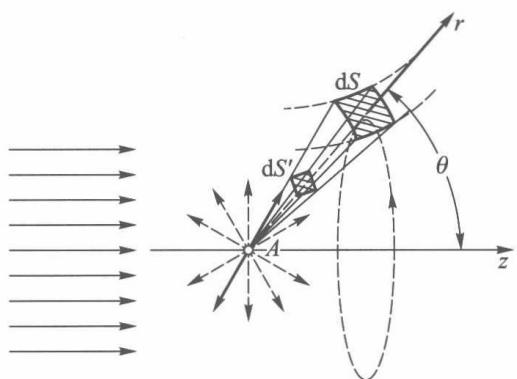
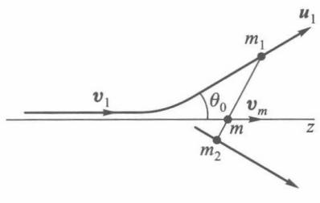
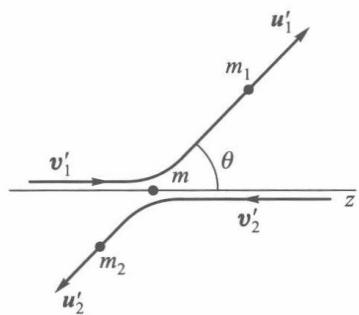
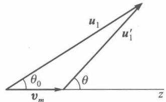

# 第 6 章 散射

!!! warning "选读 · 课件未讲"

    《量子物理基础》没有这一讲。正文、例题和原图都保留，考试按课件可以整章跳过。

!!! tip "本章目标"

    1. 理解**微分散射截面** $q(\theta,\varphi)$、**总截面** $Q$ 和**散射振幅** $f(\theta,\varphi)$ 的意义，会由概率流推出 $q=|f|^2$；
    2. 掌握**分波法**：会把散射振幅写成各分波相移 $\delta_l$ 的级数，理解“只有 $l\lesssim ka$ 的分波被散射”，知道**光学定理**；
    3. 会用分波法处理**低能方势阱、方势垒和硬球**散射，理解量子硬球截面 $4\pi a^2$ 的来源；
    4. 掌握**玻恩近似**：散射振幅正比于势能对动量转移 $\boldsymbol K$ 的**傅里叶变换**，会算屏蔽库仑势、高斯势、指数势，并得到卢瑟福公式；会判断玻恩近似的适用条件；
    5. 会在**质心系与实验室系**之间换算散射角和微分截面。

**本章在全书中的位置。** 前面几章研究的是**束缚态**：能量分立，问题是“能级是多少”。散射研究的是**非束缚态**：能量 $E=\hbar^2k^2/2m$ 连续、事先给定，问题变成“粒子往哪个方向去的概率多大”。两套主要方法分别对应前几章的两条主线：

- **分波法**（§6.2—§6.3）= 第 3 章中心力场的径向方程 + 角动量分解，适合**低能**（少数几个分波）；
- **玻恩近似**（§6.4）= 第 5 章费米黄金定则 + 傅里叶变换，适合**高能**（势能相对动能是小量）。

我们对原子结构的几乎全部认识——卢瑟福发现原子核、弗兰克–赫兹实验证实能级——都来自散射实验；今天的电子衍射、中子散射、粒子对撞机也都在测 $q(\theta,\varphi)$。

---

## 6.1 碰撞过程　散射截面

### 6.1.1 散射实验在测什么

若碰撞中只交换动能和动量、粒子内部状态不变，称为**弹性散射**；若内部状态改变（原子被激发、电离等），称为**非弹性散射**。本章只讨论弹性散射，并先假设散射中心（靶）质量很大、不动（§6.5 再处理靶也运动的情形）。

<figure markdown>
{ width="380" }
<figcaption>图 6.1　粒子流沿 $z$ 轴射向散射中心 A，在 $(\theta,\varphi)$ 方向的立体角 $\mathrm d\Omega$ 内被探测。</figcaption>
</figure>

单位时间散射到 $(\theta,\varphi)$ 方向立体角 $\mathrm d\Omega$ 内的粒子数 $\mathrm dn$，显然正比于 $\mathrm d\Omega$，也正比于入射粒子流强度 $N$（单位时间穿过垂直于入射方向单位面积的粒子数）。

!!! definition "定义 6.1（微分散射截面与总散射截面）"

    $$\mathrm dn=q(\theta,\varphi)\,N\,\mathrm d\Omega ,$$

    比例系数 $q(\theta,\varphi)$ 称为**微分散射截面**（常记为 $\dfrac{\mathrm d\sigma}{\mathrm d\Omega}$）；它对全部方向的积分

    $$Q=\int q(\theta,\varphi)\,\mathrm d\Omega=\int_0^{\pi}\!\!\int_0^{2\pi}q(\theta,\varphi)\sin\theta\,\mathrm d\theta\,\mathrm d\varphi$$

    称为**总散射截面**。由 $[\mathrm dn]=T^{-1}$、$[N]=L^{-2}T^{-1}$ 知 $q$ 和 $Q$ 都有**面积**量纲。

**几何意义。** 在入射束中垂直放一块面积为 $q\,\mathrm d\Omega$ 的“靶面”，打在这块面积上的粒子恰好都被散射进 $\mathrm d\Omega$；$Q$ 就是靶“挡住”入射流的有效面积。这和雷达里的**雷达散射截面（RCS）**是同一个概念：RCS 也是“把散射功率折算成多大的等效截获面积”。

!!! example "例题 6.1（经典硬球）"

    质点被半径为 $a$ 的刚性球弹性反射。求经典的 $q(\theta)$ 和 $Q$。

    **解**　瞄准距离为 $b$ 的粒子打在球面上，入射角 $\alpha$ 满足 $b=a\sin\alpha$，反射后散射角 $\theta=\pi-2\alpha$，于是 $b=a\cos\frac{\theta}{2}$。$b\to b+\mathrm db$ 的圆环（面积 $2\pi b|\mathrm db|$）中的粒子散射到 $\theta\to\theta+\mathrm d\theta$ 的锥带（立体角 $2\pi\sin\theta\,\mathrm d\theta$）中：

    $$q(\theta)=\frac{b}{\sin\theta}\left|\frac{\mathrm db}{\mathrm d\theta}\right|=\frac{a\cos\frac\theta2\cdot\frac a2\sin\frac\theta2}{2\sin\frac\theta2\cos\frac\theta2}=\frac{a^2}{4},\qquad Q=4\pi\cdot\frac{a^2}{4}=\pi a^2 .$$

    经典硬球**各向同性**散射，总截面就是几何截面 $\pi a^2$。§6.3 将看到量子结果是它的 4 倍（低能）或 2 倍（高能）。

### 6.1.2 散射振幅

取散射中心为原点，相互作用势能为 $U(\boldsymbol r)$。记

$$k^2=\frac{2mE}{\hbar^2},\qquad v=\frac{\hbar k}{m},\qquad V(\boldsymbol r)=\frac{2m}{\hbar^2}U(\boldsymbol r),$$

定态薛定谔方程化为

$$\nabla^2\psi+\left[k^2-V(\boldsymbol r)\right]\psi=0 .$$

探测器总在离靶很远处。若 $r\to\infty$ 时 $U$ 比 $1/r$ 更快地趋于零，远处的波函数由两部分组成：未受扰动的**入射平面波**和由散射中心向外传播的**出射球面波**。

!!! definition "定义 6.2（散射边界条件与散射振幅）"

    散射问题要求定态解在远处具有渐近形式

    $$\psi\xrightarrow[r\to\infty]{}e^{\mathrm ikz}+f(\theta,\varphi)\frac{e^{\mathrm ikr}}{r},$$

    其中 $f(\theta,\varphi)$ 只依赖于方向，称为**散射振幅**。因为是弹性散射，球面波的波数与入射波相同。入射波取 $|e^{\mathrm ikz}|^2=1$，即单位体积一个入射粒子。

<figure class="video" markdown>
<video controls preload="metadata" width="100%" poster="assets/posters/C6_ScatterWave.jpg"><source src="assets/videos/C6_ScatterWave.mp4" type="video/mp4"></video>
<figcaption>动画 6-1　散射的定态图像：平面波射入，散射中心发出外向球面波；穿过立体角 $\mathrm d\Omega$ 的粒子流给出 $q=|f|^2$。</figcaption>
</figure>

!!! theorem "定理 6.1（截面与散射振幅）"

    $$q(\theta,\varphi)=|f(\theta,\varphi)|^2 ,\qquad Q=\int|f(\theta,\varphi)|^2\,\mathrm d\Omega .$$

!!! proof "证明"

    用概率流密度 $\boldsymbol J=\dfrac{\mathrm i\hbar}{2m}(\psi\nabla\psi^*-\psi^*\nabla\psi)$。入射波 $\psi_1=e^{\mathrm ikz}$：

    $$J_z=\frac{\mathrm i\hbar}{2m}(-\mathrm ik-\mathrm ik)=\frac{\hbar k}{m}=v=N .$$

    散射波 $\psi_2=f\,e^{\mathrm ikr}/r$ 的径向流（只保留 $1/r^2$ 主项）：

    $$J_r=\frac{\mathrm i\hbar}{2m}|f|^2\left(-\frac{\mathrm ik}{r^2}-\frac{\mathrm ik}{r^2}\right)=\frac{v}{r^2}|f|^2 .$$

    单位时间穿过球面面元 $\mathrm dS=r^2\mathrm d\Omega$ 的粒子数 $\mathrm dn=J_r\,\mathrm dS=v|f|^2\mathrm d\Omega$。与定义 6.1 中 $\mathrm dn=qN\mathrm d\Omega$、$N=v$ 比较即得。（在探测器所在的 $\theta\neq0$ 方向，入射波被准直狭缝挡在外面，两部分的干涉项不出现；$\theta=0$ 方向的干涉见定理 6.3。） $\square$

**于是散射问题归结为：解薛定谔方程，并从远处的解中读出 $f(\theta,\varphi)$。** 下面两节的分波法、§6.4 的玻恩近似，就是两种读法。

---

## 6.2 中心力场中的弹性散射（分波法）

### 6.2.1 分波展开

对中心力场 $U(r)$，入射方向 $z$ 是旋转对称轴，$\psi$ 和 $f$ 与 $\varphi$ 无关，即只出现 $m=0$ 的球谐函数 $Y_{l0}\propto P_l(\cos\theta)$。由第 3 章中心力场的分离变量，

$$\psi(r,\theta)=\sum_{l=0}^{\infty}R_l(r)P_l(\cos\theta),\qquad R_l=\frac{u_l(r)}{r},\qquad u_l''+\left[k^2-V(r)-\frac{l(l+1)}{r^2}\right]u_l=0 .$$

每一项称为一个**分波**，$l=0,1,2,\cdots$ 依次称为 s、p、d……分波，它们各自具有确定的角动量 $\sqrt{l(l+1)}\hbar$，而且**中心力场不改变角动量**，所以各个分波彼此独立地被散射。

远处 $V\to0$、离心项也 $\to0$，$u_l''+k^2u_l=0$，所以

$$R_l(r)\xrightarrow[r\to\infty]{}\frac{A_l}{kr}\sin\!\left(kr-\frac{l\pi}{2}+\delta_l\right).$$

!!! definition "定义 6.3（相移）"

    自由粒子（$V\equiv0$）的第 $l$ 个径向解是球贝塞尔函数 $j_l(kr)\to\dfrac{\sin(kr-l\pi/2)}{kr}$。有势场时远处径向函数相位上多出的常数 $\delta_l$ 称为第 $l$ 个分波的**相移**。相移是实数，并且只在模 $\pi$ 的意义上有确定值（$\delta_l$ 与 $\delta_l+\pi$ 只差整体符号）。

**相移就是势场留给远方观察者的全部信息。** 势场内部的波函数可以非常复杂，但到了探测器所在的远处，每个分波只剩下一个数 $\delta_l$。吸引势把波“拉进来”，波长在势阱内变短，外部相位超前，$\delta_l>0$；排斥势把波“推出去”，$\delta_l<0$。

<figure class="video" markdown>
<video controls preload="metadata" width="100%" poster="assets/posters/C6_PhaseShift.jpg"><source src="assets/videos/C6_PhaseShift.mp4" type="video/mp4"></video>
<figcaption>动画 6-2　s 波相移：方势阱越深，阱内波数越大，阱外波形整体平移 $\delta_0$；截面只依赖于 $\sin^2\delta_0$。</figcaption>
</figure>

### 6.2.2 散射振幅与相移

要把渐近解写成“平面波 + 外向球面波”的形式，需要平面波按球面波展开的公式（瑞利公式）：

$$e^{\mathrm ikz}=e^{\mathrm ikr\cos\theta}=\sum_{l=0}^{\infty}(2l+1)\,\mathrm i^l\,j_l(kr)\,P_l(\cos\theta),\qquad j_l(kr)\xrightarrow[r\to\infty]{}\frac{\sin(kr-l\pi/2)}{kr}.$$

!!! theorem "定理 6.2（分波法公式）"

    $$f(\theta)=\frac{1}{k}\sum_{l=0}^{\infty}(2l+1)\,e^{\mathrm i\delta_l}\sin\delta_l\,P_l(\cos\theta)=\frac{1}{2\mathrm ik}\sum_{l=0}^{\infty}(2l+1)\left(e^{2\mathrm i\delta_l}-1\right)P_l(\cos\theta),$$

    $$Q=\sum_{l=0}^{\infty}Q_l,\qquad Q_l=\frac{4\pi}{k^2}(2l+1)\sin^2\delta_l .$$

!!! proof "证明"

    把 $\sin x=\dfrac{e^{\mathrm ix}-e^{-\mathrm ix}}{2\mathrm i}$ 代入，比较渐近式

    $$\sum_l\frac{A_l}{kr}\sin\!\left(kr-\tfrac{l\pi}{2}+\delta_l\right)P_l=\sum_l\frac{(2l+1)\mathrm i^l}{kr}\sin\!\left(kr-\tfrac{l\pi}{2}\right)P_l+f(\theta)\frac{e^{\mathrm ikr}}{r}$$

    两边的**入射球面波** $e^{-\mathrm ikr}$ 系数（右边只有平面波含它）：

    $$A_le^{-\mathrm i(\delta_l-l\pi/2)}=(2l+1)\mathrm i^le^{\mathrm il\pi/2}\ \Rightarrow\ A_l=(2l+1)\mathrm i^le^{\mathrm i\delta_l}.$$

    再比较 $e^{\mathrm ikr}$ 系数：

    $$2\mathrm ik f(\theta)=\sum_l\left[A_le^{\mathrm i(\delta_l-l\pi/2)}-(2l+1)\mathrm i^le^{-\mathrm il\pi/2}\right]P_l=\sum_l(2l+1)\left(e^{2\mathrm i\delta_l}-1\right)P_l ,$$

    其中用到 $\mathrm i^le^{-\mathrm il\pi/2}=1$。$e^{2\mathrm i\delta_l}-1=2\mathrm ie^{\mathrm i\delta_l}\sin\delta_l$，即得 $f$。总截面利用勒让德多项式的正交性 $\displaystyle\int_{-1}^{1}P_lP_{l'}\,\mathrm d(\cos\theta)=\frac{2}{2l+1}\delta_{ll'}$：

    $$Q=2\pi\int_{-1}^{1}|f|^2\,\mathrm d(\cos\theta)=\frac{2\pi}{k^2}\sum_l(2l+1)^2\sin^2\delta_l\cdot\frac{2}{2l+1}=\frac{4\pi}{k^2}\sum_l(2l+1)\sin^2\delta_l .\ \square$$

**物理图像：“出射波 = 入射波 × 相位因子”。** 证明中的关键一步说明：每个分波的入射部分 $e^{-\mathrm ikr}$ 不受影响，出射部分 $e^{\mathrm ikr}$ 被乘上 $S_l=e^{2\mathrm i\delta_l}$。$|S_l|=1$ 表示**粒子数守恒**（弹性散射不吸收）；散射就是“出射波相对于没有势场时多转了 $2\delta_l$ 的相位”。这和传输线终端接纯电抗负载时 $|\Gamma|=1$、只有反射相位变化完全是一回事。

!!! theorem "定理 6.3（光学定理与分波截面上限）"

    1. **光学定理**：$\displaystyle \operatorname{Im}f(0)=\frac{k}{4\pi}Q$；
    2. **幺正性上限**：$Q_l\le\dfrac{4\pi}{k^2}(2l+1)$，当 $\delta_l=\dfrac\pi2$（模 $\pi$）时取等号（**共振**）。

!!! proof "证明"

    1. $P_l(1)=1$，由定理 6.2，$\operatorname{Im}f(0)=\dfrac1k\sum_l(2l+1)\sin^2\delta_l=\dfrac{k}{4\pi}Q$。
    2. 由 $\sin^2\delta_l\le1$ 立得。 $\square$

光学定理的含义：散射出去的粒子必然来自入射束，所以**前方**必须有一部分入射波被散射波**干涉相消**，形成靶的“影子”；影子的“深度”由 $\operatorname{Im}f(0)$ 决定，恰好等于被散射走的总流量。

### 6.2.3 需要多少个分波：$l\lesssim ka$

经典地看，动量 $p=\hbar k$、瞄准距离为 $b$ 的粒子，角动量 $L=pb$。令 $L\approx l\hbar$，得 $b\approx l/k$。若势场作用范围为 $a$，只有 $b\lesssim a$ 的粒子才会被散射：

$$l\lesssim ka .$$

量子地看：离心势垒 $\dfrac{\hbar^2l(l+1)}{2mr^2}$ 使 $j_l(kr)$ 在 $kr\lesssim l$ 的区域很小，$l>ka$ 的分波“钻不进”势场，$\delta_l\approx0$。

!!! info "分波法的适用范围"

    - **低能**（$ka\ll1$）：只需 s 波，$f\approx\dfrac{e^{\mathrm i\delta_0}\sin\delta_0}{k}$ **各向同性**——低能散射看不出势场的形状细节；
    - **中能**：取 $l=0,1,\cdots,\sim ka$ 若干项；
    - **高能**（$ka\gg1$）：要求和很多分波，分波法很不方便，改用 §6.4 的玻恩近似。

!!! example "例题 6.2（$U=a/r^2$ 的散射，教材习题 6.1）"

    粒子受到势能 $U(r)=\dfrac{a}{r^2}$（$a>0$）的散射，求各分波相移及 s 分波的微分散射截面。

    **解**　势能与离心项形式相同，可以合并：

    $$u_l''+\left[k^2-\frac{l(l+1)+2ma/\hbar^2}{r^2}\right]u_l=0 .$$

    令 $l'(l'+1)=l(l+1)+\dfrac{2ma}{\hbar^2}$（取 $l'>0$ 的根），方程就是“角动量量子数为 $l'$”的自由径向方程，在原点有限的解是 $j_{l'}(kr)\to\dfrac{\sin(kr-l'\pi/2)}{kr}$。与 $\sin(kr-l\pi/2+\delta_l)$ 比较：

    $$\delta_l=\frac{\pi}{2}(l-l'),\qquad l'=-\frac12+\sqrt{\left(l+\frac12\right)^2+\frac{2ma}{\hbar^2}} .$$

    s 波：$\delta_0=-\dfrac{\pi}{2}l'_0=\dfrac{\pi}{4}\left(1-\sqrt{1+\dfrac{8ma}{\hbar^2}}\right)$（排斥势，$\delta_0<0$），

    $$q_0(\theta)=\frac{\sin^2\delta_0}{k^2}=\frac{1}{k^2}\sin^2\!\left[\frac{\pi}{4}\left(1-\sqrt{1+\frac{8ma}{\hbar^2}}\right)\right].$$

    s 波微分截面与角度无关；若 $a$ 很小，$\delta_0\approx-\dfrac{\pi ma}{\hbar^2}$，$q_0\approx\dfrac{\pi^2m^2a^2}{\hbar^4k^2}$。

---

## 6.3 方形势阱与势垒所产生的散射

### 6.3.1 低能方势阱

设 $U(r)=-U_0$（$r\le a$，$U_0>0$），$U=0$（$r>a$），粒子能量很低，只考虑 s 波。记

$$k'^2=k^2+k_0^2,\qquad k_0^2=\frac{2mU_0}{\hbar^2}.$$

$u=rR$ 在 $r=0$ 处必须为零，故

$$u(r)=\begin{cases}A\sin k'r,& r\le a\\ B\sin(kr+\delta_0),& r>a\end{cases}$$

!!! theorem "定理 6.4（方势阱 s 波相移与低能截面）"

    由 $r=a$ 处 $u'/u$ 连续，

    $$k\cot(ka+\delta_0)=k'\cot k'a\ \Longrightarrow\ \delta_0=\arctan\!\left(\frac{k}{k'}\tan k'a\right)-ka ,$$

    $$Q\approx Q_0=\frac{4\pi}{k^2}\sin^2\delta_0 .$$

    低能极限 $k\to0$（$k'\to k_0$）：$\delta_0\approx ka\left(\dfrac{\tan k_0a}{k_0a}-1\right)$，

    $$Q\approx4\pi a^2\left(\frac{\tan k_0a}{k_0a}-1\right)^2 .$$

!!! proof "证明"

    前两式由衔接条件直接解出。$k\to0$ 时 $\arctan x\approx x$，$\delta_0\approx\dfrac{k}{k_0}\tan k_0a-ka$，代入 $Q_0\approx\dfrac{4\pi}{k^2}\delta_0^2$ 即得。 $\square$

几个值得注意的结论：

- **低能截面与能量无关**，由一个长度 $a_s=a\left(1-\dfrac{\tan k_0a}{k_0a}\right)$ 决定：$Q=4\pi a_s^2$。$a_s$ 称为**散射长度**——低能下，任何短程势在远处看起来都只是一个“有效硬球”。
- **零能共振**：当 $k_0a\to\dfrac\pi2$（势阱恰好深到能容纳一个零能束缚态），$\tan k_0a\to\infty$，低能截面急剧增大，直到被幺正性上限 $4\pi/k^2$ 截断。弱束缚的氘核使低能中子–质子散射截面异常大，就是这个原因。
- 势阱很浅（$k_0a\ll1$）时，$\dfrac{\tan x}{x}-1\approx\dfrac{x^2}{3}$，$Q\approx\dfrac{4\pi a^2(k_0a)^4}{9}$——练习 7 将看到这与玻恩近似的结果完全一致。

### 6.3.2 方势垒与硬球

若是方势垒 $U=U_0>0$（$r<a$），只需把 $k_0$ 换成 $\mathrm ik_0$：$\tan(\mathrm ix)=\mathrm i\tanh x$，于是低能截面

$$Q\approx4\pi a^2\left(\frac{\tanh k_0a}{k_0a}-1\right)^2 .$$

!!! theorem "定理 6.5（量子硬球的低能截面）"

    $U_0\to\infty$（刚性球）时 $\tanh k_0a\to1$，$\dfrac{\tanh k_0a}{k_0a}\to0$：

    $$Q\approx4\pi a^2 ,$$

    是经典结果 $\pi a^2$ 的 **4 倍**，恰为球的表面积。

更一般地，硬球的条件是 $R_l(a)=0$。外部解是 $j_l$ 与 $n_l$（球诺伊曼函数）的组合 $R_l\propto\cos\delta_l\,j_l(kr)-\sin\delta_l\,n_l(kr)$，故

$$\tan\delta_l=\frac{j_l(ka)}{n_l(ka)},\qquad\text{s 波：}\ \delta_0=-ka\ (\text{精确}).$$

!!! example "例题 6.3（硬球：从 $4\pi a^2$ 到 $2\pi a^2$）"

    讨论硬球截面在低能与高能两个极限下的物理含义。

    **解**　**低能** $ka\ll1$：只有 s 波，$\delta_0=-ka$，$Q=\dfrac{4\pi}{k^2}\sin^2ka\to4\pi a^2$。此时德布罗意波长 $\lambda\gg a$，波“看到”的是整个球面，而不是几何投影，没有经典的“擦边而过”。

    **高能** $ka\gg1$：$l$ 从 $0$ 到 $\approx ka$ 的分波都被强烈散射（相移在 $0\sim\pi$ 间近乎随机，$\overline{\sin^2\delta_l}\approx\frac12$），

    $$Q\approx\frac{4\pi}{k^2}\sum_{l=0}^{ka}(2l+1)\cdot\frac12\approx\frac{2\pi}{k^2}(ka)^2=2\pi a^2 .$$

    其中 $\pi a^2$ 是被球直接弹开的粒子（几何光学部分）；另外 $\pi a^2$ 是集中在前方小角度 $\theta\lesssim1/ka$ 内的**衍射峰**——它与入射波相消，造成球后面的影子。这就是光学定理在硬球上的体现；同样的“消光截面 = 2 × 几何截面”在电磁波对大导体的散射中也成立（消光悖论）。

<figure class="video" markdown>
<video controls preload="metadata" width="100%" poster="assets/posters/C6_HardSphere.jpg"><source src="assets/videos/C6_HardSphere.mp4" type="video/mp4"></video>
<figcaption>动画 6-3　硬球的分波截面 $Q_l$ 随 $ka$ 的变化：只有 $l\lesssim ka$ 的分波（虚线左侧）有贡献；总截面从 $4\pi a^2$ 逐渐趋于 $2\pi a^2$。</figcaption>
</figure>

!!! warning "易错点"

    - 方势阱公式中 $\arctan$ 有多值性：$\delta_0$ 应取使它随参数**连续变化**的那一支；但截面只认 $\sin^2\delta_0$，所以差 $\pi$ 不影响结果。
    - $Q=4\pi a^2$ 是**低能**极限，不能说“量子硬球截面永远是经典的 4 倍”。
    - $u(0)=0$ 是 $R=u/r$ 有限的要求，不可遗漏。

---

## 6.4 玻恩近似

### 6.4.1 从费米黄金定则到玻恩公式

入射粒子动能比势能大得多时，可以把整个 $U(\boldsymbol r)$ 当作微扰，$\hat H=\dfrac{\hat p^2}{2m}+U(\boldsymbol r)$。散射就是**动量本征态之间的跃迁** $\hbar\boldsymbol k\to\hbar\boldsymbol k'$，末态动量方向连续分布，正是[第 5 章费米黄金定则](ch5.md)的用武之地。

取箱归一化平面波 $L^{-3/2}e^{\mathrm i\boldsymbol k\cdot\boldsymbol r}$（体积 $L^3$ 中一个粒子），弹性散射 $|\boldsymbol k'|=|\boldsymbol k|=k$。

!!! theorem "定理 6.6（玻恩近似）"

    记动量转移 $\boldsymbol K=\boldsymbol k'-\boldsymbol k$，$K=2k\sin\dfrac\theta2$。在一级玻恩近似下

    $$f(\theta,\varphi)=-\frac{m}{2\pi\hbar^2}\int U(\boldsymbol r)\,e^{-\mathrm i\boldsymbol K\cdot\boldsymbol r}\,\mathrm d^3r ,\qquad q=|f|^2 .$$

    对中心势，

    $$f(\theta)=-\frac{2m}{\hbar^2K}\int_0^{\infty}rU(r)\sin Kr\,\mathrm dr ,\qquad q(\theta)=\frac{4m^2}{\hbar^4K^2}\left|\int_0^{\infty}rU(r)\sin Kr\,\mathrm dr\right|^2 .$$

!!! proof "证明"

    入射流强度为 $vL^{-3}$，由定义 6.1，单位时间散射进 $\mathrm d\Omega$ 的粒子数 $\mathrm dn=vL^{-3}q\,\mathrm d\Omega$。

    另一方面，动量大小在 $p\sim p+\mathrm dp$、方向在 $\mathrm d\Omega$ 内的末态数为 $\left(\dfrac{L}{2\pi\hbar}\right)^3p^2\mathrm dp\,\mathrm d\Omega$，用 $\mathrm dE=p\,\mathrm dp/m$ 得态密度 $\rho=\left(\dfrac{L}{2\pi\hbar}\right)^3m\hbar k\,\mathrm d\Omega$。微扰矩阵元

    $$H'_{k'k}=L^{-3}\int e^{-\mathrm i\boldsymbol k'\cdot\boldsymbol r}U(\boldsymbol r)e^{\mathrm i\boldsymbol k\cdot\boldsymbol r}\,\mathrm d^3r=L^{-3}\int U(\boldsymbol r)e^{-\mathrm i\boldsymbol K\cdot\boldsymbol r}\,\mathrm d^3r .$$

    由黄金定则 $\mathrm dn=w=\dfrac{2\pi}{\hbar}|H'_{k'k}|^2\rho$，与上式比较（$v=\hbar k/m$，$L$ 全部消去）：

    $$q=\frac{m^2}{4\pi^2\hbar^4}\left|\int U(\boldsymbol r)e^{-\mathrm i\boldsymbol K\cdot\boldsymbol r}\,\mathrm d^3r\right|^2 .$$

    $f$ 前的负号由与严格理论（积分方程迭代）比较确定，使吸引势给出正的 $f(0)$。中心势时取 $\boldsymbol K$ 为积分的极轴：

    $$\int U(r)e^{-\mathrm iKr\cos\vartheta}r^2\sin\vartheta\,\mathrm dr\,\mathrm d\vartheta\,\mathrm d\varphi=2\pi\int_0^\infty U(r)r^2\frac{2\sin Kr}{Kr}\,\mathrm dr=\frac{4\pi}{K}\int_0^\infty rU(r)\sin Kr\,\mathrm dr .\ \square$$

### 6.4.2 散射 = 傅里叶变换

定理 6.6 是本章最有用的一句话：**一级玻恩散射振幅就是势能的三维傅里叶变换 $\tilde U(\boldsymbol K)$，在动量转移 $\boldsymbol K$ 处取值。**

- 散射角 $\theta$ 通过 $K=2k\sin\frac\theta2$ 扫描“空间频率”。小角度 $\leftrightarrow$ 小 $K$ $\leftrightarrow$ 势的大尺度结构；大角度 $\leftrightarrow$ 大 $K$ $\leftrightarrow$ 细节。
- 能测到的最大空间频率是 $K_{\max}=2k$（背散射），所以分辨尺寸 $\sim1/2k\sim\lambda/4\pi$：**要看清更小的结构，就需要更高的能量**——这是电子显微镜和高能对撞机的原理。
- 势的作用范围为 $a$，$\tilde U(K)$ 的宽度 $\sim1/a$：**势越短程，散射越各向同性**（频谱越宽）。
- X 射线衍射、电子衍射测得的强度正比于电荷/势分布的傅里叶变换模平方，同理。

计算径向积分时常用复指数技巧：$\displaystyle\int_0^\infty e^{-r/a}\sin Kr\,\mathrm dr=\operatorname{Im}\int_0^\infty e^{-(1/a-\mathrm iK)r}\mathrm dr=\operatorname{Im}\frac{1}{1/a-\mathrm iK}=\frac{K}{K^2+a^{-2}}$；更复杂的积分可以用留数定理，见[复变函数讲义第 5 章 留数及其应用](https://cockroach-f.github.io/complex-functions/ch5.html)。

<figure class="video" markdown>
<video controls preload="metadata" width="100%" poster="assets/posters/C6_Born.jpg"><source src="assets/videos/C6_Born.mp4" type="video/mp4"></video>
<figcaption>动画 6-4　玻恩近似：散射角决定动量转移 $K=2k\sin\frac\theta2$；屏蔽库仑势的傅里叶谱 $\propto1/(K^2+a^{-2})$，$ka$ 越大，散射越集中于小角度，大角处回到卢瑟福公式。</figcaption>
</figure>

### 6.4.3 适用条件

玻恩近似要求势场对入射波的扰动很小，即各分波相移都很小。以作用范围 $a$、强度 $U_0$ 的势为例：

!!! theorem "定理 6.7（玻恩近似的适用条件）"

    - **高能**情形（$ka\gg1$）：$\left|\dfrac{U_0a}{\hbar v}\right|\ll1$，即粒子穿越势场 $a/v$ 时间内积累的附加相位 $U_0a/\hbar v$ 很小；
    - **低能**情形（$ka\lesssim1$）：要求 $\dfrac{m|U_0|a^2}{\hbar^2}\ll1$，即势阱浅到远不能形成束缚态。

    因此玻恩近似**总适用于高能散射**，与分波法互补。

!!! proof "说明"

    对方势垒，高能时由 $k'=k\sqrt{1-U_0/E}\approx k\left(1-\dfrac{U_0}{2E}\right)$，衔接条件中 $k'a$ 与 $ka$ 只差 $\dfrac{kaU_0}{2E}=\dfrac{aU_0}{\hbar v}$；它很小时 $\delta_0$ 很小，微扰处理合理。低能时 $\tan\delta_0\approx\sqrt{E/|U_0|}\tan k_0a$，只要 $k_0a$ 不接近 $\pi/2$（远离零能共振），$\delta_0$ 就很小。 $\square$

!!! success "分波法与玻恩近似怎样分工"

    | | 分波法 | 玻恩近似 |
    |---|---|---|
    | 适用能区 | **低能**（$ka\lesssim1$），只需少数几个分波 | **高能**或弱势（$\lvert U_0 a/\hbar v\rvert\ll1$） |
    | 物理图像 | 只有 $l\lesssim ka$ 的分波碰得到势场（经典碰撞参数 $l/k\lesssim a$） | 散射振幅就是势能的傅里叶变换 $f\propto\tilde U(\boldsymbol K)$，$K=2k\sin\tfrac\theta2$ |
    | 低能极限 | $s$ 波为主，截面各向同性，由散射长度决定 | 仅当势阱浅到不能形成束缚态时才可用 |
    | 高能极限 | 要叠加很多分波，不方便 | 越来越好；角分布逐渐集中于前向 |

    两条路线在浅方势阱的低能极限下给出同一个截面（练习 7），正好作为互相校验。光学定理 $\sigma_t=\dfrac{4\pi}{k}\operatorname{Im}f(0)$ 则是对振幅整体的约束：一级玻恩近似的 $f$ 是实数，还不满足它。

### 6.4.4 屏蔽库仑场与卢瑟福公式

!!! example "例题 6.4（带电粒子被中性原子散射）"

    电荷为 $Z'e$ 的高速粒子被原子序数为 $Z$ 的中性原子散射。原子核的库仑场被核外电子屏蔽，近似为

    $$U(r)=-\frac{ZZ'e^2}{4\pi\varepsilon_0r}e^{-r/a}\qquad(a\ \text{为原子半径}).$$

    求微分截面，并讨论 $Ka\gg1$ 的情形。

    **解**　代入定理 6.6：

    $$\int_0^\infty rU\sin Kr\,\mathrm dr=-\frac{ZZ'e^2}{4\pi\varepsilon_0}\int_0^\infty e^{-r/a}\sin Kr\,\mathrm dr=-\frac{ZZ'e^2}{4\pi\varepsilon_0}\frac{K}{K^2+a^{-2}} ,$$

    $$q(\theta)=\frac{4m^2Z^2Z'^2}{\hbar^4}\left(\frac{e^2}{4\pi\varepsilon_0}\right)^2\frac{1}{\left(K^2+a^{-2}\right)^2},\qquad K=2k\sin\frac\theta2 .$$

    若 $Ka=2ka\sin\frac\theta2\gg1$（能量高、角度不太小），略去 $a^{-2}$，并用 $\hbar k=mv$：

    $$q(\theta)=\frac{Z^2Z'^2}{4m^2v^4}\left(\frac{e^2}{4\pi\varepsilon_0}\right)^2\csc^4\frac\theta2 .$$

    这正是**卢瑟福公式**——经典力学、一级玻恩近似（以及库仑场的严格量子解）给出同一结果，是物理学中一个幸运的巧合。屏蔽的作用是把 $\theta\to0$ 的发散截断：未屏蔽库仑势的总截面无穷大，屏蔽后有限。

!!! example "例题 6.5（高斯势，教材习题 6.4）"

    用玻恩近似求 $U(r)=U_0e^{-a^2r^2}$ 的微分截面和总截面。

    **解**　三维高斯积分可以分解成三个一维积分：

    $$\int e^{-a^2r^2}e^{-\mathrm i\boldsymbol K\cdot\boldsymbol r}\,\mathrm d^3r=\left(\frac{\pi}{a^2}\right)^{3/2}e^{-K^2/4a^2}$$

    （高斯函数的傅里叶变换仍是高斯函数）。于是

    $$f=-\frac{mU_0\sqrt\pi}{2\hbar^2a^3}e^{-K^2/4a^2},\qquad q(\theta)=\frac{\pi m^2U_0^2}{4\hbar^4a^6}\exp\!\left(-\frac{2k^2\sin^2\frac\theta2}{a^2}\right).$$

    总截面：$K^2=2k^2(1-\cos\theta)$，$\mathrm d\Omega=2\pi\sin\theta\,\mathrm d\theta=\dfrac{2\pi K\,\mathrm dK}{k^2}$，

    $$Q=\frac{\pi m^2U_0^2}{4\hbar^4a^6}\cdot\frac{2\pi}{k^2}\int_0^{2k}Ke^{-K^2/2a^2}\mathrm dK=\frac{\pi^2m^2U_0^2}{2\hbar^4a^4k^2}\left(1-e^{-2k^2/a^2}\right).$$

    高能时 $Q\propto1/k^2\propto1/E$；散射集中在 $\theta\lesssim a/k$ 的小角度内。

!!! warning "易错点"

    - $\boldsymbol K=\boldsymbol k'-\boldsymbol k$ 的大小是 $2k\sin\frac\theta2$，不是 $k\sin\theta$。
    - 中心势化简后的积分是 $\int rU\sin Kr\,\mathrm dr$，前面有 $\dfrac{1}{K}$；不要漏掉 $r$ 的一次方。
    - 一级玻恩近似的 $f$ 是实数（对实的中心势），所以它**不满足光学定理**（$\operatorname{Im}f(0)=0$）；光学定理要到二级近似才体现——这正说明它只在弱散射时可靠。

---

## 6.5 质心系与实验室坐标系

前面假定靶不动，这只在靶很重时成立。一般地，质量 $m_1$ 的入射粒子（速度 $\boldsymbol v_1$）撞击静止的 $m_2$。由二体问题（第 3 章氢原子已用过）：

- 在**质心系**中，问题化为约化质量 $\mu=\dfrac{m_1m_2}{m_1+m_2}$ 的粒子在势 $U(r)$ 中的散射，前面所有公式都适用（$m\to\mu$，$k$ 为相对运动波数），算出的是质心系的 $q(\theta,\varphi)$；
- 实验在**实验室系**中测量，散射角为 $\theta_0$。

<figure markdown>
{ width="300" }
{ width="300" }
<figcaption>图 6.2　(a) 实验室坐标系；(b) 质心坐标系。</figcaption>
</figure>

质心速度 $\boldsymbol v_m=\dfrac{m_1\boldsymbol v_1}{m_1+m_2}$。质心系中碰撞前 $m_1$ 的速度 $\boldsymbol v_1'=\dfrac{m_2\boldsymbol v_1}{m_1+m_2}$；弹性碰撞只改变方向不改变大小，碰撞后 $|\boldsymbol u_1'|=|\boldsymbol v_1'|$，转过角度 $\theta$。回到实验室系，$\boldsymbol u_1=\boldsymbol v_m+\boldsymbol u_1'$：

$$u_1\cos\theta_0=v_m+u_1'\cos\theta,\qquad u_1\sin\theta_0=u_1'\sin\theta .$$

<figure markdown>
{ width="340" }
<figcaption>图 6.3　速度合成：实验室系速度 = 质心速度 + 质心系中的速度。</figcaption>
</figure>

!!! theorem "定理 6.8（散射角与微分截面的换算）"

    $$\tan\theta_0=\frac{m_2\sin\theta}{m_1+m_2\cos\theta},\qquad \varphi_0=\varphi ;$$

    $$q_{\text{lab}}(\theta_0,\varphi_0)=\frac{\left(m_1^2+m_2^2+2m_1m_2\cos\theta\right)^{3/2}}{m_2^2\left|m_2+m_1\cos\theta\right|}\,q(\theta,\varphi).$$

!!! proof "证明"

    两式相除，并用 $v_m/u_1'=m_1/m_2$ 得角度关系。截面换算依据“散射到对应立体角的粒子数相同”：$q_{\text{lab}}\sin\theta_0\,\mathrm d\theta_0=q\sin\theta\,\mathrm d\theta$（总截面在两系中相同）。由角度关系得 $\cos\theta_0=\dfrac{m_1+m_2\cos\theta}{\sqrt{m_1^2+m_2^2+2m_1m_2\cos\theta}}$，微分后

    $$\sin\theta_0\,\mathrm d\theta_0=\frac{m_2^2(m_2+m_1\cos\theta)}{(m_1^2+m_2^2+2m_1m_2\cos\theta)^{3/2}}\sin\theta\,\mathrm d\theta ,$$

    取绝对值代入即得。 $\square$

!!! example "例题 6.6（等质量粒子）"

    $m_1=m_2$（如质子–质子、中子–质子近似），求两系散射角与截面的关系。

    **解**　$\tan\theta_0=\dfrac{\sin\theta}{1+\cos\theta}=\tan\dfrac\theta2$，所以 $\theta_0=\dfrac\theta2$，**实验室系中散射角不超过 $90^\circ$**。截面

    $$q_{\text{lab}}(\theta_0)=\frac{[2(1+\cos\theta)]^{3/2}}{1+\cos\theta}q(\theta)=2\sqrt2\sqrt{1+\cos\theta}\;q(\theta)=4\cos\theta_0\;q(2\theta_0).$$

    检验：质心系各向同性 $q=\dfrac{Q}{4\pi}$ 时，$\displaystyle\int_0^{\pi/2}4\cos\theta_0\frac{Q}{4\pi}2\pi\sin\theta_0\,\mathrm d\theta_0=Q$。✓

    另两个极限：$m_2\gg m_1$ 时 $\theta_0\approx\theta$（靶不动，回到 §6.1—§6.4）；$m_1>m_2$ 时 $\theta_0$ 有最大值 $\arcsin(m_2/m_1)$，重粒子打轻粒子不可能被大角度反弹。

!!! info "联系第 8 章"

    若两个碰撞粒子是**全同粒子**（如 $\alpha$–$\alpha$、电子–电子），探测器无法分辨在 $\theta$ 方向测到的是入射粒子还是被反冲的靶粒子，散射振幅要按交换对称性组合成 $f(\theta)\pm f(\pi-\theta)$，截面出现干涉项。见[第 8 章 全同粒子](ch8.md)。

---

## 知识点归纳总结

!!! abstract "知识点归纳总结"

    ```mermaid
    flowchart TD
        A["散射问题<br/>E 连续，求 f(θ,φ)"] --> B["边界条件<br/>ψ → exp(ikz) + f exp(ikr)/r"]
        B --> C["截面 q = |f|², Q = ∫q dΩ"]
        C --> PW["分波法（低能）<br/>中心力场 + 角动量分解"]
        C --> BO["玻恩近似（高能）<br/>黄金定则 + 傅里叶变换"]
        PW --> D["相移 δ_l<br/>f = (1/k) Σ (2l+1) exp(iδₗ) sinδₗ Pₗ"]
        D --> OT["光学定理 Im f(0) = kQ/4π"]
        D --> SW["低能 s 波：方势阱、势垒"]
        SW --> HS["硬球 Q → 4πa²（高能 2πa²）"]
        BO --> FT["f ∝ Ũ(K), K = 2k sin(θ/2)"]
        FT --> RU["屏蔽库仑 → 卢瑟福 csc⁴(θ/2)"]
        C --> LAB["§6.5 质心系 ↔ 实验室系"]
        LAB -.第8章.-> ID["全同粒子散射 f(θ) ± f(π−θ)"]
    ```

    **核心公式**

    | 内容 | 公式 |
    |---|---|
    | 微分截面 | $\mathrm dn=qN\,\mathrm d\Omega$，$q=\lvert f\rvert^2$ |
    | 渐近形式 | $\psi\to e^{\mathrm ikz}+f(\theta,\varphi)e^{\mathrm ikr}/r$ |
    | 分波振幅 | $f=\dfrac1k\sum_l(2l+1)e^{\mathrm i\delta_l}\sin\delta_l\,P_l(\cos\theta)$ |
    | 分波截面 | $Q=\dfrac{4\pi}{k^2}\sum_l(2l+1)\sin^2\delta_l$ |
    | 光学定理 | $\operatorname{Im}f(0)=\dfrac{k}{4\pi}Q$ |
    | 分波数 | $l\lesssim ka$ |
    | 方势阱 s 波 | $k\cot(ka+\delta_0)=k'\cot k'a$ |
    | 低能方势阱 | $Q\approx4\pi a^2\left(\dfrac{\tan k_0a}{k_0a}-1\right)^2$ |
    | 硬球 | $\tan\delta_l=j_l(ka)/n_l(ka)$；低能 $Q=4\pi a^2$，高能 $Q\to2\pi a^2$ |
    | 玻恩近似 | $f=-\dfrac{m}{2\pi\hbar^2}\int U e^{-\mathrm i\boldsymbol K\cdot\boldsymbol r}\mathrm d^3r$ |
    | 中心势 | $f=-\dfrac{2m}{\hbar^2K}\int_0^\infty rU\sin Kr\,\mathrm dr$，$K=2k\sin\frac\theta2$ |
    | 卢瑟福 | $q=\dfrac{Z^2Z'^2}{4m^2v^4}\left(\dfrac{e^2}{4\pi\varepsilon_0}\right)^2\csc^4\dfrac\theta2$ |
    | 玻恩适用 | 高能 $\lvert U_0a/\hbar v\rvert\ll1$ |
    | 坐标系换算 | $\tan\theta_0=\dfrac{m_2\sin\theta}{m_1+m_2\cos\theta}$；$m_1=m_2$：$\theta_0=\frac\theta2$，$q_{\text{lab}}=4\cos\theta_0\,q$ |

    **解题方法**

    1. **分波法**：写出各区域径向方程 → $r=0$ 处 $u=0$（或有限）→ 远处写成 $\sin(kr-l\pi/2+\delta_l)$ → 在边界处让 $u'/u$ 连续解出 $\delta_l$ → 代入 $Q_l$。低能只算 s 波。
    2. **势与离心项同形**（$\propto1/r^2$）时合并成等效角动量 $l'$；$\propto1/r^4$ 等奇异势可先找零能精确解，再读远处直线的截距（散射长度）。
    3. **玻恩近似**：先判断适用性 → 计算 $\int rU\sin Kr\,\mathrm dr$（常用 $\sin Kr=\operatorname{Im}e^{\mathrm iKr}$、对参数求导、高斯积分）→ $q=|f|^2$ → 求 $Q$ 时换元 $\mathrm d\Omega=2\pi K\,\mathrm dK/k^2$。
    4. **坐标系换算**：先在质心系中用约化质量算 $q(\theta)$，再用定理 6.8 换到实验室系。

    **易错点汇总**

    - $q$ 和 $Q$ 是面积；$f$ 是长度。量纲检查能发现大部分错误。
    - 分波法中各分波截面**相加**（正交），但振幅 $f$ 是各分波振幅相加后再取模平方，微分截面中有分波间干涉。
    - 相移的正负：吸引势 $\delta>0$，排斥势 $\delta<0$。
    - 低能各向同性 ≠ 势场球对称以外没有信息：只是 $ka\ll1$ 时分辨不了。
    - 玻恩近似用 $\boldsymbol K=\boldsymbol k'-\boldsymbol k$，大小 $2k\sin\frac\theta2$；二体问题中 $m$ 应换成约化质量。

---

## 练习题

!!! example "练习 1（光学定理的验证）"

    低能下只有 s 波相移 $\delta_0$ 不为零。直接计算 $f(0)$ 与 $Q$，验证光学定理；并说明 $Q$ 的最大值。

??? success "解答"

    $f(\theta)=\dfrac{1}{k}e^{\mathrm i\delta_0}\sin\delta_0$（与 $\theta$ 无关），$Q=4\pi|f|^2=\dfrac{4\pi}{k^2}\sin^2\delta_0$。

    $\operatorname{Im}f(0)=\dfrac{\sin^2\delta_0}{k}=\dfrac{k}{4\pi}\cdot\dfrac{4\pi\sin^2\delta_0}{k^2}=\dfrac{k}{4\pi}Q$。✓

    $Q$ 的最大值为 $\dfrac{4\pi}{k^2}=\dfrac{\lambda^2}{\pi}$（$\delta_0=\pi/2$，s 波共振），与势场的强弱和尺寸无关。

!!! example "练习 2（慢速粒子被方势垒散射，教材习题 6.2）"

    $U(r)=U_0$（$r<a$），$U=0$（$r>a$），$U_0>0$，粒子能量 $E<U_0$ 且很低。求散射截面。

??? success "解答"

    记 $\kappa=\sqrt{2m(U_0-E)}/\hbar$。s 波：$r<a$ 时 $u=A\sinh\kappa r$，$r>a$ 时 $u=B\sin(kr+\delta_0)$。衔接：

    $$k\cot(ka+\delta_0)=\kappa\coth\kappa a\ \Rightarrow\ \delta_0=\arctan\!\left(\frac{k}{\kappa}\tanh\kappa a\right)-ka .$$

    $k\to0$：$\kappa\to k_0=\sqrt{2mU_0}/\hbar$，$\delta_0\approx ka\left(\dfrac{\tanh k_0a}{k_0a}-1\right)$，

    $$Q\approx4\pi a^2\left(\frac{\tanh k_0a}{k_0a}-1\right)^2 .$$

    $U_0\to\infty$ 时 $Q\to4\pi a^2$；$k_0a\ll1$ 时 $\dfrac{\tanh x}{x}-1\approx-\dfrac{x^2}{3}$，$Q\approx\dfrac{4\pi a^2(k_0a)^4}{9}$。

!!! example "练习 3（$U=a/r^4$ 的低能散射，教材习题 6.3）"

    只考虑 s 分波，求慢速粒子受 $U(r)=\dfrac{a}{r^4}$（$a>0$）散射的截面。

??? success "解答"

    记 $\beta^2=\dfrac{2ma}{\hbar^2}$（$\beta$ 有长度量纲）。在 $k\to0$ 的极限下，势能起作用的区域里可以略去 $k^2$：

    $$u''-\frac{\beta^2}{r^4}u=0 .$$

    直接验证 $u=re^{-\beta/r}$ 是解：$u'=e^{-\beta/r}\left(1+\dfrac\beta r\right)$，$u''=e^{-\beta/r}\dfrac{\beta^2}{r^3}=\dfrac{\beta^2}{r^4}u$，且 $r\to0$ 时 $u\to0$。

    当 $r\gg\beta$ 时 $u\approx r-\beta$，而 $\dfrac{\sin(kr+\delta_0)}{k}\approx r+\dfrac{\delta_0}{k}$（$kr\ll1$），比较得 $\delta_0=-k\beta$。所以

    $$Q\approx\frac{4\pi}{k^2}\delta_0^2=4\pi\beta^2=\frac{8\pi ma}{\hbar^2}.$$

    散射长度就是 $\beta$：低能下这个势等效于半径 $\beta$ 的硬球。

!!! example "练习 4（玻恩近似：指数势，教材习题 6.6）"

    用玻恩近似求 $U(r)=-U_0e^{-r/a}$（$U_0>0$，$a>0$）的微分截面，并讨论适用条件。

??? success "解答"

    $$\int_0^\infty re^{-r/a}\sin Kr\,\mathrm dr=\operatorname{Im}\frac{1}{(1/a-\mathrm iK)^2}=\frac{2K/a}{(a^{-2}+K^2)^2}=\frac{2Ka^3}{(1+K^2a^2)^2}.$$

    $$f=\frac{2mU_0}{\hbar^2K}\cdot\frac{2Ka^3}{(1+K^2a^2)^2}=\frac{4mU_0a^3}{\hbar^2(1+K^2a^2)^2},\qquad q=\frac{16m^2U_0^2a^6}{\hbar^4\left(1+4k^2a^2\sin^2\frac\theta2\right)^4}.$$

    适用条件：高能 $ka\gg1$ 时要求 $\dfrac{U_0a}{\hbar v}\ll1$；若 $\dfrac{mU_0a^2}{\hbar^2}\ll1$（势太浅不能束缚粒子），则对任意能量都适用。

!!! example "练习 5（玻恩近似：库仑势作为极限）"

    在例题 6.4 中令 $a\to\infty$，并用 $q$ 的表达式说明为什么未屏蔽库仑场的总截面发散，而屏蔽后有限。估计屏蔽后总截面的量级。

??? success "解答"

    $a\to\infty$ 时 $q\propto\dfrac{1}{K^4}\propto\csc^4\dfrac\theta2$，在 $\theta\to0$ 附近 $q\propto\theta^{-4}$，$\displaystyle\int q\,2\pi\theta\,\mathrm d\theta\propto\int\theta^{-3}\mathrm d\theta$ 发散：长程库仑力使任意远处飞过的粒子都略微偏转。

    屏蔽后，用 $\mathrm d\Omega=2\pi K\,\mathrm dK/k^2$：

    $$Q=\frac{4m^2Z^2Z'^2}{\hbar^4}\left(\frac{e^2}{4\pi\varepsilon_0}\right)^2\frac{2\pi}{k^2}\int_0^{2k}\frac{K\,\mathrm dK}{(K^2+a^{-2})^2}=\frac{16\pi m^2Z^2Z'^2a^4}{\hbar^4}\left(\frac{e^2}{4\pi\varepsilon_0}\right)^2\frac{1}{1+4k^2a^2}.$$

    高能（$ka\gg1$）时 $Q\approx\dfrac{4\pi m^2Z^2Z'^2a^2}{\hbar^4k^2}\left(\dfrac{e^2}{4\pi\varepsilon_0}\right)^2$，有限，且随能量按 $1/E$ 下降。

!!! example "练习 6（玻恩近似：方势阱）"

    用玻恩近似求 $U=-U_0$（$r<a$）、$U=0$（$r>a$）的散射振幅；给出 $K\to0$ 的极限。

??? success "解答"

    $$\int_0^arU\sin Kr\,\mathrm dr=-U_0\frac{\sin Ka-Ka\cos Ka}{K^2},\qquad f=\frac{2mU_0}{\hbar^2K^3}\left(\sin Ka-Ka\cos Ka\right).$$

    $K\to0$：$\sin x-x\cos x\approx\dfrac{x^3}{3}$，$f\to\dfrac{2mU_0a^3}{3\hbar^2}=\dfrac{k_0^2a^3}{3}$，与角度无关。$f$ 的零点由 $\tan Ka=Ka$ 决定（$Ka\approx4.49$），对应衍射极小——和光通过圆孔的衍射花样同理。

!!! example "练习 7（玻恩近似与分波法的一致性）"

    利用练习 6 的结果，求浅方势阱（$k_0a\ll1$）的低能总截面，并与定理 6.4 比较。

??? success "解答"

    低能 $ka\ll1$，所有角度都有 $Ka\ll1$，$f\approx\dfrac{k_0^2a^3}{3}$，

    $$Q=4\pi|f|^2=\frac{4\pi k_0^4a^6}{9}=\frac{4\pi a^2(k_0a)^4}{9}.$$

    定理 6.4：$Q\approx4\pi a^2\left(\dfrac{\tan k_0a}{k_0a}-1\right)^2$，$k_0a\ll1$ 时 $\dfrac{\tan x}{x}-1\approx\dfrac{x^2}{3}$，同样得 $\dfrac{4\pi a^2(k_0a)^4}{9}$。两种方法在“低能 + 弱势”的交叠区给出相同结果；$k_0a$ 接近 $\pi/2$ 时玻恩近似完全失效（零能共振）。

!!! example "练习 8（实验室系截面）"

    质量相同的两个粒子弹性散射，质心系中散射各向同性，总截面为 $Q$。求实验室系中的微分截面 $q_{\text{lab}}(\theta_0)$，并求被散射粒子落在 $\theta_0<30^\circ$ 范围内的比例。

??? success "解答"

    由例题 6.6，$q_{\text{lab}}(\theta_0)=4\cos\theta_0\cdot\dfrac{Q}{4\pi}=\dfrac{Q\cos\theta_0}{\pi}$（$0\le\theta_0\le\pi/2$），$\theta_0>90^\circ$ 处为零。

    $$\frac{1}{Q}\int_0^{\pi/6}\frac{Q\cos\theta_0}{\pi}2\pi\sin\theta_0\,\mathrm d\theta_0=\sin^2\theta_0\Big|_0^{\pi/6}=\frac14 .$$

    质心系中对应 $\theta<60^\circ$，比例 $\dfrac{1-\cos60^\circ}{2}=\dfrac14$，一致。

## 补充练习

华科 870 没有出过散射大题，下面两题补充教材中尚未收入练习的题型。答案可以展开查看。

!!! example "补充练习 1【教材 6.5】截断的库仑势"

    势场为

    $$U=\frac{Ze^2}{4\pi\varepsilon_0}\left(\frac1r-\frac{r}{a^2}\right)\quad(r<a),\qquad U=0\quad(r>a)$$

    （在 $r=a$ 处连续为零）。用玻恩近似求散射振幅，并讨论 $qa\gg1$ 与 $qa\to0$ 两个极限。其中 $q=2k\sin\tfrac\theta2$。

    ??? success "答案"

        记 $C=\dfrac{Ze^2}{4\pi\varepsilon_0}$，则

        $$\int_0^a rU\sin qr\,\mathrm{d}r=C\int_0^a\left(1-\frac{r^2}{a^2}\right)\sin qr\,\mathrm{d}r=\frac Cq\left[1-\frac{2\sin qa}{qa}+\frac{2(1-\cos qa)}{(qa)^2}\right].$$

        于是

        $$f(\theta)=-\frac{2mC}{\hbar^2 q^2}\left[1-\frac{2\sin qa}{qa}+\frac{2(1-\cos qa)}{q^2 a^2}\right],\qquad \sigma(\theta)=\lvert f\rvert^2.$$

        两个极限可以用来检验：$qa\gg1$ 时方括号趋于 1，回到卢瑟福公式 $\sigma=\dfrac{m^2 C^2}{4\hbar^4 k^4\sin^4(\theta/2)}$；$qa\to0$ 时方括号约为 $\dfrac{(qa)^2}{4}$，$f\to-\dfrac{m C a^2}{2\hbar^2}$ 有限，说明截断（屏蔽）消除了库仑散射在前向的发散。

!!! example "补充练习 2【概念题】分波法与玻恩近似的分工"

    简述分波法和玻恩近似各自适用的能区与物理图像，并写出光学定理。全同的自旋为 0 的玻色子弹性散射，微分截面应怎样改写？

    ??? success "答案"

        - 分波法适用于**低能**（$ka\lesssim1$），只需保留少数几个分波。只有满足 $l\lesssim ka$ 的分波才碰得到势场，因为经典碰撞参数 $l/k$ 必须小于力程 $a$。
        - 玻恩近似适用于**高能**或**弱势**，其结果 $f\propto\tilde U(q)$ 就是势能的傅里叶变换。
        - 光学定理：$\sigma_t=\dfrac{4\pi}{k}\operatorname{Im}f(0)$。
        - 全同粒子散射（与第 8 章衔接）：对自旋为 0 的玻色子，$\sigma=\lvert f(\theta)+f(\pi-\theta)\rvert^2$，在 $\theta=90^\circ$ 处是经典（可区分）结果的两倍。

---

上一章：[第 5 章 微扰理论](ch5.md)　·　下一章：[第 7 章 自旋](ch7.md)
