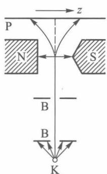
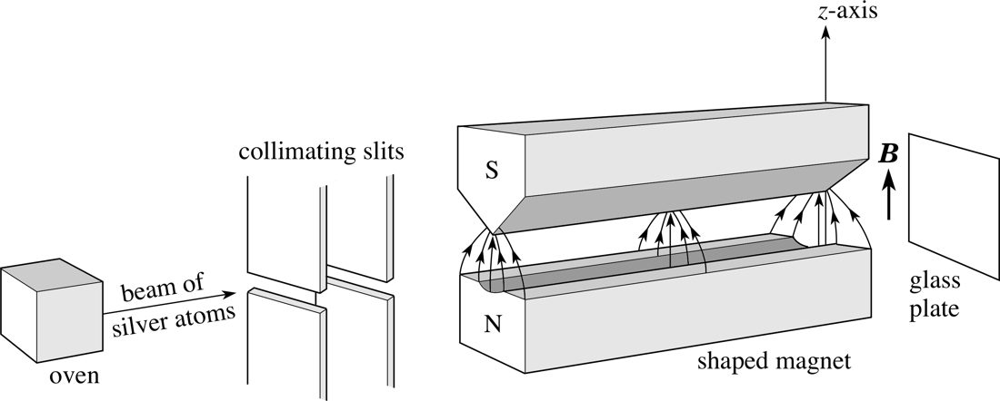
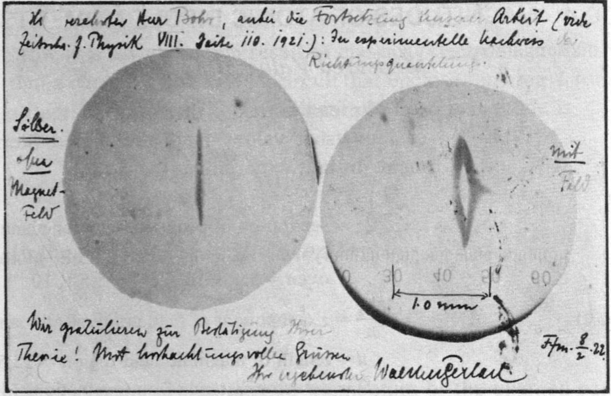
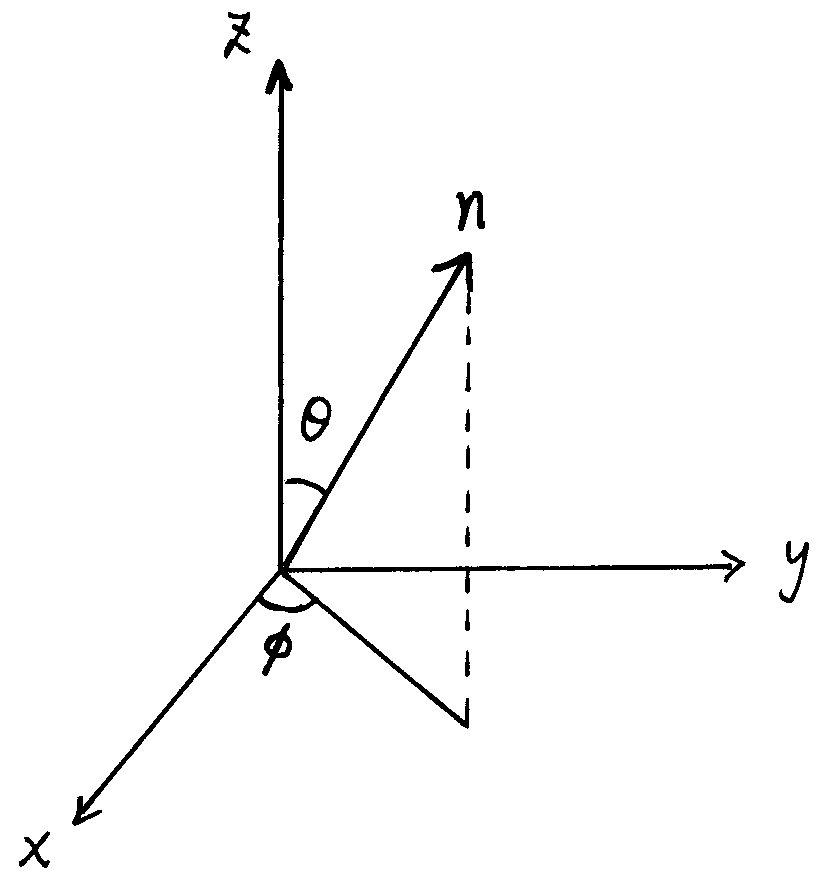
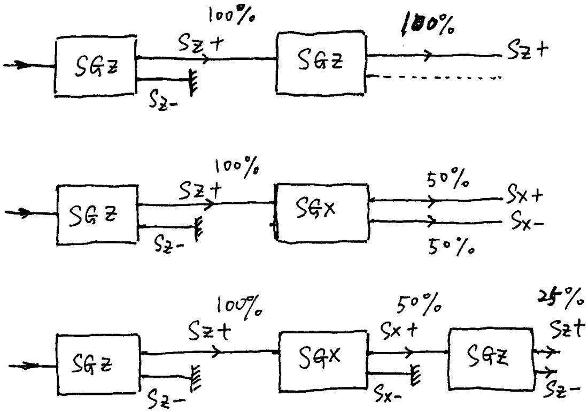
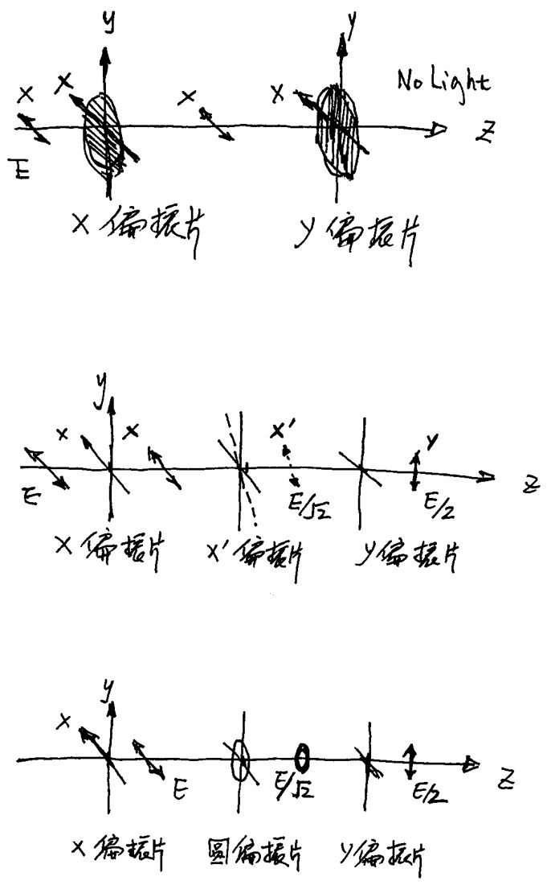
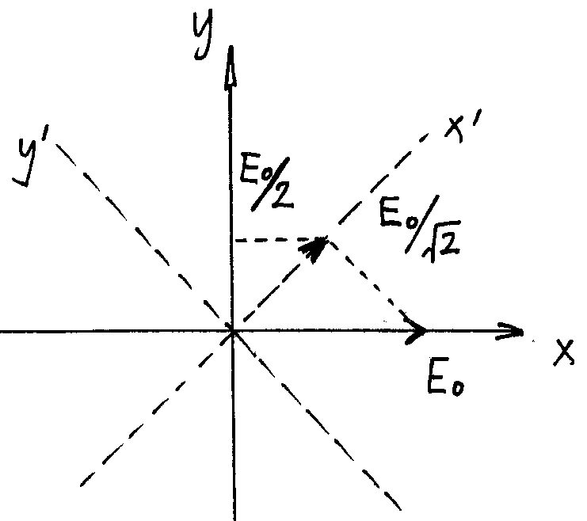
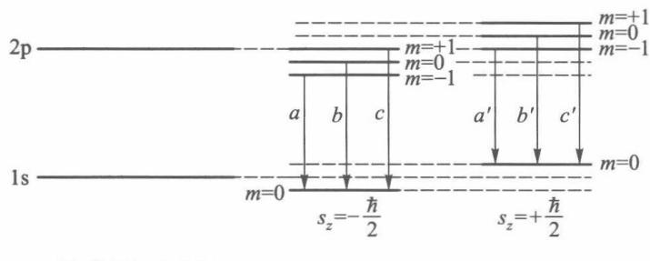
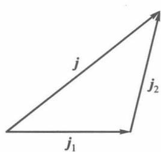
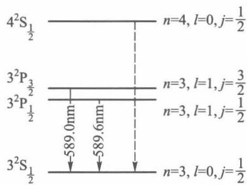

# 第 7 章 自旋

!!! note "本章学习范围"

    重点是施特恩–格拉赫实验、自旋假设、泡利矩阵、旋量和简单塞曼效应。连续测量、进动、量子比特、角动量耦合、精细结构是延伸。反常塞曼效应这里不展开，可参考杨福家《原子物理学》。

!!! tip "本章目标"

    1. 了解证明电子自旋存在的两类实验事实——**施特恩–格拉赫实验**和**光谱精细结构**，掌握乌伦贝克–古兹密特假设：$S_z=\pm\frac\hbar2$，$\boldsymbol\mu_s=-\frac{e}{m_{\mathrm e}}\boldsymbol S$；
    2. 掌握自旋算符的对易关系、**泡利矩阵**及其代数性质（$\sigma_i^2=1$、反对易、$\sigma_x\sigma_y\sigma_z=\ii$），会在 $S_z$ 表象中求任意方向 $\hat S_n$ 的本征值和本征态；
    3. 理解考虑自旋后电子波函数是**两分量旋量**，会做归一化、算概率和期望值；理解自旋空间是一个**二维希尔伯特空间**，会用**布洛赫球**表示任意自旋态，理解自旋在磁场中的**进动**与**拉比振荡**，了解它与量子比特的关系；
    4. 会求解强磁场中类氢原子的能级分裂，解释**（简单）塞曼效应**的三条谱线；
    5. 掌握**两个角动量的耦合**：无耦合表象与耦合表象、$m=m_1+m_2$、三角形关系 $j=j_1+j_2,\dots,|j_1-j_2|$、$j_2=\frac12$ 的克莱布什–戈登系数，会写两电子自旋的三重态与单态；
    6. 会用简并微扰在耦合表象中计算**自旋–轨道耦合**的能量修正，解释**光谱的精细结构**（钠 D 双线）。

**本章在全书中的位置。** 到第 6 章为止，电子的状态完全由空间波函数 $\psi(\boldsymbol r)$ 描写，力学量都是 $\hat{\boldsymbol r}$、$\hat{\boldsymbol p}$ 的函数。本章要加进一个**与 $\boldsymbol r$、$\boldsymbol p$ 都无关的新自由度**。全章的逻辑只有一条主线：

- **它是什么**（§7.1）：实验告诉我们电子有一个只能取两个值的内禀角动量；
- **怎样描写**（§7.2）：把第 3 章角动量的**对易关系**当作定义，在第 4 章的**矩阵表象**里实现它——得到 $2\times2$ 的泡利矩阵和二维的旋量；
- **它带来什么能量**：与外磁场作用 → 塞曼效应（§7.3）；与轨道运动作用 → 精细结构（§7.5）。后者让 $\hat L_z$、$\hat S_z$ 不再守恒，迫使我们换一组好量子数，所需的数学就是**角动量耦合**（§7.4）；计算方法则是第 5 章的**简并微扰论**。

第 8 章讨论多电子体系时，自旋又是泡利不相容原理和交换作用的主角。

---

## 7.1 电子自旋

### 7.1.1 施特恩–格拉赫实验

如图 7.1，由 K 射出的、处于 $s$ 态的氢原子束经狭缝 B 准直后通过一个**非均匀**磁场，最后打在照相底片 P 上。

<figure markdown>
{ width="200" }
<figcaption>图 7.1　施特恩–格拉赫实验：磁极做成一尖一平，使磁场沿 $z$ 方向有很大的梯度 $\partial B_z/\partial z$。（来源：周世勋《量子力学教程》第 3 版图 7.1）</figcaption>
</figure>

设原子磁矩为 $\boldsymbol\mu$，它在沿 $z$ 方向的磁场中的势能为

$$U=-\boldsymbol\mu\cdot\boldsymbol B=-\mu B_z\cos\theta,$$

$\theta$ 是 $\boldsymbol\mu$ 与 $\boldsymbol B$ 的夹角。均匀磁场只产生力矩、不产生合力；只有**非均匀**磁场才使原子受到 $z$ 方向的力

$$F_z=-\frac{\partial U}{\partial z}=\mu\,\frac{\partial B_z}{\partial z}\cos\theta .$$

- **经典预期**：原子磁矩的取向是随机的，$\cos\theta$ 在 $[-1,1]$ 中连续分布，底片上应当是一条**连续的带**；
- **实验结果**：底片上只有**两条分立的线**，对应 $\cos\theta=+1$ 和 $\cos\theta=-1$。

这说明：(1) 原子有磁矩；(2) 磁矩在磁场方向的投影只有两个值——**空间量子化**。更关键的是，实验用的是 **$s$ 态**氢原子，$l=0$，没有轨道角动量，也就没有轨道磁矩（第 3 章：$\boldsymbol\mu_L=-\frac{e}{2m_{\mathrm e}}\boldsymbol L$）；原子核质量大，核磁矩小约三个数量级。所以这个磁矩只能是**电子本身固有的**。

<figure class="video" markdown>
<video controls preload="metadata" width="100%" poster="assets/posters/C7_SternGerlach.jpg"><source src="assets/videos/C7_SternGerlach.mp4" type="video/mp4"></video>
<figcaption>动画 7-1　施特恩–格拉赫实验：若磁矩可以任意取向，原子在磁场中的偏转连续分布，屏上是一条带（黄）；实际只得到上下两个斑点（红、蓝），对应 $\mu_z=\mp\mu_{\mathrm B}$。</figcaption>
</figure>

!!! info "历史：一张寄给玻尔的明信片"

    施特恩（O. Stern）和盖拉赫（W. Gerlach）在 1922 年做这个实验时用的是**银原子**：基态银的电子组态是 $[\mathrm{Kr}]4d^{10}5s^1$，满壳层的总角动量为零，$5s$ 电子 $l=0$，所以测到的同样是**纯自旋**磁矩。当时还没有“自旋”的概念，他们本来是想检验玻尔–索末菲旧量子论的“空间量子化”。实验成功后，盖拉赫给玻尔寄了一张明信片，上面是底片的照片：没有磁场时是一条细线，加了磁场后分成上下两瓣，旁边写着“祝贺您的理论得到证实”。讽刺的是，按旧量子论 $l=1$ 应当分成 3 束（或在去掉 $m=0$ 后为 2 束），两条线的真正解释要等到三年后的电子自旋假设。用氢原子重复这一实验是 1927 年（菲普斯和泰勒），也就是图 7.1 的情形。施特恩因发展分子束方法和测量质子磁矩获 1943 年诺贝尔物理学奖。

<div class="grid-2" markdown>
<figure markdown>
{ width="480" }
<figcaption>图 7.1a　施特恩–格拉赫装置：炉、准直缝、刀口形磁极与玻璃屏。（来源：季燕江《量子力学》讲义（QMUSTB，github.com/jiyanjiang/QMUSTB））</figcaption>
</figure>
<figure markdown>
{ width="400" }
<figcaption>图 7.1b　1922 年盖拉赫寄给玻尔的明信片：左为无磁场时的原子束痕迹，右为加磁场后分裂成的两瓣。（来源：季燕江《量子力学》讲义（QMUSTB，github.com/jiyanjiang/QMUSTB））</figcaption>
</figure>
</div>

!!! tip "一个比喻：掷出“无穷多面的骰子”"

    经典地看，原子磁矩的方向像一个“无穷多面的骰子”（一个球），每次掷出的 $\cos\theta$ 可以是 $[-1,1]$ 中任何值；实验却发现它每次只掷出“1”或“2”。更要紧的是，掷骰子的概率来自我们对初始条件的**无知**，而量子测量的概率是**内禀的**：即使态完全确定（例如 $\chi_{+x}$），测 $S_z$ 的结果也只能以 $\frac12$ 的概率预言。

!!! info "直觉：为什么 $2l+1$ 条解释不了"

    轨道角动量的投影有 $2l+1$ 个值，永远是**奇数**条（$l=0$ 时 1 条，不偏转）。两条线意味着 “$2s+1=2$”，即量子数 $s=\frac12$——一个**半整数**。半整数角动量不可能来自 $\boldsymbol r\times\boldsymbol p$（轨道角动量的 $l$ 只能是整数，见 §3.2），这是“自旋是一个全新自由度”的最直接证据。

### 7.1.2 光谱的精细结构

用高分辨率的光谱仪观察钠原子的黄色谱线（$3\mathrm p\to3\mathrm s$），会发现它其实是两条靠得很近的线：$589.0\ \mathrm{nm}$ 和 $589.6\ \mathrm{nm}$（钠 D 双线）。其他原子的光谱中也普遍存在这种**双线**现象，称为光谱的**精细结构**。只用 $\psi(\boldsymbol r)$ 描写电子，$3\mathrm p$ 是一个能级，不可能分成两个；只有引入电子自旋，并考虑自旋与轨道运动的相互作用（§7.5），才能解释它。

### 7.1.3 乌伦贝克–古兹密特假设

!!! definition "定义 7.1（电子自旋假设，乌伦贝克–古兹密特，1925）"

    (1) 每个电子具有**自旋角动量** $\boldsymbol S$，它在空间任何方向上的投影只能取两个值：

    $$S_z=\pm\frac\hbar2 .$$

    (2) 每个电子具有**自旋磁矩** $\boldsymbol\mu_s$，它与自旋角动量的关系是

    $$\boldsymbol\mu_s=-\frac{e}{m_{\mathrm e}}\boldsymbol S,$$

    其中 $-e$ 是电子电荷，$m_{\mathrm e}$ 是电子质量。于是 $\boldsymbol\mu_s$ 在任意方向的投影只能取

    $$\mu_{sz}=\mp\frac{e\hbar}{2m_{\mathrm e}}=\mp\mu_{\mathrm B},\qquad \mu_{\mathrm B}=\frac{e\hbar}{2m_{\mathrm e}}=9.274\times10^{-24}\ \mathrm{J/T}=5.788\times10^{-5}\ \mathrm{eV/T}\ \ (\text{玻尔磁子}).$$

磁矩与角动量之比称为**磁旋比**。比较轨道与自旋：

| | 角动量 | 磁矩 | 磁旋比 | $g$ 因子 |
|---|---|---|---|---|
| 轨道 | $\boldsymbol L$，$L_z=m\hbar$ | $\boldsymbol\mu_L=-\dfrac{e}{2m_{\mathrm e}}\boldsymbol L$ | $-\dfrac{e}{2m_{\mathrm e}}$ | $g_l=1$ |
| 自旋 | $\boldsymbol S$，$S_z=\pm\frac\hbar2$ | $\boldsymbol\mu_s=-\dfrac{e}{m_{\mathrm e}}\boldsymbol S$ | $-\dfrac{e}{m_{\mathrm e}}$ | $g_s=2$ |

**自旋磁旋比是轨道磁旋比的两倍**。统一写成 $\boldsymbol\mu=-g\,\dfrac{\mu_{\mathrm B}}{\hbar}\boldsymbol J$，则 $g_l=1$、$g_s=2$。这个“2”是塞曼效应（§7.3）中 $\hat L_z+2\hat S_z$ 的来源。

!!! info "自旋不是“电子在自转”"

    把电子想象成半径 $r_e\approx2.8\times10^{-15}\ \mathrm m$ 的小球绕自身转动，要得到 $S\sim\frac\hbar2$，表面线速度约为

    $$v\sim\frac{\hbar}{2m_{\mathrm e}r_e}=\frac{1.055\times10^{-34}}{2\times9.11\times10^{-31}\times2.8\times10^{-15}}\ \mathrm{m/s}\approx2\times10^{10}\ \mathrm{m/s}\gg c .$$

    这显然不可能；而且经典转动给不出“只取两个值”和 $g=2$。**自旋是纯粹的量子特性**，“自旋”只是借用的名字。它在相对论量子力学（狄拉克方程）中自然出现，$g_s=2$ 也是狄拉克理论的结果（精确测量值 $g_s=2.0023\cdots$，偏离来自量子电动力学修正）。

!!! example "例题 7.1（施特恩–格拉赫装置中的偏转量）"

    氢原子束速度 $v=2.0\times10^3\ \mathrm{m/s}$，穿过长 $L=0.10\ \mathrm m$、梯度 $\partial B_z/\partial z=1.0\times10^3\ \mathrm{T/m}$ 的磁场区。估算离开磁场时两束原子在 $z$ 方向上的间距。（$m_{\mathrm H}=1.67\times10^{-27}\ \mathrm{kg}$）

    **解。** 受力 $F_z=\pm\mu_{\mathrm B}\,\partial B_z/\partial z=\pm9.27\times10^{-21}\ \mathrm N$，加速度 $a=F_z/m_{\mathrm H}=5.55\times10^6\ \mathrm{m/s^2}$。穿越时间 $t=L/v=5.0\times10^{-5}\ \mathrm s$，

    $$z=\tfrac12at^2=\tfrac12\times5.55\times10^6\times(5.0\times10^{-5})^2\ \mathrm m\approx6.9\ \mathrm{mm}.$$

    两束间距约 $2z\approx1.4\ \mathrm{cm}$，再经过一段自由飞行还会进一步拉开，完全可以分辨。

!!! warning "易错点"

    - 施特恩–格拉赫实验需要**非均匀**磁场；均匀磁场中磁矩只受力矩，原子束不分裂。
    - 电子带负电，$\boldsymbol\mu_s$ 与 $\boldsymbol S$ **反向**：$S_z=+\frac\hbar2$ 的电子 $\mu_z=-\mu_{\mathrm B}$，在 $\partial B_z/\partial z>0$ 的磁场中向 $-z$ 偏。
    - “自旋投影只取 $\pm\frac\hbar2$”对**任意方向**都成立，不只是 $z$ 方向——这正是下一节 $\hat S_x$、$\hat S_y$ 本征值也是 $\pm\frac\hbar2$ 的依据。

---

## 7.2 电子的自旋算符和自旋波函数

### 7.2.1 自旋算符的对易关系

自旋是力学量，要用算符 $\hat{\boldsymbol S}$ 表示。它与坐标、动量无关，$\hat{\boldsymbol r}\times\hat{\boldsymbol p}$ 的表示对它不适用；但它**是角动量**，所以要求它满足角动量的一般对易关系（§3.6）：

!!! definition "定义 7.2（自旋算符）"

    自旋算符 $\hat{\boldsymbol S}=(\hat S_x,\hat S_y,\hat S_z)$ 是厄米算符，满足

    $$\hat{\boldsymbol S}\times\hat{\boldsymbol S}=\ii\hbar\hat{\boldsymbol S},\qquad\text{即}\quad [\hat S_x,\hat S_y]=\ii\hbar\hat S_z,\quad [\hat S_y,\hat S_z]=\ii\hbar\hat S_x,\quad [\hat S_z,\hat S_x]=\ii\hbar\hat S_y ,$$

    并且每个分量的本征值只有 $\pm\frac\hbar2$。

由于每个分量的本征值都是 $\pm\frac\hbar2$，它们的平方只有一个本征值 $\frac{\hbar^2}4$，即 $\hat S_x^2=\hat S_y^2=\hat S_z^2=\frac{\hbar^2}{4}$（作为算符就是常数乘单位算符）。于是

$$\hat S^2=\hat S_x^2+\hat S_y^2+\hat S_z^2=\frac34\hbar^2 .$$

与 $\hat L^2$ 的本征值 $l(l+1)\hbar^2$ 对比，写 $S^2=s(s+1)\hbar^2$，得 **自旋量子数 $s=\frac12$**。与 $l$ 不同，**对电子 $s$ 只取一个值 $\frac12$**——$\hat S^2$ 与任何算符都对易，它是电子的固有属性，不是可变的状态量。

### 7.2.2 泡利算符

!!! definition "定义 7.3（泡利算符）"

    令 $\hat{\boldsymbol S}=\dfrac\hbar2\hat{\boldsymbol\sigma}$，则 $\hat{\boldsymbol\sigma}$ 满足

    $$\hat{\boldsymbol\sigma}\times\hat{\boldsymbol\sigma}=2\ii\hat{\boldsymbol\sigma}:\qquad [\hat\sigma_x,\hat\sigma_y]=2\ii\hat\sigma_z,\quad[\hat\sigma_y,\hat\sigma_z]=2\ii\hat\sigma_x,\quad[\hat\sigma_z,\hat\sigma_x]=2\ii\hat\sigma_y,$$

    $\hat\sigma_x,\hat\sigma_y,\hat\sigma_z$ 的本征值都是 $\pm1$，$\hat\sigma_x^2=\hat\sigma_y^2=\hat\sigma_z^2=1$。

!!! theorem "定理 7.1（泡利算符的反对易关系）"

    $$\hat\sigma_x\hat\sigma_y+\hat\sigma_y\hat\sigma_x=0,\qquad\hat\sigma_y\hat\sigma_z+\hat\sigma_z\hat\sigma_y=0,\qquad\hat\sigma_z\hat\sigma_x+\hat\sigma_x\hat\sigma_z=0 .$$

    与对易关系合起来，可以写成一个式子：

    $$\hat\sigma_i\hat\sigma_j=\delta_{ij}+\ii\sum_k\varepsilon_{ijk}\hat\sigma_k\qquad(i,j,k=x,y,z),$$

    例如 $\hat\sigma_x\hat\sigma_y=\ii\hat\sigma_z$，$\hat\sigma_y\hat\sigma_x=-\ii\hat\sigma_z$，$\hat\sigma_x\hat\sigma_y\hat\sigma_z=\ii$。

??? proof "证明"

    由 $[\hat\sigma_y,\hat\sigma_z]=2\ii\hat\sigma_x$ 得 $\hat\sigma_x=\frac1{2\ii}(\hat\sigma_y\hat\sigma_z-\hat\sigma_z\hat\sigma_y)$，代入并利用 $\hat\sigma_y^2=1$：

    $$\hat\sigma_x\hat\sigma_y+\hat\sigma_y\hat\sigma_x=\frac1{2\ii}\big(\hat\sigma_y\hat\sigma_z\hat\sigma_y-\hat\sigma_z\hat\sigma_y^2+\hat\sigma_y^2\hat\sigma_z-\hat\sigma_y\hat\sigma_z\hat\sigma_y\big)=\frac1{2\ii}(-\hat\sigma_z+\hat\sigma_z)=0 .$$

    其余两式同理（轮换 $x\to y\to z\to x$）。把 $\hat\sigma_x\hat\sigma_y-\hat\sigma_y\hat\sigma_x=2\ii\hat\sigma_z$ 与 $\hat\sigma_x\hat\sigma_y+\hat\sigma_y\hat\sigma_x=0$ 相加得 $\hat\sigma_x\hat\sigma_y=\ii\hat\sigma_z$；再右乘 $\hat\sigma_z$ 得 $\hat\sigma_x\hat\sigma_y\hat\sigma_z=\ii\hat\sigma_z^2=\ii$。 $\blacksquare$

!!! note "推论：$(\hat{\boldsymbol\sigma}\cdot\boldsymbol A)(\hat{\boldsymbol\sigma}\cdot\boldsymbol B)=\boldsymbol A\cdot\boldsymbol B+\ii\,\hat{\boldsymbol\sigma}\cdot(\boldsymbol A\times\boldsymbol B)$"

    $\boldsymbol A,\boldsymbol B$ 是与 $\hat{\boldsymbol\sigma}$ 对易的矢量（数或空间算符）。直接用 $\hat\sigma_i\hat\sigma_j=\delta_{ij}+\ii\varepsilon_{ijk}\hat\sigma_k$ 展开即得。特例：$\boldsymbol A=\boldsymbol B=\boldsymbol n$（单位矢量）时 $(\hat{\boldsymbol\sigma}\cdot\boldsymbol n)^2=1$，所以**任意方向**的 $\hat\sigma_n$ 本征值都是 $\pm1$——与“任何方向投影都是 $\pm\frac\hbar2$”自洽。

### 7.2.3 旋量波函数

自旋是描写电子状态的**第四个变量**。除了 $\boldsymbol r=(x,y,z)$，还要一个自旋变量 $s_z$，电子的波函数写作

$$\Psi=\Psi(\boldsymbol r,s_z,t).$$

$s_z$ 只取 $\pm\frac\hbar2$ 两个值，所以 $\Psi$ 实际上是两个空间函数：$\Psi_1(\boldsymbol r,t)=\Psi(\boldsymbol r,+\frac\hbar2,t)$，$\Psi_2(\boldsymbol r,t)=\Psi(\boldsymbol r,-\frac\hbar2,t)$。把它们排成一列：

!!! definition "定义 7.4（旋量波函数）"

    $$\Psi=\begin{pmatrix}\Psi_1(\boldsymbol r,t)\\ \Psi_2(\boldsymbol r,t)\end{pmatrix},$$

    第一行对应 $s_z=+\frac\hbar2$，第二行对应 $s_z=-\frac\hbar2$。归一化要**对自旋求和、对空间积分**：

    $$\int\Psi^\dagger\Psi\,\dd V=\int\big(|\Psi_1|^2+|\Psi_2|^2\big)\dd V=1 .$$

    $w=\Psi^\dagger\Psi=|\Psi_1|^2+|\Psi_2|^2$ 是 $t$ 时刻在 $\boldsymbol r$ 处单位体积内找到电子的概率；$|\Psi_1|^2$、$|\Psi_2|^2$ 分别是在 $\boldsymbol r$ 处找到 $s_z=+\frac\hbar2$、$-\frac\hbar2$ 的电子的概率密度。$\int|\Psi_1|^2\dd V$ 是测 $S_z$ 得 $+\frac\hbar2$ 的概率。

已知 $s_z=+\frac\hbar2$ 时 $\Psi_{1/2}=\begin{pmatrix}\Psi_1\\0\end{pmatrix}$；已知 $s_z=-\frac\hbar2$ 时 $\Psi_{-1/2}=\begin{pmatrix}0\\\Psi_2\end{pmatrix}$。

**自旋与轨道可分离的情形。** 一般情况下自旋与轨道运动有相互作用（§7.5），$\Psi_1$、$\Psi_2$ 是 $\boldsymbol r$ 的不同函数。当这种相互作用可以略去时，自旋状态不影响轨道运动，可以写成

$$\Psi(\boldsymbol r,s_z,t)=\psi(\boldsymbol r,t)\,\chi(s_z),$$

$\chi(s_z)$ 称为**自旋波函数**，自旋算符只作用在 $\chi$ 上。

### 7.2.4 自旋算符的矩阵形式：泡利矩阵

波函数是 $2\times1$ 的列矩阵，作用在它上面的自旋算符就是 $2\times2$ 矩阵。上面的约定正是第 4 章的 **$S_z$ 表象**：基矢取 $\hat S_z$ 的本征态，于是 $\hat S_z$ 是对角的。

!!! theorem "定理 7.2（$S_z$ 表象中的自旋矩阵）"

    $$\hat S_z=\frac\hbar2\begin{pmatrix}1&0\\0&-1\end{pmatrix},\qquad \hat S_x=\frac\hbar2\begin{pmatrix}0&1\\1&0\end{pmatrix},\qquad \hat S_y=\frac\hbar2\begin{pmatrix}0&-\ii\\\ii&0\end{pmatrix},$$

    即**泡利矩阵**

    $$\sigma_x=\begin{pmatrix}0&1\\1&0\end{pmatrix},\qquad\sigma_y=\begin{pmatrix}0&-\ii\\\ii&0\end{pmatrix},\qquad\sigma_z=\begin{pmatrix}1&0\\0&-1\end{pmatrix}.$$

??? proof "推导"

    **$\hat S_z$。** 设 $\hat S_z=\frac\hbar2\begin{pmatrix}a&b\\c&d\end{pmatrix}$。$\Psi_{1/2}=\binom{\Psi_1}{0}$ 是属于 $+\frac\hbar2$ 的本征态：$\binom{a\Psi_1}{c\Psi_1}=\binom{\Psi_1}{0}$，得 $a=1,c=0$；$\Psi_{-1/2}=\binom0{\Psi_2}$ 属于 $-\frac\hbar2$：$\binom{b\Psi_2}{d\Psi_2}=\binom{0}{-\Psi_2}$，得 $b=0,d=-1$。

    **$\sigma_x$。** 由反对易 $\sigma_x\sigma_z=-\sigma_z\sigma_x$。设 $\sigma_x=\begin{pmatrix}a&b\\c&d\end{pmatrix}$，$\sigma_x\sigma_z=\begin{pmatrix}a&-b\\c&-d\end{pmatrix}$，$-\sigma_z\sigma_x=\begin{pmatrix}-a&-b\\c&d\end{pmatrix}$，所以 $a=d=0$。$\sigma_x$ 厄米 $\Rightarrow c=b^*$；$\sigma_x^2=|b|^2I=I\Rightarrow b=\ee^{\ii\alpha}$。相因子 $\alpha$ 可以通过重新选取 $\chi_-$ 的相位吸收掉，取 $\alpha=0$：$\sigma_x=\begin{pmatrix}0&1\\1&0\end{pmatrix}$。

    **$\sigma_y$。** 由 $\sigma_z\sigma_x-\sigma_x\sigma_z=2\ii\sigma_y$：

    $$\sigma_y=\frac1{2\ii}\left[\begin{pmatrix}0&1\\-1&0\end{pmatrix}-\begin{pmatrix}0&-1\\1&0\end{pmatrix}\right]=\frac1{2\ii}\begin{pmatrix}0&2\\-2&0\end{pmatrix}=\begin{pmatrix}0&-\ii\\\ii&0\end{pmatrix}. \qquad\blacksquare$$

泡利矩阵的几条常用性质（都可直接验证）：

- 厄米：$\sigma_i^\dagger=\sigma_i$；幺正：$\sigma_i^2=I$；**无迹** $\operatorname{Tr}\sigma_i=0$；$\det\sigma_i=-1$。
- $\{I,\sigma_x,\sigma_y,\sigma_z\}$ 构成 $2\times2$ 矩阵空间的一组基：任意 $2\times2$ 矩阵 $A=a_0I+\boldsymbol a\cdot\boldsymbol\sigma$，$a_0=\frac12\operatorname{Tr}A$，$a_i=\frac12\operatorname{Tr}(A\sigma_i)$。所以**自旋空间里的任何力学量都是 $I$ 与 $\boldsymbol\sigma$ 的线性组合**。

### 7.2.5 自旋态空间：二维希尔伯特空间与布洛赫球

$\hat S_z$ 的两个本征态

$$\chi_{\frac12}=\begin{pmatrix}1\\0\end{pmatrix}\equiv\chi_+\equiv\ket{\uparrow},\qquad \chi_{-\frac12}=\begin{pmatrix}0\\1\end{pmatrix}\equiv\chi_-\equiv\ket{\downarrow}$$

正交归一：$\chi_+^\dagger\chi_-=(1\ \ 0)\binom01=0$。它们张成一个**二维复希尔伯特空间**，任意自旋态都是它们的叠加：

$$\chi=\begin{pmatrix}a\\b\end{pmatrix}=a\chi_++b\chi_-,\qquad |a|^2+|b|^2=1 .$$

测 $S_z$ 得 $+\frac\hbar2$ 的概率 $|a|^2$，得 $-\frac\hbar2$ 的概率 $|b|^2$。这就是第 3、4 章的测量公设在最小的非平凡空间里的样子——**自旋是量子力学最干净的“玩具模型”**，也是量子比特（qubit）的物理载体。

!!! theorem "定理 7.3（任意方向的自旋本征态）"

    设单位矢量 $\boldsymbol n=(\sin\theta\cos\varphi,\ \sin\theta\sin\varphi,\ \cos\theta)$，$\hat S_n=\hat{\boldsymbol S}\cdot\boldsymbol n$。在 $S_z$ 表象中

    $$\hat S_n=\frac\hbar2\begin{pmatrix}\cos\theta&\sin\theta\,\ee^{-\ii\varphi}\\\sin\theta\,\ee^{\ii\varphi}&-\cos\theta\end{pmatrix},$$

    本征值 $\pm\frac\hbar2$，对应的归一化本征态为

    $$\chi_{\boldsymbol n,+}=\begin{pmatrix}\cos\frac\theta2\\\ee^{\ii\varphi}\sin\frac\theta2\end{pmatrix},\qquad \chi_{\boldsymbol n,-}=\begin{pmatrix}\sin\frac\theta2\\-\ee^{\ii\varphi}\cos\frac\theta2\end{pmatrix}.$$

??? proof "验证"

    记 $c=\cos\frac\theta2$，$s=\sin\frac\theta2$，则 $\cos\theta=c^2-s^2$，$\sin\theta=2sc$。$\sigma_n\chi_{\boldsymbol n,+}$ 的第一分量 $=(c^2-s^2)c+2sc\cdot s=c(c^2+s^2)=c$；第二分量 $=\ee^{\ii\varphi}\big[2sc\cdot c-(c^2-s^2)s\big]=\ee^{\ii\varphi}s$。所以 $\sigma_n\chi_{\boldsymbol n,+}=\chi_{\boldsymbol n,+}$。$\chi_{\boldsymbol n,-}$ 同理，且 $\chi_{\boldsymbol n,+}^\dagger\chi_{\boldsymbol n,-}=cs-sc=0$。 $\blacksquare$

<figure markdown>
{ width="260" }
<figcaption>图 7.5　单位矢量 $\boldsymbol n$ 的极角 $\theta$ 与方位角 $\varphi$。（来源：季燕江《量子力学》讲义（QMUSTB，github.com/jiyanjiang/QMUSTB））</figcaption>
</figure>

**反过来**，任意归一化的 $\chi=\binom ab$，去掉一个无关的整体相位后都可以写成 $\chi_{\boldsymbol n,+}$ 的形式（取 $a=\cos\frac\theta2\ge0$，$b=\ee^{\ii\varphi}\sin\frac\theta2$）。于是：

!!! success "布洛赫球"

    **每个自旋 $\frac12$ 的纯态都是“沿某个方向 $\boldsymbol n$ 自旋向上”的态**，与单位球面上的一点 $(\theta,\varphi)$ 一一对应。这个态中

    $$\langle\hat{\boldsymbol S}\rangle=\frac\hbar2\,\boldsymbol n=\frac\hbar2(\sin\theta\cos\varphi,\ \sin\theta\sin\varphi,\ \cos\theta).$$

    - 北极 $\ket\uparrow$、南极 $\ket\downarrow$；赤道上 $\chi_{\pm x}=\frac1{\sqrt2}\binom1{\pm1}$、$\chi_{\pm y}=\frac1{\sqrt2}\binom1{\pm\ii}$；
    - 球面上**对径点**是正交态（$\theta\to\pi-\theta$，$\varphi\to\varphi+\pi$）；希尔伯特空间里“正交”的两个态，在布洛赫球上夹角是 $180^\circ$，而不是 $90^\circ$——这是“半角”$\frac\theta2$ 的由来。
    - 两个态的跃迁概率 $|\chi_{\boldsymbol n}^\dagger\chi_{\boldsymbol n'}|^2=\cos^2\frac{\Theta}{2}$，$\Theta$ 是 $\boldsymbol n$ 与 $\boldsymbol n'$ 的夹角。

!!! example "例题 7.2（$\hat S_x$ 的本征态与测量概率）"

    电子处于 $\chi_+=\binom10$。(1) 求 $\hat S_x$ 的本征值和本征态；(2) 测 $S_x$ 得到各值的概率和 $\langle S_x\rangle$。

    **解。** (1) 久期方程 $\det\begin{pmatrix}-\lambda&\frac\hbar2\\\frac\hbar2&-\lambda\end{pmatrix}=0\Rightarrow\lambda=\pm\frac\hbar2$。$\lambda=+\frac\hbar2$：$\binom ab$ 满足 $b=a$，$\chi_{+x}=\frac1{\sqrt2}\binom11$；$\lambda=-\frac\hbar2$：$\chi_{-x}=\frac1{\sqrt2}\binom1{-1}$。

    (2) $\chi_+=\frac1{\sqrt2}(\chi_{+x}+\chi_{-x})$，所以 $P(+\frac\hbar2)=P(-\frac\hbar2)=\frac12$，$\langle S_x\rangle=\chi_+^\dagger\hat S_x\chi_+=0$。

    在布洛赫球上：$\ket\uparrow$ 在北极，$\pm x$ 在赤道上，夹角都是 $90^\circ$，概率 $\cos^2 45^\circ=\frac12$。

### 7.2.6 连续测量：自旋测量的“记忆”

!!! warning "延伸 · 选学"

把几台施特恩–格拉赫装置串起来，就能把测量公设看得清清楚楚（动画 7-2）：

1. SG-$z$ 选出 $\ket\uparrow$，再过 SG-$z$：**100%** 仍是 $\uparrow$——$\chi_+$ 是 $\hat S_z$ 的本征态，重复测量结果不变；
2. SG-$z$ 选出 $\ket\uparrow$，再过 SG-$x$：$+x$、$-x$ 各 **50%**——$|\chi_{\pm x}^\dagger\chi_+|^2=\frac12$；
3. 再从中选出 $+x$ 束，**又**过一台 SG-$z$：$\uparrow$、$\downarrow$ 又各 50%！第一台已经把 $\downarrow$ 挡掉了，它却重新出现。

<figure markdown>
{ width="520" }
<figcaption>图 7.6　三种连续施特恩–格拉赫组合：$z\to z$ 100%；$z\to x$ 各 50%；$z\to x\to z$ 时被挡掉的 $S_z-$ 又以 25%（相对入射 $S_z+$ 束）出现。（来源：季燕江《量子力学》讲义（QMUSTB，github.com/jiyanjiang/QMUSTB））</figcaption>
</figure>

原因：测量 $S_x$ 之后，态坍缩到 $\chi_{+x}=\frac1{\sqrt2}(\chi_++\chi_-)$，关于 $S_z$ 的信息被完全抹掉了。根源是 $[\hat S_x,\hat S_z]=-\ii\hbar\hat S_y\ne0$：两者**没有共同本征态**，不能同时有确定值（§3.6）。

**光学类比：三块偏振片。** 自然光经过 $x$ 偏振片后成为 $x$ 偏振光，再经过 $y$ 偏振片，光完全被挡住；可是如果在两者之间**插入**一块 $45^\circ$ 的偏振片，反而有光透过。设入射 $x$ 偏振光振幅为 $E_0$：过 $45^\circ$ 片后振幅投影为 $E_0\cos45^\circ=E_0/\sqrt2$，再过 $y$ 片后为 $E_0/2$，光强比 $100\%:50\%:25\%$——与 $z\to x\to z$ 的计数完全一样。对照关系是

| 光的偏振 | 电子自旋 |
|---|---|
| $x$、$y$ 偏振（夹角 $90^\circ$，正交） | $\ket\uparrow$、$\ket\downarrow$（布洛赫球上夹角 $180^\circ$，正交） |
| $45^\circ$ 偏振 $=\frac1{\sqrt2}(\boldsymbol e_x+\boldsymbol e_y)$ | $\chi_{+x}=\frac1{\sqrt2}(\chi_++\chi_-)$（布洛赫球上 $90^\circ$） |
| 透过率 $\cos^2\alpha$ | 概率 $\cos^2\frac\Theta2$ |

偏振方向的夹角 $\alpha$ 对应布洛赫球上的夹角 $\Theta=2\alpha$：这又一次说明自旋态空间里的“正交”在实空间看是“反向”。偏振光本身就是光子的一个二维希尔伯特空间，两者在数学上是同一件事。

<div class="grid-2" markdown>
<figure markdown>
{ width="300" }
<figcaption>图 7.7a　与三种连续 SG 组合对应的偏振片序列。（来源：季燕江《量子力学》讲义（QMUSTB，github.com/jiyanjiang/QMUSTB））</figcaption>
</figure>
<figure markdown>
{ width="300" }
<figcaption>图 7.7b　振幅逐次投影：$E_0\to E_0/\sqrt2\to E_0/2$，光强 $100\%:50\%:25\%$。（来源：季燕江《量子力学》讲义（QMUSTB，github.com/jiyanjiang/QMUSTB））</figcaption>
</figure>
</div>

<figure class="video" markdown>
<video controls preload="metadata" width="100%" poster="assets/posters/C7_SequentialSG.jpg"><source src="assets/videos/C7_SequentialSG.mp4" type="video/mp4"></video>
<figcaption>动画 7-2　连续的施特恩–格拉赫实验。第三行中，被第一台 SG-$z$ 挡掉的 $\downarrow$ 分量在经过 SG-$x$ 之后又出现了：测量会改变态。</figcaption>
</figure>

### 7.2.7 自旋在磁场中的运动：进动

!!! warning "延伸 · 选学"

电子静止（或只看自旋自由度）时，在均匀磁场 $\boldsymbol B$ 中的哈密顿量就是自旋磁矩的能量：

$$\hat H=-\hat{\boldsymbol\mu}_s\cdot\boldsymbol B=\frac{e}{m_{\mathrm e}}\hat{\boldsymbol S}\cdot\boldsymbol B=\mu_{\mathrm B}\,\hat{\boldsymbol\sigma}\cdot\boldsymbol B .$$

取 $\boldsymbol B=B\boldsymbol e_z$，$\hat H=\frac{\hbar\omega}{2}\sigma_z$，$\omega=\dfrac{eB}{m_{\mathrm e}}$。$\hat H$ 在 $S_z$ 表象中是对角的，含时薛定谔方程 $\ii\hbar\,\dd\chi/\dd t=\hat H\chi$ 的解立即写出：

$$\chi(0)=\begin{pmatrix}\cos\frac\theta2\\\ee^{\ii\varphi_0}\sin\frac\theta2\end{pmatrix}\ \Longrightarrow\ \chi(t)=\begin{pmatrix}\cos\frac\theta2\,\ee^{-\ii\omega t/2}\\\ee^{\ii\varphi_0}\sin\frac\theta2\,\ee^{\ii\omega t/2}\end{pmatrix}=\ee^{-\ii\omega t/2}\begin{pmatrix}\cos\frac\theta2\\\ee^{\ii(\varphi_0+\omega t)}\sin\frac\theta2\end{pmatrix}.$$

!!! success "结论：拉莫尔进动"

    $\theta$ 不变、$\varphi(t)=\varphi_0+\omega t$：**布洛赫矢量 $\langle\hat{\boldsymbol S}\rangle$ 以角速度 $\omega=eB/m_{\mathrm e}$ 绕 $\boldsymbol B$ 进动**；测 $S_z$ 的概率 $\cos^2\frac\theta2$ 不随时间变化（$\hat S_z$ 与 $\hat H$ 对易，是守恒量）。

    同一结论也可以由期望值的运动方程（§3.8）得到：$\dfrac{\dd\langle\hat{\boldsymbol S}\rangle}{\dd t}=\dfrac1{\ii\hbar}\langle[\hat{\boldsymbol S},\hat H]\rangle=\dfrac{e}{m_{\mathrm e}}\boldsymbol B\times\langle\hat{\boldsymbol S}\rangle=\langle\hat{\boldsymbol\mu}_s\rangle\times\boldsymbol B$，与经典磁矩在磁场中受力矩 $\boldsymbol\mu\times\boldsymbol B$ 进动的方程完全一样。

若磁场沿 $x$ 方向，$\hat H=\frac{\hbar\omega}{2}\sigma_x$，布洛赫矢量绕 $x$ 轴转：初态 $\ket\uparrow$ 会周期性地翻到 $\ket\downarrow$，

$$\chi(t)=\ee^{-\ii\omega t\sigma_x/2}\chi_+=\begin{pmatrix}\cos\frac{\omega t}2\\-\ii\sin\frac{\omega t}{2}\end{pmatrix},\qquad P_\downarrow(t)=\sin^2\frac{\omega t}{2}.$$

（这里用到 $\sigma_x^2=1\Rightarrow\ee^{-\ii\alpha\sigma_x}=\cos\alpha-\ii\sigma_x\sin\alpha$。）核磁共振与量子比特的单比特门都是这样“转动布洛赫矢量”的。

<figure class="video" markdown>
<video controls preload="metadata" width="100%" poster="assets/posters/C7_SpinPrecession.jpg"><source src="assets/videos/C7_SpinPrecession.mp4" type="video/mp4"></video>
<figcaption>动画 7-3　布洛赫球：任意自旋态对应球面上一点。磁场沿 $z$ 时布洛赫矢量绕 $z$ 轴进动（$\theta$ 不变）；磁场沿 $x$ 时，初态 $\ket\uparrow$ 绕 $x$ 轴转到 $\ket\downarrow$ 再转回来。</figcaption>
</figure>

!!! example "例题 7.3（一般自旋态中的期望值）"

    $\chi=\dfrac1{\sqrt5}\binom{1}{2\ii}$。求 $\langle\sigma_x\rangle,\langle\sigma_y\rangle,\langle\sigma_z\rangle$，并指出它在布洛赫球上的方向。

    **解。** 对 $\chi=\binom ab$：$\langle\sigma_x\rangle=2\operatorname{Re}(a^*b)$，$\langle\sigma_y\rangle=2\operatorname{Im}(a^*b)$，$\langle\sigma_z\rangle=|a|^2-|b|^2$。这里 $a^*b=\frac{2\ii}5$：

    $$\langle\sigma_x\rangle=0,\qquad\langle\sigma_y\rangle=\frac45,\qquad\langle\sigma_z\rangle=\frac15-\frac45=-\frac35 .$$

    $\langle\boldsymbol\sigma\rangle=(0,\frac45,-\frac35)$ 是单位矢量（纯态必然如此），指向 $yz$ 平面内 $\theta=\arccos(-\frac35)\approx127^\circ$，$\varphi=90^\circ$。

!!! example "例题 7.4（用泡利矩阵代数化简）"

    求 $\ee^{\ii\alpha\,\boldsymbol n\cdot\boldsymbol\sigma}$（$\boldsymbol n$ 为单位矢量），并验证 $\operatorname{Tr}(\sigma_i\sigma_j)=2\delta_{ij}$。

    **解。** 由 $(\boldsymbol n\cdot\boldsymbol\sigma)^2=1$，展开指数时偶次项为 $1$、奇次项为 $\boldsymbol n\cdot\boldsymbol\sigma$：

    $$\ee^{\ii\alpha\,\boldsymbol n\cdot\boldsymbol\sigma}=\sum_k\frac{(\ii\alpha)^k}{k!}(\boldsymbol n\cdot\boldsymbol\sigma)^k=\cos\alpha+\ii\,(\boldsymbol n\cdot\boldsymbol\sigma)\sin\alpha .$$

    $\operatorname{Tr}(\sigma_i\sigma_j)=\operatorname{Tr}(\delta_{ij}I+\ii\varepsilon_{ijk}\sigma_k)=2\delta_{ij}$（$\sigma_k$ 无迹）。注意 $\alpha=2\pi$ 对应转动 $\ee^{-\ii\pi\boldsymbol n\cdot\boldsymbol\sigma}=-1$：**旋量转一整圈变号**，转两圈才复原——这是自旋 $\frac12$ 与普通矢量的本质区别。

!!! example "例题 7.5（磁共振与拉比振荡，【HUST 870 2024】）"

    电子处在磁场 $\boldsymbol B=B_0\boldsymbol e_z+B'(\cos\omega t,\ \sin\omega t,\ 0)$ 中（$B'\ll B_0$，横向场以角频率 $\omega$ 旋转），$\hat H=\mu_{\mathrm B}\boldsymbol\sigma\cdot\boldsymbol B$，$\chi(0)=\chi_+$。求 $t$ 时刻自旋翻转到 $\chi_-$ 的概率。

    **解。** 令 $\omega_0=2\mu_{\mathrm B}B_0/\hbar=eB_0/m_{\mathrm e}$，$\omega_1=2\mu_{\mathrm B}B'/\hbar$，

    $$\hat H=\frac\hbar2\big[\omega_0\sigma_z+\omega_1(\sigma_x\cos\omega t+\sigma_y\sin\omega t)\big].$$

    **转到旋转坐标系。** 利用 $\ee^{\ii\alpha\sigma_z}\sigma_x\ee^{-\ii\alpha\sigma_z}=\sigma_x\cos2\alpha-\sigma_y\sin2\alpha$，有 $\sigma_x\cos\omega t+\sigma_y\sin\omega t=\ee^{-\ii\omega t\sigma_z/2}\sigma_x\ee^{\ii\omega t\sigma_z/2}$。令 $\chi(t)=\ee^{-\ii\omega t\sigma_z/2}\phi(t)$，代入 $\ii\hbar\dot\chi=\hat H\chi$：

    $$\ii\hbar\dot\phi=\frac\hbar2\big[(\omega_0-\omega)\sigma_z+\omega_1\sigma_x\big]\phi\equiv\frac{\hbar\Omega}{2}\,(\boldsymbol n\cdot\boldsymbol\sigma)\,\phi,\qquad\Omega=\sqrt{(\omega_0-\omega)^2+\omega_1^2},$$

    这是**不含时**的方程：在旋转系中自旋只感受到一个静止的“等效磁场”，方向 $\boldsymbol n=\big(\omega_1,0,\omega_0-\omega\big)/\Omega$。由例题 7.4 的公式 $\ee^{-\ii\alpha\boldsymbol n\cdot\boldsymbol\sigma}=\cos\alpha-\ii\boldsymbol n\cdot\boldsymbol\sigma\sin\alpha$（$\alpha=\Omega t/2$）：

    $$\chi(t)=\begin{pmatrix}\ee^{-\ii\omega t/2}\Big[\cos\dfrac{\Omega t}{2}-\ii\dfrac{\omega_0-\omega}{\Omega}\sin\dfrac{\Omega t}{2}\Big]\\[2mm]-\ii\,\ee^{\ii\omega t/2}\dfrac{\omega_1}{\Omega}\sin\dfrac{\Omega t}{2}\end{pmatrix},\qquad P_{\uparrow\to\downarrow}(t)=\frac{\omega_1^2}{(\omega_0-\omega)^2+\omega_1^2}\sin^2\frac{\Omega t}{2}.$$

    这就是**拉比公式**。共振 $\omega=\omega_0$ 时 $\Omega=\omega_1$，经过 $t=\pi/\omega_1$（“$\pi$ 脉冲”）自旋**完全翻转**；失谐越大，翻转概率的上限 $\omega_1^2/\Omega^2$ 越小。很弱的 $B'$ 只要频率对准 $\omega_0$ 就能把自旋翻过来——核磁共振（NMR）、电子自旋共振和磁共振成像都基于这一点，也是操控量子比特的基本手段。$B_0=0$ 的特例就是上面横向磁场中的翻转 $P_\downarrow=\sin^2\frac{\omega t}2$。

### 7.2.8 布洛赫球与量子比特

!!! warning "延伸 · 选学"

二维希尔伯特空间的态 $\ket\psi=\alpha\ket0+\beta\ket1$（$|\alpha|^2+|\beta|^2=1$）称为一个**量子比特**（qubit），$\ket0\equiv\ket\uparrow$，$\ket1\equiv\ket\downarrow$。本节的内容可以原样翻译成量子信息的语言：

| 自旋 $\frac12$ | 量子比特 |
|---|---|
| 布洛赫球面上的一点 $(\theta,\varphi)$ | 量子比特的纯态 |
| 测 $S_z$，结果 $\pm\frac\hbar2$，概率 $\cos^2\frac\theta2$、$\sin^2\frac\theta2$ | 在计算基下读出 0 或 1 |
| 磁场中的进动 $\ee^{-\ii\alpha\boldsymbol n\cdot\boldsymbol\sigma}$ | 单比特**量子门**：布洛赫球的转动 |
| 共振 $\pi$ 脉冲：$\ket\uparrow\to\ket\downarrow$ | X 门（非门），差一个整体相位 |
| $\frac\pi2$ 脉冲：$\ket\uparrow\to\frac1{\sqrt2}(\ket\uparrow-\ii\ket\downarrow)$ | 制备等权叠加（Hadamard 型门） |
| 两自旋的单态 $\ket{0,0}$（§7.4） | 纠缠态（贝尔态） |

量子计算的特点由此看得很清楚：

1. **叠加**：一个经典比特只能是 0 或 1；一个量子比特是两个复振幅。$n$ 个量子比特的一般态有 $2^n$ 个复振幅，量子门同时作用在所有分量上。
2. **幺正演化**：量子门是幺正变换（在自旋上就是受控的磁场脉冲），可逆；两比特门（如受控非门）可以产生纠缠。
3. **测量坍缩**：读出时只得到一个结果，$2^n$ 个振幅不能直接全部读出。量子算法（如 Shor 分解、Grover 搜索）靠**干涉**放大正确答案的振幅。
4. **退相干**：量子比特与环境相互作用会破坏叠加的相位关系，这是实际量子计算机最主要的困难，需要量子纠错。

!!! warning "易错点"

    - $\hat S^2=\frac34\hbar^2$，**不是** $\frac14\hbar^2$；$|\boldsymbol S|=\frac{\sqrt3}2\hbar>S_z^{\max}=\frac\hbar2$，自旋矢量永远不能“完全指向” $z$ 轴。
    - $\hat S_x^2=\frac{\hbar^2}4$ 是算符恒等式，但 $\hat S_x\hat S_y\ne0$：$\hat S_x\hat S_y=\frac{\ii\hbar}{2}\hat S_z$（因为 $\sigma_x\sigma_y=\ii\sigma_z$）。
    - 泡利算符的对易关系是 $[\sigma_x,\sigma_y]=2\ii\sigma_z$（有因子 2），同时不同分量之间还**反对易**；$\hat S$ 的对易关系则是 $[\hat S_x,\hat S_y]=\ii\hbar\hat S_z$，二者不要混用。
    - 旋量归一化是 $\int(|\Psi_1|^2+|\Psi_2|^2)\dd V=1$，不是两个分量各自归一。
    - 旋量的两个分量空间部分不同时（如 $\Psi_1\propto Y_{11}$、$\Psi_2\propto Y_{10}$），算 $\langle S_x\rangle,\langle S_y\rangle$ 要带着空间波函数积分，交叉项可能因空间正交而为零；不能把系数抽出来当成纯自旋态（见练习 5）。
    - 布洛赫球上 $\chi_{\boldsymbol n}$ 的分量用**半角** $\frac\theta2$；正交态是对径点。
    - 拉莫尔进动频率：自旋是 $\omega=eB/m_{\mathrm e}$（$g_s=2$），轨道磁矩是 $eB/2m_{\mathrm e}$。

---

## 7.3 塞曼效应

### 7.3.1 强磁场中类氢原子的哈密顿量

考虑氢原子或类氢原子（碱金属的价电子）处在均匀外磁场 $\boldsymbol B=B\boldsymbol e_z$ 中。电子的轨道磁矩和自旋磁矩都与磁场作用；电子的自旋与轨道之间也有相互作用（§7.5）。本节**假设外磁场足够强**，使自旋–轨道相互作用比磁场引起的附加能量小得多，可以略去。

磁场引起的附加能量为（$\hat{\boldsymbol M}_L=-\frac{e}{2m_{\mathrm e}}\hat{\boldsymbol L}$，$\hat{\boldsymbol M}_S=-\frac{e}{m_{\mathrm e}}\hat{\boldsymbol S}$）

$$U=-(\hat{\boldsymbol M}_L+\hat{\boldsymbol M}_S)\cdot\boldsymbol B=\frac{e}{2m_{\mathrm e}}(\hat{\boldsymbol L}+2\hat{\boldsymbol S})\cdot\boldsymbol B=\frac{eB}{2m_{\mathrm e}}(\hat L_z+2\hat S_z).$$

（这里略去了与 $B^2$ 成正比的抗磁项，对通常实验室磁场它很小。）定态薛定谔方程为

$$-\frac{\hbar^2}{2m_{\mathrm e}}\nabla^2\psi+U(r)\psi+\frac{eB}{2m_{\mathrm e}}(\hat L_z+2\hat S_z)\psi=E\psi .$$

方程中有 $\hat S_z$ 但没有自旋–轨道耦合项，$\hat S_z$ 在 $S_z$ 表象中对角，所以把 $\psi=\binom{\psi_1}{\psi_2}$ 代入后两个分量**不耦合**：

$$\begin{aligned}
-\frac{\hbar^2}{2m_{\mathrm e}}\nabla^2\psi_1+U(r)\psi_1+\frac{eB}{2m_{\mathrm e}}(\hat L_z+\hbar)\psi_1&=E\psi_1,\\
-\frac{\hbar^2}{2m_{\mathrm e}}\nabla^2\psi_2+U(r)\psi_2+\frac{eB}{2m_{\mathrm e}}(\hat L_z-\hbar)\psi_2&=E\psi_2.
\end{aligned}$$

### 7.3.2 能级分裂

无磁场时两式的解都是 $\psi_{nlm}=R_{nl}(r)Y_{lm}(\theta,\varphi)$，能量 $E_{nl}$（氢原子只依赖 $n$；碱金属中内层电子屏蔽核电荷，$E_{nl}$ 也依赖 $l$）。$\psi_{nlm}$ 是 $\hat L_z$ 的本征函数，$\hat L_z\psi_{nlm}=m\hbar\psi_{nlm}$，所以**它仍是有磁场时的解**，只是能量移动了：

!!! theorem "定理 7.4（强磁场中的能级）"

    $$E_{nlm m_s}=E_{nl}+\frac{e\hbar B}{2m_{\mathrm e}}(m+2m_s)=E_{nl}+\mu_{\mathrm B}B\,(m+2m_s),\qquad m_s=\pm\tfrac12,$$

    即 $s_z=+\frac\hbar2$ 时 $E=E_{nl}+\mu_{\mathrm B}B(m+1)$，$s_z=-\frac\hbar2$ 时 $E=E_{nl}+\mu_{\mathrm B}B(m-1)$。对应的本征态为 $\psi_{nlm}\chi_{m_s}$。

**磁场消除了 $m$ 简并**（“磁量子数”的名字由此而来），并且能量与自旋有关。对 $s$ 态（$l=m=0$），能级分成**两个**——这正是施特恩–格拉赫实验中看到的两束。图 7.2 表示 $1\mathrm s$ 和 $2\mathrm p$ 能级在强磁场中的分裂：$2\mathrm p$ 的 6 个态按 $m+2m_s=2,1,0,0,-1,-2$ 分成 5 条（$m+2m_s=0$ 的一条二重简并），$1\mathrm s$ 分成 $m+2m_s=\pm1$ 两条。

<figure markdown>
{ width="560" }
<figcaption>图 7.2　强磁场中 $1\mathrm s$、$2\mathrm p$ 能级的分裂。左右两组分别为 $s_z=-\frac\hbar2$ 与 $s_z=+\frac\hbar2$；竖直箭头为允许的跃迁。（来源：周世勋《量子力学教程》第 3 版图 7.2）</figcaption>
</figure>

### 7.3.3 谱线分裂：简单塞曼效应

由能级 $E_{nlm}$ 跃迁到 $E_{n'l'm'}$ 时，谱线频率

$$\omega=\frac{E_{nlm}-E_{n'l'm'}}{\hbar}=\omega_0+\frac{eB}{2m_{\mathrm e}}\Delta m,\qquad\omega_0=\frac{E_{nl}-E_{n'l'}}{\hbar},\quad\Delta m=m-m'.$$

这里用到了电偶极跃迁**不改变自旋**（$\hat{\boldsymbol r}$ 与自旋无关，$\Delta m_s=0$），所以 $2m_s$ 项相消。由 §5.9 的选择定则 $\Delta m=0,\pm1$：

!!! success "简单（正常）塞曼效应"

    $$\omega=\omega_0,\qquad\omega=\omega_0\pm\frac{eB}{2m_{\mathrm e}} ,$$

    无磁场时的一条谱线在强磁场中分裂为**三条**，间隔 $\Delta\omega=\dfrac{eB}{2m_{\mathrm e}}$（即 $\Delta E=\mu_{\mathrm B}B$）。$\Delta m=0$ 为 $\pi$ 线（沿 $z$ 振动的线偏振），$\Delta m=\pm1$ 为 $\sigma^\pm$ 线（沿 $z$ 方向观察为圆偏振）。

<figure class="video" markdown>
<video controls preload="metadata" width="100%" poster="assets/posters/C7_Zeeman.jpg"><source src="assets/videos/C7_Zeeman.mp4" type="video/mp4"></video>
<figcaption>动画 7-4　$B$ 从零增大时，$2\mathrm p$ 分裂成 5 条、$1\mathrm s$ 分裂成 2 条，能量按 $m+2m_s$ 线性移动；满足 $\Delta m=0,\pm1$、$\Delta m_s=0$ 的 6 个跃迁只给出 3 种频率，光谱线一分为三。</figcaption>
</figure>

!!! example "例题 7.6（塞曼分裂的大小）"

    $B=1.0\ \mathrm T$，估算氢原子 $\mathrm H_\alpha$ 线（$\lambda=656.3\ \mathrm{nm}$）的塞曼分裂 $\Delta\nu$ 和 $\Delta\lambda$。

    **解。** $\Delta E=\mu_{\mathrm B}B=5.79\times10^{-5}\ \mathrm{eV}$，$\Delta\nu=\dfrac{eB}{4\pi m_{\mathrm e}}=\dfrac{1.60\times10^{-19}\times1.0}{4\pi\times9.11\times10^{-31}}\ \mathrm{Hz}\approx1.40\times10^{10}\ \mathrm{Hz}$。

    $$\Delta\lambda=\frac{\lambda^2}{c}\Delta\nu=\frac{(656.3\times10^{-9})^2\times1.40\times10^{10}}{3.0\times10^{8}}\ \mathrm m\approx2.0\times10^{-11}\ \mathrm m=0.020\ \mathrm{nm}.$$

    相对分裂 $\Delta\lambda/\lambda\sim3\times10^{-5}$，需要高分辨率光谱仪才能看到。

!!! info "拓展：弱磁场中的反常塞曼效应"

    若外磁场很弱，自旋–轨道相互作用（§7.5）不能略去，而且比磁场作用更强。这时先按 §7.5 把能级分成 $j=l\pm\frac12$，好量子数是 $l,j,m_j$；磁场再作为微扰把每个 $j$ 能级分成 $2j+1$ 条：

    $$\Delta E=g_j\,\mu_{\mathrm B}B\,m_j,\qquad g_j=1+\frac{j(j+1)-l(l+1)+s(s+1)}{2j(j+1)}\quad(\text{朗德因子}).$$

    $m_j$ 是半整数，每个能级分成**偶数**条，谱线也分裂为偶数条。例如钠 D 线：$g(^2\mathrm S_{1/2})=2$，$g(^2\mathrm P_{1/2})=\frac23$，$g(^2\mathrm P_{3/2})=\frac43$，$\mathrm D_1$ 分为 4 条、$\mathrm D_2$ 分为 6 条。历史上这种“反常”分裂正是促使人们提出电子自旋的线索之一。本节的强场结果（对应**帕邢–巴克效应**）与弱场结果的分界，由 $\mu_{\mathrm B}B$ 与精细结构分裂的相对大小决定（见练习 8）。

!!! warning "易错点"

    - 能量移动是 $\mu_{\mathrm B}B(m+2m_s)$，自旋项有因子 2（$g_s=2$）；谱线频移却只有 $\frac{eB}{2m_{\mathrm e}}\Delta m$——因为跃迁 $\Delta m_s=0$。
    - 塞曼效应解除的是 $m$ 简并，不改变 $n,l$；谱线条数由选择定则决定，不等于能级条数。
    - “三条线”只在**强磁场**（自旋–轨道耦合可略）时成立；弱磁场下是偶数条。
    - 磁场方向取 $z$ 轴时 $\hat L_z$、$\hat S_z$ 才是对角的；题目给的磁场不沿 $z$ 时，要么转坐标，要么在原表象中对角化。

---

## 7.4 两个角动量的耦合

!!! warning "延伸 · 选学"
    角动量耦合可以跳过，简单塞曼效应看 7.3 即可。

一个粒子既有轨道角动量又有自旋，两个电子各有自旋，原子中多个电子各有轨道角动量……都需要把两个角动量“加起来”。本节一般地讨论两个角动量 $\hat{\boldsymbol J}_1$、$\hat{\boldsymbol J}_2$ 的耦合，它们可以是轨道与自旋，也可以是两个粒子的自旋，等等。

### 7.4.1 总角动量及其对易关系

设 $\hat{\boldsymbol J}_1$、$\hat{\boldsymbol J}_2$ 各自满足角动量对易关系，且彼此独立（作用在不同的自由度上）：

$$\hat{\boldsymbol J}_1\times\hat{\boldsymbol J}_1=\ii\hbar\hat{\boldsymbol J}_1,\qquad\hat{\boldsymbol J}_2\times\hat{\boldsymbol J}_2=\ii\hbar\hat{\boldsymbol J}_2,\qquad[\hat J_{1\alpha},\hat J_{2\beta}]=0\ \ (\alpha,\beta=x,y,z).$$

!!! theorem "定理 7.5（总角动量的对易关系）"

    $\hat{\boldsymbol J}=\hat{\boldsymbol J}_1+\hat{\boldsymbol J}_2$ 满足角动量的一般对易关系 $\hat{\boldsymbol J}\times\hat{\boldsymbol J}=\ii\hbar\hat{\boldsymbol J}$，并且

    $$[\hat J^2,\hat J_\alpha]=0,\qquad[\hat J^2,\hat J_1^2]=[\hat J^2,\hat J_2^2]=0,\qquad[\hat J_z,\hat J_1^2]=[\hat J_z,\hat J_2^2]=0,$$

    但 $[\hat J^2,\hat J_{1z}]\ne0$，$[\hat J^2,\hat J_{2z}]\ne0$。

??? proof "证明要点"

    $[\hat J_x,\hat J_y]=[\hat J_{1x}+\hat J_{2x},\hat J_{1y}+\hat J_{2y}]=[\hat J_{1x},\hat J_{1y}]+[\hat J_{2x},\hat J_{2y}]=\ii\hbar(\hat J_{1z}+\hat J_{2z})=\ii\hbar\hat J_z$（交叉项为零）。既然 $\hat{\boldsymbol J}$ 满足角动量对易关系，$[\hat J^2,\hat J_\alpha]=0$ 的证明与 §3.6 对 $\hat{\boldsymbol L}$ 的完全相同。

    又因 $\hat{\boldsymbol J}_1$、$\hat{\boldsymbol J}_2$ 对易，

    $$\hat J^2=\hat J_1^2+\hat J_2^2+2\hat{\boldsymbol J}_1\cdot\hat{\boldsymbol J}_2 .$$

    $\hat J_1^2$ 与 $\hat{\boldsymbol J}_1$ 的每个分量对易，也与 $\hat{\boldsymbol J}_2$ 对易，所以与上式每一项都对易：$[\hat J^2,\hat J_1^2]=0$；同理 $[\hat J^2,\hat J_2^2]=0$。$\hat J_z=\hat J_{1z}+\hat J_{2z}$ 显然与 $\hat J_1^2$、$\hat J_2^2$ 对易。但 $\hat{\boldsymbol J}_1\cdot\hat{\boldsymbol J}_2$ 中含 $\hat J_{1x}\hat J_{2x}+\hat J_{1y}\hat J_{2y}$，它与 $\hat J_{1z}$ 不对易（例如 $[\hat J_{1x},\hat J_{1z}]=-\ii\hbar\hat J_{1y}$），所以 $[\hat J^2,\hat J_{1z}]\ne0$。 $\blacksquare$

### 7.4.2 无耦合表象与耦合表象

由此有**两组**相互对易的完全力学量集合：

!!! definition "定义 7.5（两种表象）"

    - **无耦合表象**：$\{\hat J_1^2,\hat J_{1z},\hat J_2^2,\hat J_{2z}\}$ 的共同本征矢

        $$\ket{j_1,m_1}\ket{j_2,m_2}\equiv\ket{j_1,m_1,j_2,m_2},$$

        $m_1=-j_1,\dots,j_1$，$m_2=-j_2,\dots,j_2$，共 $(2j_1+1)(2j_2+1)$ 个。
    - **耦合表象**：$\{\hat J_1^2,\hat J_2^2,\hat J^2,\hat J_z\}$ 的共同本征矢 $\ket{j_1,j_2,j,m}$：

        $$\hat J^2\ket{j_1,j_2,j,m}=j(j+1)\hbar^2\ket{j_1,j_2,j,m},\qquad\hat J_z\ket{j_1,j_2,j,m}=m\hbar\ket{j_1,j_2,j,m}.$$

    两组基矢都正交归一、完全，由幺正变换联系：

    $$\ket{j_1,j_2,j,m}=\sum_{m_1,m_2}\ket{j_1,m_1,j_2,m_2}\,\langle j_1,m_1,j_2,m_2\,|\,j_1,j_2,j,m\rangle ,$$

    展开系数 $\langle j_1,m_1,j_2,m_2|j_1,j_2,j,m\rangle$ 称为**矢量耦合系数**或**克莱布什–戈登（CG）系数**。

两种表象的选择，就是第 4 章“选哪组力学量对角化”的问题：**哪一组和哈密顿量对易，就用哪一组**。塞曼效应（强场）中 $\hat H$ 含 $\hat L_z+2\hat S_z$，用无耦合表象；精细结构中 $\hat H$ 含 $\hat{\boldsymbol L}\cdot\hat{\boldsymbol S}$，用耦合表象。

### 7.4.3 $m$ 与 $j$ 的取值：三角形关系

**(1) $m=m_1+m_2$。** 由 $\hat J_z=\hat J_{1z}+\hat J_{2z}$，$\hat J_z$ 作用在 $\ket{j_1,m_1,j_2,m_2}$ 上得 $(m_1+m_2)\hbar$，所以 CG 系数只在 $m=m_1+m_2$ 时不为零，展开式实际上只对 $m_2$ 求和：

$$\ket{j_1,j_2,j,m}=\sum_{m_2}\ket{j_1,m-m_2,j_2,m_2}\,\langle j_1,m-m_2,j_2,m_2\,|\,j_1,j_2,j,m\rangle .$$

**(2) $j$ 的取值。**

!!! theorem "定理 7.6（角动量相加的三角形关系）"

    $j_1$、$j_2$ 给定时，总角动量量子数 $j$ 的可能值是

    $$j=j_1+j_2,\ j_1+j_2-1,\ \dots,\ |j_1-j_2| ,$$

    每个 $j$ 恰好出现一次，对应 $m=-j,\dots,j$ 共 $2j+1$ 个态。$j_1,j_2,j$ 满足的这一关系称为**三角形关系**，记作 $\Delta(j_1,j_2,j)$。

??? proof "证明（数态）"

    $m_1,m_2$ 的最大值是 $j_1,j_2$，所以 $m$ 的最大值是 $j_1+j_2$，从而 $j_{\max}=j_1+j_2$。

    设 $j$ 的最小值为 $j_{\min}$。耦合表象与无耦合表象描述的是同一个空间，态的数目相同：

    $$\sum_{j=j_{\min}}^{j_{\max}}(2j+1)=(2j_1+1)(2j_2+1).$$

    左边是等差数列求和：$\sum_{j=j_{\min}}^{j_{\max}}(2j+1)=(j_{\max}+1)^2-j_{\min}^2$。代入 $j_{\max}=j_1+j_2$：

    $$(j_1+j_2+1)^2-j_{\min}^2=(2j_1+1)(2j_2+1)\ \Longrightarrow\ j_{\min}^2=(j_1+j_2+1)^2-(2j_1+1)(2j_2+1)=(j_1-j_2)^2,$$

    即 $j_{\min}=|j_1-j_2|$。

    **更直观的数法**（动画 7-5 第二部分）：把 $(m_1,m_2)$ 画成格点，$m=m_1+m_2$ 相同的点在一条斜线上。$m=j_1+j_2$ 只有 1 个态，必属于 $j=j_1+j_2$；$m=j_1+j_2-1$ 有 2 个态，一个属于 $j=j_1+j_2$，另一个只能开始一个新的 $j=j_1+j_2-1$；……每往下一条斜线态数加 1，就多出一个新的 $j$，直到斜线上的态数不再增加（此时 $m=|j_1-j_2|$）。 $\blacksquare$

<figure markdown>
{ width="240" }
<figcaption>图 7.3　两个角动量的耦合：$\boldsymbol j_1$、$\boldsymbol j_2$、$\boldsymbol j$ 构成三角形。（来源：周世勋《量子力学教程》第 3 版图 7.3）</figcaption>
</figure>

!!! info "直觉：矢量模型"

    这与旧量子论的“角动量矢量相加”规则一致：两个矢量之和的长度可以从“数值之和”变到“数值之差”，每步差 1。在耦合态中 $\hat J^2$、$\hat J_z$、$\hat J_1^2$、$\hat J_2^2$ 有确定值，$\hat J_{1z}$、$\hat J_{2z}$ 没有：可以想象 $\boldsymbol J_1$、$\boldsymbol J_2$ 绕 $\boldsymbol J$ **进动**，$\boldsymbol J$ 又绕 $z$ 轴进动；$\boldsymbol J_1\cdot\boldsymbol J_2=\frac12(J^2-J_1^2-J_2^2)$ 是确定的，即三角形的形状确定，但它绕 $\boldsymbol J$ 转到哪里不确定。注意矢量长度要用 $\sqrt{j(j+1)}\hbar$，不是 $j\hbar$。

<figure class="video" markdown>
<video controls preload="metadata" width="100%" poster="assets/posters/C7_AngularCoupling.jpg"><source src="assets/videos/C7_AngularCoupling.mp4" type="video/mp4"></video>
<figcaption>动画 7-5　上半段：$l=1,s=\frac12,j=\frac32$ 的矢量模型，$\boldsymbol L$、$\boldsymbol S$ 绕 $\boldsymbol J$ 进动，$\boldsymbol J$ 绕 $z$ 轴进动。下半段：$j_1=2,j_2=1$ 的 15 个 $(m_1,m_2)$ 态按 $m=m_1+m_2$ 分层，依次“剥出” $j=3,2,1$。</figcaption>
</figure>

### 7.4.4 $j_2=\frac12$ 的克莱布什–戈登系数

CG 系数的一般表达式推导较繁，需要时可查表。最常用的是第二个角动量为自旋（$j_2=\frac12$）的情形，此时 $j=j_1\pm\frac12$（$j_1>0$）：

!!! theorem "定理 7.7（$j_2=\frac12$ 的 CG 系数）"

    | $\langle j_1,m-m_2,\tfrac12,m_2\,\vert\,j_1,\tfrac12,j,m\rangle$ | $m_2=+\tfrac12$ | $m_2=-\tfrac12$ |
    |---|---|---|
    | $j=j_1+\tfrac12$ | $\sqrt{\dfrac{j_1+m+\frac12}{2j_1+1}}$ | $\sqrt{\dfrac{j_1-m+\frac12}{2j_1+1}}$ |
    | $j=j_1-\tfrac12$ | $-\sqrt{\dfrac{j_1-m+\frac12}{2j_1+1}}$ | $\sqrt{\dfrac{j_1+m+\frac12}{2j_1+1}}$ |

    即

    $$\begin{aligned}
    \ket{j_1,\tfrac12,j_1+\tfrac12,m}&=\sqrt{\frac{j_1+m+\frac12}{2j_1+1}}\,\ket{j_1,m-\tfrac12}\ket{\tfrac12,\tfrac12}+\sqrt{\frac{j_1-m+\frac12}{2j_1+1}}\,\ket{j_1,m+\tfrac12}\ket{\tfrac12,-\tfrac12},\\
    \ket{j_1,\tfrac12,j_1-\tfrac12,m}&=-\sqrt{\frac{j_1-m+\frac12}{2j_1+1}}\,\ket{j_1,m-\tfrac12}\ket{\tfrac12,\tfrac12}+\sqrt{\frac{j_1+m+\frac12}{2j_1+1}}\,\ket{j_1,m+\tfrac12}\ket{\tfrac12,-\tfrac12}.
    \end{aligned}$$

可以检查：每一行、每一列的平方和都是 1，两行正交——CG 系数构成一个 $2\times2$ 实正交矩阵（“转角”$\cos\beta=\sqrt{\frac{j_1+m+1/2}{2j_1+1}}$），这正是两组正交归一基之间的幺正变换。

!!! example "例题 7.7（$l=1$ 与 $s=\frac12$ 的耦合）"

    写出 $l=1$、$s=\frac12$ 耦合成的全部耦合态（用 $Y_{1m}\chi_\pm$ 表示）。

    **解。** $j=\frac32$（4 个态）和 $j=\frac12$（2 个态），共 $3\times2=6$ 个，与无耦合态数目相同。由定理 7.7（$j_1=l=1$，$2j_1+1=3$）：

    $$\begin{aligned}
    \ket{\tfrac32,\tfrac32}&=Y_{11}\chi_+, &\ket{\tfrac32,-\tfrac32}&=Y_{1,-1}\chi_-,\\
    \ket{\tfrac32,\tfrac12}&=\sqrt{\tfrac23}\,Y_{10}\chi_++\sqrt{\tfrac13}\,Y_{11}\chi_-, &\ket{\tfrac32,-\tfrac12}&=\sqrt{\tfrac13}\,Y_{1,-1}\chi_++\sqrt{\tfrac23}\,Y_{10}\chi_-,\\
    \ket{\tfrac12,\tfrac12}&=-\sqrt{\tfrac13}\,Y_{10}\chi_++\sqrt{\tfrac23}\,Y_{11}\chi_-, &\ket{\tfrac12,-\tfrac12}&=-\sqrt{\tfrac23}\,Y_{1,-1}\chi_++\sqrt{\tfrac13}\,Y_{10}\chi_-.
    \end{aligned}$$

    **检验**：$\ket{\frac32,\frac12}$ 与 $\ket{\frac12,\frac12}$ 的内积 $-\sqrt{\frac23}\sqrt{\frac13}+\sqrt{\frac13}\sqrt{\frac23}=0$。也可以用降算符 $\hat J_-=\hat L_-+\hat S_-$ 从 $\ket{\frac32,\frac32}$ 出发得到 $\ket{\frac32,\frac12}$：$\hat J_-\ket{\frac32,\frac32}=\sqrt3\hbar\ket{\frac32,\frac12}$，而 $(\hat L_-+\hat S_-)Y_{11}\chi_+=\sqrt2\hbar Y_{10}\chi_++\hbar Y_{11}\chi_-$，两边比较即得同样的系数。

!!! example "例题 7.8（两个电子的自旋：三重态与单态）"

    两个电子的自旋 $\hat{\boldsymbol S}_1$、$\hat{\boldsymbol S}_2$ 耦合成总自旋 $\hat{\boldsymbol S}=\hat{\boldsymbol S}_1+\hat{\boldsymbol S}_2$。求 $\hat S^2$、$\hat S_z$ 的共同本征态，以及 $\hat{\boldsymbol S}_1\cdot\hat{\boldsymbol S}_2$ 的本征值。

    **解。** $s_1=s_2=\frac12$，$S=1$ 或 $0$，态数 $3+1=4=2\times2$。记 $\chi_+(1)\chi_-(2)=\ket{\uparrow\downarrow}$ 等。

    $m=1$ 只有一个态：$\ket{1,1}=\ket{\uparrow\uparrow}$。用 $\hat S_-=\hat S_{1-}+\hat S_{2-}$（$\hat S_-\ket\uparrow=\hbar\ket\downarrow$）：

    $$\hat S_-\ket{1,1}=\sqrt2\hbar\ket{1,0}=\hbar(\ket{\downarrow\uparrow}+\ket{\uparrow\downarrow})\ \Rightarrow\ \ket{1,0}=\tfrac1{\sqrt2}(\ket{\uparrow\downarrow}+\ket{\downarrow\uparrow}).$$

    再降一次得 $\ket{1,-1}=\ket{\downarrow\downarrow}$。$m=0$ 的另一个与 $\ket{1,0}$ 正交的组合就是 $S=0$：

    $$\ket{0,0}=\tfrac1{\sqrt2}(\ket{\uparrow\downarrow}-\ket{\downarrow\uparrow}).$$

    | 态 | 记号 | $\hat S^2$ | $\hat S_z$ | 交换 $1\leftrightarrow2$ |
    |---|---|---|---|---|
    | $\ket{1,1}=\chi_+(1)\chi_+(2)$ | $\chi_{\mathrm S}^{(1)}$ | $2\hbar^2$ | $\hbar$ | 对称 |
    | $\ket{1,-1}=\chi_-(1)\chi_-(2)$ | $\chi_{\mathrm S}^{(2)}$ | $2\hbar^2$ | $-\hbar$ | 对称 |
    | $\ket{1,0}=\frac1{\sqrt2}[\chi_+(1)\chi_-(2)+\chi_-(1)\chi_+(2)]$ | $\chi_{\mathrm S}^{(3)}$ | $2\hbar^2$ | $0$ | 对称 |
    | $\ket{0,0}=\frac1{\sqrt2}[\chi_+(1)\chi_-(2)-\chi_-(1)\chi_+(2)]$ | $\chi_{\mathrm A}$ | $0$ | $0$ | 反对称 |

    由 $\hat{\boldsymbol S}_1\cdot\hat{\boldsymbol S}_2=\frac12(\hat S^2-\hat S_1^2-\hat S_2^2)=\frac12\big(\hat S^2-\frac32\hbar^2\big)$：三重态 $+\frac14\hbar^2$，单态 $-\frac34\hbar^2$（即 $\boldsymbol\sigma_1\cdot\boldsymbol\sigma_2=1$ 或 $-3$）。三重态对交换对称、单态反对称，这在第 8 章的全同粒子中起关键作用。

!!! warning "易错点"

    - $j$ 的取值是 $|j_1-j_2|$ 到 $j_1+j_2$，**步长 1**；$m=m_1+m_2$ 是严格的，但 $j\ne j_1+j_2$ 一般成立，不能把量子数 $j$ 当成矢量长度直接相加。
    - 检查态数：$\sum(2j+1)=(2j_1+1)(2j_2+1)$。$l=0$ 与 $s=\frac12$ 耦合只有 $j=\frac12$，CG 表中 $j_1-\frac12$ 一行不存在。
    - 耦合态 $\ket{j,m}$ 一般**不是** $\hat J_{1z}$、$\hat J_{2z}$ 的本征态（$\ket{j_{\max},\pm j_{\max}}$ 除外）。
    - CG 系数的符号依赖于相位约定（本书约定 $\langle j_1,j_1,j_2,j-j_1|j_1,j_2,j,j\rangle>0$），同一题内要统一。
    - $\ket{1,0}$ 的 $\frac1{\sqrt2}$ 来自降算符系数 $\sqrt{(j+m)(j-m+1)}\hbar=\sqrt2\hbar$，不要漏掉。

---

## 7.5 光谱的精细结构

!!! warning "延伸 · 选学"
    精细结构可以跳过。反常塞曼效应可参考杨福家《原子物理学》。

本节讨论没有外场时，电子自旋对类氢原子能级和谱线的影响。

### 7.5.1 不计自旋–轨道耦合：两组等价的零级基

不计自旋–轨道相互作用时，类氢原子的哈密顿量

$$\hat H_0=-\frac{\hbar^2}{2m_{\mathrm e}}\nabla^2+U(r),\qquad U(r)=-\frac{Ze^2}{4\pi\varepsilon_0r}$$

不含自旋。$\hat H_0,\hat L^2,\hat L_z,\hat S_z$ 相互对易，共同本征函数（**无耦合表象**基矢）为

$$\varphi_{nlm_lm_s}(r,\theta,\varphi,s_z)=R_{nl}(r)\,Y_{lm_l}(\theta,\varphi)\,\chi_{m_s}(s_z),$$

由 $n,l,m_l,m_s$ 四个量子数确定。能级 $E_n^{(0)}$ 只与 $n$ 有关；不计自旋时简并度为 $n^2$（§3.3），计及 $m_s=\pm\frac12$ 后为 **$2n^2$**。

令 $\hat{\boldsymbol J}=\hat{\boldsymbol L}+\hat{\boldsymbol S}$ 为电子的总角动量。$\hat H_0,\hat L^2,\hat J^2,\hat J_z$ 也相互对易（$\hat S^2=\frac34\hbar^2$ 是常数），共同本征函数（**耦合表象**基矢）为

$$\psi_{nljm}(r,\theta,\varphi,s_z)=R_{nl}(r)\,u_{ljm}(\theta,\varphi,s_z),$$

由 $n,l,j,m$ 确定；$u_{ljm}$ 就是 §7.4 中 $j_1=l$、$j_2=\frac12$ 的耦合态。

### 7.5.2 自旋–轨道耦合

电子绕核运动时，在电子静止系中看，核在绕电子转，产生磁场 $\boldsymbol B\propto\boldsymbol L$；电子自旋磁矩在这个磁场中有能量 $\propto\boldsymbol S\cdot\boldsymbol L$。考虑相对论运动学修正（托马斯进动，因子 $\frac12$）后，自旋–轨道相互作用能为

!!! definition "定义 7.6（自旋–轨道耦合）"

    $$\hat H'=\xi(r)\,\hat{\boldsymbol L}\cdot\hat{\boldsymbol S},\qquad \xi(r)=\frac{1}{2m_{\mathrm e}^2c^2}\,\frac1r\,\frac{\dd U}{\dd r},$$

    体系的哈密顿量 $\hat H=\hat H_0+\hat H'$。对吸引的中心势 $\dd U/\dd r>0$，所以 $\xi(r)>0$。

**好量子数的改变。** 由于 $\hat{\boldsymbol L}\cdot\hat{\boldsymbol S}=\hat L_x\hat S_x+\hat L_y\hat S_y+\hat L_z\hat S_z$，$\hat L_z$ 与 $\hat S_z$ 都**不再**与 $\hat H$ 对易，$m_l$、$m_s$ 不再是好量子数。另一方面

$$\hat J^2=\hat L^2+\hat S^2+2\hat{\boldsymbol L}\cdot\hat{\boldsymbol S}\ \Longrightarrow\ \hat{\boldsymbol L}\cdot\hat{\boldsymbol S}=\frac12\Big(\hat J^2-\hat L^2-\frac34\hbar^2\Big),$$

所以 $\hat J^2,\hat J_z,\hat L^2$ 都与 $\hat H$ 对易，**$l,j,m$ 是好量子数**。

但 $\psi_{nljm}$ 并不就是 $\hat H$ 的精确本征函数：$\hat{\boldsymbol L}\cdot\hat{\boldsymbol S}$ 与 $\hat H_0$ 对易，可 $\xi(r)$ 与 $\hat H_0$ 中的动能不对易，$\hat H'$ 会把不同 $n$ 的态混合。$\hat H'$ 与 $\hat H_0$ 相比是小量，用**简并微扰论**（§5.2）求一级近似。

### 7.5.3 耦合表象中的简并微扰

按 §5.2，要在 $E_n^{(0)}$ 的 $2n^2$ 维简并子空间里写出 $\hat H'$ 的矩阵并对角化。零级基可以选无耦合的 $\varphi_{nlm_lm_s}$，也可以选耦合的 $\psi_{nljm}$——**选后者，$\hat H'$ 已经是对角的，久期方程不用解**：

$$\begin{aligned}
(H')_{l'j'm',ljm}&=\langle n,l',j',m'|\hat H'|n,l,j,m\rangle=\int_0^\infty R_{nl}^2(r)\,\xi(r)\,r^2\dd r\ \langle l',j',m'|\hat{\boldsymbol L}\cdot\hat{\boldsymbol S}|l,j,m\rangle\\
&=\frac{\hbar^2}{2}\Big[j(j+1)-l(l+1)-\frac34\Big]\int_0^\infty R_{nl}^2\,\xi(r)\,r^2\dd r\ \ \delta_{l'l}\delta_{j'j}\delta_{m'm}.
\end{aligned}$$

!!! theorem "定理 7.8（自旋–轨道耦合的一级能量修正）"

    $$E_{nlj}^{(1)}=\frac{\hbar^2}{2}\Big[j(j+1)-l(l+1)-\frac34\Big]\int_0^\infty R_{nl}^2(r)\,\xi(r)\,r^2\dd r ,$$

    与 $l,j$ 有关，与 $m$ 无关。$l>0$ 时 $j=l\pm\frac12$，方括号分别为 $l$ 和 $-(l+1)$；$l=0$ 时只有 $j=\frac12$，方括号为零，**$s$ 能级不移动**。

    对类氢原子，利用 $\big\langle r^{-3}\big\rangle_{nl}=\dfrac{Z^3}{a_0^3n^3l(l+\frac12)(l+1)}$，

    $$\int_0^\infty R_{nl}^2\,\xi\,r^2\dd r=\frac{Ze^2}{8\pi\varepsilon_0m_{\mathrm e}^2c^2}\Big\langle\frac1{r^3}\Big\rangle=\frac{e^2}{8\pi\varepsilon_0m_{\mathrm e}^2c^2a_0^3}\cdot\frac{Z^4}{n^3l(l+\frac12)(l+1)},$$

    $$E_{n,l,j=l+\frac12}=E_n^{(0)}+\frac{m_{\mathrm e}c^2}{2}\Big(\frac{\alpha Z}{n}\Big)^4\frac{n}{(2l+1)(l+1)},\qquad E_{n,l,j=l-\frac12}=E_n^{(0)}-\frac{m_{\mathrm e}c^2}{2}\Big(\frac{\alpha Z}{n}\Big)^4\frac{n}{l(2l+1)},$$

    其中 $a_0=\dfrac{4\pi\varepsilon_0\hbar^2}{m_{\mathrm e}e^2}$ 是玻尔半径，$\alpha=\dfrac{e^2}{4\pi\varepsilon_0\hbar c}\approx\dfrac1{137}$ 是**精细结构常数**。

??? proof "由积分到 (7.5.14) 的化简"

    对 $j=l+\frac12$：$E^{(1)}=\frac{\hbar^2}{2}\cdot l\cdot\frac{e^2Z^4}{8\pi\varepsilon_0m_{\mathrm e}^2c^2a_0^3n^3l(l+\frac12)(l+1)}$。用 $\frac{e^2}{4\pi\varepsilon_0}=\alpha\hbar c$、$a_0=\frac{\hbar}{m_{\mathrm e}c\alpha}$：

    $$E^{(1)}=\frac{\hbar^2\cdot\alpha\hbar c\,Z^4\,(m_{\mathrm e}c\alpha)^3}{4m_{\mathrm e}^2c^2\hbar^3\,n^3(l+\frac12)(l+1)}=\frac{m_{\mathrm e}c^2\alpha^4Z^4}{4n^3(l+\frac12)(l+1)}=\frac{m_{\mathrm e}c^2}{2}\Big(\frac{\alpha Z}{n}\Big)^4\frac{n}{(2l+1)(l+1)} .$$

    $j=l-\frac12$ 时方括号由 $l$ 换成 $-(l+1)$，得第二式。 $\blacksquare$

**简并的部分消除。** 自旋–轨道耦合使同一 $n,l$ 的能级按 $j=l\pm\frac12$ 一分为二，二者相差很小，这就是**精细结构**；但 $E^{(1)}_{nlj}$ 不含 $m$，每个能级仍有 $2j+1$ 度简并（无外场时空间各向同性，这一简并不可能消除——它要靠外磁场，即 §7.3）。

**光谱项记号。** 用 $n\,{}^{2S+1}L_J$ 表示能级：$L=\mathrm S,\mathrm P,\mathrm D,\mathrm F,\dots$ 对应 $l=0,1,2,3,\dots$，左上角 $2S+1=2$ 表示“二重线”项。例如 $3\,{}^2\mathrm P_{3/2}$ 表示 $n=3$、$l=1$、$j=\frac32$ 的能级。

<figure markdown>
{ width="360" }
<figcaption>图 7.4　钠原子 $3\mathrm P$ 项的精细结构：$3\,{}^2\mathrm P_{3/2}$ 和 $3\,{}^2\mathrm P_{1/2}$ 向 $3\,{}^2\mathrm S_{1/2}$ 跃迁，给出 $589.0\ \mathrm{nm}$ 与 $589.6\ \mathrm{nm}$ 的 D 双线。（来源：周世勋《量子力学教程》第 3 版图 7.4）</figcaption>
</figure>

<figure class="video" markdown>
<video controls preload="metadata" width="100%" poster="assets/posters/C7_FineStructure.jpg"><source src="assets/videos/C7_FineStructure.mp4" type="video/mp4"></video>
<figcaption>动画 7-6　自旋–轨道耦合把 $n\mathrm p$ 能级分成 $j=\frac32$（上移 $\frac12\hbar^2\zeta$，4 个态）和 $j=\frac12$（下移 $\hbar^2\zeta$，2 个态），按简并度加权的“重心”不变；钠 $3\mathrm P$ 的这一分裂就是 D 双线。</figcaption>
</figure>

**零级波函数。** 把 §7.4 的 CG 系数（$j_1=l$）代入，

$$\begin{aligned}
\psi_{n,l,l+\frac12,m}&=\sqrt{\frac{l+m+\frac12}{2l+1}}\,R_{nl}Y_{l,m-\frac12}\chi_{+}+\sqrt{\frac{l-m+\frac12}{2l+1}}\,R_{nl}Y_{l,m+\frac12}\chi_{-},\\
\psi_{n,l,l-\frac12,m}&=-\sqrt{\frac{l-m+\frac12}{2l+1}}\,R_{nl}Y_{l,m-\frac12}\chi_{+}+\sqrt{\frac{l+m+\frac12}{2l+1}}\,R_{nl}Y_{l,m+\frac12}\chi_{-}.
\end{aligned}$$

在旋量写法中，上、下两个分量是 $\boldsymbol r$ 的**不同**函数——这就是 §7.2 所说“自旋与轨道有相互作用时 $\Psi$ 不能分离成 $\psi(\boldsymbol r)\chi(s_z)$”的具体例子。

!!! example "例题 7.9（氢原子 $2\mathrm p$ 的精细结构分裂）"

    求氢原子（$Z=1$）$2\,{}^2\mathrm P_{3/2}$ 与 $2\,{}^2\mathrm P_{1/2}$ 的能量差，并与 $E_2^{(0)}$ 比较。

    **解。** $n=2,l=1$：

    $$\Delta E=\frac{m_{\mathrm e}c^2}{2}\Big(\frac\alpha2\Big)^4\cdot2\left[\frac1{3\cdot2}+\frac1{1\cdot3}\right]=\frac{m_{\mathrm e}c^2\alpha^4}{32}=\frac{0.511\times10^6\ \mathrm{eV}}{32\times137.04^4}\approx4.5\times10^{-5}\ \mathrm{eV},$$

    相应频率 $\Delta E/h\approx10.9\ \mathrm{GHz}$。而 $|E_2^{(0)}|=3.4\ \mathrm{eV}$，相对大小 $\sim\alpha^2\sim10^{-5}$——“精细”之名由此而来。

!!! example "例题 7.10（由 D 双线估算钠 $3\mathrm P$ 的自旋–轨道耦合强度）"

    钠 D 线 $\lambda_1=589.0\ \mathrm{nm}$、$\lambda_2=589.6\ \mathrm{nm}$。求 $3\,{}^2\mathrm P_{3/2}$ 与 $3\,{}^2\mathrm P_{1/2}$ 的能量差，以及 $\zeta_{3\mathrm p}=\int R^2\xi r^2\dd r$ 满足的 $\hbar^2\zeta$。

    **解。** $\Delta E=hc\Big(\dfrac1{\lambda_1}-\dfrac1{\lambda_2}\Big)\approx\dfrac{hc\,\Delta\lambda}{\lambda^2}=\dfrac{1240\ \mathrm{eV\cdot nm}\times0.6\ \mathrm{nm}}{(589.3\ \mathrm{nm})^2}\approx2.1\times10^{-3}\ \mathrm{eV}$。

    $l=1$ 时两能级的修正是 $+\frac12\hbar^2\zeta$ 与 $-\hbar^2\zeta$，差 $\frac32\hbar^2\zeta=\Delta E$，故 $\hbar^2\zeta\approx1.4\times10^{-3}\ \mathrm{eV}$。钠的价电子会钻入内层电子云、感受到更强的核电场，所以分裂比氢的 $2\mathrm p$ 大约 50 倍。

!!! info "拓展：完整的精细结构公式"

    本节只算了自旋–轨道耦合项，结果依赖于 $l$ 和 $j$。同一数量级（$\sim\alpha^2E_n$）的修正还有两项：动能的相对论修正 $-\hat p^4/8m_{\mathrm e}^3c^2$ 和达尔文项（只对 $s$ 态有贡献）。三者合起来，氢原子的能级只依赖于 $n$ 和 $j$：

    $$E_{nj}=E_n^{(0)}\left[1+\frac{(Z\alpha)^2}{n^2}\Big(\frac{n}{j+\frac12}-\frac34\Big)\right],$$

    这与狄拉克方程的结果一致。于是 $2\,{}^2\mathrm S_{1/2}$ 与 $2\,{}^2\mathrm P_{1/2}$ 简并；实验上两者还有约 $4.4\times10^{-6}\ \mathrm{eV}$ 的微小差别（兰姆移位），需要量子电动力学才能解释。例题 7.9 中的 $2\mathrm p$ 分裂 $\frac{m_{\mathrm e}c^2\alpha^4}{32}$ 与完整公式给出的结果相同，因为另外两项不依赖 $j$、在同一 $n,l$ 内不改变分裂。

!!! warning "易错点"

    - $l=0$ 时没有自旋–轨道耦合：只有 $j=\frac12$，$E^{(1)}=0$。不要把 $j=l-\frac12=-\frac12$ 代入公式。
    - 选耦合表象的原因是 $\hat{\boldsymbol L}\cdot\hat{\boldsymbol S}$ 在其中对角；用无耦合表象当然也行，但要解 $2(2l+1)$ 维的久期方程。
    - $j=l+\frac12$ 的能级在**上**（$\xi>0$ 时），这对单个价电子成立；多电子原子中“壳层过半”时次序会倒过来。
    - 能级仍有 $2j+1$ 重简并；钠 $3\mathrm p$ 的 6 个态分成 4+2，不是 3+3。
    - $\alpha=\dfrac{e^2}{4\pi\varepsilon_0\hbar c}$，精细结构分裂 $\propto Z^4/n^3$，相对能级本身 $\propto(Z\alpha)^2$。

---

## 知识点归纳总结

!!! abstract "知识点归纳总结"

    ```mermaid
    flowchart TD
        EXP["实验事实<br/>施特恩–格拉赫：两束<br/>钠 D 双线"] --> HYP["§7.1 自旋假设<br/>S_z = ±ħ/2，μ_s = −(e/mₑ)S，g_s = 2"]
        HYP --> OP["§7.2 自旋算符<br/>S×S = iħS，S² = 3ħ²/4"]
        OP --> PAULI["泡利矩阵 σ_x, σ_y, σ_z<br/>σ_iσ_j = δ_ij + iε_ijk σ_k"]
        OP --> SPINOR["旋量 Ψ = (Ψ₁, Ψ₂)ᵀ<br/>二维希尔伯特空间"]
        SPINOR --> BLOCH["布洛赫球<br/>χ = (cos(θ/2), exp(iφ) sin(θ/2))ᵀ"]
        BLOCH --> PREC["磁场中进动 ω = eB/mₑ<br/>拉比振荡（磁共振）"]
        PREC --> QB["§7.2.8 量子比特与量子门"]
        OP --> ZEE["§7.3 强场塞曼效应<br/>E = E_nl + μ_B B (m_l + 2m_s)<br/>谱线一分为三"]
        OP --> CPL["§7.4 角动量耦合<br/>j = j₁+j₂ … |j₁−j₂|，m = m₁+m₂"]
        CPL --> CG["CG 系数（j₂ = 1/2）<br/>三重态 / 单态"]
        CG --> FS["§7.5 精细结构<br/>ξ(r) L·S 在耦合表象中对角"]
        FS --> DLINE["j = l ± 1/2 分裂<br/>钠 D 双线"]
        PT["第5章 简并微扰"] -.-> FS
        CG -.->|"第8章"| ID["全同粒子：交换对称性"]
        ZEE -.->|"弱场"| LANDE["反常塞曼效应 g_j"]
    ```

    **核心公式**

    | 内容 | 公式 |
    |---|---|
    | 自旋假设 | $S_z=\pm\frac\hbar2$，$\boldsymbol\mu_s=-\frac{e}{m_{\mathrm e}}\boldsymbol S$，$\mu_{\mathrm B}=\frac{e\hbar}{2m_{\mathrm e}}$ |
    | 对易关系 | $\hat{\boldsymbol S}\times\hat{\boldsymbol S}=\ii\hbar\hat{\boldsymbol S}$，$\hat{\boldsymbol\sigma}\times\hat{\boldsymbol\sigma}=2\ii\hat{\boldsymbol\sigma}$ |
    | 平方 | $\hat S_x^2=\hat S_y^2=\hat S_z^2=\frac{\hbar^2}4$，$\hat S^2=\frac34\hbar^2$，$\sigma_i^2=1$ |
    | 泡利代数 | $\sigma_i\sigma_j=\delta_{ij}+\ii\varepsilon_{ijk}\sigma_k$，$\sigma_x\sigma_y\sigma_z=\ii$，$(\boldsymbol\sigma\cdot\boldsymbol A)(\boldsymbol\sigma\cdot\boldsymbol B)=\boldsymbol A\cdot\boldsymbol B+\ii\boldsymbol\sigma\cdot(\boldsymbol A\times\boldsymbol B)$ |
    | 泡利矩阵 | $\sigma_x=\begin{pmatrix}0&1\\1&0\end{pmatrix}$，$\sigma_y=\begin{pmatrix}0&-\ii\\\ii&0\end{pmatrix}$，$\sigma_z=\begin{pmatrix}1&0\\0&-1\end{pmatrix}$ |
    | 旋量归一化 | $\int(\lvert\Psi_1\rvert^2+\lvert\Psi_2\rvert^2)\dd V=1$ |
    | 任意方向本征态 | $\chi_{\boldsymbol n,+}=\big(\cos\frac\theta2,\ \ee^{\ii\varphi}\sin\frac\theta2\big)^{\mathrm T}$，$\langle\hat{\boldsymbol S}\rangle=\frac\hbar2\boldsymbol n$ |
    | 期望值 | $\chi=\binom ab$：$\langle\sigma_x\rangle=2\operatorname{Re}(a^*b)$，$\langle\sigma_y\rangle=2\operatorname{Im}(a^*b)$，$\langle\sigma_z\rangle=\lvert a\rvert^2-\lvert b\rvert^2$ |
    | 拉比公式 | $P_{\uparrow\to\downarrow}=\dfrac{\omega_1^2}{(\omega_0-\omega)^2+\omega_1^2}\sin^2\dfrac{\Omega t}2$，$\Omega=\sqrt{(\omega_0-\omega)^2+\omega_1^2}$ |
    | 自旋进动 | $\hat H=\mu_{\mathrm B}\boldsymbol\sigma\cdot\boldsymbol B$，$\omega=\frac{eB}{m_{\mathrm e}}$；$\ee^{-\ii\alpha\boldsymbol n\cdot\boldsymbol\sigma}=\cos\alpha-\ii\boldsymbol n\cdot\boldsymbol\sigma\sin\alpha$ |
    | 强场塞曼 | $E=E_{nl}+\mu_{\mathrm B}B(m_l+2m_s)$，$\omega=\omega_0,\ \omega_0\pm\frac{eB}{2m_{\mathrm e}}$ |
    | 朗德因子（弱场） | $g_j=1+\frac{j(j+1)-l(l+1)+s(s+1)}{2j(j+1)}$，$\Delta E=g_j\mu_{\mathrm B}Bm_j$ |
    | 三角形关系 | $j=j_1+j_2,\dots,\lvert j_1-j_2\rvert$，$m=m_1+m_2$，$\sum(2j+1)=(2j_1+1)(2j_2+1)$ |
    | CG（$j_2=\frac12$） | $\ket{j_1\pm\frac12,m}=\pm\sqrt{\frac{j_1\pm m+\frac12}{2j_1+1}}\ket{m-\frac12}\chi_++\sqrt{\frac{j_1\mp m+\frac12}{2j_1+1}}\ket{m+\frac12}\chi_-$ |
    | 两电子自旋 | 三重态 $\ket{1,1},\ket{1,0},\ket{1,-1}$（对称），单态 $\ket{0,0}$（反对称）；$\hat{\boldsymbol S}_1\cdot\hat{\boldsymbol S}_2=\frac{\hbar^2}4,\ -\frac{3\hbar^2}4$ |
    | 自旋–轨道 | $\hat H'=\xi(r)\hat{\boldsymbol L}\cdot\hat{\boldsymbol S}$，$\xi=\frac1{2m_{\mathrm e}^2c^2}\frac1r\frac{\dd U}{\dd r}$，$\hat{\boldsymbol L}\cdot\hat{\boldsymbol S}=\frac12(\hat J^2-\hat L^2-\frac34\hbar^2)$ |
    | 精细结构 | $E^{(1)}_{nlj}=\frac{\hbar^2}2[j(j+1)-l(l+1)-\frac34]\int R_{nl}^2\xi r^2\dd r$ |
    | 类氢结果 | $E_{n,l,l\pm\frac12}=E_n^{(0)}\pm\frac{m_{\mathrm e}c^2}{2}\big(\frac{\alpha Z}{n}\big)^4\frac{n}{(2l+1)(l+\frac12\pm\frac12)}$ |

    **解题方法**

    1. **自旋本征值问题**：写出 $2\times2$ 矩阵（任意方向 $\hat S_n$ 用定理 7.3 的形式）→ $\det(A-\lambda I)=0$ → 求本征矢并归一化。看到 $\boldsymbol\sigma\cdot\boldsymbol n$，立刻想到本征值 $\pm1$。
    2. **测量概率与期望值**：把态按所测量的本征态展开，系数模方即概率；期望值 $\chi^\dagger A\chi$，或用 $\langle\boldsymbol\sigma\rangle$ 的现成公式。含空间部分的旋量，先对空间积分再对自旋求和。
    3. **泡利矩阵的代数化简**：优先用 $\sigma_i\sigma_j=\delta_{ij}+\ii\varepsilon_{ijk}\sigma_k$、$(\boldsymbol n\cdot\boldsymbol\sigma)^2=1$，避免直接乘矩阵；$\ee^{\ii\alpha\boldsymbol n\cdot\boldsymbol\sigma}=\cos\alpha+\ii\boldsymbol n\cdot\boldsymbol\sigma\sin\alpha$。
    4. **自旋在磁场中的演化**：$\hat H=\mu_{\mathrm B}\boldsymbol\sigma\cdot\boldsymbol B$ → 本征值 $\pm\mu_{\mathrm B}B$ → 初态按本征态展开、各乘 $\ee^{-\ii E t/\hbar}$；几何上就是布洛赫矢量绕 $\boldsymbol B$ 以 $eB/m_{\mathrm e}$ 进动。
    5. **角动量耦合**：先由三角形关系列出 $j$，用态数检验；从最高态 $\ket{j_{\max},j_{\max}}$ 出发用 $\hat J_-$ 往下降，再用正交性得到较低 $j$ 的最高态；$j_2=\frac12$ 直接用 CG 表。
    6. **含 $\hat{\boldsymbol L}\cdot\hat{\boldsymbol S}$、$\hat{\boldsymbol S}_1\cdot\hat{\boldsymbol S}_2$ 的哈密顿量**：用 $\hat{\boldsymbol J}_1\cdot\hat{\boldsymbol J}_2=\frac12(\hat J^2-\hat J_1^2-\hat J_2^2)$ 换成耦合表象中的对角量；若同时有外磁场项，判断哪一项占优决定用哪个表象，两者相当时在小子空间内直接对角化。

    **易错点汇总**

    - $\hat S^2=\frac34\hbar^2$；电子 $s=\frac12$ 是固定值，不是可变量子数。
    - 电子 $\boldsymbol\mu_s$ 与 $\boldsymbol S$ 反向，$g_s=2$；自旋进动频率 $eB/m_{\mathrm e}$，塞曼谱线间隔 $eB/2m_{\mathrm e}$。
    - $[\sigma_x,\sigma_y]=2\ii\sigma_z$（有 2），$\{\sigma_x,\sigma_y\}=0$；$[\hat S_x,\hat S_y]=\ii\hbar\hat S_z$。
    - 布洛赫球用半角；正交态是对径点；旋量转 $2\pi$ 变号。
    - 强场塞曼效应三条线，弱场为偶数条（朗德 $g_j$）。
    - $j$ 从 $|j_1-j_2|$ 到 $j_1+j_2$，步长 1；用态数检验。
    - 精细结构：$l=0$ 无自旋–轨道分裂；$m_l,m_s$ 不是好量子数，$l,j,m$ 是；每个 $j$ 能级仍 $2j+1$ 重简并。

---

## 练习题

!!! example "练习 1（教材习题 7.1，【HUST 870 2006】）"

    证明 $\hat\sigma_x\hat\sigma_y\hat\sigma_z=\ii$。

??? success "解答"

    **方法一（代数）。** 由 $[\sigma_x,\sigma_y]=2\ii\sigma_z$ 与反对易 $\sigma_x\sigma_y+\sigma_y\sigma_x=0$ 相加：$2\sigma_x\sigma_y=2\ii\sigma_z$，即 $\sigma_x\sigma_y=\ii\sigma_z$。右乘 $\sigma_z$，用 $\sigma_z^2=1$：$\sigma_x\sigma_y\sigma_z=\ii$。

    **方法二（矩阵）。** $\sigma_x\sigma_y=\begin{pmatrix}0&1\\1&0\end{pmatrix}\begin{pmatrix}0&-\ii\\\ii&0\end{pmatrix}=\begin{pmatrix}\ii&0\\0&-\ii\end{pmatrix}=\ii\sigma_z$，再乘 $\sigma_z$ 得 $\ii I$。

    注意方法一只用了对易关系和 $\sigma_i^2=1$，不依赖表象。

!!! example "练习 2（教材习题 7.2，【HUST 870 2006、2016】）"

    求在自旋态 $\chi_{\frac12}(s_z)$ 中 $\hat S_x$ 与 $\hat S_y$ 的不确定关系 $\overline{(\Delta S_x)^2}\cdot\overline{(\Delta S_y)^2}$。

??? success "解答"

    $\chi_{\frac12}=\binom10$。$\langle S_x\rangle=\frac\hbar2(1\ 0)\begin{pmatrix}0&1\\1&0\end{pmatrix}\binom10=0$，同理 $\langle S_y\rangle=0$；$\hat S_x^2=\hat S_y^2=\frac{\hbar^2}4$，所以

    $$\overline{(\Delta S_x)^2}=\langle S_x^2\rangle-\langle S_x\rangle^2=\frac{\hbar^2}4,\qquad\overline{(\Delta S_y)^2}=\frac{\hbar^2}{4},\qquad\overline{(\Delta S_x)^2}\cdot\overline{(\Delta S_y)^2}=\frac{\hbar^4}{16}.$$

    检验：不确定关系要求 $\overline{(\Delta S_x)^2}\,\overline{(\Delta S_y)^2}\ge\frac14\big|\langle[\hat S_x,\hat S_y]\rangle\big|^2=\frac{\hbar^2}{4}\langle S_z\rangle^2=\frac{\hbar^4}{16}$。这里**恰好取等号**，$\chi_{\frac12}$ 是 $S_x,S_y$ 的最小不确定态。

!!! example "练习 3（教材习题 7.3）"

    求 $\hat S_x=\frac\hbar2\begin{pmatrix}0&1\\1&0\end{pmatrix}$ 及 $\hat S_y=\frac\hbar2\begin{pmatrix}0&-\ii\\\ii&0\end{pmatrix}$ 的本征值和所属的本征函数。

??? success "解答"

    **$\hat S_x$**：$\det\begin{pmatrix}-\lambda&\frac\hbar2\\\frac\hbar2&-\lambda\end{pmatrix}=\lambda^2-\frac{\hbar^2}4=0$，$\lambda=\pm\frac\hbar2$。$\lambda=\frac\hbar2$ 时 $b=a$；$\lambda=-\frac\hbar2$ 时 $b=-a$：

    $$\chi_{x,+}=\frac1{\sqrt2}\binom11,\qquad\chi_{x,-}=\frac1{\sqrt2}\binom1{-1}.$$

    **$\hat S_y$**：$\lambda^2-\frac{\hbar^2}4=0$，$\lambda=\pm\frac\hbar2$。$\frac\hbar2(-\ii b)=\lambda a$：$\lambda=\frac\hbar2$ 时 $b=\ii a$，$\lambda=-\frac\hbar2$ 时 $b=-\ii a$：

    $$\chi_{y,+}=\frac1{\sqrt2}\binom1{\ii},\qquad\chi_{y,-}=\frac1{\sqrt2}\binom1{-\ii}.$$

    它们分别是定理 7.3 中 $(\theta,\varphi)=(\frac\pi2,0)$ 与 $(\frac\pi2,\frac\pi2)$ 的特例（本征函数可差一个整体相因子）。

!!! example "练习 4（教材习题 7.4，【HUST 870 2002、2005、2011、2015、2016、2020】）"

    求自旋角动量在 $(\cos\alpha,\cos\beta,\cos\gamma)$ 方向的投影 $\hat S_n=\hat S_x\cos\alpha+\hat S_y\cos\beta+\hat S_z\cos\gamma$ 的本征值和所属的本征函数。在这些本征态中测量 $\hat S_z$ 有哪些可能值？各以多大概率出现？$\hat S_z$ 的期望值是多少？

??? success "解答"

    $$\hat S_n=\frac\hbar2\begin{pmatrix}\cos\gamma&\cos\alpha-\ii\cos\beta\\\cos\alpha+\ii\cos\beta&-\cos\gamma\end{pmatrix}.$$

    久期方程 $\lambda^2-\frac{\hbar^2}4(\cos^2\alpha+\cos^2\beta+\cos^2\gamma)=0$，由 $\cos^2\alpha+\cos^2\beta+\cos^2\gamma=1$ 得 $\lambda=\pm\frac\hbar2$。

    $\lambda=+\frac\hbar2$：$(\cos\gamma-1)a+(\cos\alpha-\ii\cos\beta)b=0$，取

    $$\chi_{n,+}=\frac1{\sqrt{2(1+\cos\gamma)}}\binom{1+\cos\gamma}{\cos\alpha+\ii\cos\beta}.$$

    $\lambda=-\frac\hbar2$：

    $$\chi_{n,-}=\frac1{\sqrt{2(1-\cos\gamma)}}\binom{1-\cos\gamma}{-(\cos\alpha+\ii\cos\beta)}.$$

    （归一化：$|\cos\alpha+\ii\cos\beta|^2=\sin^2\gamma$，$(1+\cos\gamma)^2+\sin^2\gamma=2(1+\cos\gamma)$。）

    **测 $S_z$**：可能值 $\pm\frac\hbar2$。在 $\chi_{n,+}$ 中

    $$P\big(+\tfrac\hbar2\big)=\frac{(1+\cos\gamma)^2}{2(1+\cos\gamma)}=\frac{1+\cos\gamma}{2},\qquad P\big(-\tfrac\hbar2\big)=\frac{1-\cos\gamma}{2},\qquad\langle S_z\rangle=\frac\hbar2\cos\gamma .$$

    在 $\chi_{n,-}$ 中两概率互换，$\langle S_z\rangle=-\frac\hbar2\cos\gamma$。布洛赫球解释：$\gamma$ 就是 $\boldsymbol n$ 与 $z$ 轴的夹角 $\theta$，$P(+)=\cos^2\frac\gamma2$。

!!! example "练习 5（教材习题 7.5，【HUST 870 2017、2018、2019】）"

    氢原子处于

    $$\psi=\begin{pmatrix}\frac12R_{21}(r)Y_{11}(\theta,\varphi)\\-\frac{\sqrt3}{2}R_{21}(r)Y_{10}(\theta,\varphi)\end{pmatrix}.$$

    (1) 求 $\hat L_z$ 和 $\hat S_z$ 的期望值；(2) 求总磁矩 $\hat{\boldsymbol M}=-\frac{e}{2m_{\mathrm e}}\hat{\boldsymbol L}-\frac{e}{m_{\mathrm e}}\hat{\boldsymbol S}$ 的 $z$ 分量的平均值（用玻尔磁子表示）；(3) 求 $\overline{(\Delta S_x)^2}\cdot\overline{(\Delta S_y)^2}$。

??? success "解答"

    先检查归一化：$\frac14+\frac34=1$。上分量 ($s_z=+\frac\hbar2$) 中 $m=1$，概率 $\frac14$；下分量 ($s_z=-\frac\hbar2$) 中 $m=0$，概率 $\frac34$。

    (1) $\langle L_z\rangle=\frac14\cdot\hbar+\frac34\cdot0=\frac\hbar4$；$\langle S_z\rangle=\frac14\cdot\frac\hbar2+\frac34\cdot\big(-\frac\hbar2\big)=-\frac\hbar4$。

    (2) $\langle M_z\rangle=-\frac{e}{2m_{\mathrm e}}\cdot\frac\hbar4-\frac{e}{m_{\mathrm e}}\cdot\Big(-\frac\hbar4\Big)=\frac{e\hbar}{2m_{\mathrm e}}\Big(-\frac14+\frac12\Big)=\frac14\mu_{\mathrm B}.$

    (3) 自旋算符只作用在自旋上，但期望值仍要**对空间积分**：

    $$\langle S_x\rangle=\frac\hbar2\int\big(\psi_1^*\psi_2+\psi_2^*\psi_1\big)\dd V=\frac\hbar2\cdot2\operatorname{Re}\Big[\tfrac12\cdot\big(-\tfrac{\sqrt3}{2}\big)\int R_{21}^2r^2\dd r\oint Y_{11}^*Y_{10}\,\dd\Omega\Big]=0,$$

    因为 $Y_{11}$ 与 $Y_{10}$ 正交；同理 $\langle S_y\rangle=0$。又 $\hat S_x^2=\hat S_y^2=\frac{\hbar^2}4$，所以

    $$\overline{(\Delta S_x)^2}\cdot\overline{(\Delta S_y)^2}=\frac{\hbar^2}{4}\cdot\frac{\hbar^2}{4}=\frac{\hbar^4}{16}.$$

    **不能**把自旋部分直接当成纯态 $\big(\frac12,-\frac{\sqrt3}2\big)^{\mathrm T}$ 来算——那样会得到 $\langle S_x\rangle=-\frac{\sqrt3}4\hbar$ 和 $\frac{\hbar^4}{64}$，是错的。这里两个自旋分量带着**正交**的空间波函数，自旋与轨道“纠缠”在一起，单看自旋时它处于混合态，横向分量的相干性完全消失（布洛赫矢量 $\langle\boldsymbol\sigma\rangle=(0,0,-\frac12)$，长度小于 1）。

    注意这个态**不是** $\hat J^2$ 的本征态：对照例题 7.7，$\ket{\frac32,\frac12}$ 与 $\ket{\frac12,\frac12}$ 中 $Y_{11}\chi_-$ 与 $Y_{10}\chi_+$ 搭配，而这里是 $Y_{11}\chi_+$ 与 $Y_{10}\chi_-$，$m_j$ 分别为 $\frac32$ 和 $-\frac12$。

!!! example "练习 6（磁场方向偏离 $z$ 轴，【HUST 870 2022】）"

    电子（只考虑自旋）处在 $\boldsymbol B=(B_x,0,B_z)$ 的均匀磁场中，$\hat H=\mu_{\mathrm B}\boldsymbol\sigma\cdot\boldsymbol B$。(1) 求精确能级；(2) 设 $B_x\ll B_z$，取 $\hat H_0=\mu_{\mathrm B}B_z\sigma_z$、$\hat H'=\mu_{\mathrm B}B_x\sigma_x$，用微扰论求能量至二级并与 (1) 比较。

??? success "解答"

    (1) $\hat H=\mu_{\mathrm B}B\,\boldsymbol\sigma\cdot\boldsymbol n$，$B=\sqrt{B_x^2+B_z^2}$，$(\boldsymbol\sigma\cdot\boldsymbol n)^2=1$，所以 $E_\pm=\pm\mu_{\mathrm B}\sqrt{B_x^2+B_z^2}$，本征态是沿 $\pm\boldsymbol n$ 方向的自旋态（$\tan\theta=B_x/B_z$，$\varphi=0$）。

    (2) $\hat H_0$ 的本征值 $E_\pm^{(0)}=\pm\mu_{\mathrm B}B_z$，本征态 $\chi_\pm$，非简并。$H'_{++}=H'_{--}=0$（$\sigma_x$ 无对角元），一级修正为零；$H'_{+-}=\mu_{\mathrm B}B_x$，

    $$E_+^{(2)}=\frac{|H'_{-+}|^2}{E_+^{(0)}-E_-^{(0)}}=\frac{\mu_{\mathrm B}^2B_x^2}{2\mu_{\mathrm B}B_z}=\frac{\mu_{\mathrm B}B_x^2}{2B_z},\qquad E_-^{(2)}=-\frac{\mu_{\mathrm B}B_x^2}{2B_z}.$$

    $E_\pm\approx\pm\mu_{\mathrm B}\Big(B_z+\dfrac{B_x^2}{2B_z}\Big)$，正是精确解 $\pm\mu_{\mathrm B}B_z\sqrt{1+B_x^2/B_z^2}$ 展开到二阶的结果。

!!! example "练习 7（两自旋的交换耦合）"

    两个电子的自旋哈密顿量为 $\hat H=J\,\hat{\boldsymbol S}_1\cdot\hat{\boldsymbol S}_2$（$J>0$）。(1) 求能级及简并度；(2) $t=0$ 时体系处于 $\chi_+(1)\chi_-(2)$，求 $t$ 时刻处于 $\chi_-(1)\chi_+(2)$ 的概率。

??? success "解答"

    (1) $\hat{\boldsymbol S}_1\cdot\hat{\boldsymbol S}_2=\frac12(\hat S^2-\frac32\hbar^2)$。三重态 $S=1$：$E_T=\frac14J\hbar^2$，三重简并；单态 $S=0$：$E_S=-\frac34J\hbar^2$，非简并。

    (2) $\ket{\uparrow\downarrow}=\frac1{\sqrt2}(\ket{1,0}+\ket{0,0})$，

    $$\ket{\psi(t)}=\frac1{\sqrt2}\Big(\ee^{-\ii E_Tt/\hbar}\ket{1,0}+\ee^{-\ii E_St/\hbar}\ket{0,0}\Big).$$

    $\langle\downarrow\uparrow|1,0\rangle=\frac1{\sqrt2}$，$\langle\downarrow\uparrow|0,0\rangle=-\frac1{\sqrt2}$，所以

    $$P_{\downarrow\uparrow}(t)=\frac14\big|\ee^{-\ii E_Tt/\hbar}-\ee^{-\ii E_St/\hbar}\big|^2=\sin^2\frac{(E_T-E_S)t}{2\hbar}=\sin^2\frac{J\hbar t}{2}.$$

    两个自旋以频率 $J\hbar$ 来回交换——三重态与单态的能量差决定了“交换”的快慢，这就是第 8 章交换能的雏形。

!!! example "练习 8（精细结构与塞曼效应谁占优）"

    (1) 氢原子 $3\mathrm d$ 电子的 $j$ 可取哪些值？各有几个态？（2）求 $3\,{}^2\mathrm D_{5/2}$ 与 $3\,{}^2\mathrm D_{3/2}$ 的自旋–轨道分裂（以 $m_{\mathrm e}c^2\alpha^4$ 为单位）；(3) 氢原子 $2\mathrm p$ 的精细结构分裂约 $4.5\times10^{-5}\ \mathrm{eV}$（例题 7.9）。磁场多大时可以用 §7.3 的“强场”结果？

??? success "解答"

    (1) $l=2$，$s=\frac12$：$j=\frac52$（6 个态）、$j=\frac32$（4 个态），共 $10=5\times2$。

    (2) 由定理 7.8（$Z=1,n=3,l=2$）：

    $$\Delta E=\frac{m_{\mathrm e}c^2}{2}\Big(\frac\alpha3\Big)^4\cdot3\left[\frac1{5\cdot3}+\frac1{2\cdot5}\right]=\frac{m_{\mathrm e}c^2\alpha^4}{2}\cdot\frac{3}{81}\cdot\frac16=\frac{m_{\mathrm e}c^2\alpha^4}{324}.$$

    （约 $4.5\times10^{-6}\ \mathrm{eV}$，$\propto1/n^3$ 且随 $l$ 增大而减小。）

    (3) “强场”要求 $\mu_{\mathrm B}B\gg\Delta E_{\mathrm{fs}}$：$B\gg\dfrac{4.5\times10^{-5}\ \mathrm{eV}}{5.79\times10^{-5}\ \mathrm{eV/T}}\approx0.8\ \mathrm T$。所以对氢 $2\mathrm p$，几特斯拉以上才接近三条线的简单塞曼效应；实验室常见的 $0.1\ \mathrm T$ 量级磁场属于弱场，应当用朗德因子（反常塞曼效应）。$\mu_{\mathrm B}B$ 与 $\Delta E_{\mathrm{fs}}$ 相当时，需要在 $2\mathrm p$ 的 6 维子空间里把 $\xi\hat{\boldsymbol L}\cdot\hat{\boldsymbol S}+\frac{eB}{2m_{\mathrm e}}(\hat L_z+2\hat S_z)$ 同时对角化。

---

## 补充练习（HUST 870 真题）

!!! example "补充 1【HUST 870 2004、2012、2014】"

    求 $A\hat S_y+B\hat S_z$（$A,B$ 为实常数）的本征值和归一化本征函数；在其最大本征值的本征态中测 $S_z$，各结果的概率是多少？另求在 $\chi_{\frac12}$ 中测得 $S_y=\frac\hbar2$ 的概率。

??? success "解答"

    记 $C=\sqrt{A^2+B^2}$。$M=\frac\hbar2\begin{pmatrix}B&-\ii A\\\ii A&-B\end{pmatrix}$，$M^2=\frac{\hbar^2}4C^2$，本征值 $\pm\frac\hbar2C$。

    $$\chi_+=\frac{1}{\sqrt{2C(C-B)}}\begin{pmatrix}A\\\ii(C-B)\end{pmatrix},\qquad\chi_-=\frac{1}{\sqrt{2C(C+B)}}\begin{pmatrix}A\\-\ii(C+B)\end{pmatrix}.$$

    在 $\chi_+$ 中 $P(S_z=+\frac\hbar2)=\dfrac{A^2}{2C(C-B)}=\dfrac{C+B}{2C}$，$P(-\frac\hbar2)=\dfrac{C-B}{2C}$——这是练习 4 中 $\cos\gamma=B/C$ 的特例（方向在 $yz$ 平面内）。$\chi_{\frac12}$ 中测得 $S_y=\frac\hbar2$ 的概率为 $\big|\tfrac1{\sqrt2}(1,\ -\ii)\binom10\big|^2=\frac12$。

!!! example "补充 2【HUST 870 2009、2017、2018】"

    求 $\hat S_x+\hat S_y$ 的本征值和本征函数；在其本征态中测 $S_z$ 的概率。

??? success "解答"

    $M=\frac\hbar2\begin{pmatrix}0&1-\ii\\1+\ii&0\end{pmatrix}$，$|1+\ii|=\sqrt2$，本征值 $\pm\dfrac{\hbar}{\sqrt2}$——它是 $\sqrt2\,\hat S_n$，$\boldsymbol n=(1,1,0)/\sqrt2$。本征态 $\chi_\pm=\frac1{\sqrt2}\binom{1}{\pm\ee^{\ii\pi/4}}$（$\theta=\frac\pi2,\varphi=\frac\pi4$）。$\boldsymbol n$ 在 $xy$ 平面内，测 $S_z$ 得 $\pm\frac\hbar2$ 的概率各 $\frac12$。

!!! example "补充 3【HUST 870 2010】"

    $t=0$ 时电子自旋沿 $+z$，置于沿 $x$ 方向的均匀磁场 $B$ 中，$\hat H=\mu_{\mathrm B}B\sigma_x$。求 $\chi(t)$、$\langle S_x\rangle,\langle S_y\rangle,\langle S_z\rangle$ 及测 $S_z$ 的概率。

??? success "解答"

    令 $\omega=eB/m_{\mathrm e}=2\mu_{\mathrm B}B/\hbar$，$\chi(t)=\ee^{-\ii\omega t\sigma_x/2}\chi_+=\begin{pmatrix}\cos\frac{\omega t}2\\-\ii\sin\frac{\omega t}2\end{pmatrix}$。由 $\langle\boldsymbol\sigma\rangle$ 公式（$a^*b=-\ii\cos\frac{\omega t}2\sin\frac{\omega t}2$）：

    $$\langle S_x\rangle=0,\qquad\langle S_y\rangle=-\frac\hbar2\sin\omega t,\qquad\langle S_z\rangle=\frac\hbar2\cos\omega t,$$

    $P(+\frac\hbar2)=\cos^2\frac{\omega t}2$，$P(-\frac\hbar2)=\sin^2\frac{\omega t}2$。自旋在 $yz$ 平面内绕 $x$ 轴以 $\omega=eB/m_{\mathrm e}$ 进动，$\hbar\omega=2\mu_{\mathrm B}B$ 正是两能级 $\pm\mu_{\mathrm B}B$ 之差（动画 7-3 后半段）。

!!! example "补充 4【HUST 870 2022】"

    电子自旋态 $\chi=\binom ab$ 已归一化。(1) 求 $\langle\sigma_x\rangle,\langle\sigma_y\rangle,\langle\sigma_z\rangle$，并证明 $|a|=|b|$ 时 $\langle S_z\rangle=0$；(2) $\boldsymbol m=(m_x,m_y,m_z)$ 为非零实矢量，求 $\boldsymbol m\cdot\hat{\boldsymbol\sigma}$ 的本征值；(3) 求电子在 $\boldsymbol B=(0,0,B_z)$ 中的能量和本征函数（$\hat H=\mu_{\mathrm B}\boldsymbol\sigma\cdot\boldsymbol B$）。

??? success "解答"

    (1) $\langle\sigma_x\rangle=a^*b+b^*a=2\operatorname{Re}(a^*b)$，$\langle\sigma_y\rangle=-\ii a^*b+\ii b^*a=2\operatorname{Im}(a^*b)$，$\langle\sigma_z\rangle=|a|^2-|b|^2$；$|a|=|b|$ 时 $\langle S_z\rangle=\frac\hbar2\langle\sigma_z\rangle=0$。还可以验证 $\langle\sigma_x\rangle^2+\langle\sigma_y\rangle^2+\langle\sigma_z\rangle^2=(|a|^2+|b|^2)^2=1$：布洛赫矢量是单位矢量。

    (2) $(\boldsymbol m\cdot\boldsymbol\sigma)^2=|\boldsymbol m|^2$，本征值 $\pm|\boldsymbol m|=\pm\sqrt{m_x^2+m_y^2+m_z^2}$。

    (3) $\hat H=\mu_{\mathrm B}B_z\sigma_z$，$E=\pm\mu_{\mathrm B}B_z$，本征函数分别为 $\chi_{\frac12}$、$\chi_{-\frac12}$。再加一个小的横向场 $B_x$ 的情形见练习 6。

!!! example "补充 5【HUST 870 2002、2010、2012、2015、2020】"

    设计一个实验证明电子具有自旋，画出原理图，写出预期结果并分析。

??? success "答题要点"

    1. **装置**：原子炉 → 准直缝 → 刀口形（非均匀）磁铁 → 玻璃屏（图 7.1、7.1a）。
    2. **原子选择**：用基态银原子 $[\mathrm{Kr}]4d^{10}5s^1$ 或 $s$ 态氢原子，$l=0$，没有轨道磁矩，内层满壳层总角动量为零。
    3. **原理**：$F_z=\mu_z\,\partial B_z/\partial z$。经典预期 $\mu_z$ 连续分布，屏上一条连续的带。
    4. **结果**：屏上只有两条分立的斑纹 $\Rightarrow$ 存在内禀角动量，$2s+1=2$，$s=\frac12$；由偏转量可得 $\mu_z=\pm\mu_{\mathrm B}$，即 $g_s\approx2$。
    5. **佐证**：碱金属光谱的双线（精细结构，§7.5）、反常塞曼效应（§7.3）、连续 SG 实验（$z\to x\to z$ 后又出现两束）。

!!! example "补充 6【HUST 870 2024】"

    用电子自旋（或原子核自旋）的两个能级 $\ket0,\ket1$，简单说明量子计算机的原理与特点。

??? success "答题要点"

    见 §7.2.8。要点：(1) 量子比特 $\alpha\ket0+\beta\ket1$ 对应布洛赫球面上一点，$n$ 个量子比特有 $2^n$ 个复振幅，可处于叠加态；(2) 量子门是幺正演化，单比特门就是磁共振脉冲对自旋的转动（例题 7.5：共振 $\pi$ 脉冲实现 X 门，$\frac\pi2$ 脉冲制备等权叠加），两比特门可产生纠缠；(3) 测量使态坍缩，只能读出一个结果，算法依靠干涉放大正确答案的振幅（Shor、Grover 算法）；(4) 主要困难是退相干，需要量子纠错。

---

上一章：[第 6 章 散射](ch6.md)　·　下一章：[第 8 章 全同粒子](ch8.md)——两电子自旋的三重态与单态，将与空间波函数的交换对称性一起决定氦原子的能级。
