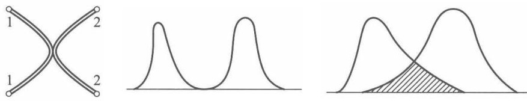
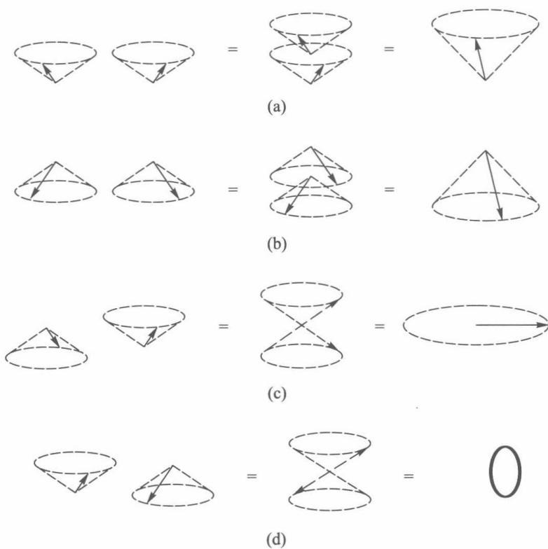
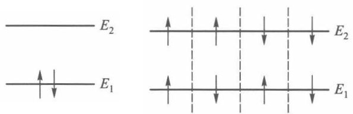
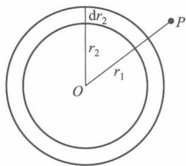
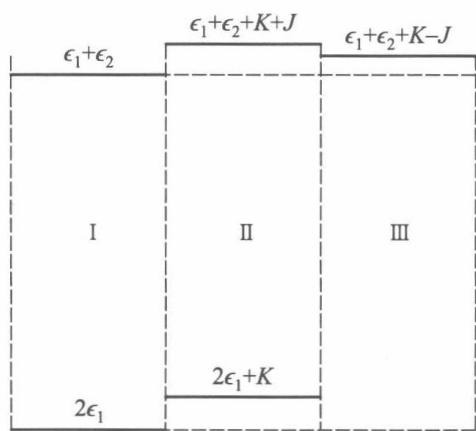
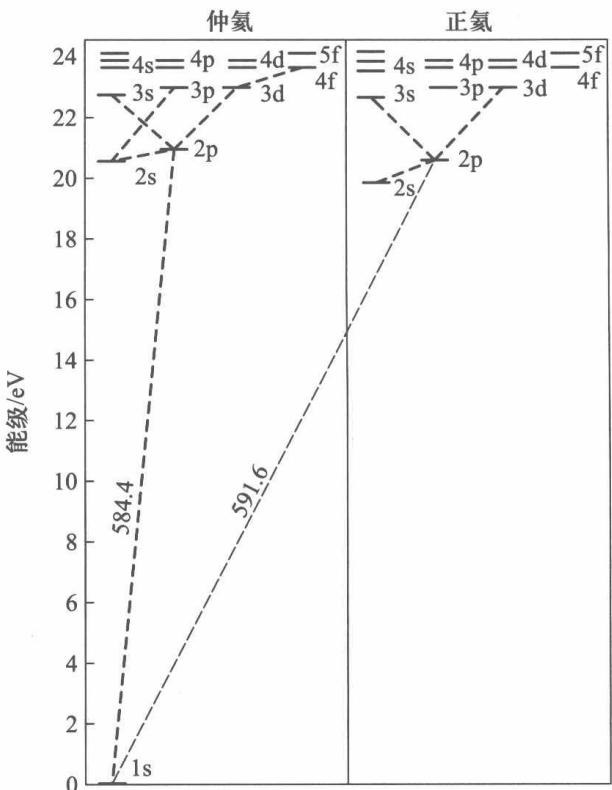
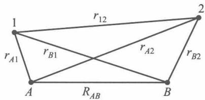
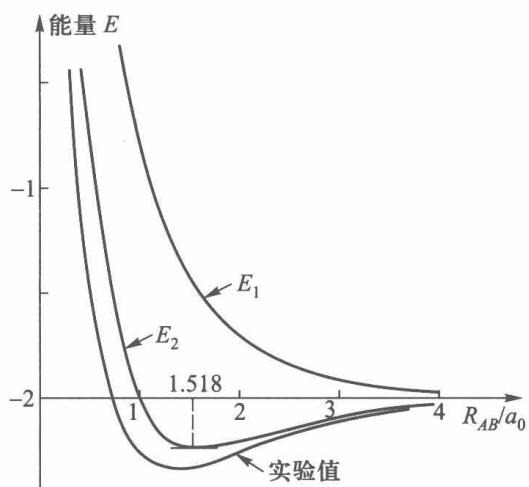

# 第 8 章 全同粒子

!!! tip "本章目标"

    1. 理解**全同性原理**：全同粒子不可区分，交换任意两个粒子不改变物理状态；会用**交换算符** $\hat P_{ij}$ 表述它，并证明波函数只能是**对称**或**反对称**的，且对称性不随时间改变；
    2. 记住自旋与统计的关系：整数自旋为**玻色子**（对称），半整数自旋为**费米子**（反对称）；会判断复合粒子属于哪一类；
    3. 会由单粒子态构造无相互作用体系的**对称化波函数**与**斯莱特行列式**，并由此得到**泡利不相容原理**；会数全同粒子体系的状态数；
    4. 掌握两个电子的**自旋单态与三重态**：会写出 $|S,m_s\rangle$ 四个态，求出 $\hat S^2$、$\hat S_z$ 的本征值，并利用“总波函数反对称”把空间对称性与自旋对称性配对；
    5. 会用微扰法计算**氦原子**的基态能量，理解激发态能级 $K\pm J$ 的来源，区分**仲氦**（单态）与**正氦**（三重态）；
    6. 理解**交换能**的物理意义，会用海特勒–伦敦法定性解释**氢分子**的形成与**共价键的饱和性**。

**本章在全书中的位置。** 前七章研究的都是“一个粒子”：一个粒子在势阱里、一个电子绕核运动、一个电子的自旋。可是真实的原子、分子、固体里是成群的**同种**粒子。量子力学在这里给出一条经典力学里完全没有的新规律：

- 经典粒子再相像，也能靠**轨道**把它们区分开；量子粒子没有轨道，波函数一旦重叠，“哪个是 1 号、哪个是 2 号”就失去意义；
- 这条规律只用一个算符 $\hat P_{12}$ 就能表述清楚，但它的后果遍布全部物理学：元素周期表（泡利原理）、氦光谱分成两套（交换能）、化学键（交换能 + 自旋单态）、金属中的电子气与激光中的光子聚束（费米子与玻色子）。

本章所用的数学工具都已具备：第 4 章的表象与狄拉克符号、第 5 章的微扰论与变分法（[§5.5 氦原子基态的变分计算](ch5.md)）、第 7 章的自旋算符与泡利矩阵（[第 7 章 自旋](ch7.md)）。

---

## 引言：全同粒子与全同性原理

我们称**质量、电荷、自旋等固有性质完全相同**的微观粒子为**全同粒子**。所有电子彼此全同，所有质子彼此全同，所有处于基态的 $^4$He 原子也彼此全同。

<figure markdown>
{ width="640" }
<figcaption>图 8.1　(a) 经典粒子各有确定轨道，可以“跟踪”；(b) 两个波包相距很远时尚可区分；(c) 波包重叠后（阴影区），无法判断在那里找到的是哪一个粒子。</figcaption>
</figure>

在经典力学中，即使两个粒子固有性质完全相同，它们在每一时刻都有确定的位置和速度，可以沿轨道“跟踪”下去，因而总能区分 [图 8.1(a)]。在量子力学中，粒子的状态用波函数描写，位置和动量不能同时有确定值，**轨道的概念不存在**。只要两个粒子的波函数在空间有重叠 [图 8.1(c)]，在重叠区域里测到一个粒子时，就根本无法判断它是“第一个”还是“第二个”。

!!! definition "定义 8.1（全同性原理）"

    由全同粒子组成的体系中，**交换任意两个粒子，不引起体系物理状态的改变**。

    这是量子力学的基本原理之一，不能由其他原理推出，其正确性由全部实验结果保证。

!!! info "直觉：标签只是记账工具"

    写波函数 $\Phi(q_1,q_2)$ 时，我们“给粒子贴了标签”：$q_1$ 属于 1 号，$q_2$ 属于 2 号。全同性原理说：**这些标签没有物理意义**，任何可观测量都不能依赖于标签怎么贴。下面所有结论都来自这一句话。

---

## 8.1 全同粒子的特性

### 8.1.1 哈密顿算符的交换对称性

设 $N$ 个全同粒子组成的体系，用 $q_i=(\boldsymbol r_i,s_{iz})$ 表示第 $i$ 个粒子的坐标和自旋，$U(q_i,t)$ 表示它在外场中的势能，$W(q_i,q_j)$ 表示第 $i$、$j$ 两粒子的相互作用能。体系的哈密顿算符为

$$
\hat H(q_1,\dots,q_i,\dots,q_j,\dots,q_N,t)=\sum_{i=1}^{N}\left[-\frac{\hbar^2}{2m}\nabla_i^2+U(q_i,t)\right]+\sum_{i<j}^{N}W(q_i,q_j). \tag{8.1.1}
$$

因为每个粒子的质量 $m$、所受外场 $U$、相互作用的形式 $W$ 都相同，交换任意两个粒子 $i\leftrightarrow j$，$\hat H$ 保持不变：

$$
\hat H(q_1,\dots,q_i,\dots,q_j,\dots,q_N,t)=\hat H(q_1,\dots,q_j,\dots,q_i,\dots,q_N,t). \tag{8.1.2}
$$

### 8.1.2 交换算符

!!! definition "定义 8.2（交换算符）"

    定义算符 $\hat P_{ij}$：它把波函数中第 $i$ 个粒子与第 $j$ 个粒子的全部变量（坐标和自旋）互换，

    $$\hat P_{ij}\,\Phi(q_1,\dots,q_i,\dots,q_j,\dots,q_N,t)=\Phi(q_1,\dots,q_j,\dots,q_i,\dots,q_N,t).$$

$\hat P_{ij}$ 有三条基本性质：

1. **$\hat P_{ij}^2=1$**：连换两次回到原样。因此若 $\hat P_{ij}\Phi=\lambda\Phi$，则 $\Phi=\hat P_{ij}^2\Phi=\lambda^2\Phi$，所以 $\lambda=\pm1$。
2. **$\hat P_{ij}$ 是厄米的**（也是幺正的）：交换积分变量的名称不改变积分值，$\langle\Psi|\hat P_{ij}\Phi\rangle=\langle\hat P_{ij}\Psi|\Phi\rangle$。所以 $\hat P_{ij}$ 是一个可观测量，本征值 $\pm1$ 是实数。
3. **$[\hat P_{ij},\hat H]=0$**：这正是 (8.1.2) 式的算符形式——对任意 $\Phi$，$\hat P_{ij}(\hat H\Phi)=\hat H(\hat P_{ij}\Phi)$。

!!! theorem "定理 8.1（全同粒子体系波函数的交换对称性）"

    全同粒子体系的波函数对任意两粒子的交换，要么**对称**，要么**反对称**：

    $$\hat P_{ij}\Phi=\lambda\Phi,\qquad \lambda=+1\ (\text{对称}\ \Phi_{\mathrm S})\quad\text{或}\quad\lambda=-1\ (\text{反对称}\ \Phi_{\mathrm A}),$$

    并且这种对称性**不随时间改变**。

??? proof "证明"

    **(1) 只能对称或反对称。** 若 $\Phi$ 满足薛定谔方程 $\mathrm i\hbar\,\partial_t\Phi=\hat H\Phi$，两边作用 $\hat P_{ij}$，利用 $[\hat P_{ij},\hat H]=0$：

    $$\mathrm i\hbar\frac{\partial}{\partial t}(\hat P_{ij}\Phi)=\hat H(\hat P_{ij}\Phi),$$

    即 $\hat P_{ij}\Phi$ 也是解。由全同性原理，$\hat P_{ij}\Phi$ 与 $\Phi$ 描写同一个状态，二者只能相差一个常数因子：$\hat P_{ij}\Phi=\lambda\Phi$。再交换一次得 $\Phi=\lambda^2\Phi$，所以 $\lambda=\pm1$。

    **(2) 对称性不随时间改变。** 设 $t$ 时刻 $\Phi$ 是对称的。由于 $\hat H$ 交换对称，$\hat H\Phi$ 也是对称的，于是 $\partial_t\Phi=\hat H\Phi/\mathrm i\hbar$ 对称；在 $t+\mathrm dt$ 时刻 $\Phi+\partial_t\Phi\,\mathrm dt$ 是两个对称函数之和，仍对称。依次递推，以后任何时刻都对称。反对称情形完全相同。

    用算符语言说更简洁：$[\hat P_{ij},\hat H]=0$ 意味着 $\hat P_{ij}$ 是**守恒量**（第 3 章 §3.7），它的本征值不随时间变化。$\blacksquare$

!!! info "直觉：为什么 $|\Phi|^2$ 不变就够了"

    可观测的只是概率密度 $|\Phi|^2$。全同性原理要求 $|\hat P_{ij}\Phi|^2=|\Phi|^2$，单看这一点只能推出 $\hat P_{ij}\Phi=\mathrm e^{\mathrm i\alpha}\Phi$；再加上 $\hat P_{ij}^2=1$，才把相因子限制为 $\pm1$。（在二维空间中，粒子绕另一粒子转一圈的路径不能连续收缩为零，“换两次”不一定等于“不换”，于是可以出现任意相因子的“任意子”。我们生活的三维空间里只有 $\pm1$ 两种。）

### 8.1.3 玻色子与费米子

$\lambda=+1$ 还是 $-1$，由粒子的种类决定，而且实验表明它只与粒子的**自旋**有关：

!!! theorem "自旋–统计关系（实验规律；在相对论量子场论中可以证明）"

    | | 自旋 | 体系波函数 | 统计 | 例子 |
    |---|---|---|---|---|
    | **费米子** | $\frac{\hbar}{2}$ 的奇数倍 | 交换**反对称** $\Phi_{\mathrm A}$ | 费米–狄拉克统计 | 电子、质子、中子、$^3$He 原子 |
    | **玻色子** | $0$ 或 $\hbar$ 的整数倍 | 交换**对称** $\Phi_{\mathrm S}$ | 玻色–爱因斯坦统计 | 光子（自旋 1）、$\pi$ 介子、$\alpha$ 粒子、基态 $^4$He 原子 |

**复合粒子的规则。** 由若干基本粒子组成的复合粒子，若各组分相对运动的激发可以忽略，可以把它看成一个整体：**含奇数个费米子的是费米子，含偶数个费米子的是玻色子**。理由是交换两个复合粒子，等于把其中的组分费米子逐一交换，每交换一对费米子贡献一个 $-1$。

!!! example "例题 8.1（判断玻色子还是费米子）"

    判断下列粒子是玻色子还是费米子：(1) 氘核 $d$（1 个质子 + 1 个中子）；(2) 氢原子（基态）；(3) $^3$He 原子；(4) $^4$He 原子；(5) $^{87}$Rb 原子。

    **解。** 数组分中费米子（质子、中子、电子）的总数：

    1. 氘核：$1+1=2$，偶数 → **玻色子**（实验测得自旋为 1）；
    2. 氢原子：$1$ 质子 $+1$ 电子 $=2$ → **玻色子**；
    3. $^3$He：$2p+1n+2e=5$ → **费米子**；
    4. $^4$He：$2p+2n+2e=6$ → **玻色子**；
    5. $^{87}$Rb：$37p+50n+37e=124$ → **玻色子**。1995 年首次实现的玻色–爱因斯坦凝聚正是用 $^{87}$Rb 原子气体完成的。

    $^3$He 与 $^4$He 化学性质几乎一样，但低温下表现截然不同：$^4$He 在 $2.17\ \mathrm K$ 变为超流体，而 $^3$He 要到 $\sim 10^{-3}\ \mathrm K$ 才通过“两两配对”成为超流体——配成对后才像玻色子。

!!! warning "易错点"

    - 全同性原理说的是“交换后**状态**不变”，不是“交换后**波函数**不变”。费米子交换后波函数变号，但 $-\Phi$ 与 $\Phi$ 描写同一状态。
    - $\hat P_{ij}$ 交换的是**全部变量** $q=(\boldsymbol r,s_z)$，不是只交换坐标。只换坐标的算符记作 $\hat P^{r}_{12}$，只换自旋的记作 $\hat P^{\sigma}_{12}$，$\hat P_{12}=\hat P^{r}_{12}\hat P^{\sigma}_{12}$。
    - 两粒子不全同（如电子和质子）时，没有任何对称性要求；不要给氢原子里的电子和质子做反对称化。

---

## 8.2 全同粒子体系的波函数　泡利不相容原理

### 8.2.1 两个无相互作用的全同粒子：交换简并

忽略粒子间相互作用，两全同粒子体系的哈密顿算符为

$$
\hat H=\hat H_0(q_1)+\hat H_0(q_2), \tag{8.2.1}
$$

$\hat H_0$ 是单粒子哈密顿算符（不显含 $t$，两粒子的 $\hat H_0$ 形式相同）。设它的第 $i$ 个本征值和本征函数为 $\epsilon_i,\ \phi_i$：

$$
\hat H_0(q)\,\phi_i(q)=\epsilon_i\,\phi_i(q). \tag{8.2.2}
$$

第一个粒子处于 $\phi_i$、第二个粒子处于 $\phi_j$ 时，

$$
\Phi(q_1,q_2)=\phi_i(q_1)\phi_j(q_2),\qquad \hat H\Phi=(\epsilon_i+\epsilon_j)\Phi. \tag{8.2.3}
$$

把两粒子的状态对调，$\hat P_{12}\Phi=\phi_j(q_1)\phi_i(q_2)$ 也属于同一本征值 $E=\epsilon_i+\epsilon_j$。这种由交换两粒子而产生的简并称为**交换简并**。

- 若 $i=j$，$\phi_i(q_1)\phi_i(q_2)$ 本身就是对称的；
- 若 $i\ne j$，$\phi_i(q_1)\phi_j(q_2)$ **既不对称也不反对称**，不能作为全同粒子体系的波函数。但它和 $\hat P_{12}\Phi$ 的和、差有确定的对称性，且仍属于同一本征值。

!!! theorem "两全同粒子的对称化波函数"

    设 $\phi_i,\phi_j$ 正交归一，$i\neq j$，则归一化的对称与反对称波函数为

    $$
    \Phi_{\mathrm S}(q_1,q_2)=\frac{1}{\sqrt2}\big[\phi_i(q_1)\phi_j(q_2)+\phi_j(q_1)\phi_i(q_2)\big],\qquad
    \Phi_{\mathrm A}(q_1,q_2)=\frac{1}{\sqrt2}\big[\phi_i(q_1)\phi_j(q_2)-\phi_j(q_1)\phi_i(q_2)\big]. \tag{8.2.8}
    $$

    $i=j$ 时只有对称态 $\Phi_{\mathrm S}=\phi_i(q_1)\phi_i(q_2)$（已归一，**不要**再乘 $1/\sqrt2$）；反对称组合恒为零。

??? proof "归一化因子的来历"

    记 $\int\mathrm dq$ 为对坐标积分并对自旋求和。未归一的 $\phi_i\phi_j\pm\phi_j\phi_i$ 的模方积分为

    $$\iint|\phi_i(q_1)\phi_j(q_2)\pm\phi_j(q_1)\phi_i(q_2)|^2\mathrm dq_1\mathrm dq_2=1+1\pm2\,\mathrm{Re}\Big[\int\phi_i^*\phi_j\,\mathrm dq_1\int\phi_j^*\phi_i\,\mathrm dq_2\Big]=2,$$

    交叉项因 $\langle\phi_i|\phi_j\rangle=0$ 而为零，所以因子是 $1/\sqrt2$。$i=j$ 时交叉项不为零，对称组合为 $2\phi_i\phi_i$，归一化后就是 $\phi_i\phi_i$。

**有相互作用时。** 若 $W(q_1,q_2)$ 不能忽略，定态波函数不能写成单粒子函数的乘积，但 $\hat H\Phi(q_1,q_2)=E\Phi(q_1,q_2)$ 两边交换 $q_1\leftrightarrow q_2$ 后仍有 $\hat H\Phi(q_2,q_1)=E\Phi(q_2,q_1)$，交换简并依然存在，仍可按 (8.2.8) 的方式对称化。

### 8.2.2 交换效应：费米子“互相躲避”，玻色子“抱团”

对称化不只是数学手续，它改变了可观测的概率分布。以一维无限深方势阱（宽度 $a$）中一个粒子处于 $\psi_1$、另一个处于 $\psi_2$ 为例（先不管自旋），比较三种情形的联合概率密度 $|\Psi(x_1,x_2)|^2$：

- **可区分粒子**：$\Psi_{\mathrm D}=\psi_1(x_1)\psi_2(x_2)$；
- **对称**：$\Psi_{\mathrm S}=\frac1{\sqrt2}[\psi_1(x_1)\psi_2(x_2)+\psi_2(x_1)\psi_1(x_2)]$；
- **反对称**：$\Psi_{\mathrm A}=\frac1{\sqrt2}[\psi_1(x_1)\psi_2(x_2)-\psi_2(x_1)\psi_1(x_2)]$。

在对角线 $x_1=x_2=x$ 上，$\Psi_{\mathrm A}(x,x)=0$，$|\Psi_{\mathrm S}(x,x)|^2=2|\Psi_{\mathrm D}(x,x)|^2$：反对称态中两粒子**永远不会出现在同一点**，周围形成一个概率被挖空的区域，称为**交换空穴**；对称态则在对角线附近概率加倍，称为**聚束**。

<figure class="video" markdown>
<video controls preload="metadata" width="100%" poster="assets/posters/C8_ExchangeHole.jpg"><source src="assets/videos/C8_ExchangeHole.mp4" type="video/mp4"></video>
<figcaption>动画 8-1　一维势阱中两粒子分别处于 $\psi_1,\psi_2$：可区分、对称、反对称三种情形的 $|\Psi(x_1,x_2)|^2$（同一色标）。反对称态沿对角线 $x_1=x_2$ 出现“交换空穴”，对称态在对角线附近聚集；第二幕给出对角线上的密度和方均根间距。</figcaption>
</figure>

!!! example "例题 8.2（交换力的定量估计）"

    一维无限深方势阱 $0<x<a$ 中两个无相互作用的粒子，一个处于 $\psi_1$，一个处于 $\psi_2$（$\psi_n=\sqrt{2/a}\sin\frac{n\pi x}{a}$）。分别对可区分粒子、对称态、反对称态求 $\langle(x_1-x_2)^2\rangle$。

    **解。** 展开 $(x_1-x_2)^2=x_1^2+x_2^2-2x_1x_2$。记 $\langle x\rangle_n=\langle\psi_n|x|\psi_n\rangle$，$\langle x^2\rangle_n$ 同理，$x_{12}=\langle\psi_1|x|\psi_2\rangle$。

    *可区分*：$\langle(x_1-x_2)^2\rangle_{\mathrm D}=\langle x^2\rangle_1+\langle x^2\rangle_2-2\langle x\rangle_1\langle x\rangle_2$。

    *对称/反对称*：代入 (8.2.8)，$x_1^2$ 的期望值为 $\frac12(\langle x^2\rangle_1+\langle x^2\rangle_2)$，$x_2^2$ 同样，而

    $$\langle x_1x_2\rangle_{\pm}=\frac12\big[\langle x\rangle_1\langle x\rangle_2+\langle x\rangle_2\langle x\rangle_1\pm x_{12}x_{21}\pm x_{21}x_{12}\big]=\langle x\rangle_1\langle x\rangle_2\pm|x_{12}|^2,$$

    所以

    $$\boxed{\langle(x_1-x_2)^2\rangle_{\pm}=\langle(x_1-x_2)^2\rangle_{\mathrm D}\mp2|x_{12}|^2}$$

    代入势阱的数据：$\langle x\rangle_n=\frac a2$，$\langle x^2\rangle_n=a^2\left(\frac13-\frac1{2n^2\pi^2}\right)$，

    $$x_{12}=\frac2a\int_0^a x\sin\frac{\pi x}{a}\sin\frac{2\pi x}{a}\,\mathrm dx=-\frac{16a}{9\pi^2}.$$

    得 $\langle(x_1-x_2)^2\rangle_{\mathrm D}=0.1033a^2$，$2|x_{12}|^2=0.0649a^2$，所以

    | | 可区分 | 对称（玻色型） | 反对称（费米型） |
    |---|---|---|---|
    | $\langle(x_1-x_2)^2\rangle$ | $0.103\,a^2$ | $0.038\,a^2$ | $0.168\,a^2$ |
    | 方均根间距 | $0.32\,a$ | $0.20\,a$ | $0.41\,a$ |

    交换项 $|x_{12}|^2$ 只有在 $\psi_1,\psi_2$ **空间上重叠**时才不为零；若两个波函数相距很远（如一个电子在北京、一个在东京），$x_{12}\approx0$，对称化就没有可观测效果——这正是“波函数不重叠时全同粒子可以区分”的定量说法。

!!! info "直觉：交换“力”不是力"

    对称态中两粒子好像互相吸引，反对称态中好像互相排斥，但哈密顿量中**根本没有相互作用项**。这种“交换力”纯粹是波函数对称性造成的**统计关联**。一旦再加上真正的相互作用（如电子间的库仑排斥），这种关联就会转化为能量差——§8.3 例题和 §8.4 的交换能 $J$ 就是它的定量结果。

### 8.2.3 $N$ 个全同粒子：对称化与斯莱特行列式

推广到 $N$ 个无相互作用的全同粒子，

$$
\hat H=\sum_{i=1}^{N}\hat H_0(q_i). \tag{8.2.9}
$$

!!! theorem "定理 8.2（无相互作用体系的分离）"

    若 $\hat H_0\phi_k=\epsilon_k\phi_k$，则乘积函数

    $$\Phi(q_1,q_2,\dots,q_N)=\phi_i(q_1)\phi_j(q_2)\cdots\phi_k(q_N) \tag{8.2.13}$$

    是 $\hat H$ 的本征函数，本征值为 $E=\epsilon_i+\epsilon_j+\cdots+\epsilon_k$。

    即：**无相互作用体系的本征函数是单粒子本征函数之积，本征能量是单粒子能量之和**，多体问题归结为单粒子问题。

??? proof "证明"

    $\hat H_0(q_l)$ 只作用于含 $q_l$ 的因子 $\phi(q_l)$，其余因子对它是常数：

    $$\hat H\Phi=\sum_{l}\Big[\prod_{l'\neq l}\phi(q_{l'})\Big]\hat H_0(q_l)\phi(q_l)=(\epsilon_i+\epsilon_j+\cdots+\epsilon_k)\Phi.\qquad\blacksquare$$

乘积 (8.2.13) 一般没有确定的交换对称性，需要对称化：

!!! theorem "定理 8.3（玻色子与费米子的多粒子波函数）"

    **玻色子**——对所有排列求和：

    $$\Phi_{\mathrm S}(q_1,\dots,q_N)=C\sum_{P}P\,\phi_i(q_1)\phi_j(q_2)\cdots\phi_k(q_N), \tag{8.2.14}$$

    $P$ 表示 $N$ 个粒子坐标的一种排列，$\sum_P$ 对全部 $N!$ 种排列求和。若有 $n_1$ 个粒子处于态 $1$、$n_2$ 个处于态 $2$……，则归一化因子 $C=\big(N!\,n_1!\,n_2!\cdots\big)^{-1/2}$。

    **费米子**——斯莱特（Slater）行列式：

    $$
    \Phi_{\mathrm A}(q_1,\dots,q_N)=\frac{1}{\sqrt{N!}}
    \begin{vmatrix}
    \phi_i(q_1)&\phi_i(q_2)&\cdots&\phi_i(q_N)\\
    \phi_j(q_1)&\phi_j(q_2)&\cdots&\phi_j(q_N)\\
    \vdots&\vdots&&\vdots\\
    \phi_k(q_1)&\phi_k(q_2)&\cdots&\phi_k(q_N)
    \end{vmatrix}. \tag{8.2.15}
    $$

    行列式的每一项都是 (8.2.13) 型的乘积，所以它是 $\hat H$ 的本征函数；交换两个粒子 = 交换两列，行列式变号，所以它是反对称的。

??? proof "玻色子归一化因子 $C$ 的来历"

    $N!$ 个排列中，只有把**不同**单粒子态之间的粒子对调才产生新的乘积项；在同一态内部重排（$n_1!\,n_2!\cdots$ 种）给出相同的项。所以 $\sum_P$ 中共有 $\frac{N!}{n_1!n_2!\cdots}$ 个互相正交的不同项，每项重复 $n_1!n_2!\cdots$ 次：

    $$\|\textstyle\sum_P\|^2=\Big(n_1!n_2!\cdots\Big)^2\cdot\dfrac{N!}{n_1!n_2!\cdots}=N!\,n_1!\,n_2!\cdots.$$

    因此 $C=(N!\,n_1!\,n_2!\cdots)^{-1/2}$。等价地，若只对“给出不同项”的排列求和，归一化因子为 $\sqrt{n_1!n_2!\cdots/N!}$。例：三个玻色子，两个在 $\phi_a$、一个在 $\phi_b$，

    $$\Phi_{\mathrm S}=\frac{1}{\sqrt3}\big[\phi_a(q_1)\phi_a(q_2)\phi_b(q_3)+\phi_a(q_1)\phi_b(q_2)\phi_a(q_3)+\phi_b(q_1)\phi_a(q_2)\phi_a(q_3)\big].$$

!!! theorem "泡利不相容原理"

    若斯莱特行列式中有两个单粒子态相同，行列式有两行相同，恒等于零。所以：**全同费米子体系中，不能有两个或两个以上的费米子处于同一单粒子态**。

    对电子，“单粒子态”包括自旋：原子中一组量子数 $(n,l,m,m_s)$ 最多容纳一个电子，所以每个轨道 $(n,l,m)$ 最多容纳自旋相反的两个电子。这就是元素周期表电子壳层结构的根源。

两个费米子时，(8.2.15) 就是 (8.2.8) 中的 $\Phi_{\mathrm A}$：

$$\frac{1}{\sqrt2}\begin{vmatrix}\phi_i(q_1)&\phi_i(q_2)\\ \phi_j(q_1)&\phi_j(q_2)\end{vmatrix}=\frac1{\sqrt2}\big[\phi_i(q_1)\phi_j(q_2)-\phi_j(q_1)\phi_i(q_2)\big].$$

### 8.2.4 状态计数与能级填充

对称化大大减少了独立的状态数。设单粒子有 $g$ 个可能的状态，放入 $N$ 个粒子：

| | 独立状态数 | 原因 |
|---|---|---|
| 可区分粒子 | $g^N$ | 每个粒子独立选态 |
| 全同玻色子 | $\dbinom{N+g-1}{N}$ | 状态只由“各单粒子态上有几个粒子” $\{n_k\}$ 决定，$n_k=0,1,2,\dots$ |
| 全同费米子 | $\dbinom{g}{N}$ | 同上，但 $n_k=0$ 或 $1$ |

!!! info "直觉：全同粒子只关心“占据数”"

    对全同粒子，问“1 号粒子在哪个态”毫无意义，能问的只有“**每个单粒子态上有几个粒子**”。所以一个多粒子态完全由一组占据数 $\{n_1,n_2,\dots\}$ 确定，(8.2.14)、(8.2.15) 只是把这组数字翻译成波函数的标准方式。玻色子 $n_k$ 不受限制，费米子 $n_k\le1$。

<figure class="video" markdown>
<video controls preload="metadata" width="100%" poster="assets/posters/C8_Filling.jpg"><source src="assets/videos/C8_Filling.mp4" type="video/mp4"></video>
<figcaption>动画 8-2　往一维势阱（$E_n=n^2E_1$）中逐个放入粒子。零自旋玻色子全部挤在基态，总能量 $NE_1$；自旋 $\tfrac12$ 的费米子每个能级只能放自旋相反的两个，逐级向上填，$N=6$ 时总能量已达 $28E_1$。</figcaption>
</figure>

!!! example "例题 8.3（数状态）"

    两个粒子，单粒子只有三个态 $\phi_a,\phi_b,\phi_c$。分别对可区分粒子、全同玻色子、全同费米子写出所有可能的状态。

    **解。** *可区分*：$3^2=9$ 个，$\phi_\alpha(q_1)\phi_\beta(q_2)$，$\alpha,\beta\in\{a,b,c\}$。

    *玻色子*：$\binom{4}{2}=6$ 个：$\phi_a\phi_a,\ \phi_b\phi_b,\ \phi_c\phi_c$（两粒子同态），以及 $\frac1{\sqrt2}(\phi_a\phi_b+\phi_b\phi_a)$、$\frac1{\sqrt2}(\phi_b\phi_c+\phi_c\phi_b)$、$\frac1{\sqrt2}(\phi_c\phi_a+\phi_a\phi_c)$。

    *费米子*：$\binom32=3$ 个：$\frac1{\sqrt2}(\phi_a\phi_b-\phi_b\phi_a)$ 等三个反对称组合。

    验算：$6+3=9$——两个粒子时，$g^2$ 维空间恰好分解为对称子空间与反对称子空间（三个及以上粒子时，还有既不对称也不反对称的部分，物理上不出现）。

!!! example "例题 8.4（无相互作用电子的基态）"

    宽度为 $a$ 的一维无限深方势阱中有 5 个无相互作用的电子。求体系基态能量，并与 5 个零自旋玻色子比较。

    **解。** 单粒子能级 $E_n=n^2E_1$，$E_1=\frac{\pi^2\hbar^2}{2ma^2}$。每个 $n$ 有 $m_s=\pm\frac12$ 两个态。按泡利原理从下往上填：$n=1$ 两个、$n=2$ 两个、$n=3$ 一个，

    $$E_0^{\mathrm F}=2E_1+2\cdot4E_1+9E_1=19E_1 .$$

    5 个零自旋玻色子全部处于 $n=1$：$E_0^{\mathrm B}=5E_1$。占据的最高能级（此处 $n=3$）称为**费米能级**；金属中的导电电子正是这样一层层填到费米能级，所以即使在绝对零度，电子也有很大的动能。

### 8.2.5 坐标与自旋分开写

当自旋–轨道相互作用可以忽略时，哈密顿量不含自旋变量，体系波函数可以写成坐标函数与自旋函数之积：

$$
\Phi(\boldsymbol r_1s_1,\dots,\boldsymbol r_Ns_N)=\phi(\boldsymbol r_1,\dots,\boldsymbol r_N)\,\chi(s_1,\dots,s_N).
$$

对两个费米子，$\hat P_{12}=\hat P^{r}_{12}\hat P^{\sigma}_{12}$，要求 $\Phi$ 反对称有两种方式：

$$
\boxed{\ \phi\ \text{对称}\times\chi\ \text{反对称}\qquad\text{或}\qquad\phi\ \text{反对称}\times\chi\ \text{对称}\ }
$$

（对称函数乘反对称函数是反对称函数。）这一配对规则是 §8.3—§8.5 的核心。

!!! warning "易错点"

    - 两粒子同处一个态时，玻色子波函数就是 $\phi_i\phi_i$，归一化因子是 $1$ 不是 $1/\sqrt2$。
    - 泡利原理禁止的是两个费米子处于**同一个完整的单粒子态**（包括自旋）。两个电子可以有相同的空间波函数，只要自旋相反——这时空间部分对称，自旋部分必须是反对称的单态。
    - “电子之间有排斥力，所以不能处于同一状态”是错误理解：泡利原理与相互作用无关，无相互作用的费米子同样遵守。
    - 斯莱特行列式只适用于“每个粒子各占一个单粒子态”的**无相互作用**（或独立粒子近似）情形；有相互作用时，精确的波函数是若干行列式的叠加，但交换反对称性仍严格成立。

---

## 8.3 两个电子的自旋波函数

### 8.3.1 四个乘积态与对称化

在哈密顿量不含自旋相互作用时，两电子的自旋波函数是单电子自旋波函数之积（第 7 章：$\chi_+=\binom10$ 表示 $s_z=+\frac\hbar2$，$\chi_-=\binom01$ 表示 $s_z=-\frac\hbar2$）：

$$
\chi(s_{1z},s_{2z})=\chi_{\alpha_1}(s_{1z})\chi_{\alpha_2}(s_{2z}),\qquad \alpha_1,\alpha_2=\pm. \tag{8.3.1}
$$

这样的乘积态共 $2\times2=4$ 个。为简洁，下面记 $|{\uparrow\downarrow}\rangle\equiv\chi_+(s_{1z})\chi_-(s_{2z})$（左边一个箭头属于电子 1），等等。$|{\uparrow\uparrow}\rangle$、$|{\downarrow\downarrow}\rangle$ 本身是对称的；$|{\uparrow\downarrow}\rangle$ 与 $|{\downarrow\uparrow}\rangle$ 在交换下互变，取它们的和与差，得到四个有确定交换对称性的态：

!!! theorem "两电子的自旋三重态与单态"

    $$
    \begin{aligned}
    |1,1\rangle&=\chi_{\mathrm S}^{(1)}=\chi_+(s_{1z})\chi_+(s_{2z}), &(8.3.2)\\
    |1,-1\rangle&=\chi_{\mathrm S}^{(2)}=\chi_-(s_{1z})\chi_-(s_{2z}), &(8.3.3)\\
    |1,0\rangle&=\chi_{\mathrm S}^{(3)}=\tfrac{1}{\sqrt2}\big[\chi_+(s_{1z})\chi_-(s_{2z})+\chi_-(s_{1z})\chi_+(s_{2z})\big], &(8.3.4)\\
    |0,0\rangle&=\chi_{\mathrm A}=\tfrac{1}{\sqrt2}\big[\chi_+(s_{1z})\chi_-(s_{2z})-\chi_-(s_{1z})\chi_+(s_{2z})\big]. &(8.3.5)
    \end{aligned}
    $$

    右矢 $|S,m_s\rangle$ 标出总自旋量子数 $S$ 与 $\hat S_z$ 的量子数 $m_s$：三个对称态 $S=1$ 构成**三重态**，反对称态 $S=0$ 为**单态**。

由 4 个乘积态只能构成 4 个线性独立的态，所以除此之外不再有别的独立对称或反对称自旋波函数。

### 8.3.2 总自旋 $\hat S^2$、$\hat S_z$ 的本征值

总自旋 $\hat{\boldsymbol S}=\hat{\boldsymbol S}_1+\hat{\boldsymbol S}_2$，$\hat{\boldsymbol S}_1$ 只作用于电子 1 的自旋函数。因为 $\hat S_1^2=\hat S_2^2=\frac34\hbar^2$（第 7 章），

$$
\hat S^2=\hat S_1^2+\hat S_2^2+2\hat{\boldsymbol S}_1\cdot\hat{\boldsymbol S}_2=\frac32\hbar^2+2\big(\hat S_{1x}\hat S_{2x}+\hat S_{1y}\hat S_{2y}+\hat S_{1z}\hat S_{2z}\big). \tag{8.3.6}
$$

由泡利矩阵，对每个电子都有

$$
\hat S_x\chi_\pm=\frac\hbar2\chi_\mp,\qquad \hat S_y\chi_+=\frac{\mathrm i\hbar}{2}\chi_-,\quad \hat S_y\chi_-=-\frac{\mathrm i\hbar}{2}\chi_+,\qquad \hat S_z\chi_\pm=\pm\frac\hbar2\chi_\pm. \tag{8.3.7}
$$

!!! example "例题 8.5（逐个验证本征值）"

    求 $\hat S^2$、$\hat S_z$ 作用于 $\chi_{\mathrm S}^{(1)}$ 和 $\chi_{\mathrm A}$ 的结果。

    **解。** *$\chi_{\mathrm S}^{(1)}=\chi_+\chi_+$*：

    $$2\hat{\boldsymbol S}_1\cdot\hat{\boldsymbol S}_2\,\chi_+\chi_+=2\cdot\frac{\hbar^2}{4}\big[\chi_-\chi_-+(\mathrm i)(\mathrm i)\chi_-\chi_-+\chi_+\chi_+\big]=\frac{\hbar^2}{2}\chi_+\chi_+,$$

    所以 $\hat S^2\chi_{\mathrm S}^{(1)}=\left(\frac32+\frac12\right)\hbar^2\chi_{\mathrm S}^{(1)}=2\hbar^2\chi_{\mathrm S}^{(1)}$，$\hat S_z\chi_{\mathrm S}^{(1)}=\left(\frac\hbar2+\frac\hbar2\right)\chi_{\mathrm S}^{(1)}=\hbar\chi_{\mathrm S}^{(1)}$。

    *$\chi_{\mathrm A}$*：先算 $2\hat{\boldsymbol S}_1\cdot\hat{\boldsymbol S}_2$ 作用于 $\chi_+\chi_-$：

    $$2\cdot\frac{\hbar^2}{4}\big[\chi_-\chi_++(\mathrm i)(-\mathrm i)\chi_-\chi_+-\chi_+\chi_-\big]=\frac{\hbar^2}{2}\big(2\chi_-\chi_+-\chi_+\chi_-\big),$$

    同理作用于 $\chi_-\chi_+$ 得 $\frac{\hbar^2}{2}(2\chi_+\chi_--\chi_-\chi_+)$。相减：

    $$2\hat{\boldsymbol S}_1\cdot\hat{\boldsymbol S}_2(\chi_+\chi_--\chi_-\chi_+)=\frac{\hbar^2}{2}\big(-3\chi_+\chi_-+3\chi_-\chi_+\big)=-\frac32\hbar^2(\chi_+\chi_--\chi_-\chi_+),$$

    所以 $\hat S^2\chi_{\mathrm A}=\left(\frac32-\frac32\right)\hbar^2\chi_{\mathrm A}=0$；$\hat S_z\chi_{\mathrm A}=\left(\frac\hbar2-\frac\hbar2\right)\chi_{\mathrm A}=0$。

    同样可得 $\hat S^2\chi_{\mathrm S}^{(2,3)}=2\hbar^2\chi_{\mathrm S}^{(2,3)}$，$\hat S_z\chi_{\mathrm S}^{(2)}=-\hbar\chi_{\mathrm S}^{(2)}$，$\hat S_z\chi_{\mathrm S}^{(3)}=0$。

结果汇总：

| 态 | 交换 $\hat P^{\sigma}_{12}$ | $\hat S^2$ | $S$ | $\hat S_z$ | $\hat{\boldsymbol S}_1\cdot\hat{\boldsymbol S}_2$ | $\hat{\boldsymbol\sigma}_1\cdot\hat{\boldsymbol\sigma}_2$ |
|---|---|---|---|---|---|---|
| $\chi_{\mathrm S}^{(1)}=\lvert1,1\rangle$ | $+1$ | $2\hbar^2$ | 1 | $\hbar$ | $\frac14\hbar^2$ | $1$ |
| $\chi_{\mathrm S}^{(3)}=\lvert1,0\rangle$ | $+1$ | $2\hbar^2$ | 1 | $0$ | $\frac14\hbar^2$ | $1$ |
| $\chi_{\mathrm S}^{(2)}=\lvert1,-1\rangle$ | $+1$ | $2\hbar^2$ | 1 | $-\hbar$ | $\frac14\hbar^2$ | $1$ |
| $\chi_{\mathrm A}=\lvert0,0\rangle$ | $-1$ | $0$ | 0 | $0$ | $-\frac34\hbar^2$ | $-3$ |

最后两列来自一个很有用的恒等式：

$$
\hat{\boldsymbol S}_1\cdot\hat{\boldsymbol S}_2=\frac12\Big(\hat S^2-\frac32\hbar^2\Big)=\frac{\hbar^2}{2}\Big[S(S+1)-\frac32\Big],\qquad \hat{\boldsymbol\sigma}_1\cdot\hat{\boldsymbol\sigma}_2=\frac{4}{\hbar^2}\hat{\boldsymbol S}_1\cdot\hat{\boldsymbol S}_2 .
$$

!!! info "另一种推导：用降算符一步得到 $|1,0\rangle$"

    总自旋降算符 $\hat S_-=\hat S_{1-}+\hat S_{2-}$，$\hat S_{-}\chi_+=\hbar\chi_-$，$\hat S_-\chi_-=0$。由角动量的一般结论 $\hat S_-|S,m\rangle=\hbar\sqrt{(S+m)(S-m+1)}\,|S,m-1\rangle$：

    $$\hat S_-|1,1\rangle=\hbar\big(\chi_-\chi_++\chi_+\chi_-\big)=\sqrt2\,\hbar\,|1,0\rangle\ \Rightarrow\ |1,0\rangle=\frac{1}{\sqrt2}(\chi_+\chi_-+\chi_-\chi_+).$$

    再降一次得 $|1,-1\rangle=\chi_-\chi_-$。$|0,0\rangle$ 则是 $m_s=0$ 子空间中与 $|1,0\rangle$ 正交的那个组合。这正是第 7 章“角动量耦合”$\frac12\otimes\frac12=1\oplus0$ 的最简单实例。

<figure markdown>
{ width="440" }
<figcaption>图 8.2　两电子自旋组合的四种态：每个电子的自旋用绕 $z$ 轴锥面进动的矢量表示（$S_z$ 确定，$S_x,S_y$ 不确定）。(a)(b)(c) 依次对应 $|1,1\rangle,|1,-1\rangle,|1,0\rangle$，为自旋“平行”的三重态；(d) 为自旋反平行的单态 $|0,0\rangle$。</figcaption>
</figure>

图 8.2 中 $|1,0\rangle$ 与 $|0,0\rangle$ 都有 $S_z=0$（两自旋的 $z$ 分量反平行），区别在于垂直于 $z$ 轴的分量：$|1,0\rangle$ 中两者“同相”（相互平行），$|0,0\rangle$ 中“反相”（相互反平行），所以只有后者总自旋为零。

<figure class="video" markdown>
<video controls preload="metadata" width="100%" poster="assets/posters/C8_SingletTriplet.jpg"><source src="assets/videos/C8_SingletTriplet.mp4" type="video/mp4"></video>
<figcaption>动画 8-3　两电子自旋的四个乘积态在交换算符下的表现：$|{\uparrow\uparrow}\rangle,|{\downarrow\downarrow}\rangle$ 不变，$|{\uparrow\downarrow}\rangle\leftrightarrow|{\downarrow\uparrow}\rangle$ 互换；取和与差，得到三重态 $S=1$ 与单态 $S=0$，以及 $\hat{\boldsymbol S}_1\cdot\hat{\boldsymbol S}_2$ 的取值和“空间–自旋”配对规则。</figcaption>
</figure>

### 8.3.3 自旋决定空间对称性：两个例子

总波函数 $\Phi=\phi(\boldsymbol r_1,\boldsymbol r_2)\chi$ 必须反对称，于是

$$
\boxed{\ \text{单态 }(S=0)\ \Longleftrightarrow\ \phi\ \text{对称};\qquad \text{三重态 }(S=1)\ \Longleftrightarrow\ \phi\ \text{反对称}\ }
$$

**哈密顿量即使完全不含自旋，能级也会依赖于总自旋**——因为自旋通过对称性要求“锁定”了空间波函数的形状，而空间波函数决定了相互作用能。

<figure markdown>
{ width="420" }
<figcaption>图 8.3　一维方势阱中两电子的组态。左：基态，两电子都在 $n=1$，自旋相反，$S=0$；右：第一激发态，一个在 $n=1$、一个在 $n=2$，可构成 $S=0$ 或 $S=1$。</figcaption>
</figure>

!!! example "例题 8.6（一维势阱中两个电子，教材例题）"

    宽度为 $a$ 的一维无限深方势阱中有两个电子，电子间排斥势 $V(|x_1-x_2|)$ 视为微扰。求体系基态和第一激发态的能级（至一级微扰）。

    **解。** 取阱的左端为原点，单粒子 $E_n=\frac{\pi^2\hbar^2}{2ma^2}n^2$，$\psi_n=\sqrt{\frac2a}\sin\frac{n\pi x}{a}$。总波函数 $\Phi=\varphi(x_1,x_2)\chi$ 反对称。

    **基态。** 两电子都在 $\psi_1$，空间部分只能是对称的 $\varphi=\psi_1(x_1)\psi_1(x_2)$（反对称组合为零），故自旋为单态 $\chi_{\mathrm A}$，$S=0$。一级修正

    $$E_{1}^{(1)}=\frac{4}{a^2}\int_0^a\!\!\int_0^a\sin^2\frac{\pi x_1}{a}\sin^2\frac{\pi x_2}{a}\,V(|x_1-x_2|)\,\mathrm dx_1\mathrm dx_2,\qquad E_{1,\mathrm s}=2E_1+E_1^{(1)} .$$

    **第一激发态。** 一个电子在 $\psi_1$、一个在 $\psi_2$，零级能量 $E_1+E_2$，四重简并（空间 2 种对称性 × 相应自旋态：1 个单态 + 3 个三重态）。由于 $V$ 不含自旋，$\hat H'$ 在这四个态的基中已经是对角的，直接取期望值：

    $$
    \varphi_{\mathrm{S,A}}=\frac{1}{\sqrt2}\big[\psi_1(x_1)\psi_2(x_2)\pm\psi_2(x_1)\psi_1(x_2)\big],\qquad
    E^{(1)}_{2,\mathrm{s/t}}=K\pm J,
    $$

    $$
    K=\iint|\psi_1(x_1)|^2|\psi_2(x_2)|^2V\,\mathrm dx_1\mathrm dx_2,\qquad
    J=\iint\psi_1^*(x_1)\psi_2^*(x_2)\psi_2(x_1)\psi_1(x_2)\,V\,\mathrm dx_1\mathrm dx_2 .
    $$

    - 单态（$\chi_{\mathrm A}$，$\varphi_{\mathrm S}$）：$E_{2,\mathrm s}=E_1+E_2+K+J$；
    - 三重态（$\chi_{\mathrm S}$，$\varphi_{\mathrm A}$）：$E_{2,\mathrm t}=E_1+E_2+K-J$。

    原来四重简并的第一激发态分裂为一个单态和一个三重态。对于库仑型这类随距离减小的排斥势，三重态的空间波函数在 $x_1=x_2$ 处为零（交换空穴，例题 8.2），两电子平均相距更远，排斥能更小，所以三重态较低（此时 $J>0$）。

!!! example "例题 8.7（中子–中子低能散射，教材例题）"

    两中子间相互作用为 $V(r)=V_0\,\hat{\boldsymbol\sigma}_1\cdot\hat{\boldsymbol\sigma}_2\ (r\le a)$，$V(r)=0\ (r>a)$，$V_0>0$。入射中子与靶中子均未极化。只考虑 $s$ 波，求低能散射截面。

    **解。** *对称性分析。* 中子是费米子，总波函数反对称。$s$ 波（$l=0$）空间波函数在交换（$\boldsymbol r\to-\boldsymbol r$）下对称，所以自旋必为单态，$S=0$，$\hat{\boldsymbol\sigma}_1\cdot\hat{\boldsymbol\sigma}_2=-3$。于是在 $s$ 波通道中势场实际上是一个**吸引**的方势阱：

    $$V(r)=-3V_0\quad(r\le a),\qquad V(r)=0\quad(r>a).$$

    *求解径向方程。* 用约化质量 $\mu=m_n/2$，令 $u(r)=rR(r)$，$E\to0$ 时

    $$u''+k_0^2u=0\ (r\le a),\qquad u''=0\ (r>a),\qquad k_0^2=\frac{2\mu\cdot3V_0}{\hbar^2}=\frac{3m_nV_0}{\hbar^2},\quad u(0)=0 .$$

    解为 $u=A\sin k_0r\ (r\le a)$，$u=c_0+c_1r\ (r>a)$。在 $r=a$ 处 $u'/u$ 连续：

    $$k_0\cot k_0a=\frac{c_1}{c_0+c_1a}\ \Rightarrow\ \frac{c_0}{c_1}=a\left(\frac{\tan k_0a}{k_0a}-1\right).$$

    *散射振幅。* $r>a$ 时 $\psi\propto1+\frac{c_0}{c_1}\frac1r$，与 $k\to0$ 时的渐近形式 $1+f\frac{1}{r}$ 比较，$f=\frac{c_0}{c_1}$（第 6 章）。

    *全同粒子的截面。* 空间波函数对称化后，在质心系中散射到 $\theta$ 方向与 $\pi-\theta$ 方向无法区分，振幅相加：

    $$\sigma(\theta)=|f(\theta)+f(\pi-\theta)|^2=4|f|^2,\qquad \sigma_{\mathrm t}=\int\sigma(\theta)\,\mathrm d\Omega=16\pi a^2\left(\frac{\tan k_0a}{k_0a}-1\right)^2 .$$

    未极化时四个自旋态等概率，处于单态的概率为 $\frac14$（三重态在 $s$ 波中被禁止，低能下对散射无贡献），所以

    $$\sigma_{\text{总有效}}=\frac14\sigma_{\mathrm t}=4\pi a^2\left(\frac{\tan k_0a}{k_0a}-1\right)^2\ \xrightarrow{\ \text{刚球极限}\ }\ 4\pi a^2 .$$

    （刚球极限对应势为无限高的排斥芯，此时 $c_0/c_1\to-a$。）$4\pi a^2$ 恰为半径 $a$ 的球面积，是经典截面 $\pi a^2$ 的 4 倍：低能下波长远大于 $a$，$s$ 波各向同性地“绕满”整个球面，这是纯粹的量子效应。

!!! warning "易错点"

    - $|1,0\rangle$ 与 $|0,0\rangle$ 的 $S_z$ 都是 $0$，**不能**用“$z$ 分量反平行”区分单态与三重态，要看 $\hat S^2$（或交换对称性）。
    - $|{\uparrow\downarrow}\rangle$ 本身既不是 $\hat S^2$ 的本征态，也没有确定的交换对称性：$|{\uparrow\downarrow}\rangle=\frac{1}{\sqrt2}(|1,0\rangle+|0,0\rangle)$。
    - 单态对应**对称**的空间波函数，三重态对应**反对称**的空间波函数——“自旋对称，空间反对称”，两者总是相反，别记反。
    - $\hat{\boldsymbol\sigma}_1\cdot\hat{\boldsymbol\sigma}_2$ 在单态是 $-3$，不是 $-\frac34$；$-\frac34\hbar^2$ 是 $\hat{\boldsymbol S}_1\cdot\hat{\boldsymbol S}_2$ 的值。

---

## 8.4 氦原子（微扰法）

氦原子的结构仅比氢原子复杂一点，但它的光谱是旧量子论（玻尔理论）无法解释的难题之一：氦光谱分成两套几乎互不跃迁的线系，仿佛存在“两种氦”。本节说明，在薛定谔方程中加上**电子自旋**和**泡利原理**，就能得到与实验符合的结果。

### 8.4.1 哈密顿算符与零级近似

取氦核（电荷 $2e$）为原点，两电子的坐标和自旋为 $\boldsymbol r_1,s_1$ 与 $\boldsymbol r_2,s_2$，$r_{12}=|\boldsymbol r_1-\boldsymbol r_2|$：

$$
\hat H=-\frac{\hbar^2}{2m}\nabla_1^2-\frac{\hbar^2}{2m}\nabla_2^2-\frac{2e^2}{4\pi\varepsilon_0r_1}-\frac{2e^2}{4\pi\varepsilon_0r_2}+\frac{e^2}{4\pi\varepsilon_0r_{12}}. \tag{8.4.1}
$$

$\hat H$ 不含自旋，所以定态可以写成

$$
\Phi(\boldsymbol r_1,\boldsymbol r_2,s_{1z},s_{2z})=\psi(\boldsymbol r_1,\boldsymbol r_2)\,\chi(s_{1z},s_{2z}),\qquad \hat H\psi=E\psi . \tag{8.4.2}
$$

以电子间库仑排斥为微扰：

$$
\hat H^{(0)}=\Big(-\frac{\hbar^2}{2m}\nabla_1^2-\frac{2e^2}{4\pi\varepsilon_0r_1}\Big)+\Big(-\frac{\hbar^2}{2m}\nabla_2^2-\frac{2e^2}{4\pi\varepsilon_0r_2}\Big),\qquad \hat H'=\frac{e^2}{4\pi\varepsilon_0r_{12}}. \tag{8.4.4}
$$

$\hat H^{(0)}$ 是两个类氢离子（$Z=2$）哈密顿量之和，由定理 8.2，其本征值是 $\epsilon_n+\epsilon_m$（$\epsilon_n=-\frac{Z^2}{n^2}\cdot13.6\ \mathrm{eV}=-\frac{54.4}{n^2}\ \mathrm{eV}$），对称化本征函数为

$$
\begin{aligned}
\psi_{\mathrm S}^{(0)}&=\psi_n(\boldsymbol r_1)\psi_n(\boldsymbol r_2) &&(n=m),\\
\psi_{\mathrm S}^{(0)}&=\tfrac{1}{\sqrt2}\big[\psi_n(\boldsymbol r_1)\psi_m(\boldsymbol r_2)+\psi_m(\boldsymbol r_1)\psi_n(\boldsymbol r_2)\big] &&(n\ne m),\\
\psi_{\mathrm A}^{(0)}&=\tfrac{1}{\sqrt2}\big[\psi_n(\boldsymbol r_1)\psi_m(\boldsymbol r_2)-\psi_m(\boldsymbol r_1)\psi_n(\boldsymbol r_2)\big] &&(n\ne m).
\end{aligned}
$$

这里 $\psi_n$ 是类氢原子的单电子空间波函数，下标 $n$ 代表一组量子数 $(n,l,m)$。

### 8.4.2 基态：$E_0\approx-74.8\ \mathrm{eV}$

基态两电子都在 1s：

$$
\psi_{\mathrm S}^{(0)}=\psi_{100}(\boldsymbol r_1)\psi_{100}(\boldsymbol r_2)=\frac{8}{\pi a_0^3}\,\mathrm e^{-2(r_1+r_2)/a_0},\qquad E^{(0)}=2\epsilon_1=-108.8\ \mathrm{eV}. \tag{8.4.11}
$$

空间对称，所以自旋必为单态 $\chi_{\mathrm A}$：**氦的基态是单态**。能量一级修正是两团电子云之间的静电能：

$$
E_0^{(1)}=\frac{e^2}{4\pi\varepsilon_0}\Big(\frac{8}{\pi a_0^3}\Big)^2\iint\frac{\mathrm e^{-4(r_1+r_2)/a_0}}{r_{12}}\,\mathrm dV_1\mathrm dV_2 .
$$

??? proof "用“球壳电势”计算积分"

    先固定 $\boldsymbol r_1$，对 $\boldsymbol r_2$ 积分：

    $$U(r_1)=\frac{e}{4\pi\varepsilon_0}\int\frac{\mathrm e^{-4r_2/a_0}}{|\boldsymbol r_1-\boldsymbol r_2|}\,\mathrm dV_2,$$

    它恰好是密度为 $e\,\mathrm e^{-4r_2/a_0}$ 的球对称电荷分布在距原点 $r_1$ 处产生的静电势。把电荷分成同心球壳（图 8.4）：由高斯定理，场点在球壳**外**时，球壳的电势如同电荷集中于球心；场点在球壳**内**时，电势为常量（等于球壳表面电势）：

    $$\mathrm dU=\frac{4\pi r_2^2e\,\mathrm e^{-4r_2/a_0}\,\mathrm dr_2}{4\pi\varepsilon_0}\times\begin{cases}1/r_1,& r_2\le r_1\\ 1/r_2,& r_2\ge r_1\end{cases}$$

    积分得

    $$U(r_1)=\frac{e}{\varepsilon_0}\Big[\frac1{r_1}\int_0^{r_1}r_2^2\mathrm e^{-4r_2/a_0}\mathrm dr_2+\int_{r_1}^{\infty}r_2\mathrm e^{-4r_2/a_0}\mathrm dr_2\Big]=\frac{ea_0^3}{32\varepsilon_0r_1}\Big[1-\Big(1+\frac{2r_1}{a_0}\Big)\mathrm e^{-4r_1/a_0}\Big].$$

    再代回对 $\boldsymbol r_1$ 积分：

    $$E_0^{(1)}=\Big(\frac{8}{\pi a_0^3}\Big)^2e\int_0^\infty U(r_1)\,\mathrm e^{-4r_1/a_0}\,4\pi r_1^2\,\mathrm dr_1=\frac{5e^2}{16\pi\varepsilon_0a_0}=\frac54\cdot\frac{e^2}{4\pi\varepsilon_0a_0}.$$

    （中间用到 $\int_0^\infty r\,\mathrm e^{-4r/a_0}\mathrm dr=\frac{a_0^2}{16}$，$\int_0^\infty(r+\frac{2r^2}{a_0})\mathrm e^{-8r/a_0}\mathrm dr=\frac{a_0^2}{64}+\frac{a_0^2}{128}$。）对一般核电荷 $Z$，结果为 $\frac58Z\frac{e^2}{4\pi\varepsilon_0a_0}$。

<figure markdown>
{ width="260" }
<figcaption>图 8.4　计算 $U(r_1)$：把电子云分成半径 $r_2$、厚 $\mathrm dr_2$ 的同心球壳，$P$ 点在球壳外或球壳内分别处理。</figcaption>
</figure>

因 $\frac{e^2}{4\pi\varepsilon_0a_0}=27.2\ \mathrm{eV}$，$E_0^{(1)}=\frac54\times27.2=34.0\ \mathrm{eV}$，于是

$$
E_0=E_0^{(0)}+E_0^{(1)}=-\frac{11}{4}\cdot\frac{m}{\hbar^2}\Big(\frac{e^2}{4\pi\varepsilon_0}\Big)^2=-108.8+34.0=-74.8\ \mathrm{eV}. \tag{8.4.13}
$$

实验值为 $-78.98\ \mathrm{eV}$，误差约 $5.3\%$。误差较大是因为 $\hat H'$ 与核的吸引相比并不很小（$34\ \mathrm{eV}$ 对 $108.8\ \mathrm{eV}$）。[第 5 章](ch5.md) 用有效核电荷 $Z^*=\frac{27}{16}$ 的变分法得到 $-77.5\ \mathrm{eV}$，更接近实验——每个电子都感到另一个电子对核电荷的部分“屏蔽”。

| 方法 | 基态能量 | 与实验值偏差 |
|---|---|---|
| 零级（忽略 $r_{12}$） | $-108.8\ \mathrm{eV}$ | $38\%$ |
| 一级微扰（本节） | $-74.8\ \mathrm{eV}$ | $5.3\%$ |
| 变分 $Z^*=27/16$（§5.5） | $-77.5\ \mathrm{eV}$ | $1.9\%$ |
| 实验 | $-78.98\ \mathrm{eV}$ | — |

### 8.4.3 激发态：库仑能 $K$ 与交换能 $J$

一个电子在 $\psi_n$（通常是 1s），另一个在 $\psi_m$（$m\neq n$）。用 $\psi_{\mathrm S}^{(0)}$ 或 $\psi_{\mathrm A}^{(0)}$ 求一级修正：

$$
E^{(1)}=\frac12\iint\big[\psi_n^*(\boldsymbol r_1)\psi_m^*(\boldsymbol r_2)\pm\psi_m^*(\boldsymbol r_1)\psi_n^*(\boldsymbol r_2)\big]\frac{e^2}{4\pi\varepsilon_0r_{12}}\big[\psi_n(\boldsymbol r_1)\psi_m(\boldsymbol r_2)\pm\psi_m(\boldsymbol r_1)\psi_n(\boldsymbol r_2)\big]\mathrm dV_1\mathrm dV_2=K\pm J ,
$$

展开的四项两两相等（交换积分变量 $\boldsymbol r_1\leftrightarrow\boldsymbol r_2$ 不改变积分值），其中

$$
K=\frac{e^2}{4\pi\varepsilon_0}\iint\frac{|\psi_n(\boldsymbol r_1)|^2|\psi_m(\boldsymbol r_2)|^2}{r_{12}}\,\mathrm dV_1\mathrm dV_2, \tag{8.4.15}
$$

$$
J=\frac{e^2}{4\pi\varepsilon_0}\iint\frac{\psi_n^*(\boldsymbol r_1)\psi_m^*(\boldsymbol r_2)\psi_m(\boldsymbol r_1)\psi_n(\boldsymbol r_2)}{r_{12}}\,\mathrm dV_1\mathrm dV_2. \tag{8.4.16}
$$

!!! theorem "氦原子能级（一级微扰）"

    $$
    \left.\begin{aligned}
    E_{\mathrm S}&=\epsilon_n+\epsilon_m+K+J\\
    E_{\mathrm A}&=\epsilon_n+\epsilon_m+K-J
    \end{aligned}\right\}\quad(n\neq m),\qquad E=2\epsilon_n+K\quad(n=m). \tag{8.4.17}
    $$

    与之配套的总波函数（电子是费米子，$\Phi$ 必须反对称）：

    $$\Phi_{\mathrm I}=\psi_{\mathrm S}^{(0)}(\boldsymbol r_1,\boldsymbol r_2)\,\chi_{\mathrm A}\quad(\text{单态，仲氦}),\qquad \Phi_{\mathrm{II}}=\psi_{\mathrm A}^{(0)}(\boldsymbol r_1,\boldsymbol r_2)\,\chi_{\mathrm S}\quad(\text{三重态，正氦}). \tag{8.4.18}$$

    处于单态的氦称为**仲氦**，处于三重态的氦称为**正氦**。基态只有单态，所以基态氦是仲氦。

<div class="grid" markdown>

<figure markdown>
{ width="320" }
<figcaption>图 8.5　氦原子能级示意图。Ⅰ：不考虑电子相互作用；Ⅱ：考虑相互作用时的仲氦；Ⅲ：考虑相互作用时的正氦。</figcaption>
</figure>

<figure markdown>
{ width="360" }
<figcaption>图 8.6　仲氦和正氦的实际能级。较粗的虚线表示跃迁概率较大，较细的虚线表示跃迁概率很小。</figcaption>
</figure>

</div>

<figure class="video" markdown>
<video controls preload="metadata" width="100%" poster="assets/posters/C8_HeliumLevels.jpg"><source src="assets/videos/C8_HeliumLevels.mp4" type="video/mp4"></video>
<figcaption>动画 8-4　氦原子能级的形成：库仑能 $K$ 把零级能级整体抬高；激发态再由交换能 $J$ 劈裂为仲氦（单态，$K+J$，简并度 1）与正氦（三重态，$K-J$，简并度 3）。</figcaption>
</figure>

### 8.4.4 $K$ 与 $J$ 的物理意义

引入电荷密度与**交换密度**：

$$
\rho_{nn}(\boldsymbol r)=-e|\psi_n(\boldsymbol r)|^2,\quad \rho_{mm}(\boldsymbol r)=-e|\psi_m(\boldsymbol r)|^2,\quad \rho_{mn}(\boldsymbol r)=-e\,\psi_m^*(\boldsymbol r)\psi_n(\boldsymbol r),
$$

则

$$
K=\iint\frac{\rho_{nn}(\boldsymbol r_1)\rho_{mm}(\boldsymbol r_2)}{4\pi\varepsilon_0r_{12}}\,\mathrm dV_1\mathrm dV_2,\qquad
J=\iint\frac{\rho_{mn}(\boldsymbol r_1)\rho_{mn}^*(\boldsymbol r_2)}{4\pi\varepsilon_0r_{12}}\,\mathrm dV_1\mathrm dV_2. \tag{8.4.20–21}
$$

- **$K$ 是库仑能**：把两个电子看成两团电荷云 $\rho_{nn}$、$\rho_{mm}$，它们之间的经典静电相互作用能。
- **$J$ 是交换能**：形式上是“交换密度” $\rho_{mn}$ 与自身的静电能，没有经典对应。它完全来自波函数的对称化要求——经典力学中没有这种要求，所以**交换能是量子力学特有的结果**。

$K$ 和 $J$ 都源于同一个库仑作用，只是对称化把它分成了两部分。关于 $J$ 还有两点：

1. **$J$ 的大小取决于 $\psi_n$ 与 $\psi_m$ 的重叠。** 若 $|\psi_n|^2$ 和 $|\psi_m|^2$ 集中在不同区域，则 $\rho_{mn}$ 处处很小，交换能很小——与例题 8.2 中 $|x_{12}|^2$ 的作用完全一样。
2. **氦原子中 $J>0$，正氦比同一组态的仲氦能量低。** $J$ 是一个电荷分布 $\rho_{mn}$ 与其自身的库仑能，而库仑核 $1/r_{12}$ 的傅里叶变换 $4\pi/k^2$ 恒正，所以 $J\ge0$。物理上就是交换空穴：三重态空间波函数反对称，两电子不会靠近，库仑排斥较小。这也是原子物理中**洪德（Hund）规则**“总自旋最大的谱项能量最低”的根源。

**为什么氦光谱分成两套？** 电偶极跃迁算符 $e(\boldsymbol r_1+\boldsymbol r_2)$ 不含自旋，不能改变自旋波函数，所以单态与三重态之间的跃迁（$\Delta S\neq0$）几乎被禁止（只靠很弱的自旋–轨道耦合发生，即图 8.6 中的细虚线）。于是仲氦与正氦各自形成一套谱线，好像两种不同的元素。三重态的最低能级 $1\mathrm s2\mathrm s\ ^3\mathrm S_1$ 无法跃迁回基态，寿命极长，称为**亚稳态**。

!!! example "例题 8.8（类氦离子的基态能量）"

    用一级微扰求类氦离子（核电荷 $Ze$，两个电子）的基态能量，并计算 $\mathrm{Li}^+$（$Z=3$）的数值（实验值 $-198.1\ \mathrm{eV}$）。

    **解。** 记 $E_{\mathrm h}=\frac{e^2}{4\pi\varepsilon_0a_0}=27.2\ \mathrm{eV}$。零级：两电子都在类氢 1s，$E^{(0)}=2\times\left(-\frac{Z^2}{2}E_{\mathrm h}\right)=-Z^2E_{\mathrm h}$。一级：只需把 8.4.2 中的 $\frac{2}{a_0}$ 换成 $\frac{Z}{a_0}$，积分结果与 $Z$ 成正比，$E^{(1)}=\frac58ZE_{\mathrm h}$。所以

    $$E_0\approx\Big(-Z^2+\frac58Z\Big)E_{\mathrm h}.$$

    $\mathrm{Li}^+$：$E_0\approx(-9+1.875)\times27.2=-193.8\ \mathrm{eV}$，误差约 $2.2\%$，比氦（$5.3\%$）好：$Z$ 越大，电子间排斥相对于核吸引越小（$\propto1/Z$），微扰论越准确。

!!! warning "易错点"

    - 仲氦 = **单态**（空间对称），正氦 = **三重态**（空间反对称）。“正”对应“三重”，别记反。
    - 基态 $1\mathrm s^2$ 只有单态：两电子空间态相同，反对称空间函数为零，没有正氦基态。
    - 交换能 $J$ 不是一种新的相互作用，它和 $K$ 一样来自库仑排斥 $e^2/4\pi\varepsilon_0r_{12}$；如果把 $\hat H'$ 去掉，$J$ 也消失。
    - 激发态 $K\pm J$ 中，**加号**对应**空间对称**（单态），能量较高。

---

## \*8.5 氢分子（海特勒–伦敦法）　化学键

### 8.5.1 模型与近似波函数

双原子分子中两个原子核的质量远大于电子，运动比电子慢得多。讨论电子能级时可以把核看成固定的，核的振动与转动另外讨论（振动能级见第 2 章谐振子，转动能级见第 3 章转子），这称为**绝热近似**。

<figure markdown>
{ width="380" }
<figcaption>图 8.7　讨论氢分子时所用的坐标：核 $A$、$B$ 相距 $R_{AB}$，$r_{A1}$ 为电子 1 到核 $A$ 的距离，等等。</figcaption>
</figure>

设核 $A$、$B$ 固定，略去自旋–轨道及自旋–自旋相互作用，氢分子的哈密顿算符为

$$
\hat H=-\frac{\hbar^2}{2m}(\nabla_1^2+\nabla_2^2)+\frac{e^2}{4\pi\varepsilon_0}\Big(-\frac1{r_{A1}}-\frac1{r_{B1}}-\frac1{r_{A2}}-\frac1{r_{B2}}+\frac1{r_{12}}+\frac1{R_{AB}}\Big). \tag{8.5.1}
$$

**海特勒–伦敦（Heitler–London）法**：两个相距较远的氢原子各自处于基态，把原子间的相互作用看成微扰，用两原子基态波函数在满足对称性要求下构造近似波函数 $\Phi$，再由 $E=\int\Phi^*\hat H\Phi\,\mathrm dV$ 计算能量（这实际上是一种变分计算）。

电子 1 在核 $A$、电子 2 在核 $B$ 时的基态波函数为

$$
\psi(r_{A1})=\frac{1}{\sqrt{\pi a_0^3}}\mathrm e^{-r_{A1}/a_0},\qquad \psi(r_{B2})=\frac{1}{\sqrt{\pi a_0^3}}\mathrm e^{-r_{B2}/a_0}. \tag{8.5.3}
$$

“电子 2 在 $A$、电子 1 在 $B$”同样可能，两种安排交换简并。构成两个反对称总波函数：

$$
\begin{aligned}
\Phi_{\mathrm I}&=C_1\big[\psi(r_{A1})\psi(r_{B2})-\psi(r_{A2})\psi(r_{B1})\big]\,\chi_{\mathrm S}\quad(\text{三重态}), &(8.5.4)\\
\Phi_{\mathrm{II}}&=C_2\big[\psi(r_{A1})\psi(r_{B2})+\psi(r_{A2})\psi(r_{B1})\big]\,\chi_{\mathrm A}\quad(\text{单态}). &(8.5.5)
\end{aligned}
$$

与氦原子不同，这里 $\psi(r_{A1})$ 与 $\psi(r_{B1})$ 是以不同核为中心的函数，**并不正交**，其**重叠积分**为

$$
\Delta=\int\psi(r_{A1})\psi(r_{B1})\,\mathrm dV_1\qquad(0<\Delta<1),
$$

由归一化得

$$
C_1^2=\frac{1}{2(1-\Delta^2)},\qquad C_2^2=\frac{1}{2(1+\Delta^2)} .
$$

### 8.5.2 能量曲线与结合能

代入 $E=\int\Phi^*\hat H\Phi\,\mathrm dV$，得三重态能量 $E_1$ 与单态能量 $E_2$：

!!! theorem "海特勒–伦敦结果"

    $$
    E_1=2E_{\mathrm H}+\frac{e^2}{4\pi\varepsilon_0R_{AB}}+\frac{K-J}{1-\Delta^2}\quad(\text{三重态}),\qquad
    E_2=2E_{\mathrm H}+\frac{e^2}{4\pi\varepsilon_0R_{AB}}+\frac{K+J}{1+\Delta^2}\quad(\text{单态}), \tag{8.5.6–7}
    $$

    $E_{\mathrm H}=-13.6\ \mathrm{eV}$ 为氢原子基态能量，

    $$K=\frac{e^2}{4\pi\varepsilon_0}\iint\psi^2(r_{A1})\psi^2(r_{B2})\Big(\frac1{r_{12}}-\frac1{r_{A2}}-\frac1{r_{B1}}\Big)\mathrm dV_1\mathrm dV_2, \tag{8.5.8}$$

    $$J=\frac{e^2}{8\pi\varepsilon_0}\iint\psi(r_{A1})\psi(r_{B2})\psi(r_{B1})\psi(r_{A2})\Big(\frac{2}{r_{12}}-\frac1{r_{A1}}-\frac1{r_{A2}}-\frac1{r_{B1}}-\frac1{r_{B2}}\Big)\mathrm dV_1\mathrm dV_2. \tag{8.5.9}$$

$K$ 的三项依次是两电子间的库仑能、电子 2 在核 $A$ 场中的平均势能、电子 1 在核 $B$ 场中的平均势能；$J$ 是交换能，同样是波函数对称化的必然结果。

<figure markdown>
{ width="420" }
<figcaption>图 8.8　氢分子能量随核间距 $R_{AB}$ 的变化（能量以 13.6 eV 为单位）。$E_1$：三重态；$E_2$：单态；并与实验曲线比较。</figcaption>
</figure>

- **三重态** $E_1$ 随 $R_{AB}$ 增加单调减小：原子间始终相互排斥，不能形成稳定分子；
- **单态** $E_2$ 在 $R_{AB}\approx1.518a_0\approx0.080\ \mathrm{nm}$ 处有极小值：大于此距离相互吸引，小于此距离相互排斥，形成稳定的氢分子。

由极小值算得结合能（离解能）约 $3.14\ \mathrm{eV}$，实验值 $4.48\ \mathrm{eV}$，数量级符合；更精细的计算可与实验符合得很好。结论：**只有两电子自旋反平行（单态）时才能形成氢分子**。

!!! info "对照：为什么氦里三重态低，氢分子里单态低？"

    两个结果都写成“$\pm J$”，但符号相反，关键在 $J$ 的正负：

    - **氦原子**：$J$ 只含电子间排斥 $1/r_{12}$，$J>0$，空间反对称（三重态）让电子远离，能量低。
    - **氢分子**：$J$ 中还有电子与核的吸引项 $-1/r_{A1}-\cdots$，在成键距离上吸引项占优，$J<0$。空间对称（单态）的波函数在两核之间有较大的概率密度（$|\psi_A+\psi_B|^2$ 中的交叉项），电子同时受两个核吸引，把两核“粘”在一起；空间反对称则在两核中垂面上概率为零，起不到这个作用。

    一句话：**交换效应决定电子“靠近”还是“分开”，能量上哪个有利，要看哪种相互作用占优。**

### 8.5.3 共价键及其饱和性

化学键有两类：

1. **离子键**：存在于正负离子之间（如 $\mathrm{Na^+}$ 与 $\mathrm{Cl^-}$），由静电吸引形成，经典图像即可理解；
2. **共价键**：存在于中性原子之间（如 $\mathrm H_2$ 中的两个 H 原子），在量子力学出现以前一直无法解释。

由 (8.5.6—7) 式，$E_1$ 与 $E_2$ 的差别仅在交换能 $J$ 前的符号，所以**共价键来源于量子力学的交换效应**，这就是经典理论无法解释它的原因。

共价键还有**饱和性**：H 原子是一价的，一个 H 原子只能与一个 H 原子结合。量子力学的解释是：$\mathrm H_2$ 形成于两电子自旋相互抵消（单态）时，第三个 H 原子的电子自旋无法再与已配对的电子抵消，不能形成新的成键单态；详细计算也表明 $\mathrm H_2$ 与第三个 H 原子之间不产生成键的交换能。“价”的概念就这样从自旋配对中得到了理解。

!!! warning "易错点"

    - 海特勒–伦敦法中 $\Delta\ne0$，归一化因子是 $[2(1\mp\Delta^2)]^{-1/2}$，不是 $1/\sqrt2$。空间**反对称**（三重态）对应 $1-\Delta^2$。
    - 氢分子成键态是**单态**，空间波函数**对称**；不要把氦原子“三重态更低”的结论照搬过来。
    - 绝热近似中核间距 $R_{AB}$ 是参数，$E(R_{AB})$ 是核运动的有效势能曲线；它的极小值位置给出键长，极小值深度给出结合能。

---

## 知识点归纳总结

!!! abstract "知识点归纳总结"

    ```mermaid
    flowchart TD
        A["全同粒子不可区分<br/>（无轨道，波函数重叠）"] --> B["全同性原理<br/>交换不改变状态"]
        B --> P["交换算符 P̂ᵢⱼ<br/>P̂²=1, [P̂,Ĥ]=0"]
        P --> SA["Φ 只能对称或反对称<br/>且不随时间改变"]
        SA --> BOS["玻色子（整数自旋）<br/>对称 Φ_S"]
        SA --> FER["费米子（半整数自旋）<br/>反对称 Φ_A"]
        FER --> SL["斯莱特行列式"]
        SL --> PAULI["泡利不相容原理<br/>→ 壳层、周期表、费米能级"]
        BOS --> BUN["聚束、BEC"]
        FER --> SP["Φ = φ(r)·χ(s)<br/>空间与自旋对称性相反"]
        SP --> SPIN["§8.3 两电子自旋<br/>三重态 S=1（对称）<br/>单态 S=0（反对称）"]
        SPIN --> HE["§8.4 氦原子<br/>K±J，仲氦/正氦"]
        SPIN --> H2["§8.5 氢分子<br/>单态成键，共价键饱和性"]
        HE --> EX["交换能 J：量子特有<br/>源于对称化 + 库仑作用"]
        H2 --> EX
    ```

    **核心公式**

    | 内容 | 公式 |
    |---|---|
    | 交换算符 | $\hat P_{ij}\Phi(\dots q_i\dots q_j\dots)=\Phi(\dots q_j\dots q_i\dots)$，本征值 $\pm1$，$[\hat P_{ij},\hat H]=0$ |
    | 两粒子对称化 | $\Phi_{\mathrm{S/A}}=\frac1{\sqrt2}[\phi_i(q_1)\phi_j(q_2)\pm\phi_j(q_1)\phi_i(q_2)]$（$i\ne j$）；$i=j$：$\phi_i\phi_i$ |
    | 玻色子 | $\Phi_{\mathrm S}=(N!\,n_1!\,n_2!\cdots)^{-1/2}\sum_PP\,\phi_i(q_1)\cdots\phi_k(q_N)$ |
    | 斯莱特行列式 | $\Phi_{\mathrm A}=\frac1{\sqrt{N!}}\det[\phi_\alpha(q_\beta)]$ |
    | 状态数（$N$ 粒子，$g$ 态） | 可区分 $g^N$；玻色 $\binom{N+g-1}{N}$；费米 $\binom gN$ |
    | 交换效应 | $\langle(x_1-x_2)^2\rangle_\pm=\langle(x_1-x_2)^2\rangle_{\mathrm D}\mp2\lvert x_{12}\rvert^2$ |
    | 三重态 | $\lvert1,1\rangle=\chi_+\chi_+$，$\lvert1,0\rangle=\frac1{\sqrt2}(\chi_+\chi_-+\chi_-\chi_+)$，$\lvert1,-1\rangle=\chi_-\chi_-$ |
    | 单态 | $\lvert0,0\rangle=\frac1{\sqrt2}(\chi_+\chi_--\chi_-\chi_+)$ |
    | 自旋点乘 | $\hat{\boldsymbol S}_1\cdot\hat{\boldsymbol S}_2=\frac{\hbar^2}{2}[S(S+1)-\frac32]$：$\frac14\hbar^2$（$S=1$），$-\frac34\hbar^2$（$S=0$） |
    | 氦基态 | $E_0\approx(-Z^2+\frac58Z)\frac{e^2}{4\pi\varepsilon_0a_0}=-74.8\ \mathrm{eV}$（$Z=2$） |
    | 氦激发态 | $E=\epsilon_n+\epsilon_m+K\pm J$：$+$ 单态（仲氦），$-$ 三重态（正氦） |
    | 库仑能/交换能 | $K=\iint\frac{\rho_{nn}(1)\rho_{mm}(2)}{4\pi\varepsilon_0r_{12}}$，$J=\iint\frac{\rho_{mn}(1)\rho^*_{mn}(2)}{4\pi\varepsilon_0r_{12}}$ |
    | 氢分子 | $E_{1,2}=2E_{\mathrm H}+\frac{e^2}{4\pi\varepsilon_0R_{AB}}+\frac{K\mp J}{1\mp\Delta^2}$（三重态/单态） |

    **解题方法**

    1. **判断类型**：数组分中的费米子个数，奇数为费米子、偶数为玻色子；同时确认粒子是否真的全同。
    2. **无相互作用体系**：先解单粒子问题 → 按能量从低到高“填”占据数（费米子每个完整单粒子态至多 1 个）→ 由占据数写出对称化波函数或斯莱特行列式。
    3. **自旋 $\frac12$ 的两粒子**：哈密顿量不含自旋时写 $\Phi=\varphi\chi$；空间对称配单态，空间反对称配三重态；同一空间态（$n=m$）只有单态。
    4. **含相互作用的微扰**：零级态按对称性分类后，微扰矩阵在“单态/三重态”基中已对角化，直接取期望值得 $K\pm J$。
    5. **自旋相关势** $V\propto\hat{\boldsymbol\sigma}_1\cdot\hat{\boldsymbol\sigma}_2$：换到耦合表象 $|S,m_s\rangle$，用 $\hat{\boldsymbol\sigma}_1\cdot\hat{\boldsymbol\sigma}_2=1$ 或 $-3$ 代成普通数。
    6. **数状态**：只数占据数组合，不数“哪个粒子在哪”。

    **易错点汇总**

    - $\hat P_{12}$ 交换坐标与自旋全部变量；“反对称”指总波函数，不是只指空间部分。
    - $i=j$ 时的对称态不乘 $1/\sqrt2$；海特勒–伦敦法中有重叠积分 $\Delta$。
    - $|{\uparrow\downarrow}\rangle$ 不是 $\hat S^2$ 本征态；$|1,0\rangle$ 和 $|0,0\rangle$ 的 $S_z$ 都为 0。
    - 仲氦 = 单态（较高），正氦 = 三重态（较低）；氢分子则是单态成键。
    - 泡利原理与相互作用无关；交换能也不是新的力，而是库仑能在对称化下分出的一部分。

---

## 练习题

!!! example "练习 1（教材习题 8.1）"

    一体系由三个全同的玻色子组成，玻色子之间无相互作用。玻色子只有两个可能的单粒子态 $\phi_1,\phi_2$。问体系可能的状态有几个？它们的波函数怎样用单粒子波函数构成？

??? success "解答"

    按占据数 $(n_1,n_2)$，$n_1+n_2=3$：$(3,0),(2,1),(1,2),(0,3)$，共 $\binom{3+2-1}{3}=4$ 个态：

    $$
    \begin{aligned}
    \Phi_{\mathrm S}^{(1)}&=\phi_1(q_1)\phi_1(q_2)\phi_1(q_3),\qquad \Phi_{\mathrm S}^{(2)}=\phi_2(q_1)\phi_2(q_2)\phi_2(q_3),\\
    \Phi_{\mathrm S}^{(3)}&=\tfrac{1}{\sqrt3}\big[\phi_1(q_1)\phi_1(q_2)\phi_2(q_3)+\phi_1(q_1)\phi_2(q_2)\phi_1(q_3)+\phi_2(q_1)\phi_1(q_2)\phi_1(q_3)\big],\\
    \Phi_{\mathrm S}^{(4)}&=\tfrac{1}{\sqrt3}\big[\phi_2(q_1)\phi_2(q_2)\phi_1(q_3)+\phi_2(q_1)\phi_1(q_2)\phi_2(q_3)+\phi_1(q_1)\phi_2(q_2)\phi_2(q_3)\big].
    \end{aligned}
    $$

    归一化因子 $\sqrt{n_1!n_2!/N!}=\sqrt{2/6}=1/\sqrt3$（只对给出不同项的 3 个排列求和）。对比：可区分粒子有 $2^3=8$ 个态；费米子 $\binom23=0$——三个费米子放不进两个态。

!!! example "练习 2（教材习题 8.2）"

    证明 $\chi_{\mathrm S}^{(1)},\chi_{\mathrm S}^{(2)},\chi_{\mathrm S}^{(3)}$ 和 $\chi_{\mathrm A}$ 组成正交归一系。

??? success "解答"

    两电子自旋空间的内积是对 $s_{1z},s_{2z}$ 求和，乘积态满足 $\langle\chi_\alpha\chi_\beta|\chi_{\alpha'}\chi_{\beta'}\rangle=\delta_{\alpha\alpha'}\delta_{\beta\beta'}$，即 $|{\uparrow\uparrow}\rangle,|{\uparrow\downarrow}\rangle,|{\downarrow\uparrow}\rangle,|{\downarrow\downarrow}\rangle$ 是正交归一基。

    - $\chi_{\mathrm S}^{(1)}=|{\uparrow\uparrow}\rangle$、$\chi_{\mathrm S}^{(2)}=|{\downarrow\downarrow}\rangle$ 是基矢本身，归一且互相正交；
    - $\chi_{\mathrm S}^{(3)},\chi_{\mathrm A}$ 只含 $|{\uparrow\downarrow}\rangle,|{\downarrow\uparrow}\rangle$，与前两个正交；
    - $\langle\chi_{\mathrm S}^{(3)}|\chi_{\mathrm S}^{(3)}\rangle=\frac12(1+1)=1$，$\langle\chi_{\mathrm A}|\chi_{\mathrm A}\rangle=\frac12(1+1)=1$；
    - $\langle\chi_{\mathrm S}^{(3)}|\chi_{\mathrm A}\rangle=\frac12(1-1)=0$。

    写成矩阵：在基 $(|{\uparrow\uparrow}\rangle,|{\uparrow\downarrow}\rangle,|{\downarrow\uparrow}\rangle,|{\downarrow\downarrow}\rangle)$ 下四个态的系数构成正交矩阵，故为正交归一系（且完备）。另一种说法：它们是厄米算符 $\hat S^2,\hat S_z$ 属于不同本征值组的本征矢，自然正交。

!!! example "练习 3（教材习题 8.3）"

    两电子在弹性中心力场中运动，每个电子的势能 $U(r)=\frac12m_e\omega^2r^2$。电子之间的库仑能可忽略。当一个电子处在基态、另一个处在沿 $x$ 方向运动的第一激发态时，求两电子体系的波函数。

??? success "解答"

    三维各向同性谐振子 $\psi_{n_xn_yn_z}=\psi_{n_x}(x)\psi_{n_y}(y)\psi_{n_z}(z)$，记 $\alpha=\sqrt{m_e\omega/\hbar}$：

    $$\psi_{000}(\boldsymbol r)=\frac{\alpha^{3/2}}{\pi^{3/4}}\mathrm e^{-\alpha^2r^2/2},\qquad \psi_{100}(\boldsymbol r)=\sqrt2\,\alpha x\,\psi_{000}(\boldsymbol r).$$

    能量 $E=\frac32\hbar\omega+\frac52\hbar\omega=4\hbar\omega$。空间部分与自旋部分配对，得 4 个态：

    $$\Phi_{\mathrm{singlet}}=\frac{1}{\sqrt2}\big[\psi_{000}(\boldsymbol r_1)\psi_{100}(\boldsymbol r_2)+\psi_{100}(\boldsymbol r_1)\psi_{000}(\boldsymbol r_2)\big]\chi_{\mathrm A},$$

    $$\Phi_{\mathrm{triplet}}=\frac{1}{\sqrt2}\big[\psi_{000}(\boldsymbol r_1)\psi_{100}(\boldsymbol r_2)-\psi_{100}(\boldsymbol r_1)\psi_{000}(\boldsymbol r_2)\big]\chi_{\mathrm S}^{(i)},\quad i=1,2,3 .$$

    化简：$\psi_{000}(\boldsymbol r_1)\psi_{000}(\boldsymbol r_2)=\frac{\alpha^3}{\pi^{3/2}}\mathrm e^{-\alpha^2(r_1^2+r_2^2)/2}$，所以

    $$\Phi_{\mathrm{singlet}}=\frac{\alpha^4}{\pi^{3/2}}(x_1+x_2)\mathrm e^{-\alpha^2(r_1^2+r_2^2)/2}\chi_{\mathrm A},\qquad \Phi_{\mathrm{triplet}}=\frac{\alpha^4}{\pi^{3/2}}(x_2-x_1)\mathrm e^{-\alpha^2(r_1^2+r_2^2)/2}\chi_{\mathrm S}^{(i)} .$$

    三重态的空间部分在 $x_1=x_2$ 处为零——交换空穴的又一个实例。

!!! example "练习 4（两粒子在势阱中：三种情形对比）"

    两个无相互作用的粒子处于宽为 $a$ 的一维无限深方势阱中。分别就 (1) 可区分粒子（无自旋）；(2) 全同玻色子（自旋 0）；(3) 全同费米子（自旋 $\frac12$），求基态和第一激发态的能量与简并度。

??? success "解答"

    单粒子 $E_n=n^2E_1$。两粒子能量 $(n_1^2+n_2^2)E_1$，基态 $(1,1)$：$2E_1$；第一激发态 $(1,2)$：$5E_1$。

    | | 基态 $2E_1$ 的简并度 | 第一激发态 $5E_1$ 的简并度 |
    |---|---|---|
    | 可区分 | 1：$\psi_1\psi_1$ | 2：$\psi_1(x_1)\psi_2(x_2)$、$\psi_2(x_1)\psi_1(x_2)$ |
    | 玻色子 | 1：$\psi_1\psi_1$ | 1：$\frac1{\sqrt2}(\psi_1\psi_2+\psi_2\psi_1)$ |
    | 费米子 | 1：$\psi_1\psi_1\chi_{\mathrm A}$ | 4：$\varphi_{\mathrm S}\chi_{\mathrm A}$（1 个）+ $\varphi_{\mathrm A}\chi_{\mathrm S}^{(1,2,3)}$（3 个） |

    费米子基态也存在，因为两个电子可以靠自旋相反同处 $n=1$；若是两个**自旋同向**的费米子（自旋极化），基态才被迫变为 $(1,2)$，能量 $5E_1$。

!!! example "练习 5（数状态）"

    三个粒子，单粒子有三个态 $\phi_a,\phi_b,\phi_c$。分别对可区分粒子、全同玻色子、全同费米子数出独立状态数，并写出费米子的态。

??? success "解答"

    - 可区分：$3^3=27$；
    - 玻色子：$\binom{3+3-1}{3}=10$（占据数 $(3,0,0)$ 型 3 个，$(2,1,0)$ 型 6 个，$(1,1,1)$ 型 1 个）；
    - 费米子：$\binom33=1$，即斯莱特行列式

    $$\Phi_{\mathrm A}=\frac{1}{\sqrt6}\begin{vmatrix}\phi_a(q_1)&\phi_a(q_2)&\phi_a(q_3)\\\phi_b(q_1)&\phi_b(q_2)&\phi_b(q_3)\\\phi_c(q_1)&\phi_c(q_2)&\phi_c(q_3)\end{vmatrix}.$$

    注意 $10+1=11<27$：三个粒子时，还有 16 维空间既不全对称也不全反对称，自然界的全同粒子从不处于这类态。

!!! example "练习 6（锂原子与泡利原理）"

    锂原子有 3 个电子。(1) 忽略电子间相互作用，写出基态的斯莱特行列式；(2) 说明为什么第三个电子不能也处于 1s 态。

??? success "解答"

    (1) 单电子态（含自旋）：$u_1=\psi_{1\mathrm s}\chi_+$，$u_2=\psi_{1\mathrm s}\chi_-$，$u_3=\psi_{2\mathrm s}\chi_+$（或 $\chi_-$，基态二重简并）：

    $$\Phi=\frac{1}{\sqrt6}\begin{vmatrix}\psi_{1\mathrm s}(\boldsymbol r_1)\chi_+(1)&\psi_{1\mathrm s}(\boldsymbol r_2)\chi_+(2)&\psi_{1\mathrm s}(\boldsymbol r_3)\chi_+(3)\\ \psi_{1\mathrm s}(\boldsymbol r_1)\chi_-(1)&\psi_{1\mathrm s}(\boldsymbol r_2)\chi_-(2)&\psi_{1\mathrm s}(\boldsymbol r_3)\chi_-(3)\\ \psi_{2\mathrm s}(\boldsymbol r_1)\chi_+(1)&\psi_{2\mathrm s}(\boldsymbol r_2)\chi_+(2)&\psi_{2\mathrm s}(\boldsymbol r_3)\chi_+(3)\end{vmatrix}.$$

    (2) 1s 轨道只有 $m_s=\pm\frac12$ 两个单粒子态。若第三个电子也在 1s，它必与前两个之一的完整量子数 $(1,0,0,m_s)$ 相同，行列式有两行相同而为零。所以第三个电子只能进入 $n=2$ 壳层。正因如此，锂的最外层电子束缚较弱（电离能 $5.4\ \mathrm{eV}$，远小于氦的 $24.6\ \mathrm{eV}$），表现出碱金属的活泼性。

!!! example "练习 7（类氦离子）"

    用一级微扰估计 $\mathrm H^-$（$Z=1$，两个电子）的基态能量，并判断这一近似下 $\mathrm H^-$ 是否稳定（与 $\mathrm H+e^-$ 的能量 $-13.6\ \mathrm{eV}$ 比较）。实际上 $\mathrm H^-$ 是稳定的，说明了什么？

??? success "解答"

    由例题 8.8，$E_0\approx(-Z^2+\frac58Z)\times27.2\ \mathrm{eV}=(-1+0.625)\times27.2=-10.2\ \mathrm{eV}$。

    这高于 $-13.6\ \mathrm{eV}$，按一级微扰 $\mathrm H^-$ 会自发放出一个电子而不稳定。实际上 $\mathrm H^-$ 束缚（结合能约 $0.75\ \mathrm{eV}$，总能量约 $-14.35\ \mathrm{eV}$）。这说明 $Z=1$ 时电子间排斥与核吸引同数量级，一级微扰远不够准确；必须让波函数中两电子“互相避开”（如在变分函数中显含 $r_{12}$ 或让两个电子用不同的有效电荷），即考虑**电子关联**，才能得到束缚态。

!!! example "练习 8（狄拉克交换算符）"

    证明对两个自旋 $\frac12$ 粒子，只交换自旋的算符可以写成

    $$\hat P^{\sigma}_{12}=\frac12\big(1+\hat{\boldsymbol\sigma}_1\cdot\hat{\boldsymbol\sigma}_2\big),$$

    并由此说明：在空间与自旋可分离的两电子体系中，有效哈密顿量可写成 $\hat H_{\mathrm{eff}}=\text{const}-\frac{J}{2}\big(1+\hat{\boldsymbol\sigma}_1\cdot\hat{\boldsymbol\sigma}_2\big)$ 的形式，自旋之间仿佛出现了“相互作用”。

??? success "解答"

    在三重态中 $\hat{\boldsymbol\sigma}_1\cdot\hat{\boldsymbol\sigma}_2=1$，右边 $=\frac12(1+1)=1$；在单态中 $\hat{\boldsymbol\sigma}_1\cdot\hat{\boldsymbol\sigma}_2=-3$，右边 $=\frac12(1-3)=-1$。而 $\hat P^{\sigma}_{12}$ 在三重态（自旋对称）本征值为 $+1$、在单态为 $-1$。两边在一组完备基上作用相同，所以算符相等。

    总波函数反对称：$\hat P^{r}_{12}\hat P^{\sigma}_{12}=-1$，所以 $\hat P^{r}_{12}=-\hat P^{\sigma}_{12}$。氦原子激发态（或任何两电子体系）的一级能量为 $E=E_0+K+J\,\hat P^{r}_{12}$（空间对称取 $+J$、反对称取 $-J$），于是

    $$E=E_0+K-J\hat P^{\sigma}_{12}=E_0+K-\frac J2\big(1+\hat{\boldsymbol\sigma}_1\cdot\hat{\boldsymbol\sigma}_2\big).$$

    哈密顿量本身不含自旋，但能量依赖于 $\hat{\boldsymbol\sigma}_1\cdot\hat{\boldsymbol\sigma}_2$——好像两个自旋之间有强度为 $J$ 的耦合。$J>0$ 时自旋平行能量低（铁磁倾向），$J<0$ 时自旋反平行能量低（如氢分子）。这就是海森伯用来解释铁磁性的**交换相互作用**模型的出发点：铁磁性来自库仑作用加泡利原理，而不是磁偶极之间的作用（后者小了约三个数量级）。

---

上一章：[第 7 章 自旋](ch7.md)　·　全书回顾：[全课程总结](summary.md)
