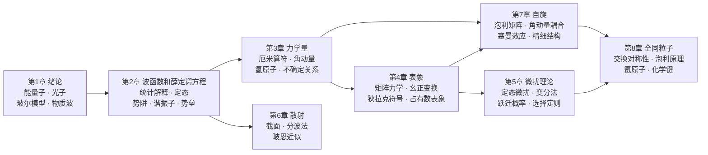

# 量子力学从零到精通

这是一份《量子物理基础》课程的讲义，章节和推导沿周世勋、陈灏《量子力学教程》（第 3 版）第 1–8 章，前面加了一章「预备 原子的结构」。每章开头的「本章学习范围」标出哪些是重点、哪些是选学；标了「延伸 · 选学」的小节和整个第 6 章复习时可以跳过。正文里还穿插了「拓展」方框，讲量子力学在隧穿器件、半导体、量子阱、激光、有机发光等方面的应用和相关历史。

每一章先建立**物理图像和直觉**，再给出严格的定义、定理和推导，然后做手算例题。关键的过程配有 manim 动画，直接嵌在正文里。全书贯穿两条主线：**物理上**，从“能量是一份一份的”“粒子也是波”出发，建立起波函数、算符、表象、近似方法这一整套框架；**数学上**，量子力学就是**复数域上的线性代数**——态是向量，力学量是厄米矩阵，换表象是换基。

!!! tip "怎么用这份讲义"

    - 第一次学：按顺序读。每节先看“直觉”框和动画，再看定义、定理，最后自己做例题。
    - 复习考试：看每章末的**知识点归纳总结**和**练习题**（答案可折叠），再配合[公式速查](formulas.md)和[全课程总结](summary.md)。
    - 遇到“线性代数对照”框：它把新概念翻译成你熟悉的矩阵语言，这是理解第 3、4 章的捷径。

## 绪论

### 1. 量子力学研究什么

量子力学是描述**微观粒子**（电子、原子、光子……）运动规律的理论。它和经典力学的关系，就像相对论和牛顿力学的关系：当普朗克常量 $h$ 相对于体系的作用量可以忽略时，量子力学退化为经典力学。

今天几乎所有的高技术都直接建立在量子力学上：半导体能带与晶体管、激光、LED 与光电探测器、核磁共振成像、原子钟与卫星导航、超导器件、扫描隧道显微镜，以及正在发展的量子计算与量子通信。

### 2. 历史回顾

| 年份 | 事件 | 对应章节 |
|---|---|---|
| 1900 | 普朗克提出能量子，解释黑体辐射 | 第 1 章 |
| 1905 | 爱因斯坦提出光量子，解释光电效应 | 第 1 章 |
| 1913 | 玻尔的氢原子理论 | 第 1 章 |
| 1923 | 康普顿散射证实光子有动量 | 第 1 章 |
| 1924 | 德布罗意提出物质波 | 第 1 章 |
| 1925 | 海森伯矩阵力学；泡利不相容原理；乌伦贝克、古德斯米特提出电子自旋 | 第 4、7、8 章 |
| 1926 | 薛定谔方程；玻恩的统计解释 | 第 2 章 |
| 1927 | 戴维森–革末电子衍射实验；海森伯不确定关系；海特勒–伦敦氢分子理论 | 第 1、3、8 章 |
| 1928 | 伽莫夫用隧道效应解释 $\alpha$ 衰变；狄拉克相对论电子方程 | 第 2、7 章 |
| 1930 | 狄拉克《量子力学原理》，引入狄拉克符号 | 第 4 章 |

### 3. 一条主线：五条基本假设

整门课的逻辑骨架是下面五条基本假设，各章都在展开其中的一条或几条：

| 基本假设 | 内容 | 展开章节 |
|---|---|---|
| 一、波函数 | 体系状态由波函数 $\Psi$（态矢量 $\ket\Psi$）完全描述，$\lvert\Psi\rvert^2$ 是概率密度 | 第 2 章 |
| 二、算符 | 力学量用线性厄米算符表示，测量值是其本征值 | 第 3 章 |
| 三、测量 | 测得本征值 $\lambda_n$ 的概率为 $\lvert\ip{\phi_n}{\Psi}\rvert^2$ | 第 3、4 章 |
| 四、演化 | $\Psi$ 随时间的变化由薛定谔方程 $\ii\hbar\partial_t\Psi=\hat H\Psi$ 决定 | 第 2、5 章 |
| 五、全同性 | 全同粒子体系的波函数对交换粒子对称（玻色子）或反对称（费米子） | 第 8 章 |

后面的章节在这个框架上解决具体问题：求不出精确解时用**微扰论**（第 5 章）；电子还有自旋（第 7 章）；多个电子必须考虑全同性（第 8 章）。变分法和散射属于选学，下面这张图仍按八章画出，复习时把这两块当成选读即可。

### 4. 量子力学 ≈ 线性代数

!!! info "贯穿全书的对照表"

    | 线性代数 | 量子力学 | 首次出现 |
    |---|---|---|
    | 复向量 $\vv v\in\mathbb C^n$ | 态矢量 $\ket\psi$，坐标表象中是波函数 $\psi(x)$ | 第 2 章 |
    | 内积 $\vv u^\dagger\vv v$ | $\ip\phi\psi=\int\phi^*\psi\,\dd x$ | 第 2 章 |
    | 厄米矩阵 $A=A^\dagger$ | 力学量算符 $\hat F=\hat F^\dagger$ | 第 3 章 |
    | 特征值、特征向量 | 测量值、本征态 | 第 3 章 |
    | 正交归一基、按基展开 | 本征函数系的完全性、态叠加 | 第 3 章 |
    | 两矩阵对易 ⇔ 可同时对角化 | 两力学量可同时有确定值 | 第 3 章 |
    | 换基（相似变换） | 换表象（幺正变换） | 第 4 章 |
    | 对角化 | 求本征值、本征态 | 第 4 章 |
    | 矩阵的小扰动 | 微扰论 | 第 5 章 |
    | $2\times2$ 矩阵 | 自旋 $\tfrac12$、泡利矩阵 | 第 7 章 |
    | 张量积、对称/反对称化 | 多粒子体系、全同粒子 | 第 7、8 章 |

    唯一的新东西是：向量可以有**无穷多个**分量（每个 $x$ 一个），而且分量是**复数**。

### 5. 预备知识

- **复数**：$\ee^{\ii\theta}=\cos\theta+\ii\sin\theta$，模与辐角，复共轭。见[复变函数 · 第 1 章](https://cockroach-f.github.io/complex-functions/ch1.html)。
- **线性代数**：矩阵乘法、特征值与特征向量、厄米矩阵与幺正矩阵、相似对角化。
- **傅里叶分析**：傅里叶级数与傅里叶变换。坐标波函数与动量波函数就是一对傅里叶变换。
- **常微分方程**：二阶线性常系数方程、分离变量、级数解法（会在正文中边用边讲）。
- **电磁学**：库仑势、矢势、电偶极矩、磁矩。可参考[电磁场与电磁波](https://cockroach-f.github.io/em-fields-waves/)。

### 6. 记号约定

- 教材记号与狄拉克记号并用：$\int\psi_m^*\hat F\psi_n\,\dd\tau=\mel{m}{\hat F}{n}=F_{mn}$，期望值 $\bar F=\langle F\rangle$。
- 算符加帽 $\hat F$；在不致混淆时（尤其是矩阵形式中）略去帽子。
- 虚数单位写作 $\ii$，自然对数底写作 $\ee$；采用国际单位制，库仑势写作 $-\dfrac{e^2}{4\pi\varepsilon_0r}$。
- 粒子质量一般记作 $m$（教材有时用 $\mu$）；电子质量 $m_e$。

### 7. 常用物理常量

| 常量 | 数值 | 常用组合 |
|---|---|---|
| 普朗克常量 | $h=6.626\times10^{-34}\ \mathrm{J\cdot s}$，$\hbar=1.055\times10^{-34}\ \mathrm{J\cdot s}$ | $hc=1240\ \mathrm{eV\cdot nm}$，$\hbar c=197.3\ \mathrm{eV\cdot nm}$ |
| 电子质量 | $m_e=9.109\times10^{-31}\ \mathrm{kg}$ | $m_ec^2=0.511\ \mathrm{MeV}$ |
| 元电荷 | $e=1.602\times10^{-19}\ \mathrm C$ | $\dfrac{e^2}{4\pi\varepsilon_0}=1.44\ \mathrm{eV\cdot nm}$ |
| 玻尔半径 | $a_0=0.0529\ \mathrm{nm}$ | 里德伯能量 $13.6\ \mathrm{eV}$ |
| 精细结构常数 | $\alpha=\dfrac{e^2}{4\pi\varepsilon_0\hbar c}\approx\dfrac1{137}$ | 玻尔磁子 $\mu_B=9.27\times10^{-24}\ \mathrm{J/T}$ |
| 玻耳兹曼常量 | $k_B=1.381\times10^{-23}\ \mathrm{J/K}$ | $k_B\cdot300\ \mathrm K\approx0.0259\ \mathrm{eV}$ |

## 章节目录

| 章 | 内容 | 关键词 | 状态 |
|---|---|---|---|
| [预备 原子的结构](atom.md) | 原子线度、电子的发现、核式模型 | 晶格、荷质比、油滴实验、卢瑟福散射 | ✅ 例题 1 · 练习 5 · 动画 1 |
| [第 1 章 绪论](ch1.md) | 经典物理的困难，光和微粒的波粒二象性，玻尔理论 | 能量子、光电效应、康普顿散射、德布罗意波 | ✅ 例题 8 · 练习 8+5 · 动画 3 |
| [第 2 章 波函数和薛定谔方程](ch2.md) | 量子力学的基本框架与一维问题 | 统计解释、态叠加、概率流、定态、势阱、谐振子、隧道效应 | ✅ 例题 10 · 练习 8+4 · 动画 4 |
| [第 3 章 量子力学中的力学量](ch3.md) | 算符、本征值问题与测量 | 厄米算符、角动量、氢原子、对易关系、不确定关系、守恒量 | ✅ 例题 16 · 练习 8+8 · 动画 7 |
| [第 4 章 态和力学量的表象](ch4.md) | 矩阵形式与狄拉克符号 | 表象、矩阵元、幺正变换、狄拉克符号、升降算符 | ✅ 例题 13 · 练习 8+4 · 动画 4 |
| [第 5 章 微扰理论](ch5.md) | 近似方法 | 非简并与简并微扰、斯塔克效应、变分法、跃迁概率、选择定则 | ✅ 例题 8 · 练习 8+6 · 动画 5 |
| [第 6 章 散射](ch6.md) | 粒子的碰撞。**选读** | 散射截面、分波法、玻恩近似 | 原文和原图都保留 |
| [第 7 章 自旋](ch7.md) | 内禀角动量 | 施特恩–格拉赫实验、泡利矩阵、塞曼效应、角动量耦合、精细结构 | ✅ 例题 10 · 练习 8+6 · 动画 6 |
| [第 8 章 全同粒子](ch8.md) | 多粒子体系 | 交换对称性、泡利原理、单态与三重态、氦原子、氢分子 | ✅ 例题 8 · 练习 8+3 · 动画 4 |

状态栏中“练习 a+b”表示 a 道章末练习加 b 道补充或真题练习。
