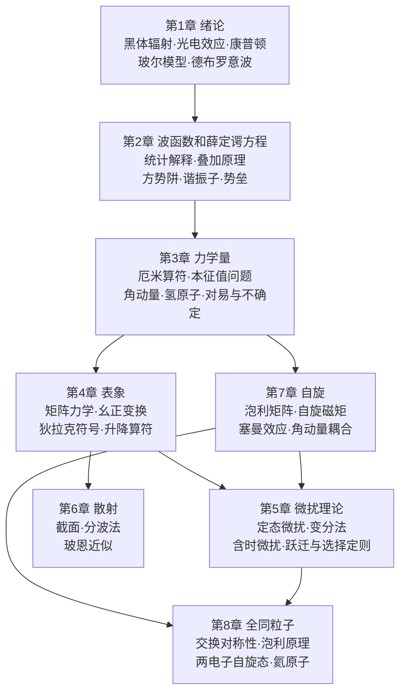
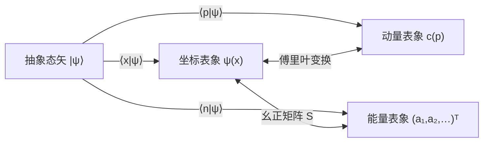

# 全课程总结

这一页把 8 章串成一个整体，帮你看清全课的主干：**态用什么描述，力学量用什么表示，怎样求本征值，怎样处理解不出来的问题，最后再加上自旋和全同性**。每章的细节和推导请看对应章节的“知识点归纳总结”，所有公式都整理在[公式速查](formulas.md)里。下面的图保持原样。按课件复习时，散射、变分法、角动量耦合、精细结构和氦原子微扰可以跳过；原子大小和核式模型在[第 1 讲](atom.md)。

## 1. 全书知识地图

| 部分 | 章 | 核心问题 | 主要工具 |
|---|---|---|---|
| 量子力学的诞生与基本框架 | 1–2 | 微观粒子为什么要用波函数描述？波函数怎样演化？ | 德布罗意关系、薛定谔方程、边界与衔接条件 |
| 力学量与表象 | 3–4 | 测量结果是什么？各个力学量之间是什么关系？ | 厄米算符、本征展开、对易子、矩阵与幺正变换 |
| 近似方法与散射 | 5–6 | 薛定谔方程解不出精确解时怎么办？ | 微扰级数、变分原理、分波法、玻恩近似 |
| 自旋与全同粒子 | 7–8 | 电子还有哪些内禀性质？多个电子怎样描述？ | 泡利矩阵、角动量耦合、对称化与反对称化 |

## 2. 贯穿全书的五条主线

### 主线一：量子化从哪里来

| 来源 | 例子 | 章节 |
|---|---|---|
| 假设（旧量子论） | 普朗克能量子 $\varepsilon=h\nu$、玻尔轨道 $\oint p\,\dd q=nh$ | [1.2](ch1.md#12)、[1.3](ch1.md#13) |
| 边界条件 | 无限深方势阱 $E_n\propto n^2$ | [2.6](ch2.md#26) |
| 波函数有限（级数截断） | 谐振子 $E_n=(n+\tfrac12)\hbar\omega$、氢原子 $E_n\propto-1/n^2$ | [2.7](ch2.md#27)、[3.3](ch3.md#33) |
| 单值性 | $L_z=m\hbar$ | [3.2](ch3.md#32) |
| 代数关系 | $[\hat a,\hat a^\dagger]=1$ 推出 $n=0,1,2,\dots$；$\hat{\vv J}\times\hat{\vv J}=\ii\hbar\hat{\vv J}$ 推出 $j$ 取整数或半整数 | [4.6](ch4.md#46)、[7.4](ch7.md#74) |

一句话：**束缚态 ⇒ 分立谱，非束缚态 ⇒ 连续谱。** 薛定谔方程本身是连续的，量子化来自“物理上可接受”的条件。

### 主线二：态 = 希尔伯特空间中的矢量

- 第 2 章的“态叠加原理”$\psi=\sum c_n\psi_n$ 就是**按基矢展开**。
- 第 3 章的“正交归一完全系”就是**一组正交归一基**。
- 第 4 章把这件事说透：换表象就是**换基**，物理量（本征值、期望值、内积）都不变。
- 第 7 章的自旋态 $\begin{pmatrix}a\\b\end{pmatrix}$ 是最简单的二维希尔伯特空间，第 8 章的多粒子态是**张量积空间**中对称或反对称的子空间。

### 主线三：力学量 = 厄米算符，测量 = 本征展开

| 测量公设的各个部分 | 数学表达 |
|---|---|
| 可能的测量值 | $\hat F$ 的本征值 $\lambda_n$（厄米 ⇒ 实数） |
| 得到 $\lambda_n$ 的概率 | $\lvert c_n\rvert^2=\lvert\ip{\phi_n}{\psi}\rvert^2$ |
| 平均值 | $\langle F\rangle=\mel{\psi}{\hat F}{\psi}=\sum\lambda_n\lvert c_n\rvert^2$ |
| 能否同时确定 | $[\hat F,\hat G]=0$ ⇔ 有共同本征函数系 |
| 不能同时确定时 | $\Delta F\Delta G\geqslant\tfrac12\lvert\langle[\hat F,\hat G]\rangle\rvert$ |
| 守恒 | $\partial_t\hat F=0$ 且 $[\hat F,\hat H]=0$ ⇒ $\langle F\rangle$ 与概率分布都不随时间变化 |

### 主线四：对称性 ⇔ 守恒量 ⇔ 简并

| 对称性 | 守恒量或好量子数 | 后果 |
|---|---|---|
| 时间平移 | 能量 $E$ | 定态 |
| 空间平移 | 动量 $\vv p$ | 自由粒子平面波 |
| 空间转动（中心力场） | $L^2$、$L_z$ | 能级与 $m$ 无关，$(2l+1)$ 重简并；可分离出 $Y_{lm}$ |
| 库仑场的额外对称性 | — | 能级与 $l$ 也无关，$n^2$ 重简并 |
| 空间反演 | 宇称 | 对称势的本征函数有确定奇偶性；选择定则 $\Delta l=\pm1$ |
| 粒子交换 | 交换宇称 | 玻色子对称、费米子反对称；泡利原理 |

简并会被**打破对称性的微扰**解除：斯塔克效应（电场破坏球对称，第 5 章）、塞曼效应（磁场挑出 $z$ 方向，第 7 章）、自旋–轨道耦合（精细结构，第 7 章）、交换作用（正氦和仲氦分裂，第 8 章）。

### 主线五：精确解 → 近似解

| 精确可解的模型 | 近似方法 |
|---|---|
| 无限深势阱、谐振子、氢原子、$\delta$ 势、方势垒 | 定态微扰：$H=H_0+H'$，按 $H'$ 展开 |
| 自由粒子 | 变分法：给出基态能量的上界 |
| 两能级（自旋 1/2） | 含时微扰：跃迁概率、黄金定则 |
| 硬球散射 | 分波法（低能）、玻恩近似（高能、弱势） |
| | WKB：$D\approx\ee^{-\frac2\hbar\int\sqrt{2m(U-E)}\dd x}$ |

精确解是近似方法的**零级出发点**：微扰论在谐振子和氢原子的本征函数基上展开，变分法的试探函数往往就取这些精确解的形状。

## 3. 跨章节的联系

| 概念 | 第一次出现 | 后来怎样发展 |
|---|---|---|
| 谐振子 | 第 2 章：厄米多项式、级数解 | 第 4 章：升降算符、占有数表象；第 5 章：微扰（如外加电场 $\hat H'=-q\mathcal Ex$） |
| 氢原子 | 第 1 章：玻尔模型 $E_n=-13.6/n^2\ \mathrm{eV}$ | 第 3 章：严格解与 $\psi_{nlm}$；第 5 章：斯塔克效应、跃迁选择定则；第 7 章：精细结构、塞曼效应 |
| 角动量 | 第 1 章：玻尔 $L=n\hbar$ | 第 3 章：$L^2,L_z$ 本征值 $l(l+1)\hbar^2$、$m\hbar$；第 7 章：自旋、$\vv J=\vv L+\vv S$ |
| 概率流 | 第 2 章：连续性方程、势垒透射 | 第 6 章：入射流与散射流定义截面 |
| 不确定关系 | 第 1 章：波包的直观图像 | 第 3 章：一般证明；第 4 章：谐振子相干态取等号；第 5 章：$\Delta E\Delta t\sim\hbar$ |
| 傅里叶变换 | 第 2 章：$\psi(x)\leftrightarrow c(p)$ | 第 4 章：$\ip xp$ 是变换核；第 6 章：玻恩振幅是势的傅里叶变换 |
| 矩阵本征值问题 | 第 3 章：本征方程 | 第 4 章：久期方程；第 5 章：简并微扰；第 7 章：泡利矩阵、$\vv\sigma\cdot\vv n$ |
| 黑体辐射 | 第 1 章：普朗克公式 | 第 5 章：爱因斯坦 $A,B$ 系数重新推出普朗克公式 |

## 4. 常见题型速查

| 题型 | 标准做法 | 参考 |
|---|---|---|
| 归一化、求期望值、求概率 | $\int\lvert\psi\rvert^2=1$；$\langle F\rangle=\int\psi^*\hat F\psi$；概率是 $\lvert c_n\rvert^2$ | [2.1](ch2.md#21)、[3.5](ch3.md#35) |
| 一维定态（势阱、势垒、$\delta$ 势） | 分区写通解 → 边界条件 + 衔接条件（$\psi$ 和 $\psi'$ 连续；$\delta$ 势处 $\psi'$ 跳变） → 超越方程或透射系数 | [2.6](ch2.md#26)、[2.8](ch2.md#28) |
| 求概率流 | $J=\frac{\ii\hbar}{2m}(\psi\psi'^*-\psi^*\psi')$；实波函数的 $J=0$ | [2.4](ch2.md#24) |
| 初态按本征态展开后演化 | $c_n=\ip{\psi_n}{\Psi(0)}$，每项乘 $\ee^{-\ii E_nt/\hbar}$ | [2.5](ch2.md#25) |
| 证明对易关系 | 作用到任意 $\psi$ 上，或用 $[A,BC]$ 恒等式 | [3.6](ch3.md#36) |
| 角动量、氢原子 | 用 $Y_{lm}$ 的正交性读出 $L^2,L_z$ 的概率；用 $R_{nl}$ 求径向期望值和最概然半径 | [3.2](ch3.md#32)、[3.3](ch3.md#33) |
| 给定矩阵求本征值 | 久期方程 → 本征矢量 → 归一化；判断厄米性 | [4.2](ch4.md#42)、[4.3](ch4.md#43) |
| 换表象 | 找本征矢量排成 $S$；$F'=S^\dagger FS$ | [4.4](ch4.md#44) |
| 谐振子代数 | $\hat x,\hat p$ 换成 $\hat a,\hat a^\dagger$，用 $\hat a\ket n=\sqrt n\ket{n-1}$ | [4.6](ch4.md#46) |
| 非简并微扰 | $E^{(1)}=H'_{nn}$，$E^{(2)}=\sum\lvert H'_{mn}\rvert^2/(E_n-E_m)$，常用宇称或递推关系判断哪些矩阵元为零 | [5.1](ch5.md#51) |
| 简并微扰 | 在简并子空间写出 $H'$ 矩阵并对角化 | [5.2](ch5.md#52) |
| 变分法 | 选含参试探函数 → $\bar H(\lambda)$ → 求极小 | [5.4](ch5.md#54) |
| 跃迁概率 | $a_m^{(1)}=\frac1{\ii\hbar}\int H'_{mk}\ee^{\ii\omega_{mk}t}\dd t$；判断选择定则 | [5.7](ch5.md#57) |
| 散射截面 | 低能：只留 $s$ 波求 $\delta_0$；高能或弱势：玻恩积分 | [6.2](ch6.md#62)、[6.4](ch6.md#64) |
| 自旋 | 泡利矩阵运算、$\sigma_n=\vv\sigma\cdot\vv n$ 本征态 $\chi_{\vv n,\pm}$、布洛赫球、自旋进动、测量概率 | [7.2](ch7.md#72) |
| 塞曼效应、角动量耦合、精细结构 | 强场：$\mu_BB(m+2m_s)$；弱场：朗德因子 $g_j$；耦合表象用 CG 系数，$\hat{\vv L}\cdot\hat{\vv S}=\tfrac12(\hat J^2-\hat L^2-\hat S^2)$ | [7.3](ch7.md#73)、[7.4](ch7.md#74)、[7.5](ch7.md#75) |
| 全同粒子 | 先写单粒子态，再对称化或反对称化（注意空间部分和自旋部分要搭配） | [8.2](ch8.md#82)、[8.3](ch8.md#83)、[8.4](ch8.md#84) |

## 5. 方法与习惯

1. **先看对称性再动手。** 势是偶函数，本征函数就有确定宇称，奇偶相乘积分为零的矩阵元可以直接划掉。
2. **能用代数就别硬积分。** 谐振子用升降算符，角动量用对易关系，自旋用泡利矩阵的乘法规则。
3. **记住几个典型量级。** 原子能量 $\sim\mathrm{eV}$，原子尺度 $\sim0.1\ \mathrm{nm}$，$\hbar c\approx197\ \mathrm{eV\cdot nm}$，$hc\approx1240\ \mathrm{eV\cdot nm}$。
4. **检查量纲和极限。** $\hbar\to0$ 应回到经典，$U_0\to\infty$ 应回到无限深势阱，透射系数满足 $R+D=1$。
5. **算完再归一化，用完再检验。** 概率加起来应等于 1，期望值应为实数，本征值应与对称性和简并度一致。
6. **把狄拉克符号当作语言。** 波函数积分 $\int\phi^*\hat F\psi\,\dd x$ 就是 $\mel{\phi}{\hat F}{\psi}$；看到 $\sum_n\ket n\bra n$ 就想到插入单位算符。

## 6. 综合自测

!!! example "自测 1（第 1–2 章）"
    电子被限制在宽 $a=0.2\ \mathrm{nm}$ 的一维无限深势阱中。求它从 $n=2$ 跃迁到 $n=1$ 时发出的光子波长。

    ??? success "答案"
        $E_n=\dfrac{n^2\pi^2\hbar^2}{2ma^2}=\dfrac{n^2(\pi\hbar c)^2}{2mc^2a^2}$，其中 $E_1=\dfrac{(\pi\times197.3)^2}{2\times0.511\times10^6\times0.04}\ \mathrm{eV}\approx9.40\ \mathrm{eV}$。

        $\Delta E=3E_1\approx28.2\ \mathrm{eV}$，$\lambda=hc/\Delta E\approx1240/28.2\ \mathrm{nm}\approx44\ \mathrm{nm}$（极紫外）。

!!! example "自测 2（第 2、4 章）"
    谐振子初态为 $\Psi(x,0)=\frac{1}{\sqrt2}(\psi_0+\psi_1)$。求 $\langle x\rangle(t)$。

    ??? success "答案"
        $\Psi(t)=\frac1{\sqrt2}\left(\psi_0\ee^{-\ii\omega t/2}+\psi_1\ee^{-3\ii\omega t/2}\right)$。由 $x_{01}=x_{10}=\sqrt{\hbar/2m\omega}$，

        $$\langle x\rangle=\tfrac12\left(x_{01}\ee^{-\ii\omega t}+x_{10}\ee^{\ii\omega t}\right)=\sqrt{\frac{\hbar}{2m\omega}}\cos\omega t$$

        期望值像经典振子一样以 $\omega$ 振荡，正是埃伦费斯特定理所预期的结果。

!!! example "自测 3（第 3 章）"
    氢原子处于 $\psi=\frac12\psi_{100}+\frac{1}{\sqrt2}\psi_{211}+\frac12\psi_{21,-1}$。求能量、$L^2$、$L_z$ 的可能值及其概率，以及 $\langle E\rangle$。

    ??? success "答案"
        - 能量：$E_1$ 的概率为 $1/4$，$E_2=E_1/4$ 的概率为 $3/4$；$\langle E\rangle=\frac14E_1+\frac34\cdot\frac{E_1}{4}=\frac{7}{16}E_1\approx-5.95\ \mathrm{eV}$。
        - $L^2$：$0$ 的概率为 $1/4$，$2\hbar^2$ 的概率为 $3/4$。
        - $L_z$：$0$ 的概率为 $1/4$，$\hbar$ 的概率为 $1/2$，$-\hbar$ 的概率为 $1/4$。

!!! example "自测 4（第 3 章）"
    证明：若 $\hat A,\hat B$ 都与 $\hat H$ 对易，但 $[\hat A,\hat B]\neq0$，则能级一般是简并的。

    ??? success "答案"
        设 $\hat H\ket\psi=E\ket\psi$ 且能级 $E$ 非简并。因为 $[\hat A,\hat H]=0$，$\hat A\ket\psi$ 也是能量为 $E$ 的本征态，非简并就意味着 $\hat A\ket\psi=a\ket\psi$；同理 $\hat B\ket\psi=b\ket\psi$。于是 $[\hat A,\hat B]\ket\psi=0$。如果每个能级都非简并，那么 $[\hat A,\hat B]$ 作用在一组完全基上都等于零，即 $[\hat A,\hat B]=0$，与假设矛盾。所以至少有一些能级是简并的。中心力场中 $L_x,L_y$ 都与 $H$ 对易，就造成了 $(2l+1)$ 重简并。

!!! example "自测 5（第 4 章）"
    在某表象中 $\hat H=\begin{pmatrix}E_0&\Delta\\\Delta&E_0\end{pmatrix}$（$\Delta>0$ 为实数）。求能级与本征态。若 $t=0$ 时处于 $\begin{pmatrix}1\\0\end{pmatrix}$，求 $t$ 时刻仍处于该态的概率。

    ??? success "答案"
        本征值 $E_\pm=E_0\pm\Delta$，本征态 $\frac{1}{\sqrt2}\begin{pmatrix}1\\\pm1\end{pmatrix}$。初态 $=\frac{1}{\sqrt2}(\ket++\ket-)$，

        $$P(t)=\left\lvert\tfrac12\left(\ee^{-\ii\Delta t/\hbar}+\ee^{\ii\Delta t/\hbar}\right)\right\rvert^2=\cos^2\frac{\Delta t}{\hbar}$$

        粒子在两个态之间来回振荡（两能级系统，比如氨分子反转）。

!!! example "自测 6（第 5 章）"
    谐振子受到微扰 $\hat H'=\lambda\hat x^2$。用微扰论求 $E_n$ 的一级修正，并与精确解比较。

    ??? success "答案"
        $E_n^{(1)}=\lambda\langle x^2\rangle_n=\lambda\dfrac{\hbar}{m\omega}\left(n+\tfrac12\right)$。

        精确解：$\omega'=\omega\sqrt{1+2\lambda/m\omega^2}$，$E_n=\left(n+\tfrac12\right)\hbar\omega'\approx\left(n+\tfrac12\right)\hbar\omega\left(1+\dfrac{\lambda}{m\omega^2}\right)$，一阶项与微扰结果一致。

!!! example "自测 7（第 7 章）"
    电子自旋处于 $S_z=+\hbar/2$ 态。测量 $\vv S\cdot\vv n$，其中 $\vv n=(\sin\theta,0,\cos\theta)$。求得到 $+\hbar/2$ 的概率。

    ??? success "答案"
        $\vv\sigma\cdot\vv n=\begin{pmatrix}\cos\theta&\sin\theta\\\sin\theta&-\cos\theta\end{pmatrix}$，本征值 $+1$ 对应的本征态为 $\chi_{\vv n,+}=\begin{pmatrix}\cos\frac\theta2\\\sin\frac\theta2\end{pmatrix}$（$\varphi=0$）。

        概率 $=\left\lvert\left(\cos\tfrac\theta2,\ \sin\tfrac\theta2\right)\begin{pmatrix}1\\0\end{pmatrix}\right\rvert^2=\cos^2\dfrac\theta2$。这正是[布洛赫球](ch7.md#72)上两点夹角为 $\theta$ 时的跃迁概率 $\cos^2\frac\theta2$。

!!! example "自测 8（第 8 章）"
    两个无相互作用的电子在一维无限深势阱中。忽略自旋–轨道作用，写出基态和第一激发态的能量、简并度和波函数结构。

    ??? success "答案"
        - **基态**：两个电子都在 $\psi_1$，空间部分对称，所以自旋必须取单态 $\chi_{00}$。$E=2E_1$，非简并。
        - **第一激发态**：$\psi_1,\psi_2$ 各一个，$E=5E_1$。
            - 空间对称 $\frac1{\sqrt2}[\psi_1(x_1)\psi_2(x_2)+\psi_2(x_1)\psi_1(x_2)]$ 配单态，1 个态；
            - 空间反对称配三重态，3 个态；
            - 共 4 重简并（如果是无自旋的玻色子，只有对称的那 1 个）。

## 7. 继续学习

- 本课的数学工具在[复变函数与积分变换](https://cockroach-f.github.io/complex-functions/)里有详细讲解：复数与欧拉公式、留数积分、傅里叶变换。
- 波动方程、平面波、亥姆霍兹方程和边值问题可以对照[电磁场与电磁波](https://cockroach-f.github.io/em-fields-waves/)。散射、透射、反射的处理方式在两门课里非常相似。
- 下一步可以读教材第 9 章（相对论量子力学初步），或参考资料中 Sakurai、Shankar 的相关章节：路径积分、二次量子化、角动量的一般理论。
